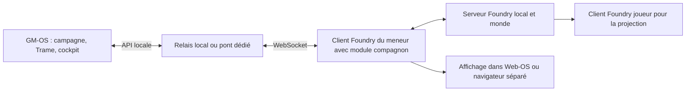

# Exploration : utiliser les modules Foundry VTT depuis GM-OS

**13/10/2026 — étude de faisabilité, aucune intégration réalisée.**

David n'a pas encore installé Foundry. Il envisage une installation locale sur
son PC et souhaite utiliser **les contenus prêts à jouer et les extensions de
fonctions** depuis GM-OS. Ce document distingue les possibilités documentées,
les points constatés dans GM-OS et les propositions à éprouver.

## Conclusion

Une connexion est réalisable. Pour réutiliser les modules Foundry eux-mêmes,
l'architecture proposée est **GM-OS comme cockpit et Foundry comme moteur des modules**.
Les contenus peuvent être convertis vers les objets GM-OS ; les extensions
continuent à s'exécuter dans Foundry. Les scripts d'une extension s'appuient
sur l'environnement client et les API Foundry : le manifeste de module ne
constitue pas un format de plugin GM-OS.
[Documentation des modules](https://foundryvtt.com/article/module-development/).

Afficher Foundry dans GM-OS et importer ses données sont deux capacités
différentes. La première permet d'utiliser son interface et ses extensions ;
la seconde permet de travailler sur certaines données dans les écrans GM-OS.

## Ce que l'on peut reprendre

| Éléments Foundry | Usage envisageable dans GM-OS | Limite à traiter |
| --- | --- | --- |
| Journaux, textes, illustrations | Documentation de campagne, notes du meneur, documents montrables | Liens UUID, HTML enrichi et références aux médias |
| Cartes et pions d'une scène | Carte et placement initial dans Map-OS | Une conversion simple ne restitue pas tout le rendu Foundry |
| Acteurs PJ/PNJ et objets | Personnages, fiches et inventaires | Correspondance propre au système de jeu et à sa version |
| Tables et listes audio | Tables et ressources GM-OS | Traduction des formats et récupération des fichiers |
| Extensions graphiques ou tactiques | Utilisation dans une vue Foundry | Leur rendu reste produit par Foundry |
| Extensions d'automatisation | Commandes ou résultats transmis au cockpit | Adaptateur spécifique si l'extension expose une API exploitable |

Les aventures peuvent regrouper acteurs, scènes, objets, tables, journaux,
cartes et playlists. Les médias restent référencés par leurs chemins :
importer les documents ne copie pas automatiquement les fichiers.
[Documents Adventure](https://foundryvtt.com/article/adventure/).

Les compendiums sont une source de contenu, distincte du monde actuellement
chargé. Le premier prototype devrait utiliser une aventure importée dans un
monde de test ; la lecture directe des compendiums viendrait ensuite.
[Compendium Packs](https://foundryvtt.com/article/compendium/).

**Une scène Foundry est un espace graphique ; une scène de la Trame GM-OS est
une unité narrative.** Le rapprochement doit rester un choix du meneur : une
scène narrative peut utiliser plusieurs cartes, et une carte servir plusieurs
scènes narratives.
[API Scene](https://foundryvtt.com/api/classes/foundry.documents.Scene.html),
[`Scene` GM-OS](../../src/types/trame.types.ts).

## API et options de transport

La documentation officielle consultée présente une **API JavaScript côté
client**, actuellement documentée en version 14. Elle expose les documents et
leurs opérations, pas une API REST externe universelle. Le projet communautaire
Foundry REST API fournit précisément ce pont manquant.
[API officielle](https://foundryvtt.com/api/),
[dépôt du relais](https://github.com/ThreeHats/foundryvtt-rest-api-relay).

| Option | Intérêt | Travail restant |
| --- | --- | --- |
| Foundry dans Web-OS | Essayer les modules dans une fenêtre GM-OS | Vérifier rendu, connexion et durée de vie de la vue |
| Foundry REST API avec relais local | Réutiliser une API de lecture/écriture existante | Installer ultérieurement module et relais, développer le consommateur GM-OS |
| Module compagnon GM-OS pour Foundry | Exposer seulement les commandes utiles au cockpit | Développer et maintenir le module et son protocole |

Le catalogue Foundry annonce le module communautaire **Foundry REST API**
compatible 12+ et vérifié 14. Cela ne garantit pas la compatibilité des autres
modules que David choisira.
[Fiche du module](https://foundryvtt.com/packages/foundry-rest-api).

Le relais accepte REST et WebSocket. Sa documentation décrit des abonnements
temps réel aux événements de chat et de jets ; **elle ne suffit pas à garantir
un abonnement général aux modifications d'acteurs ou de scènes**. Ces autres
flux devront être vérifiés dans la version retenue, ou ajoutés au compagnon.
[Interface WebSocket](https://foundryrestapi.com/docs/websocket).

L'appairage du module est attaché au navigateur du meneur. Une seule connexion
de meneur par monde détient le relais. **Le monde et un client Foundry connecté
comme meneur doivent donc rester ouverts pour ce pont**, pas seulement le
processus serveur. Les commandes de macros et de JavaScript arbitraire sont
désactivées par défaut dans la configuration décrite.
[Configuration du module](https://foundryrestapi.com/docs/foundry-module).

Pour le prototype, choisir un relais local et une clé dédiée à la lecture.
Les identifiants Foundry et les jetons d'appairage GM-OS restent distincts.
[Authentification du relais](https://foundryrestapi.com/docs/authentication).

## Points d'appui constatés dans GM-OS

- [`WebDashboard.tsx`](../../src/modules/web/WebDashboard.tsx) affiche déjà une
  page dans une `webview` Electron. Une adresse locale Foundry pourrait y être
  ouverte, sous réserve d'un essai réel. La vue appartient à ce module : son
  maintien lorsque l'on change d'écran doit être vérifié avant d'en faire un
  client de pont permanent.
- [`navigateurIntegre.ts`](../../electron/navigateurIntegre.ts) isole cette vue,
  sans Node ni `appBridge`. **Conserver cette séparation** ; communiquer par
  un protocole explicite, sans injecter des privilèges GM-OS dans Foundry.
- [`SyncServer.ts`](../../electron/SyncServer.ts) utilise déjà HTTP/WebSocket,
  appairage et contrôle des actions. C'est un précédent technique, pas une
  API Foundry déjà disponible. Il écoute sur `0.0.0.0` : un pont réservé au PC
  ne doit pas exposer implicitement ses commandes sur tout le réseau local.
- [`contratsDeLaFiche.ts`](../../src/modules/fiches/contratsDeLaFiche.ts) offre
  lecture, écriture et événements pour les fiches ;
  [`correspondanceDeFiche.ts`](../../src/modules/fiches/correspondanceDeFiche.ts)
  montre les conversions déjà nécessaires entre une fiche et GM-OS. Foundry
  exige ses propres correspondances, distinctes de celles des HTML existants.
- [`types.ts` de Map-OS](../../src/modules/map/types.ts) décrit cartes, pions,
  grille et brouillard. Ce modèle n'est pas celui du canvas Foundry : conserver
  Foundry pour profiter fidèlement de ses extensions graphiques.
- [`useCombatStore.ts`](../../src/modules/combat/useCombatStore.ts) et
  [`DescripteurDeJet.ts`](../../src/modules/dice/DescripteurDeJet.ts) portent
  déjà des comportements métier. Une connexion doit décider qui lance les dés
  et qui conduit les tours, pour éviter deux résultats ou deux avances.

La compatibilité réelle de la vue intégrée reste à éprouver. Foundry demande
un navigateur moderne avec accélération matérielle ; la charge dépend du
contenu et des modules activés.
[Configuration requise](https://foundryvtt.com/article/requirements/).

## Architecture proposée

Le client joueur de projection doit rester distinct du client meneur.
Importer des contenus implique de conserver leur provenance et de choisir
les éléments montrables. Les usages des contenus achetés restent soumis à
leurs conditions ; l'API ne fournit pas un droit d'export supplémentaire.

Pour des données synchronisées, relier les identités par monde, UUID Foundry
et identifiant GM-OS. Les commandes doivent porter un identifiant unique,
recevoir un accusé de traitement et éviter les boucles d'écho. Un retour de
connexion ne doit pas rejouer automatiquement un jet ou une macro.
Ce sont des choix de conception proposés, pas des capacités déjà branchées.

## Premier essai proposé

1. Choisir **un jeu et deux modules précis** : un contenu prêt à jouer et une
   extension fonctionnelle. Choisir ensuite une version Foundry compatible
   avec les trois, au lieu de supposer que la dernière convient à tout.
2. Installer Foundry localement lors d'une prochaine étape autorisée, créer
   un monde jetable et vérifier les deux modules dans son client normal.
3. Essayer ce monde dans Web-OS : rendu, clavier, performances et maintien
   de connexion en changeant d'écran GM-OS.
4. Éprouver le relais local en lecture seule : lister une carte, un journal,
   un acteur et leurs médias. Mesurer ce qui manque avant toute conversion.
5. Présenter un aperçu d'import GM-OS avec les éléments convertibles,
   les références manquantes et les champs non pris en charge. Tester un
   second import sans doublons ni écrasement des retouches du meneur.
6. Relier une commande précise à l'extension choisie, seulement si son API
   ou une macro explicitement choisie le permet. Vérifier le résultat dans
   Foundry et son retour dans le cockpit.

**Critères de réussite :** un contenu consultable dans GM-OS, une extension
utilisable dans la vue Foundry, puis un échange API identifiable et sans
doublon. La synchronisation générale des personnages, du combat et des médias
est une étape ultérieure, dont l'effort dépendra du système choisi.

## Cas précis : MU/TH/UR et Motion Tracker pour Alien

David précise ensuite : *« il y a module mu/th/ur qui simule les dialogues
avec maman dans alien, je voudrais pouvoir avoir quelque chose de semblable
dans GM-OS (ou aussi le tracker) »*.

Pour ces accessoires, **une réalisation native GM-OS est la proposition
privilégiée** : elle permettrait de les utiliser sur les tablettes existantes
sans ajouter un second moteur de jeu. Aucun de ces deux accessoires n'est
actuellement implanté dans GM-OS ; les points d'appui ci-dessous sont des
fonctions existantes, pas une fonctionnalité livrée.

### Références identifiées

- **Alien-Mu-Th-Ur**, ShazProd : terminal joueur et meneur, commandes,
  réponses, autorisations et animations. Le README décrit notamment les
  commandes HELP, STATUS et /M, les requêtes de piratage arbitrées par le MJ,
  l'alarme et un compte à rebours approuvé par le MJ.
  [Présentation](https://foundryvtt.com/packages/alien-mu-th-ur),
  [documentation française](https://github.com/ShazProd/alien-mu-th-ur/blob/main/README.fr.md).
- **Alien RPG – Motion Tracker**, pplans/Draedrus : détecteur centré sur un
  pion, filtrage de contacts, choix des joueurs destinataires, sons,
  faux signaux et effets de panne.
  [Dépôt de l'auteur](https://github.com/pplans/foundry-vtt-module-motion-tracker).

Les catalogues ne sont pas toujours à jour avec les manifestes : celui de
MU/TH/UR déclare minimum 13 et vérifié 13 ; le manifeste courant du tracker
déclare version 1.5.5, minimum 11 et vérifié 14. Cela ne démontre pas leur
compatibilité commune avec Foundry 14.
[Manifeste MU/TH/UR](https://raw.githubusercontent.com/ShazProd/alien-mu-th-ur/main/module.json),
[manifeste Motion Tracker](https://raw.githubusercontent.com/pplans/foundry-vtt-module-motion-tracker/main/module.json).

Leurs scripts utilisent les événements et sockets Foundry. Le tracker expose
des méthodes dans `game.motion_tracker`, mais cela reste un objet du client
Foundry, pas un service REST autonome. Un pont général ne transforme pas leur
interface en composant React : pour réutiliser ces modules, conserver leur
client et prévoir un adaptateur pour les gestes que GM-OS devra piloter.
[Script du tracker](https://raw.githubusercontent.com/pplans/foundry-vtt-module-motion-tracker/main/scripts/motion_tracker.js),
[script MU/TH/UR](https://raw.githubusercontent.com/ShazProd/alien-mu-th-ur/main/scripts/main.js).

### Terminal Maman proposé

**Demande précisée le 13/10 :** *« je voudrais les mêmes effets pour mu/th/ur,
a examiner (avec des mots de passe, des codes etc) »*.

Le périmètre à examiner comprend un terminal joueur, un panneau de contrôle
meneur et un miroir de l'écran pour les spectateurs choisis. La référence
documente écriture progressive, lignes et teinte CRT, parasites visuels,
sons de frappe, de réponse et d'erreur, séquences de piratage et alarmes.
[Guide du module](https://github.com/ShazProd/alien-mu-th-ur/blob/main/README.fr.md).

| Effet ou interaction à examiner | Proposition pour GM-OS |
| --- | --- |
| Connexion au terminal | Séquence de démarrage, identification puis invite de commande |
| Affichage des réponses | Écriture progressive, curseur, lignes CRT et sons synchronisés |
| Accès refusé ou intrusion | Texte d'erreur, bip distinct, perturbation visuelle configurable |
| Piratage | Défilement technique, tentatives simulées et résultat choisi par le meneur |
| Alerte et autodestruction fictive | Affichage d'alerte, son, confirmation et compte à rebours sous contrôle du meneur |
| Dialogue | Questions reçues sur le PC et réponses au nom de Maman, libres ou préparées |

La fidélité des effets doit se vérifier visuellement et à l'écoute, avec un
essai du module de référence ou une vidéo de son fonctionnement. La lecture
du code seule ne permet pas de promettre un rendu identique. Recréer les
comportements ne signifie pas importer ses scripts ou ses fichiers audio.

#### Mots de passe et codes du scénario

Proposition : le meneur configure, par terminal ou vaisseau, les accès,
mots de passe, codes numériques et éléments déverrouillés. Un code peut
ouvrir un dossier, révéler un ordre ou autoriser une commande particulière.
Les niveaux d'accès proposés — équipage, officier, administrateur — restent
des paramètres de scénario ; ils ne confèrent aucun rôle technique GM-OS.

Les codes sont des **chaînes de caractères** : `0042` doit rester différent
de `42`. Leur casse, le nombre de tentatives, un éventuel blocage et les
indices sont configurables ; aucune politique n'est déduite d'une règle du
jeu. Le meneur peut accorder, retirer ou réinitialiser un accès.

Les mots de passe et textes encore verrouillés restent du côté meneur.
La tablette envoie une tentative et reçoit le résultat et les seuls contenus
autorisés. Les échanges restent dans la campagne et retrouvent leur état
après reconnexion ; une animation interrompue ne doit pas accorder un accès.

**Distinction observée dans la source :** le module affiche une recherche
de mots de passe lors de sa séquence de piratage. Cela ne démontre pas
l'existence d'un éditeur de mots de passe et codes de scénario. Le système
d'accès demandé par David fait donc partie de la conception GM-OS à examiner.
[Séquences dans le script](https://raw.githubusercontent.com/ShazProd/alien-mu-th-ur/main/scripts/main.js).

Le meneur arbitre les tentatives de piratage. Aucun résultat de jeu, décès
ou dépense de ressource ne serait déduit d'une animation sans une règle
explicitement fournie.

Les réponses préparées et le meneur suffisent à cette première version.
Une IA n'est pas nécessaire pour obtenir l'expérience de terminal.
Le dialogue de l'ordinateur du vaisseau serait un canal identifiable,
avec ses destinataires, distinct du fil ordinaire : ne pas usurper
l'identité technique du meneur en renommant tous ses messages.

La messagerie et sa persistance existent dans
[`uiSlice.ts`](../../src/modules/session/store/uiSlice.ts) et
[`filDesMessages.ts`](../../src/modules/session/logic/filDesMessages.ts).
Le routage privé est défini dans
[`destinatairesDesMessages.ts`](../../electron/destinatairesDesMessages.ts).
Réutiliser ces mécanismes nécessiterait d'étendre les contrats et les contrôles
pour ce canal ; un simple habillage ne suffit pas à assurer la confidentialité.

### Détecteur proposé

**Décision de David, 13/10 :** *« pour le tracker, je voudrais surtout pouvoir
l'utiliser comme outil de stress, donc c'est moi qui donne l'intensité »*.

Le périmètre principal est un **détecteur de tension scénarisé**, utilisable
sans carte. Le meneur choisit qui reçoit l'écran et règle l'intensité depuis
le cockpit. La liaison aux positions réelles des pions n'est plus un objectif
de la première version.

Le réglage d'intensité pourrait être un curseur avec des paliers de rappel,
par exemple calme, inquiétant, menaçant et critique. Ces paliers sont une
proposition d'interface, pas une échelle de règle approuvée. Ils feraient
varier la fréquence des bips, le rythme du balayage, la persistance et
l'agitation des signaux. Le volume conserve son réglage indépendant.

| Contrôle du meneur proposé | Effet chez les joueurs |
| --- | --- |
| Intensité | Tension sonore et visuelle réglée en direct |
| Contacts scénarisés | Quelques points anonymes, rapprochés ou éloignés à volonté |
| Faux signal / contact perdu | Apparition trompeuse ou disparition d'un écho |
| Parasites / panne | Affichage perturbé ou scan interrompu |
| Arrêt | Fin immédiate du scan et du son |

L'intensité est distincte du **Niveau de Stress mécanique des PJ**. Elle
n'écrit pas dans leur fiche et ne lance pas de panique automatiquement.
Le moteur peut animer les signaux et interpoler un changement, mais il ne
décide pas seul de faire monter la tension : cette décision reste au meneur.

Les contacts n'annoncent pas un nombre de créatures réel ni une distance
physique vérifiée. Une éventuelle indication de distance est scénarisée et
paramétrée par le meneur. Les joueurs reçoivent l'état du détecteur choisi
pour eux, sans les notes ou réglages de mise en scène.

Une liaison ultérieure à Map-OS reste possible sur demande : échelle de
distance explicite, choix des contacts détectables et filtrage avant envoi.
La visibilité graphique d'un ennemi ne suffirait pas à décider de sa
détectabilité. Ce prolongement reste hors du premier périmètre.

Map-OS connaît déjà les coordonnées des pions et réagit aux déplacements :
[`useMapStore.ts`](../../src/modules/map/useMapStore.ts),
[`SpatialTriggerService.ts`](../../src/modules/map/SpatialTriggerService.ts).
Les unités existantes ne garantissent pas à elles seules une conversion
physique en mètres :
[`TacticalService.ts`](../../src/modules/map/TacticalService.ts).

**Ordre proposé pour cette demande précise :** examiner et maqueter les effets
du terminal avec ses accès, puis le détecteur dont l'intensité est pilotée
par le meneur. La liaison à la carte reste un prolongement éventuel.
Ce choix donne des accessoires utilisables avec les tablettes GM-OS, tout
en laissant l'intégration Foundry disponible pour les autres modules.

### Liaison aux pilotes et au jeu Alien

**Exigence de David, 13/10 :** *« Tout cela doit être lié au drivres / jeux Alien »*.

Proposition de contrat : le pilote déclare les accessoires disponibles,
MU/TH/UR et détecteur, avec leurs commandes et paramètres par défaut.
Seuls les pilotes Alien les déclarent dans ce premier chantier. L'interface
les propose lorsque le pilote actif de la campagne possède cette déclaration.
La déclaration doit pouvoir être activée et éditée dans le pilote : ne pas
ajouter un champ que ni la Forge ni l'éditeur ne savent produire.

L'identification du jeu ne doit pas comparer l'identifiant du pilote à la
chaîne `alien` : les pilotes forgés peuvent avoir un identifiant horodaté.
Le dépôt dispose de `corpusId` et du rapprochement de corpus, utilisables
pour associer les accessoires au bon jeu et à son habillage :
[`drivers.ts`](../../src/types/drivers.ts),
[`useCorpusDeLaCampagne.ts`](../../src/modules/session/hooks/useCorpusDeLaCampagne.ts),
[`corpusSysteme.ts`](../../electron/corpusSysteme.ts).

La répartition proposée est :

- **Pilote / jeu Alien :** disponibilité des deux outils, présentation,
  commandes et réglages par défaut.
- **Campagne / scénario :** terminaux, vaisseau, mots de passe, codes,
  dossiers, réponses préparées et scénarios de détecteur.
- **Séance :** terminaux ouverts, destinataires, accès accordés, dialogues,
  intensité courante, contacts et compte à rebours éventuel.

Les secrets de scénario ne sont pas placés dans les documents de corpus ni
dans la définition partagée du pilote. L'habillage suit le thème Alien
existant ; aucune modification de ses couleurs, polices ou icônes n'est
requise par cette étude.

En changeant de campagne ou de jeu, arrêter les sons et animations et
fermer les accessoires chez leurs destinataires. Les nouvelles tablettes
et celles qui se reconnectent reçoivent seulement l'état courant autorisé.
La sauvegarde conserve l'état utile ; elle ne relance pas une alarme ni une
séquence de piratage au simple chargement de l'application.

### Vérifications à prévoir avant de considérer ces outils livrés

1. Un pilote Alien forgé est reconnu ; un autre jeu ne propose pas les outils.
2. Un code avec zéros initiaux ouvre seulement l'élément prévu ; un échec
   garde le contenu verrouillé. Les secrets ne voyagent pas vers la tablette.
3. Les effets de MU/TH/UR sont comparés à la référence, y compris sons,
   erreur, piratage, fin de séquence et miroir joueur/spectateur.
4. Le meneur peut faire monter ou baisser l'intensité du tracker, sans
   modifier le Stress des PJ. L'arrêt coupe effectivement l'animation et le son.
5. Deux joueurs non destinataires ne reçoivent pas les dialogues ou scans
   privés ; une reconnexion retrouve l'état autorisé sans rejouer les effets.
6. Un changement de campagne ferme les accessoires sans mélange d'accès,
   de mots de passe, de contacts ou de sons entre les campagnes.

### Variante : petite application web séparée

David demande ensuite : *« on peut faire une petite appli à côté qu'on
appelerait comme une page web ? »*.

**Cette architecture est possible et proposée pour la première maquette.**
Une application web dédiée contient MU/TH/UR, ses effets et ses accès, ainsi
que le tracker piloté par le meneur. Elle possède une vue meneur et des vues
joueur/spectateur. Elle peut être développée et essayée séparément, puis
ouverte dans Web-OS comme une page locale.

Le navigateur intégré accepte HTTP et HTTPS, y compris une adresse locale,
mais refuse `file:`. Pour l'ouvrir dans GM-OS, il faut donc servir l'application
par HTTP ; un fichier HTML seul peut servir de maquette dans un navigateur
normal, sans constituer encore la connexion multijoueur.
[`navigateurIntegre.ts`](../../electron/navigateurIntegre.ts),
[`adresseDeLaBarre.ts`](../../src/modules/web/adresseDeLaBarre.ts).

Architecture proposée pour l'usage à la table :

1. Un petit service local sur le PC sert les fichiers et synchronise les
   vues meneur/joueur par WebSocket. Il conserve la configuration privée et
   vérifie les tentatives de codes ; aucune ressource distante n'est nécessaire
   si les effets, polices et sons sont fournis avec l'application.
2. Le meneur ouvre la vue de contrôle depuis GM-OS, à une adresse locale
   configurée. Les tablettes utilisent l'adresse réseau du PC : `localhost`
   sur une tablette désignerait cette tablette, pas le PC du meneur.
3. Chaque vue joueur reçoit seulement son dialogue, ses accès et le radar
   qui lui est destiné. Une ouverture du contrôle meneur demande son propre
   appairage, distinct des mots de passe fictifs du scénario.
4. Le pilote Alien déclare le point d'entrée de l'accessoire. Une liaison
   explicite transmet les identifiants de campagne et de destinataire,
   l'ouverture/fermeture et les paramètres utiles ; la page ne reçoit pas
   `appBridge` et ne lit pas directement les magasins de GM-OS.

**Afficher la page est déjà compatible avec le navigateur GM-OS ; la liaison
automatique au pilote, à la campagne et aux tablettes reste à développer.**
L'application séparée devrait continuer à fonctionner lorsque le meneur
quitte Web-OS : le service porte l'état, pas la durée de vie de la vue.

Le premier livrable pourrait être une maquette autonome, avec aperçu meneur
et joueur, permettant d'éprouver les effets CRT/parasites, un code d'accès et
le curseur d'intensité du tracker. La connexion multijoueur et l'intégration
au pilote viendraient ensuite. Aucun serveur n'a été lancé pour cette étude.

## Première application livrée dans `outils/alien`

**Demande du 13/10 :** *« ok commence crée cela dans outils\\alien »*.

**Retour sur cette version :** *« c'est un bon début documente »*. Le guide
d'utilisation et la note d'architecture sont complétés ; le chantier reste
ouvert dans le [registre, § 135](2026-08-23-chantiers-gares.md#135--accessoires-alien--muthur-et-détecteur-de-tension--13102026).
La [note de reprise du 13/10](2026-10-13-etat-et-reprise.md) distingue les
contrôles réalisés des essais matériels encore nécessaires.

Livraison : [`index.html`](../../outils/alien/index.html), styles et scripts
locaux, moteur partagé, serveur Node sans dépendance supplémentaire, manifeste
Alien et [`README`](../../outils/alien/README.md).

- Mode fichier : atelier autonome avec meneur, aperçu joueur, deux opérateurs
  fictifs et stockage local. CRT, bruit, décalages, texte progressif, sons
  synthétisés et séquence de piratage.
- Terminal : codes exacts, dossiers protégés, mot de passe éditable, réponses,
  arbitrage d'intrusion, révocation et compte à rebours fictif.
- Radar : activation, intensité, contacts, proximité, parasites, volume
  indépendant, faux écho et destinataires. Aucun effet mécanique sur les PJ.
- Mode HTTP : code de table, lien meneur privé, vues joueurs filtrées et flux
  d'événements serveur. Codes et contenus verrouillés restent côté serveur.
  Changer un code révoque les déverrouillages associés.
- Le manifeste déclare `system: alien`, les deux accessoires et leur point
  d'entrée. Le branchement automatique au pilote et à la campagne GM-OS
  demeure à développer ; le serveur porte actuellement une table autonome.

**Vérifications :** syntaxe Node et ESLint propres ; parcours du navigateur
hors ligne ; dialogue meneur/joueur avec le vrai protocole appelé en mémoire ;
mot de passe, zéros initiaux, codes édités et sauvegardés, droits joueur,
documents non divulgués, radar sans données chez un non-destinataire, piratage,
arrêt, reconnexion et rendu à 390 px sans débordement. Aucune erreur JavaScript
relevée. Captures du terminal, du piratage et du radar relues.

Le serveur réseau n'a pas été lancé par l'agent. Son protocole a été appelé
directement et les requêtes du navigateur interceptées, sans port ouvert.
L'essai sur les tablettes physiques et la comparaison sonore avec Foundry
restent à faire. Les sons et visuels sont originaux, sans fichiers Foundry.

## État et reprise

Étude complétée et première application séparée livrée. Aucun paquet installé,
aucun service réseau lancé, aucune connexion à un monde, aucune modification
de `src/` ou `electron/`. Les changements présents de l'autre agent,
notamment dans le registre des chantiers, sont conservés.

Le jeu et deux modules d'exemple sont maintenant identifiés : Alien,
MU/TH/UR et Motion Tracker. Leur réalisation web propre est disponible
comme prototype dans `outils/alien`, sans dépendre de Foundry.
Pour une intégration des modules Foundry eux-mêmes, la compatibilité et les
commandes accessibles restent à éprouver dans un monde jetable.
