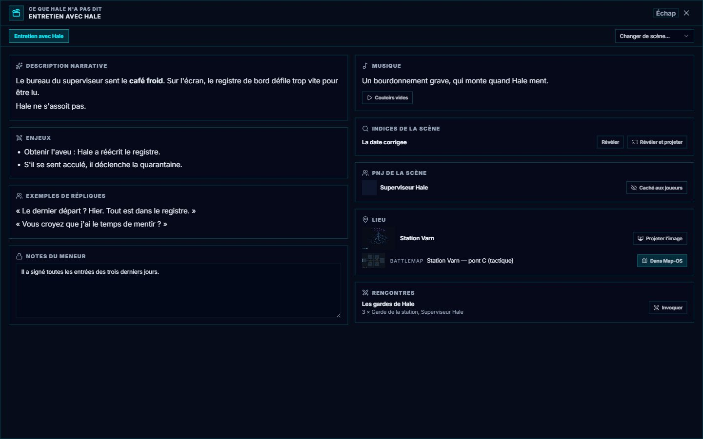

# 🎬 L'écran « Scène en cours »

*Ajouté le 2026-10-12, après la première séance jouée.* David, au débriefing : *« lorsque je
démarre une scène, ses informations ne sont pas facilement accessibles »*. Tout ce que la
[Trame](./11-Trame-actes-et-scenes.md) a préparé pour une scène se lisait en dépliant sa ligne, en
noms seuls. Cet écran le met **en plein écran, dans l'ordre où l'on s'en sert**.

---

## 1. Quand il s'ouvre, et comment le refermer

| Geste | Ce qui se passe |
| :--- | :--- |
| **Une scène commence** (ou reprend après une pause) | L'écran **s'ouvre tout seul** sur cette scène — d'où que vous l'ayez lancée : panneau de séance, inspecteur ou fiche de la Trame. |
| **Échap** | Il se ferme. |
| **Ctrl+E** | Il se rouvre sur la scène en cours ; une seconde frappe le referme. Sans scène en cours, un message le dit. |

Il **ne s'ouvre pas** au démarrage de GM-OS, ni pendant une restauration ou un import Nexus-OS :
les scènes déjà en cours y « reviennent » toutes d'un coup, et personne n'a rien commencé.

**Un groupe séparé** — deux scènes ouvertes en même temps : **un onglet par scène** en haut de
l'écran. La liste **Changer de scène…** permet de lire n'importe quelle scène de la campagne.

---

## 2. Ce qu'il montre

**À gauche — ce qu'on décrit, ce qui se joue, ce qu'on dit :**

| Bloc | Contenu |
| :--- | :--- |
| **Description narrative** | Ce que les joueurs voient, entendent, sentent — à lire à voix haute. |
| **Enjeux** | Ce qui doit se jouer, ce qui peut se perdre. |
| **Exemples de répliques** | Quelques phrases à dire telles quelles. |
| **Notes du meneur** 🔒 | **Modifiables ici.** C'est le même champ que dans la Trame, pas une copie : *deux zones de notes pour une scène finiraient par se contredire.* |
| **Note Obsidian** | La note de la scène dans votre coffre, **repliée** ; un clic la déplie, **Ouvrir dans Obsidian** l'ouvre dans l'application. |

Les textes sont rendus en **Markdown** (gras, listes, tableaux). Si aucun des trois premiers n'est
rempli, l'écran montre le **résumé** de la scène à leur place.

**À droite — ce qu'on manipule :**

| Bloc | Gestes |
| :--- | :--- |
| **Musique** | Vos idées musicales ; **Lancer l'ambiance** (le moment de storyboard lié) ; les **morceaux liés**, jouables d'un clic et **allumés quand ils jouent**. |
| **Indices de la scène** | **Révéler**, **Révéler et projeter**. Un indice découvert **reste là**, avec sa date, et garde **Projeter**. |
| **PNJ de la scène** | **Montré aux joueurs / Caché aux joueurs** ; un clic sur le nom ouvre sa fiche. La première fois qu'un PNJ est montré, il reste marqué **« rencontré le… »** — le cacher ensuite n'efface pas la rencontre. |
| **Lieu** | Un lieu-**image** : **Projeter l'image**, d'un clic, sur l'**écran par défaut d'Image-OS** (un second clic la retire). Une **battlemap** — le lieu lui-même s'il en est une, et chacune des battlemaps de la scène : **Charger dans Map-OS** (allumé quand c'est la carte du plateau). |
| **Rencontres** | Les [rencontres préparées](./30-Combat-OS.md#-les-rencontres-préparées) de la scène. **Invoquer** ferme l'écran, passe à Combat-OS et ouvre **« Qui entre ? »**. |

Un bloc vide ne s'affiche pas : une scène sans indice n'a pas de bloc « Indices ».

---

## 3. Où ça se prépare

Tout se remplit dans la **fiche de la scène**, dans la Trame — voir
[§ 2 du guide de la Trame](./11-Trame-actes-et-scenes.md#2-ce-quune-scène-contient). Rien n'est
obligatoire : une scène improvisée en pleine partie a un écran presque vide, et c'est normal.

> 💡 **La description narrative ne se projette pas** (décision du 12/10) : elle est à vous, et vous
> la lisez. Ce qui part aux joueurs, ce sont les indices, les PNJ montrés, l'image du lieu et la
> battlemap.

> ⚠️ **Rien ne part tout seul au début d'une scène** (décision du 12/10). Jusqu'à ce jour, ouvrir
> une scène chargeait l'image de son lieu dans Map-OS — or un lieu est souvent une illustration, et
> l'illustration devenait le plateau. C'est vous qui projetez l'image ou chargez une battlemap.

---

## 💡 Ce qu'il faut retenir

- **Il s'ouvre seul** quand une scène commence ; **Échap** le ferme, **Ctrl+E** le rouvre.
- **Les notes du meneur s'y écrivent** : c'est le champ de la scène.
- **Un PNJ montré une fois reste « rencontré »**, avec la scène et la date.
- **Invoquer** une rencontre mène droit à « Qui entre ? » dans Combat-OS.
