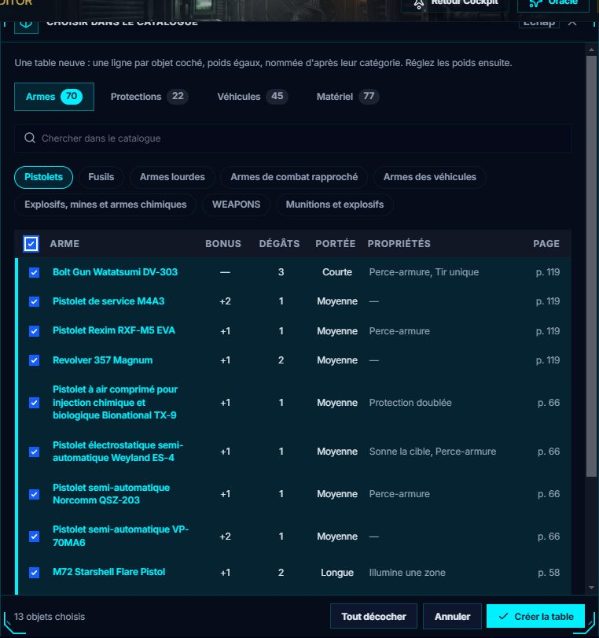
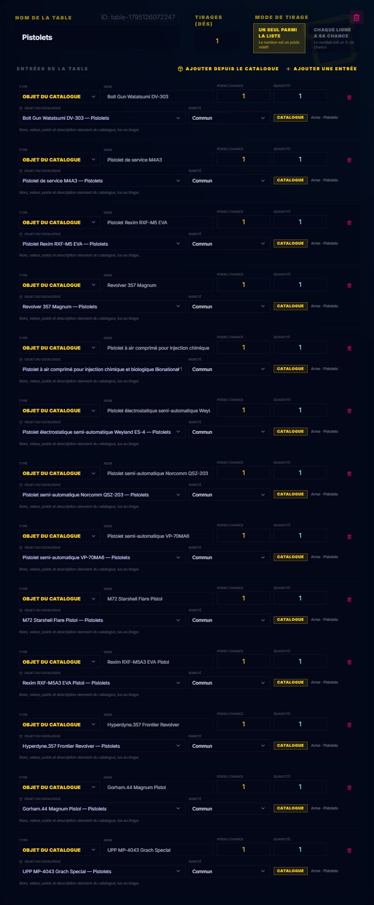
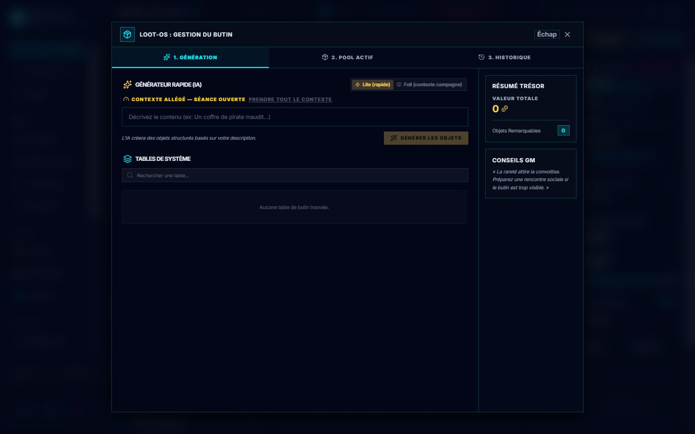

# Loot-OS — écrire ses tables

Ce guide détaille comment alimenter et structurer les tables de butin pour vos parties sur GM-OS.

## 1. Structure d'une Table de Butin

Une table de butin est un objet JSON structuré contenant une liste d'entrées pondérées. Voici la structure de base :

```ts
{
    id: 'ma-table-unique',
    name: 'Nom de la Table',
    rolls: '1d3',            // OPTIONNEL: Nombre de sélections automatiques
    rollMode: 'independent', // OPTIONNEL: 'weighted' (défaut) ou 'independent'
    entries: [
        { 
            id: 'item-01', 
            type: 'item', 
            name: 'Nom de l\'Objet', 
            weight: 50, // Poids relatif ou probabilité (%) selon le mode
            metadata: { 
                rarity: 'Commun', 
                quantityFormula: '1d6' 
            }
        }
    ]
}
```

## 2. Types d'Entrées

Le système supporte cinq types d'entrées :

| Type | Description | Usage |
| :--- | :--- | :--- |
| `item` | Un objet physique simple, décrit à la main. | Armes, consommables, gadgets. |
| `currency` | De l'argent ou des crédits. | Chinyen, Or, Dollars. |
| `table` | Une référence à une *autre* table **du pilote**. | **Récursivité** (une table « Trésor » appelle « Gemmes »). |
| `oracle` | Un tirage sur une table de **Table-OS**. | Faire fouiller un corps par la table de fouille du jeu. |
| `catalogue` | **Un objet du catalogue d'équipement du pilote**, désigné, pas recopié. | Un casier d'armurerie, une épave, un coffre de contrebandier. |

> ⭐ **La cible se choisit dans une liste, plus jamais à la main.** Jusqu'au 2026-09-04,
> l'identifiant de la table appelée se recopiait dans un champ texte : une faute de frappe
> produisait **zéro objet sans un mot à l'écran**. Aujourd'hui le tirage vous dit ce qu'il n'a
> pas trouvé, et nomme la cible manquante.

### Le type `oracle`, en pratique

Choisissez l'univers puis la table (les listes viennent de `databases/tables/`). Le tirage se
fait avec le moteur de Table-OS — plages `min`/`max`, dés concaténés `d66` — et **seul ce que l'entrée
tirée DÉCLARE entre au butin** : son champ `butin`, décrit dans le *Guide Table-OS*. Un oracle
qui ne déclare rien se lit, il ne verse pas — et il vous le dit.

> ⚠️ Le **modificateur** du tableau de bord de Table-OS ne s'applique pas ici : il appartient à
> l'écran où vous tirez à la main, pas à un appel depuis une table de butin.

### Le type `catalogue` : les tables faites depuis l'équipement du jeu (19/11/2026)

Quand le pilote a un **catalogue d'équipement** (section Équipement de l'éditeur du pilote : Alien,
Delta Green, Blade Runner, Cthulhu Hack, COC, Barbarians, Vampire), deux boutons apparaissent dans
la section **« Trésors »** de l'éditeur du pilote — depuis le cockpit : **Modèles de fiches** ›
le pilote › **Éditer le moteur** › **Trésors** (ou « Configurer le pilote » dans les modules du jeu) :

- **« Nouvelle table depuis le catalogue »**, à côté de « Créer une table » : cochez des objets,
  ou toute une catégorie avec « Toute la catégorie », puis **« Créer la table »**. La table porte
  le nom de leur catégorie (« Pistolets »), sinon « Sélection du catalogue » ; une ligne par
  objet, poids égaux, un seul tirage parmi la liste. Réglez les poids ensuite.
- **« Ajouter depuis le catalogue »**, dans chaque table, à côté de « Ajouter une entrée » : les
  objets cochés s'ajoutent à la suite de ses lignes.

La fenêtre est celle de « Prendre dans le catalogue » sur la fiche — familles, catégories,
recherche, « Livre, p. N » —, avec des cases à cocher, et les **quatre** familles : un butin peut
contenir un véhicule.



**Une ligne du catalogue désigne son objet ; elle ne le recopie pas.** Nom, valeur, masse et
description se lisent **au tirage** dans le catalogue : corrigez le M41A une fois, toutes les
tables qui le donnent suivent. Sur la ligne, vous réglez seulement la **rareté**, la
**quantité** et le poids de tirage ; vous pouvez aussi désigner un autre objet. Un objet retiré
du catalogue s'annonce en rouge sur sa ligne, et le tirage le dit au lieu de donner un objet vide.



Ce que donne une ligne du catalogue :

| | |
| :--- | :--- |
| **Valeur** | lue dans le coût s'il commence par un nombre (« 1 200 $ » → 1 200) ; un coût qui est une catégorie de prix (« Courant » chez Delta Green) ou « Spécial » vaut 0. |
| **Masse** | le poids du catalogue (« ½ » → 0,5). |
| **Objets contenus** | un véhicule ou une combinaison arrive **avec ce qu'il contient** (la CCC5 et son canon). |
| **Lien** | l'objet reçu par un personnage reste relié au catalogue : il compte comme **porté**, et ses effets sont rappelés au jet. |

> Les tables partent avec le pilote à l'export (`.gmos-driver`) et reviennent intactes au
> réimport, catalogue compris.

## 2 bis. Ce qu'une entrée décrit

Au-delà du nom et de la quantité, chaque entrée d'objet porte :

| Champ | À quoi il sert |
| :--- | :--- |
| **Rareté** | Choisie dans l'échelle du jeu. Compte dans « Objets remarquables ». |
| **Valeur** | Additionnée dans « Valeur totale ». Une monnaie sans valeur vaut 1 par unité. |
| **Masse** | Le poids **physique** — à ne pas confondre avec le poids de tirage. |
| **Description** | Ce que le joueur lit sur l'objet. |

> Le générateur lisait ces quatre champs depuis toujours ; **ils n'avaient simplement aucun
> champ dans la Forge**. C'est pourquoi les deux compteurs du panneau valaient zéro pour tout
> ce qui venait d'une table.

## 2 ter. Le vocabulaire de votre jeu

En tête de la section *Butin* de la Forge, deux réglages facultatifs :

- **Monnaie** — « Eurodollars », « Cred », « pièces d'or ».
- **Paliers de rareté** — du plus banal au plus rare. **Le premier palier est celui qui ne
  compte pas** comme remarquable.

Sans déclaration, GM-OS reste neutre (« valeur », « objets remarquables ») au lieu d'imposer
l'échelle et l'or de D&D à Blade Runner. Ces mots partent aussi dans l'invite de l'IA.

## 3. Modes de tirage

Le système propose deux modes fondamentaux de résolution :

### A. « Un seul parmi la liste » (`weighted`) — par défaut
Le système effectue un **choix unique**. Plus le `weight` est élevé par rapport aux autres,
plus l'entrée a de chances de sortir.
- **Usage** : « une potion parmi trois », « un trésor aléatoire ».

> ⚠️ **Le même nombre veut dire deux choses selon le mode** — poids relatif ici, pourcentage
> de chance en dessous. C'était caché derrière une case à cocher ; ce sont maintenant deux
> choix nommés, et l'étiquette du champ voisin suit.

### B. « Chaque ligne a sa chance » (`independent`)
Chaque entrée est testée **individuellement**. Le `weight` est ici une **probabilité (0-100 %)**.
- Si `weight = 100`, l'objet est garanti.
- Si `weight = 10`, l'objet a 10% de chance d'apparaître.
- **Usage** : "Générer tout l'équipement de départ d'un PNJ", "Set d'objets garantis".

## 4. Multi-tirages

Vous pouvez configurer le nombre de fois que la table doit s'exécuter automatiquement via le champ `Tirages (Dés)` :
- Valeur fixe : `3` (tire 3 fois).
- Formule de dés : `1d4+1` (tire entre 2 et 5 fois).
- En mode **Indépendant**, le nombre de tirages démultiplie les tests de probabilité.

## 5. Paramètres avancés

Les métadonnées permettent d'instancier dynamiquement les objets lors du tirage.

### Formules de Quantité
Utilisez le champ `quantityFormula` pour définir des tirages de dés :
- `1d6` : Entre 1 et 6.
- `2d10*5` : Multiples de 5 entre 10 et 100.
- `10` : Valeur fixe.

### Niveaux de Rareté
Le système de notification (`LootNotification`) adapte ses couleurs selon la rareté :
- `Commun` (Gris)
- `Insolite` (Bleu)
- `Rare` (Cyan)
- `Épique` (Violet)
- `Légendaire` (Or)

## 6. Exemple complet : Blade Runner

Voici comment est implémentée la table "Preuves du LAPD" :

```ts
{
    id: 'br-lapd',
    name: 'Preuves & Saisies du LAPD',
    entries: [
        { id: 'l1', type: 'item', name: 'Données de surveillance', weight: 25, metadata: { rarity: 'Insolite' } },
        { id: 'l2', type: 'item', name: 'Peau synthétique', weight: 20, metadata: { rarity: 'Rare' } },
        { id: 'l3', type: 'item', name: 'Munitions .44', weight: 15, metadata: { quantityFormula: '1d6' } },
        { id: 'l5', type: 'table', name: 'Objet Confisqué', weight: 20, metadata: { tableId: 'br-gear' } } // APPEL RÉCURSIF
    ]
}
```

## 7. Ajouter vos tables

**Dans l'application, jamais dans les fichiers source** : Forge-OS → votre pilote → section
**Butin** → *Créer une table*.

1. Nommez la table et donnez-lui son nombre de **tirages** (`1`, `1d4+1`…).
2. Choisissez son **mode** — un seul parmi la liste, ou chaque ligne a sa chance.
3. Ajoutez ses entrées : type, nom, poids, quantité, puis rareté, valeur, masse et description.
4. Les tables apparaissent aussitôt dans **Loot-OS → onglet 1. Génération**, section **Tables de
   système**.



> ⛔ **Cette section décrivait jusqu'au 2026-09-04 une procédure impossible** : éditer
> `src/data/defaultGameDrivers.ts` pour y modifier un objet `loot.tables`. Ce champ n'existe pas
> (le pilote porte `lootTables`), **aucun pilote par défaut ne déclare de table de butin**, et le
> `LootRollPanel` où les tables devaient apparaître n'était monté nulle part — il a été supprimé.
> Les tables de butin ne viennent que d'une chose : **l'éditeur de la Forge**.

> [!IMPORTANT]
> Le tirage vous **dit** ce qu'il n'a pas trouvé — une table appelée qui n'existe plus, un oracle
> illisible. Un tirage qui rend zéro objet sans expliquer pourquoi ne se répare jamais en séance.

*Relu le 2026-10-03 et illustré.*
