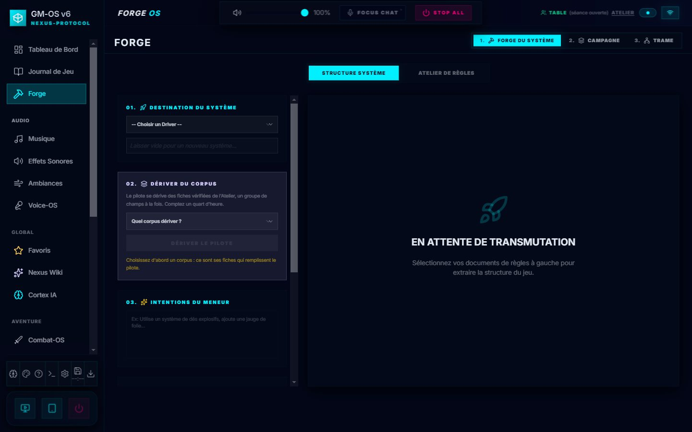
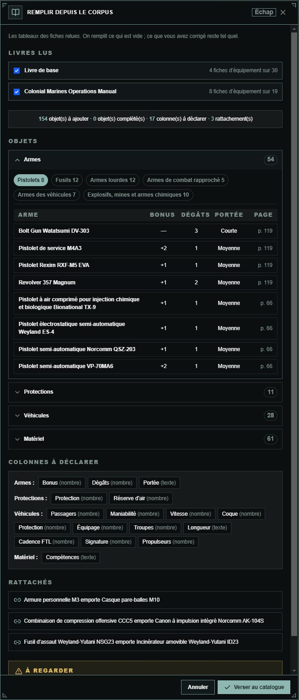
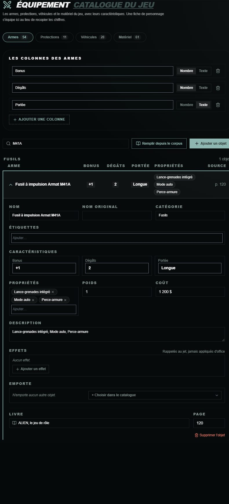
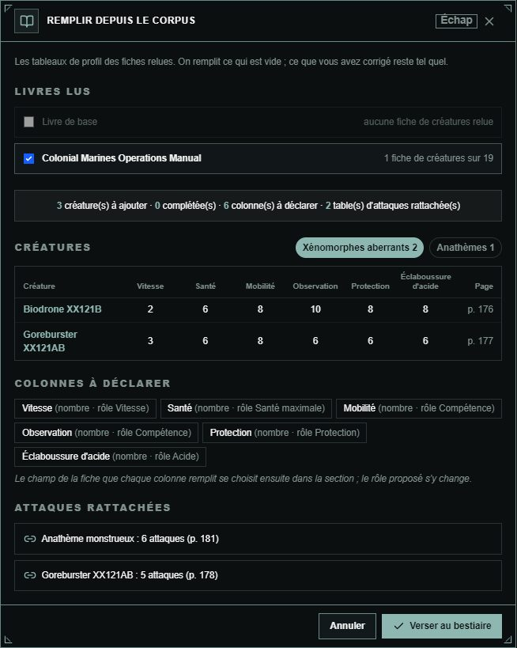
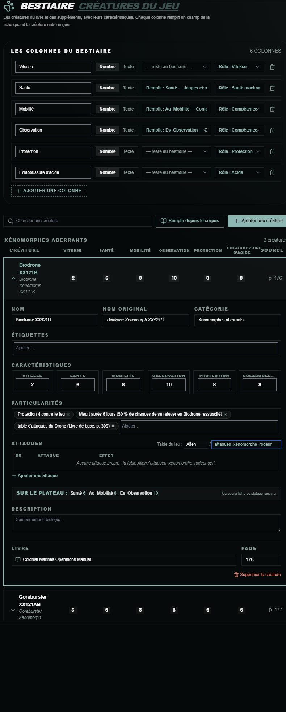

# 🔨 Rule Engine & la Forge

Deux outils, deux moments. **La Forge** lit vos documents et en tire un système jouable ; **l'éditeur
de règles** vous laisse tout reprendre à la main.

---

## 🗂️ Forge-OS a trois ateliers

L'en-tête du module porte trois onglets numérotés, en haut à droite — **1. Forge du système**,
**2. Campagne**, **3. Trame** :

| Atelier      | Ce qu'il produit                                                                                                            |
| :----------- | :-------------------------------------------------------------------------------------------------------------------------- |
| **1. Forge du système** | Un **système de jeu** : moteur de dés, combat, portées, consignes d'IA, gabarit de fiche. Deux sous-onglets : *Structure système* et *Atelier de règles* |
| **2. Campagne** | Une campagne jouable à partir d'un scénario — actes, scènes, PNJ, lieux. → [guide dédié](./12-Forge-de-campagne.md) |
| **3. Trame** | Le plan narratif d'une campagne existante. → [guide dédié](./11-Trame-actes-et-scenes.md)                                 |

---

## ⚙️ Choisir le moteur, à chaque forge

Avant de lancer, vous choisissez **quel modèle** travaille. Trois principes, tranchés une fois pour
toutes :

- **Le nuage est accepté ici.** Une forge n'a pas le contexte vivant d'une séance ; y envoyer un
  livre de règles ne coûte pas la même chose qu'y envoyer une question de table.
- **Le choix est explicite** à chaque lancement.
- **Rien ne bascule tout seul.** Le choix est mémorisé *par atelier*, mais **toujours affiché** —
  *mémoriser sans montrer redonnerait un réglage qu'on a oublié d'avoir posé.*

> ⛔ **Correction.** Ce guide annonçait « l'IA (Gemini 1.5 Pro) ». Aucun modèle n'est imposé : vous
> disposez des six fournisseurs configurés dans les réglages IA.

### Ce que ça coûte, en temps

Pour une forge système complète, mesuré :

| Moteur | Durée |
| :--- | :--- |
| Modèle local, sur processeur seul | **9 à 15 min** |
| Après distillation par NotebookLM | **2 à 5 min** |
| Gemini Flash | **~30 s** |

---

## 🔥 Forger un système

1. **Nommez le système** visé. S'il existe déjà et qu'il est personnalisé, la forge l'**enrichit**
   au lieu d'en créer un second.
2. **Donnez-lui de la matière** : un corpus de documents déjà présents, ou un carnet NotebookLM.
3. **Guidez-la** par une consigne libre — *« priorise les règles de folie »*, *« fiche
   minimaliste »*.
4. **Lancez**, puis relisez la prévisualisation avant d'enregistrer.

### ⭐ La forge enrichit, elle ne double pas

C'est le changement du 2026-08-16, et il n'était documenté nulle part. Viser un système existant ne
crée plus un doublon : la forge **remplit les champs vides** et laisse le reste intact. Le journal
dit combien de champs ont été remplis, et **rien n'est jamais écrasé**.

Une case décide du sort de la fiche de personnage :

| **Ne pas toucher à la fiche de personnage** | Effet |
| :--- | :--- |
| **Cochée** *(par défaut)* | Seul le système est enrichi. La fiche existante ne bouge pas — ses champs, leurs identifiants, et les valeurs déjà saisies sur vos personnages. |
| **Décochée** | La dérivation ajoute ses sections et ses champs manquants. ⚠️ **Si elle nomme `points_de_vie` ce que votre fiche appelle `hp`, vous obtiendrez les deux.** |

> ⛔ **Les modes « BRAIN » et « BODY » n'existent plus.** Ce guide demandait de choisir entre
> extraire la logique ou la structure visuelle. La forge produit désormais les deux ensemble, et
> c'est la case ci-dessus qui décide de ce qu'elle touche.

---

## 📚 Documenter un supplément

*Depuis le 2026-11-01.* L'**Atelier de règles** documente aussi les suppléments d'un jeu : un
bestiaire, un livre de magie, un manuel d'équipement. Exemple : le *Colonial Marines Operations
Manual* d'Alien.

1. Dans le panneau de gauche, choisissez le **corpus du jeu** (`alien`), puis, juste dessous, sous
   « Livre documenté », le **supplément**, ou tapez son titre et **Déclarer**.
2. Dans le **Bac à contexte**, cochez **la seule source** du supplément. Sans cela, l'inventaire
   lirait aussi le livre de base, et une alerte le signale.
3. **Analyser les sources** ouvre l'atelier, sans rien demander au carnet ; cliquez **Demander
   l'inventaire**. Le carnet propose dix à vingt-cinq sujets : spécialités, talents,
   armes, véhicules, créatures, règles de campagne. Il laisse de côté l'histoire, l'univers et les
   scénarios.
4. **Choisissez** : renommez un sujet (crayon), écartez-le (corbeille), ajoutez-en un. Vos choix sont
   enregistrés et reviennent à la réouverture.
5. **Forgez et relisez** chaque fiche, comme pour le livre de base. Les tableaux du livre sont
   recopiés en tableau.

| Ce qui change pour un supplément | Pourquoi |
| :--- | :--- |
| Les fiches vont dans `docs/systems/<jeu>/supplements/<supplément>/rules/` | L'Oracle les cite avec le jeu ; le pilote et sa forge ne les lisent pas |
| Pas de liste fixe de quatorze sujets | Elle est faite pour un livre de base, et un supplément traite justement ce qu'elle exclut |
| Fiches dans la langue du corpus du jeu, avec le nom original entre parenthèses | « Fusilier (Rifleman) » : c'est le nom qu'on retrouve dans le livre |
| Les titres de section sont confrontés au sommaire du supplément | Déposé dans `supplements/<supplément>/index/` |
| Pas de personas | Ce sont les voix du jeu, pas d'un livre |

> Le supplément **n'ajoute encore aucun champ au pilote** : on documente d'abord. Décision de David
> du 2026-11-01 ; les champs viendront après l'essai de Colonial Marines.

---

## 📖 L'éditeur de règles — neuf sections

On y arrive depuis Session-OS, par les **Règles** (le *Grimoire*).

| Section | Ce qu'on y règle |
| :--- | :--- |
| **Atelier** | Les fiches de règles écrites ou forgées → [les partager aux joueurs](./52-Partager-une-regle.md) |
| **Système** | Le moteur de dés : dés par défaut, et le moteur spécialisé |
| **Combat** | Statistiques, formule d'initiative et son sens de tri, dégâts |
| **Tactique** | Les seuils de portée du Cortex et leurs modificateurs |
| **Intelligence** | Les consignes des huit personas, réécrites pour ce jeu |
| **Trésors** | Les tables de butin, et le **vocabulaire** du jeu : sa monnaie, ses raretés |
| **Équipement** | Le **catalogue** du jeu : armes, protections, véhicules, matériel, avec leurs caractéristiques |
| **Bestiaire** | Les **créatures** du livre et des suppléments, leurs caractéristiques et le champ de la fiche que chacune remplit |
| **Connaissance** | Le carnet NotebookLM de référence pour ce système |

> ⛔ **Ce guide n'en décrivait que trois** — le moteur de dés, le combat et le Cortex. L'**Atelier**,
> l'**Intelligence**, les **Trésors** et la **Connaissance** n'y figuraient pas.

### Les moteurs de dés

*Year Zero* (succès sur les 6, avec dés échelonnés pour Blade Runner) · *Réserve avec explosions* ·
*Fate / Fudge* · *2d20* (Dune, Star Trek) · *D100 et ses degrés de réussite* · le lancer standard.

→ [Guide de Dice-OS](./34-Dice-OS-le-pupitre.md)

### La section Trésors

Elle porte deux choses distinctes : les **tables de butin** du jeu, et son **vocabulaire** — comment
s'appelle sa monnaie, quels sont ses rangs de rareté. Sans ce vocabulaire, Loot-OS reste neutre :
il dira « pièces » là où votre jeu dit « eddies ».

→ [Guide de Loot-OS](./42-Butin-ecrire-les-tables.md)

### La section Équipement

Le catalogue des objets du jeu, en quatre familles : **armes**, **protections**, **véhicules** et
**matériel**. Les implants et les objets magiques sont du matériel avec une étiquette. Livrée le
02/11/2026 (registre § 203).

1. **Choisissez la famille** dans les quatre onglets. Le chiffre de chaque onglet compte ses objets.
2. **Déclarez ses colonnes** dans « Les colonnes des … ». Ce sont les caractéristiques que ce jeu
   donne à cette famille : Bonus, Dégâts, Portée pour les armes d'Alien. Une colonne est un
   **nombre** ou un **texte**. En retirer une efface aussi ses valeurs, et GM-OS demande d'abord
   combien d'objets elle touche.
3. **Ajoutez un objet** : « Ajouter un objet », son nom, « Créer ». Il s'ouvre aussitôt.
4. **Remplissez sa fiche** : nom original, catégorie (les objets se rangent sous elle), étiquettes,
   une case par colonne, propriétés, poids, coût, description et source (livre, page).
5. **« Emporte »** se choisit dans le catalogue, jamais au clavier. Par exemple, la combinaison
   CCC5 emporte son canon AK-104S. Corriger le canon corrige donc tout ce qui l'emporte.
6. **Les effets** (« +2 aux tests de Mobilité sous l'eau ») disent la compétence qu'ils visent et
   leur condition. La compétence se **choisit dans la liste** des champs de la fiche
   (« Ag_Mobilité — Compétences »). Une cible absente de la fiche s'affiche en ocre, « … — absent
   de la fiche » : le jet ne la retrouverait pas, choisissez la bonne. Ils seront **rappelés** au jet et jamais appliqués d'office, car leurs
   conditions se jugent à la table.

Le contrôle du pilote s'affiche **sous l'objet concerné**, à deux niveaux :

- **en rouge**, ce qui casserait un geste : un objet emporté introuvable, une valeur hors des
  colonnes déclarées ;
- **en ocre**, ce qui se lit mais ne se compte pas, comme « Puissance 9 » dans une colonne de
  nombres.

#### Remplir le catalogue depuis le corpus

*Depuis le 2026-11-02.* Le bouton **« Remplir depuis le corpus »**, à côté de « Ajouter un objet »,
lit les tableaux des fiches de règles relues du jeu et de ses suppléments. Il n'interroge aucun
carnet : les chiffres viennent des fiches, qui ont été relues contre le livre.

1. **« Livres lus »** : cochez les livres à lire. Un livre sans fiche d'équipement est grisé.
2. **Le bilan** dit combien d'objets seraient ajoutés ou complétés, combien de colonnes déclarées et
   combien d'objets rangés dans leur porteur. Par exemple, « compris dans la CCC5 » range le canon
   AK-104S dans ce que la combinaison emporte.
3. **« Objets »** montre ce qui serait ajouté, par famille et par catégorie, avec les colonnes du jeu.
4. **« À regarder »**, en ocre :
   - ce que vous avez corrigé et que la fiche dit autrement ; c'est **votre valeur qui reste** ;
   - un porteur introuvable ;
   - une ligne de tableau illisible.
5. **« Verser au catalogue »** enregistre. Rien n'est enregistré avant.

Les tableaux qui ne décrivent pas d'équipement (tables de D66, terrains, spécialités) sont écartés,
et la fenêtre les nomme. On peut relancer le remplissage sans risque : il ne remplit que les cases
vides.

> **Pour Alien**, le livre de base a quatre fiches d'équipement, transcrites depuis le PDF
> (`docs/systems/alien/rules/equipement-*`), et *Colonial Marines* en a huit. Lus ensemble, ils
> donnent 154 objets. Le TPB M577 et le fusil AK-4047 portent un nom différent dans chaque livre,
> donc ils apparaissent deux fois.

> **Sur la fiche du personnage** (depuis le 2026-11-02, pour Alien) : le bouton « Prendre dans le
> catalogue » écrit une arme ou une protection dans les champs que le jet lit déjà. Voir
> [le manuel d'Alien](./54-Jeu-Alien.md#prendre-une-arme-ou-une-protection-dans-le-catalogue--02112026).

> **Au jet** (depuis le 2026-11-02, pour Alien) : les effets des objets portés qui visent la
> compétence lancée sont rappelés dans « Équipement porté », chacun avec une case. Rien n'est coché
> d'office.

> ⚠️ **Ce qui ne marche pas encore.** Seul Alien déclare les champs qui reçoivent une arme et
> applique les effets cochés aux dés : [le plan](../Planning/2026-11-02-catalogue-d-equipement.md).

### La section Bestiaire

Depuis le 2026-11-05 (registre § 210, étapes A, B et C ; écrans dessinés dans Stitch et validés
par David). Les **créatures du livre et des suppléments** vivent dans le pilote, comme le catalogue :
elles partent avec l'export et se corrigent une fois. Le bestiaire que le meneur remplit dans
l'atelier des adversaires (ses gabarits) ne change pas.

- **Les colonnes du bestiaire** : celles que le jeu donne à une créature (Alien : Vitesse, Santé,
  Mobilité, Observation, Protection, Éclaboussure d'acide), chacune **Nombre** ou **Texte**, et le
  **champ de la fiche qu'elle remplit** quand la créature entrera en jeu — choisi dans la liste des
  champs du pilote, ou « reste au bestiaire ».
- **Les créatures**, rangées par catégorie du livre, une ligne par créature, une cellule par
  colonne. Dépliée : nom, nom original, catégorie, étiquettes, caractéristiques, **particularités**
  (« Protection 4 contre le feu »), **attaques** — une table du jeu tirée au dé (« Alien /
  attaques_xenomorphe_rodeur ») et/ou des lignes D6 —, description, livre et page.
- **« Sur le plateau »** montre ce que la fiche de plateau de la créature recevra : seules les
  colonnes qui remplissent un champ y entrent.
- **Pour Alien** (depuis le 2026-11-05, étape E), chaque colonne a aussi un **rôle** dans le profil
  xénomorphe de Combat-OS — Vitesse, Santé maximale, Protection, Acide, Compétence, ou aucun.
  « Remplir depuis le corpus » le propose d'après le libellé ; il se change ici. Une créature posée
  au combat arrive alors déclarée xénomorphe : [le manuel d'Alien](./54-Jeu-Alien.md#actions-et-xénomorphes--a6).
- Le contrôle du pilote s'affiche sous ce qu'il vise : une colonne qui remplit un champ absent de la
  fiche, un texte dans une colonne de nombres, deux créatures du même identifiant.

- **« Remplir depuis le corpus »** lit les **tableaux de profil** des fiches relues — livre de base
  et suppléments déclarés, à cocher — et montre d'abord un aperçu : créatures à ajouter par
  catégorie, colonnes à déclarer, **tables d'attaques rattachées** à leur créature (« Tableau des
  attaques du Goreburster »), et « À regarder » pour ce qui diffère de ce que vous avez corrigé.
  **Rien n'est versé avant « Verser au bestiaire »**, et rien de rempli n'est remplacé. Une
  précision entre parenthèses (« 8 (4 contre le feu) ») devient une particularité. Le champ de la
  fiche que chaque colonne remplit se choisit ensuite dans la section.

> **Pour qu'une fiche se lise**, sa section « Valeurs » commence par un tableau dont la première
> colonne est « Créature » (et, si le livre en a, des tables « D6 | Attaque » titrées « Tableau des
> attaques de … »). La Forge l'écrit ainsi pour un supplément ; une fiche plus ancienne se met au
> format à la relecture. Pour Alien, la fiche des xénomorphes de *Colonial Marines* l'est (Biodrone,
> Goreburster, Anathème monstrueux) ; le livre de base n'a pas encore de fiche de créatures.

> **Sur le plateau** (depuis le 2026-11-05, étape D) : l'onglet *Livre* de l'atelier des adversaires
> pose les créatures et les décline en variantes ; les rencontres préparées les comptent —
> [guide de Combat-OS](./30-Combat-OS.md#les-créatures-du-livre--longlet-livre). Ce qui est propre
> à chaque jeu est fait pour Alien (étape E) ; les autres jeux viendront à la demande —
> [le plan](../Planning/2026-11-04-bestiaire-du-pilote.md).

---

## 💡 L'enchaînement

1. **Forgez le système** depuis vos documents de règles.
2. **Relisez-le** dans l'éditeur, section par section — c'est là qu'on rattrape ce que la forge a
   mal compris.
3. **Complétez le vocabulaire** (Trésors) et les portées (Tactique) : deux endroits que la forge
   remplit rarement bien seule.
4. **Attachez-le à une campagne** dans Session-OS.

> [!TIP]
> **Reforger n'est pas rejouer.** Vous pouvez relancer la forge sur le même système autant de fois
> que vous voulez, avec une consigne différente : elle comblera les trous sans défaire vos
> corrections.

---

*Guide refait le 2026-09-04, code à l'appui. Deux affirmations fausses retirées : le modèle n'est
pas « Gemini 1.5 Pro » mais celui que vous choisissez à chaque forge, et les modes **BRAIN / BODY**
n'existent plus. Ajouté : les **trois ateliers** de Forge-OS, l'**enrichissement** (2026-08-16) et
sa case de garde, les **quatre sections** de l'éditeur que ce guide ignorait, et les durées
mesurées.*

> 🖼️ **La bannière de l'en-tête** se choisit aussi dans l'éditeur du pilote, depuis le 2026-10-03 :
> une image du dossier du jeu, en fond de l'en-tête de Session-OS. → [Session-OS](./10-Session-OS-le-cockpit.md)

*Relu le 2026-10-03 : les onglets numérotés de la Forge. Capture de la campagne de démonstration.*
