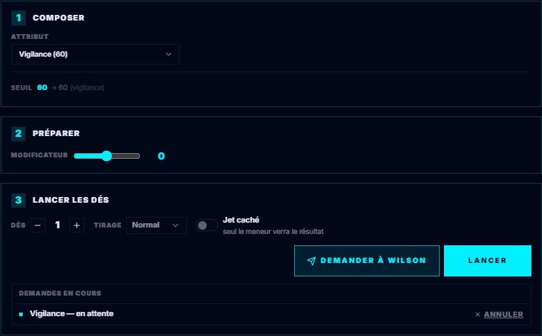

# 🎲 Les jeux et leurs mécaniques

Chaque jeu entre dans GM-OS par son **pilote** : le fichier, forgé ou écrit à la main, qui dit
comment on lance les dés, quelles réserves la table partage, comment on encaisse les coups. Le même
écran change donc de visage selon le jeu de la campagne ouverte. Cette page explique **chaque
mécanique une fois**, et dit **où la voir**. Une page par jeu dit ensuite ce que *son* pilote en
fait.

**Anciennes fiches et variantes, 03/11/2026 :** le meneur dispose du
[diagnostic et de la reprise de fiche PJ](./63-Fiche-de-personnage-HTML.md#reprendre-une-ancienne-fiche) :
référence installée, correspondances choisies, aperçu, sauvegarde JSON et restauration protégée.
L'import d'une campagne signale les dépendances locales différentes qu'il conserve. Les six essais
applicatifs des droits, reprises et variantes COC 3d6/Shadowrun alternatif passent le 03/11 ;
validation globale de David reçue le même jour.

**Dune, 25/10/2026 :** `dune` sur le descripteur de jet ouvre les maximes, la Détermination,
l'assistance, les oppositions et le bilan d'Impulsion du test. `repriseDune` sur l'initiative
permet de rejouer le même personnage, avec +1 difficulté, et fait payer les PNJ ennemis en
Menace. Le module **Dune : conflits et Maison** tient les zones et les atouts ; voir
[le guide Dune](./54-Jeu-Dune.md).

**Cthulhu Hack, 23/10/2026 :** le pilote 1.1.0 ajoute le suivi persistant des pertes du Hors Jeu,
la protection perdue par l'usure, la défausse de Fortune du MJ, les durées dans la fiction et
la variante Pulp activée explicitement. Voir [le guide du jeu](./54-Jeu-Cthulhu-Hack.md).
Le fonctionnement générique de `horsJeu` décrit ci-dessous reste celui des pilotes sans ce suivi.

> **Mis à jour le 2026-10-13**, sur les pilotes exportés ce jour-là ; **le 2026-10-14** pour Alien et Blade Runner (forcer le jet, Panique), Star Trek (spécialisation) et Torg (cosms). Un pilote nouveau ou amélioré
> se reporte ici. La marche à suivre est en bas de page, sous « Tenir ce manuel à jour ». Les captures
> sont celles des pilotes **corrigés** le même soir (`Export Dirvers/corriges/`).

---

## Les jeux

| Jeu | Ce qui le distingue dans GM-OS | Page |
| :--- | :--- | :--- |
| 🌌 **NOC** | Dés de destin sur un Domaine. **Fiel** qui déborde en **Menace**. La **Cabale**, fiche commune où l'on puise au jet | [NOC](./54-Jeu-NOC.md) |
| 🏜️ **Dune** | 2d20 sous un seuil. **Impulsion** et **Menace**. Dés achetés, ordre du tour **alterné**, **défaite** en tâche étendue | [Dune](./54-Jeu-Dune.md) |
| 🖖 **Star Trek** | 2d20 sous un seuil. **Impulsion** et **Menace** (deux par personnage au départ). Dés achetés ; **marge de complication**, **opposition**, **assistants** et **aide du vaisseau**, **Détermination** ; Stress et blessures, Réputation de fin de mission ; camps qui alternent ; module **Bataille spatiale et tâches étendues**, à côté de LCARS | [Star Trek](./54-Jeu-Star-Trek.md) |
| 👽 **Alien** | Réserve de d6 et **dés de Stress**, qui déclenchent la **Panique** | [Alien](./54-Jeu-Alien.md) |
| 🌃 **Blade Runner** | **Dés échelonnés** : un dé par attribut et par compétence, de D6 à D12 | [Blade Runner](./54-Jeu-Blade-Runner.md) |
| 🐙 **Cthulhu Hack** | **Sauvegardes** au d20 sous la caractéristique, **dés d'usure** (Torche, Bagou…) | [Cthulhu Hack](./54-Jeu-Cthulhu-Hack.md) |
| 🌑 **Symbaroum** | Un **test** au d20 sous l'un des huit attributs, opposition et Avantage tactique ; **attaque et Défense** avec dégâts et protection lancés par le joueur, valeurs fixes des PNJ ; **agonie** et Test de mort ; **Corruption**, Stigmates et Ombre ; création, progression, bourse, voyages, règles optionnelles de la table ; fiche HTML reliée | [Symbaroum](./54-Jeu-Symbaroum.md) |
| 🕯️ **Crimes** | **Potentiel GARDE Compétence** : des d10, on en garde autant que la compétence, les 1 d'office ; seuil 9, 8 ou 7 avec une spécialisation ; quatre bilans et la Névrose dite | [Crimes](./54-Jeu-Crimes.md) |
| 🐉 **Rêves de Dragons** | d100 sous un **pourcentage**, degrés ; **Livret du voyageur HTML de cinq pages**, dont l'Archétype, relié au formulaire ; **round en sept phases, initiative par arme** ; fatigue, blessures, ouvrages, repos et Château Dormant avec **famine et potions** ; **stress/XP/Archétype, entraînement et apprentissage**, **chance/destinée/moral**, **astrologie privée liée à Clock-OS** ; **Haut-Rêve** (rencontres, sorts, réserves, queues, souffles et têtes) ; carte TMR | [Rêves de Dragons](./54-Jeu-Reves-de-Dragons.md) |
| ⚡️ **Torg Eternity** | Un d20 qui **explose**, converti par la **Table des Bonus**, contre un **Niveau de Difficulté** ; **Possibilité**, « Un de plus ! » et relance favorisée après le premier dé ; **Annulation des dommages** | [Torg](./54-Jeu-Torg.md) |
| 🌴 **Barbarians of Lemuria** | **2d6 additionnés** à un attribut et à une carrière ou une aptitude de combat, contre **9** ; difficulté du livre et Défense de la cible ; **dés de bonus et de malus** ; double 6 héroïque, double 1 automatique ; **points d'héroïsme** (Faveur divine, succès héroïque et légendaire) ; jet de réaction ; fiche HTML reliée | [Barbarians of Lemuria](./54-Jeu-Barbarians-of-Lemuria.md) |
| 🏰 **Argyropée** | **Un d10 lu de 0 à 9** additionné à la compétence et au **métier choisi au jet**, lu sur cinq **paliers** (0 ou moins, 1-7, 8-9, 10-14, 15+) ; modificateur et **entraide** ; **action complexe** sur la moyenne des compétences, **test en opposition** jusqu'à 5 succès ; **Panache** dépensé après le tirage, jusqu'à 9 au dé ; **Faveur divine**, réveil et repas, **Exubérance**, **magie** et silenciada au panneau ; **test de PNJ** (1d6 de compétence) et **Guigne** au pupitre ; fiche HTML reliée, bestiaire de 163 profils | [Argyropée](./54-Jeu-Argyropee.md) |
| 🏺 **RuneQuest** | D100 sous une **aptitude** — compétence, Rune, Passion, caractéristique — en **cinq niveaux** lus sur les chances modifiées ; 01-05 et 96-00 ; **test de caractéristique** ×5 à ×0,5, **table de résistance**, **augmentation**, nouvelle tentative, **opposition** selon l'errata ; **localisation** au D20 et **coups localisés** dans Combat-OS (armure, zone, total, effets du livre) ; **dégâts de l'attaque** (arme, bonus, spéciaux, parade et esquive, critique sans armure) ; **rangs d'action selon l'action** (arme, tir, sort, délais, limite de 12) ; **attributs calculés** depuis les caractéristiques ; **sort payé** selon le niveau du jet et le culte ; **inspiration** pour la situation ; **tests d'expérience** de fin de saison ; fiche HTML reliée | [RuneQuest](./54-Jeu-RuneQuest.md) |
| 🍄 **Degenesis** | Une **réserve de d6** (attribut + compétence), chaque **4+** un succès, contre une difficulté en **succès requis** ; les **6 déclencheurs** sur une réussite, l'**échec critique** quand les 1 dépassent les succès, le surplus au-delà de **12 dés** en succès d'office ; **modificateurs en dés**, −1D par **Traumatisme**, **Égo** dépensé ; santé en **deux pistes** (Blessures superficielles puis Traumatismes), attaque mentale sur l'Égo ; **round** : Égo payé une fois à l'initiative, en succès de PSY+Réactivité, puis rendu à la première action, actions comptées ; **attaque** jusqu'aux dégâts nets — défense passive ou active (une action), arme et F, une seule armure, Mortel, Pénétration, Étourdissement, sonique ; **jets liés** — aide (difficulté +1, déclencheurs en dés pour l'aidé), combinaison, confrontation, action complexe ; **maxima** calculés selon la branche (Concentration ou Pulsions, Foi ou Volonté) ; **Sporulation** permanente, test du Germe, exposition et EX ; **Brûlure** et stimulation proposée aux jets ; Potentiel choisi au jet ; **adversaires sans fiche** préparés à deux pistes ; fiche HTML reliée | [Degenesis](./54-Jeu-Degenesis.md) |
| 🎭 **Chroniques Oubliées Contemporain** | **d20 + une caractéristique** (ou une attaque, ou l'arme) contre une **difficulté** de 5 à 25 ou la **DEF** de la cible ; **20 naturel** réussite critique, **1 naturel** échec critique, plages élargies ; **dé bonus et dé malus** ; conditions, aides, états préjudiciables, prendre son temps ; **échelle de santé** en 20 cases noircies (RD, mort instantanée, malus d'état aux actions physiques et à l'initiative) ; **une échelle d'évolution**, héros ou blues ; option du **3d6** ; fiche HTML reliée ; **COC-A1/A2/A3 (2.1.0)** : DM de l’arme, FOR et critique fixe, cible et RD unique ; DEF effective et conséquences confirmées, action perdue et durées persistantes ; rôles PNJ, Pulp explicite et bandes sans DM ; **2.2.0** : héroïsme hors test et Légende, événements/chocs/séquelles persistants, cinq capacités de Voies contextuelles, même calcul au Hub | [Chroniques Oubliées Contemporain](./54-Jeu-COC.md) |
| 🕶️ **Shadowrun : Anarchy 2.0** | Une **réserve de d6** (compétence + attribut, **+2** de spécialisation), chaque **5+** un succès — **4+** sous avantage, **6** seul sous désavantage — contre un **seuil** de 2 à 8 ; des **dés de risque** pris dans la réserve, leurs succès **doublés** et leurs 1 en **complication** mineure, critique ou **désastre**, la **RR** lue sur la ligne de la compétence ; **points d'Anarchy** pour l'avantage et la **relance**, gagnés sur une complication critique ou un désastre ; **moniteur d'état** (légères, grave, incapacitante) contre les seuils de la fiche ; fiche HTML reliée | [Shadowrun : Anarchy 2.0](./54-Jeu-Shadowrun-Anarchy.md) |
| ✨ **Nephilim Légende** | d100 sous une cible en **degrés × 10** (Vécu ou Art occulte + Ka d'approche), **doubles** critiques ou maladresses et leurs **suites** (Khaïba, Ombre, Sapience), **marge** sur les dizaines ; **Traque** plafonnée au **Seuil RK** du lieu ; **155 Vécus** et **31 époques** reliés à la fiche | [Nephilim](./54-Jeu-Nephilim.md) |

---

## Où regarder

| Écran | Ce qu'on y trouve |
| :--- | :--- |
| **Le bandeau des réserves**, en tête de Session-OS | Les réserves de table (Impulsion, Menace, Fiel…), leurs boutons + / −, et les gestes « Fin de scène », « Début de séance », « Nouveau scénario » — et, si le jeu les déclare, « Moment de calme », « Effets du … » et « Bonne nuit » |
| **L'onglet « Lancer un test »** de la fiche d'un personnage, chez vous (à côté de « Formulaire » et « Fiche du jeu ») et sur la tablette (à côté de « Vue synthétique » et « Ma fiche ») | Le jet du jeu : ce qu'on retient sur la fiche, les dés achetés, ce qu'on puise dans le groupe, le résultat, puis les blocs du jeu |
| **La carte de campagne**, dans le cockpit | Le bouton de la **fiche du groupe** (la Cabale), quand le jeu en a une |
| **La tablette d'un joueur** | Les mêmes réserves et le même jet, et l'onglet du groupe à côté de « Ma fiche » |
| **Combat-OS** | L'ordre du tour, la santé, la défaite — voir [Combat-OS](./30-Combat-OS.md) |
| **Dice-OS** | Le pupitre, et les dés d'usure — voir [Dice-OS](./34-Dice-OS-le-pupitre.md) |

---

## Les modules du jeu (`modulesDuJeu`)

Dans **Bibliothèque des modèles › pilote du jeu › Modules du jeu**, le meneur choisit les outils
proposés pour ce pilote. Le choix s’enregistre automatiquement et accompagne les exports/imports
du pilote et de campagne. Une référence absente du catalogue est signalée au meneur et conservée
à l’export ; elle peut être retirée explicitement.

Les anciens pilotes Alien proposent **MU/TH/UR 6000**, le **Détecteur de mouvement** et le **Combat spatial** par défaut.
Tout décocher enregistre une liste vide : la proposition par défaut ne revient pas à la reprise.
Star Trek propose **LCARS — Passerelle**, à sélectionner explicitement dans son pilote.

Rêve de Dragon propose **Terres Médianes du Rêve**, à sélectionner dans son pilote. Sa carte
officielle en couleur et son carnet restent dans le module ; rêve et fatigue se dépensent sur
la fiche après validation du MJ. Le pupitre tire le d7, la rencontre et sa force selon la case ;
la maîtrise se résout dans la carte « Haut-Rêve » de la fiche. Voir le [guide Rêves de Dragons](54-Jeu-Reves-de-Dragons.md).
Les autres jeux attendent leurs modules compatibles.

Dans **Cockpit › Modules du jeu**, **Ouvrir le pupitre** prépare l’outil. Pendant une séance,
coche les personnages dans **Accès des personnages** : leur Tablet Hub reçoit la carte du module.
Décocher un personnage lui retire l’accès immédiatement. **Fermer tous les accès et couper les
effets** conserve la préparation et les dialogues. **Tout couper** ferme tous les modules et leurs
effets à la fois, même si le disque est indisponible (l’erreur de sauvegarde reste visible).
MU/TH/UR et le détecteur Alien sont disponibles avec des accès indépendants. Le détecteur permet
un scan partagé entre les PJ choisis, des contacts aléatoires dans la proximité retenue et un faux
écho de neuf secondes. Chaque appareil active localement ses bips. Aucun Stress n’est modifié.
Le MJ peut classer/supprimer les dossiers MU/TH/UR et traiter plusieurs demandes privées par PJ.
Le **Combat spatial** d'Alien mène un affrontement entre vaisseaux : postes tenus par les PJ, ordres
secrets donnés depuis la tablette, résolution dans l'ordre d'initiative, dés lancés au poste du MJ
(voir le [guide Alien](54-Jeu-Alien.md)).
Les trois modules Alien gardent leur préparation complète sous un nom (**préréglages**) et ont une
**remise à zéro** qui conserve ces préréglages ; le détecteur arrive avec un plan d'exemple.
Le détecteur propose des préréglages nommés par campagne : les charger arrête le scan, qui se
relance volontairement. Voir le [guide Alien](54-Jeu-Alien.md).

**Alien A8 :** le détecteur propose aussi un mode discret optionnel, avec plan privé de
zones, déplacements par Tour et batterie propre au M314. Un scan par Tour teste l'Énergie
et ne transmet que les zones des mouvements à portée. L'onglet **Actes** de MU/TH/UR garde
les brouillons de dossiers au MJ jusqu'à publication et remet chaque objectif au seul
opérateur, une fois par acte. Les conséquences narratives et l'entrée en combat restent
arbitrées par Maman ; le suivi A7 conserve les gains de Récit.

LCARS propose sept consoles attribuées aux personnages réels de la campagne. Les affectations
se préparent au pupitre ; l’accès au module s’ouvre séparément pendant la séance. Ses 19 actions
arrivent dans une file arbitrée par le MJ, avec réponses privées, partage autorisé, publications
ciblées et ordres avec accusés. Préparation, préréglages et échanges sont sauvegardés par campagne.
Les pièces jointes privées suivent les destinataires du rapport et voyagent dans les sauvegardes.
Les alertes et décomptes suivent le serveur ; un appareil choisi par le MJ diffuse sirène,
voix et son des médias après activation locale. Il doit garder LCARS ouvert. Voir le
[guide Star Trek](54-Jeu-Star-Trek.md).

Chaque joueur reçoit uniquement sa vue autorisée. Sans accès, l’onglet dit **« Aucun module
ouvert par le meneur. »** Changer de campagne, terminer la séance ou redémarrer ferme les accès
et arrête les effets. Les codes, dossiers et dialogues restent sauvegardés ; les sauvegardes
complètes et exports de campagne les emportent, à garder entre meneurs.

---

## Le jet (`jet`)

Le panneau « Lancer un test » lit sur la fiche ce que le jeu demande, et ne lance que quand chaque
choix est fait. *Depuis le 22/10/2026*, il a son propre onglet sur la fiche, et il se lit en étapes
numérotées :

1. **Composer** : les valeurs que l'on retient sur la fiche, puis le calcul — d'où sortent le seuil
   et la réserve. Ce qui manque s'écrit dessous.
2. **Préparer**, seulement si le jeu y a quelque chose : la difficulté, les réserves où puiser, la
   préparation d'Alien, la spécialisation…
3. **Lancer les dés** : les dés achetés, le tirage, et le bouton **Lancer**.
4. **Résultat**, après le lancer : le verdict à droite du titre, les dés — nommés sous chacun quand
   le code sait ce qu'ils sont (Stress, Panique, Écarté, Critique, Complication ; Succès sur une
   réserve sans seuil) —, puis les gestes qui suivent (forcer, dépenser, Fortune, Possibilités…).

Les blocs propres à un jeu suivent, en **cartes repliables** : une carte refermée le reste sur cet
appareil. Un pilote décrit son jet avec une ou plusieurs de ces pièces :

| Pièce | Ce que c'est | Exemple |
| :--- | :--- | :--- |
| **Seuil** (`seuil`) | Des valeurs de la fiche **additionnées** : chaque dé sous le seuil (ou au-dessus, selon le `sens`) réussit | Dune : Compétence + Principe |
| **Réserve** (`reserve`) | Un nombre de dés : une base, plus des valeurs de la fiche, jusqu'à un plafond ; `sansPlafond` conserve les bonus lorsque le système ne fixe aucune limite au jet équipé | Alien : Attribut + Compétence ; NOC : le Domaine |
| **Jets Alien** (`alien`) | Bonus de l'arme reliée à la fiche HTML, outil/talent, situation signée et aide (maximum trois) ; le malus épuise la base puis le Stress. Opposition par annulation des réussites, défenseur sans forçage, actions d'éclat de la compétence avec budget et choix conservés | Alien A2 : préparer le test, résoudre l'opposition, dépenser les excédents ; les conséquences et les dégâts sont validés par Maman |
| **Combat Alien** (`combat.alien`, `jet.alien.combat`) | Tir, protection, soins et Trépas humains ; avaries et réparations synthétiques ; `survie` : réserves, privations, Rads et charge ; `actions` : lente/rapide, réactions, cartes multiples et Santé commune des xénomorphes, attaques et critiques propres, sang acide XX121 ; `progression` : objectifs remis par messagerie privée, Récit Cinéma, neuf questions de PX Campagne, achats, Camarade/Rival et fétiche par période | Alien A3–A7 : Maman valide les circonstances, résultats et temps de jeu ; les échéances et reçus survivent à la fermeture. Les objectifs secrets sont retirés des flux publics |
| **Dés achetés** (`cout`, `ressource`) | Des dés de plus, payés sur une réserve de table, à un prix qui monte | Dune : 1, 2 puis 3 points d'Impulsion |
| **Seconde réserve** (`secondaire`) | Des dés lancés avec les autres mais **comptés à part** : un 1 y déclenche quelque chose | Alien : les dés de Stress, et la **Panique** |
| **Dés échelonnés** (`desEchelonnes`) | **Un dé par valeur**, dont la taille se lit sur la fiche. Avantage : un dé du type du plus faible ; désavantage : le plus faible s'en va. Le menu **Soutien** ajoute le dé d'un allié (sa lettre de compétence). Au plus deux D12 selon le SRD, **sans plafond** si le pilote déclare `plafondDesD12: 0` | Blade Runner : A = D12 … D = D6, trois D12 permis |
| **Cible en pourcentage** (`cible`) | Un d100 sous un pourcentage que le jeu **calcule** : lu dans la table de résolution (`reves-de-dragons`), ou degrés × 10 avec doubles critiques et marge sur les dizaines (`nephilim`) | Rêves de Dragons, Nephilim |
| **Table des Bonus** (`tableDeBonus`) | Le dé se convertit en **bonus** par la table du jeu, s'ajoute au **niveau** (le seuil additionné) et se compare à la difficulté | Torg : un d20 qui explose sur 10 et 20 |
| **Jet gardé** (`garde`) | On lance autant de d10 que la réserve (le **Potentiel**) et l'on en **garde** autant que la **compétence** retenue — un seul sans elle. Chaque dé gardé réussit au `seuil`, moins `competent` si le personnage a la compétence, moins `specialise` à la place avec la **spécialisation** choisie à l'étape « Préparer » (seules celles que la fiche coche, par `specialisations.parCompetence`). **Tous les 1 sont gardés.** Le résultat nomme l'un des **quatre bilans** du livre — échec critique, échec, réussite mitigée, réussite (« succès important » à trois réussites gardées) — et dit ce que le jet fait à la Névrose. On peut **changer sa garde** en cliquant un dé (pas un 1), puis « Consigner cette garde ». Avec `atteintes`, le jet lance le Potentiel **actuel** — la valeur de départ moins la fatigue, l'épuisement et les blessures, lus sur la fiche —, et la carte **« Potentiels et atteintes »** pose ces marques ; avec `depassement`, la case **« Se dépasser »** (à Préparer, avant le jet) permet de garder des réussites en plus, une fatigue chacune, une fois par scène ; avec `armes` (`crimes`, une table transcrite du livre), Préparer propose l'**arme**, la **distance** d'un tir, les **réussites adverses**, la **cible** (un combattant) et sa **protection**, et le résultat dit le calcul des dégâts — succès excédentaires + arme − Physique de la cible − protection, au moins 1 — et **« Infliger »** les marques sur sa fiche ; la **manœuvre** (viser une localisation, assommer, déséquilibrer, immobiliser, feinter) change la marge et la localisation, et `munitions` (un champ) ajoute « −1 munition » et « Recharger ». Avec `circonstances`, Préparer ajoute ce qui **décale le seuil** d'un dé (distance, mobilité, taille, angoisse du tireur — `circonstances.angoisse` lit le champ) et la case du **seuil de base imposé** ; avec `hermetiques` (des cases de spécialisation), une **action hermétique** sans sa spécialisation ne se lance pas. Avec `psychologie` (angoisse, névrose, seuil, psychose, Mental, inclinaison, Innocence), la carte **« Psychologie »** tient ces jauges, lance le **test psychotique** et propose de noter la Névrose du jet ; avec `contacts` (nom, loyauté, appels, influence), la carte **« Contacts et fortune »** du meneur compte les **appels** du scénario sans toucher la loyauté de base, et `fortune` (niveau, jauge, seuil) y tient la fortune, montrée aussi au joueur ; avec `creation` (potentiels, choix de Jung, âge, points de développement), la carte **« Création et progression »** reporte le **tempérament**, vérifie les règles de création et dépense les points de développement | Crimes : Physique 5, Sport 2 → 5 dés, 2 gardés à 8 ; `[1, 3, 4, 6, 8]` garde 1 et 8 : réussite mitigée |
| **Réglages de Torg** (`torg`) | Le champ des **Blessures** (−1 au total d'action chacune, jusqu'à −3), celui des **Possibilités** (dépensées après le premier dé), et le test de Réalité de l'**Annulation des dommages** | Torg |
| **Provoquer le destin** (`destin`) | Le **niveau** (le seuil : le Talent) contre la difficulté ; on lance de zéro au **plafond** (la réserve : le Domaine) de dés à dix faces, chaque 8 et plus élève le niveau, un 10 fait lancer un dé de plus, **chaque 1 verse une goutte dans la réserve de table** déclarée. Des **jauges de péril** retirent au Domaine et au Talent selon leurs seuils, cumulés | NOC |
| **Réserves du personnage** (`reservesDuPersonnage`) | Ce que le personnage puise dans **ses** réserves, sur **sa** fiche, au moment du jet — même forme que les apports du groupe | NOC : Vécu, Espoir, Singularité · Nephilim : Stase, Effet Mnémos |
| **Forcer le jet** (`forcer`) | Après avoir vu les dés — sur la fiche, ou au **pupitre** et à la **télécommande** pour le dernier jet, qui annoncent le prix au lieu de l'écrire —, le bouton **« Forcer le jet »** relance ceux qui n’ont pas réussi — les 1 restent aussi, si le jeu le dit — et **fait payer** : la seconde réserve monte avant la relance (et gagne son dé), ou chaque 1 coûte un point sur la fiche. Combien de fois, qui ne force jamais, ce qui l’interdit : le bouton grisé **dit pourquoi**. Avec `relancerUneReussite`, des cases désignent les D10 et D12 à **une seule réussite** à relancer aussi, au risque de la perdre | Alien : +1 Stress ; Blade Runner : un point de Santé ou de Sang-froid par 1 |
| **Panique** (`panique`) | Un 1 sur la seconde réserve fait paraître **« Test de Panique »** : un dé, plus la valeur de cette réserve, lu dans la table du jeu. Avec les **suites** françaises d'Alien (`panique.suites`), le résultat de compétence reste provisoire, une Panique 10+ annule l'action malgré les six et le Point de Récit. Les effets, demandes, contagions choisies par Maman et rappels de traumatisme se conservent sur la fiche. Le cumul français monte d'un cran pour un résultat **inférieur** ; une égalité garde son effet | Alien : 1D6 + Niveau de Stress ; panneau **Stress et Panique** |
| **Brisé** (`brise`) | Quand forcer met un champ à zéro (Santé, Sang-froid), le panneau dit l'état ; s'il a un effet critique, **« Lancer l'effet critique »** jette le dé de la fiche (l'Empathie), lu dans la table du jeu ; sur un 1, le maximum perd un point **à vie**. Le même geste paraît **sur la carte de combat** quand ce champ tombe à zéro sous le stress, hors forçage ; l'effet tiré peut s'écrire sur la fiche (`noterDans`) | Blade Runner : Brisé par les dégâts, Brisé par le stress |
| **Stress subi** (`stressSubi`) | Un geste **« Encaisser »**, au meneur, sur la carte de combat et sous le panneau de jet : il choisit le **facteur** (1 à 3), le bouton lance les dés de la fiche nommés (l'Empathie et la Psychologie), **chaque réussite retire un point**, le reste se retire du champ (le Sang-froid). À zéro, Brisé par le stress | Blade Runner |
| **Fortune** (`fortune`) | Sous un jet **raté**, le joueur **place** des jetons sur sa fiche : un pour **relancer**, deux pour **réussir**, jamais plus que le maximum. Au panneau et au **pupitre** sur un jet de fiche ; une ressource sauvée retrouve son dé. Avec le suivi Cthulhu Hack 1.1.0, le MJ défausse les jetons par un effet choisi | Cthulhu Hack : 2 jetons au plus |
| **Suivi Blade Runner** (`bladeRunner`) | Les blessures critiques suivies une à une, sur la carte de combat et la fiche : tirage (avant zéro aussi) avec **critiques aggravés**, **sauvegarde contre la mort** (Endurance, forçable hors Brisé), **stabilisation** et **soins** (Assistance médicale, échéance Clock-OS), **premiers secours** et **main secourable** d'un Brisé, **objet fétiche** ; au panneau de jet, le **souvenir clé** (une fois par séance). La tablette lit, le meneur traite | [Blade Runner 2.0.0](./54-Jeu-Blade-Runner.md) |
| **Suivi Cthulhu Hack** (`cthulhuHack`) | Pertes permanentes avec aperçu et confirmation unique, PA liés au dé d'armure, Fortune MJ, durées persistantes en Moments/minutes/heures ; mode Pulp explicitement activé. La tablette lit les conséquences ; le MJ les applique | [Cthulhu Hack 1.1.0](./54-Jeu-Cthulhu-Hack.md) |
| **Réussite dépensée** (`reussiteDepensee`) | Après le lancer, un bouton dépense **un point de la fiche** pour ajouter **un dé réussi** au jet | Alien : le Point de Récit donne un 6 |
| **Suites des critiques** (`suitesDesCritiques`) | Sur une **maladresse** ou un **critique**, selon ce qui a été lancé (section ou champ de la fiche), une carte rappelle la règle et propose **un bouton** qui ajoute un degré à une jauge de la fiche — ou au champ retenu au jet — ; jamais écrit sans le meneur | Nephilim : +1 Khaïba (Art occulte), +1 Ombre (Vécu contemporain), +1 Sapience (critique en Science occulte), −1 au Ka du construct |
| **Composante facultative** (`facultative`) | Un choix qu'on peut laisser vide sans bloquer le jet | Torg : la compétence, absente d'un test non entraîné |
| **Composante retirée** (`soustraire`, `motif`) | La valeur retenue se **retire** de la cible au lieu de s'y ajouter ; `motif` ne propose que les champs dont l'identifiant y répond | Nephilim : le degré d'une formule d'Alchimie, et seulement lui |
| **Consommation** (`consommation`) | Au lancer, le jet **retire seul** de la fiche ce qu'il consomme — la quantité lue sur une composante, dans la jauge de l'élément lu sur la même ligne (et d'un second élément, `elementSecondSur`) —, sauf sur un critique | Nephilim : les Materiae Primae d'une transmutation, les deux éléments de l'Œuvre au blanc |
| **Nephilim jusqu'au bout** (`nephilim`) | Avec la cible `nephilim` : malus des Conséquences (physiques sur une action physique, magiques sur les Arts), lieu magique et conjonction lus au bandeau, métamorphe exprimé, Impressionner, Effet Mnémos en tant que Vécu, Sacrifice, interdits du Khaïba au jet ; après le lancer, jeton de Traque, pacte de Kabbale, sort à retenter, Chute soignée par le critique ; cartes Santé (encaisser sur des cases nommées), Chutes, Stase et Expérience. Voir le [guide Nephilim](54-Jeu-Nephilim.md) | Nephilim |
| **Somme contre 9** (`barbarians`) | Les dés ne se comptent pas un à un : les **deux gardés** s'additionnent au seuil composé, plus la difficulté choisie à l'étape « Préparer », moins la Défense ou l'Initiative adverse ; réussi à `cible` (9). Dés de bonus et de malus qui s'annulent, doubles 6 et 1, et sous le résultat les points d'héroïsme de la fiche (`heroisme`). Voir le [guide Barbarians of Lemuria](54-Jeu-Barbarians-of-Lemuria.md) | Barbarians of Lemuria : Vigueur 3 + Barbare 2, Ardue → 2d6 + 4 |
| **Somme sur des paliers** (`argyropee`) | Un **d10 lu de 0 à 9** (le 10 du dé est son zéro) s'additionne à la compétence ; l'étape « Préparer » choisit le **métier** dont relève la compétence (aucun par défaut : son bonus, 0 à +5, ne s'ajoute que s'il est choisi), le **modificateur** du Conteur (−5 à +5 par source, cumulées sans plafond) et les **aidants** (+1 chacun, +5 au plus). Le total se lit sur cinq paliers fixes : 0 ou moins échec critique, 1-7 échec, 8-9 réussite partielle, 10-14 réussite, 15 et plus réussite critique. Sous le résultat, le **Panache** de la fiche (`panache`) s'ajoute au dé, point par point, jusqu'à 9 ; les boutons disent ce que chaque palier coûte. Les métiers proposés sont ceux de la fiche (`metiers`) qui portent un nom ou un bonus. **Action complexe** : d'autres compétences de la même section, cochées à « Préparer », donnent leur moyenne arrondie à l'inférieur ; un échec se relit avec la seule meilleure (8 ou plus : partiellement ratée). **Test en opposition** : le score de l'adversaire, un d10 pour lui à chaque lancer, 1 succès par réussite (2 sur un critique), le premier à 5 l'emporte, égalité si les deux y arrivent ensemble ; « Adversaire PNJ » tire son degré au d6 à chaque manche. **Faveur divine** (`faveur`) : cochée avant le jet, deux d10, le meilleur gardé, une prière comptée sur Sciences religieuses. **La journée** : Réveil (1d10 + 10 + `panacheBonus`, + l'offrande de la Guigne), repas +3, collation +1, **Exubérance** (tout le Panache, 3 au moins, `sante` à 0 ou plus, second clic). **Magie** (`magie`) : un sort de la fiche, 1 point avec lueur, 2 sans, 1 pour une double humeur ; au sort qui porte le Panache magique du combat à 7, un d100 ≤ 20 coche la silenciada. Au pupitre, le mode **Argyropée — test de PNJ** tire 1d6 (÷ 2 hors compétence privilégiée) + carrière + d10, et la carte **La Guigne** (`guigne`) montre le Panache dépensé aux tests depuis le réveil et offre 3 points au prochain réveil | Argyropée : dé 7 + Serrurerie 3 + Malandrin 2 = 12, réussite ; Commerce 3, dé 1 + 4 Panache = 8, réussite partielle (livre 2, p. 44-45, 85) ; PNJ, compétence non privilégiée, d6 = 5 → 2, d10 = 0 : échec (p. 185) |
| **Réserve à succès et déclencheurs** (`degenesis`) | La réserve (attribut + compétence, `reserve.composantes`) réussit chaque dé sur `dice.successThreshold` (4). L'étape « Préparer » choisit la difficulté du livre en succès requis, ajoute les **modificateurs en dés** (portée, déplacement, obscurité…) et l'**Égo dépensé** (`ego`, retiré de la fiche au lancer) ; chaque Traumatisme de `traumatismes` retire un dé ; au-delà de 12 dés, le surplus devient des succès d'office. Le résultat dit la réussite et ses **déclencheurs** (bien … légendaire), ou l'**échec critique**. **`combat`** (pilote 2.1.0) : pour une compétence d'`attaques`, l'arme de la fiche (`armes` : dégâts, maniabilité ajoutée aux dés, propriétés), puis au résultat la cible, sa défense passive ou active (`defenses`, lancée depuis sa fiche, une action du round), et les dégâts nets — F (`force`), déclencheurs, Potentiels, une seule des `armures` — portés aux pistes. En combat, le jet dépense une action du round et la première reçoit l'Égo de l'initiative. **`maxima`** (pilote 2.2.0) : la carte « Maxima » de la fiche — branches exclusives d'Égo et de Sporulation (`branches`, déduites ou déclarées), Égo maximal écrit dans `ego.champ` sans remplir la jauge, les autres maxima comparés aux jauges de `combat.statsToTrack`. **`reserves`** (pilote 2.2.0) : les compétences de chaque attribut, pour lancer la réserve d'un adversaire en **confrontation** ; l'aide, la combinaison de tests et l'action complexe n'ont besoin d'aucune clé. **`contamination`** (pilote 2.3.0) : la carte « Sporulation et Brûlure » — jauge `sporulations` (permanentes sous la clé cachée de la fiche), test du Germe sur la branche des maxima, exposition sur `resistance`, EX, Brûlure (`ego`, `egoMax`) ; la stimulation se propose aux jets selon `sens` (Muse), `social` (Unité), `mental` et `physique` (Gloire), `resistance` (Bion), `attributs` (Discordia, dans l'ordre du d6) ; `potentiels` (nom et niveau) se choisissent au jet. Voir le [guide Degenesis](54-Jeu-Degenesis.md) | Degenesis : INS 2 + Dressage 1 → 3 dés, difficulté 2 |
| **d20 + caractéristique contre la difficulté** (`coc`) | Une composante, choisie parmi les caractéristiques, les attaques et les armes nommées (`motif`). L'étape « Préparer » règle la **difficulté** du livre ou la **DEF** de la cible (`attaques`), les **conditions** (±2, ±5, ±10), les **aides** (+2), le **dé bonus** ou **malus** (deux d20, le meilleur ou le pire), le pire **état préjudiciable**, les **plages critiques**, *prendre son temps* (10) ou le mode *rapide et furieux* ; l'état de l'**échelle de santé** (`sante`) retire son malus aux actions physiques (`physiques`), le **blues** joue sur la VOL et les interactions (`evolution`). Après : l'**échelle du héros** (+2, +5, Légende +10) et l'échelon gagné sur un critique. `des: '3d6'` passe à l'option du 3d6. `dommages` ajoute les DM de l’arme, la FOR et le critique fixe puis transfère le coup à une cible, RD retirée une fois ; `suivi` affiche la DEF effective et propose les conséquences CON/action perdue/inconscience, persistantes et confirmées par le meneur ; `pnj` prépare les rôles, leurs budgets, Pulp explicite 4/12/24 et les bandes (une touche retire un membre sans DM, surnombre en conditions). `heroisme` propose Init./DEF/DM/mouvement et Légende, avec un débit et une expiration ; `psychisme` prépare l’événement de VOL, son choc et sa séquelle, avec confirmation du meneur, sans seconde jauge ; `voies` relie les rangs enregistrés à un premier ensemble officiel de capacités, choisies pour le contexte du test, source/page et aperçu visibles sur PC et Hub. Voir le [guide COC](54-Jeu-COC.md) | COC : AGI 3, 8 au dé → 11 contre 10, réussi |
| **Réserve et dés de risque** (`shadowrun`) | La réserve (compétence + attribut, `reserve.composantes`) ne change jamais, sauf les deux dés de la **spécialisation**. L'étape « Préparer » règle le **seuil** du livre, les **dés de risque** — la table « Combien prendre de dés de risque ? » en raccourcis, l'action **normale** par défaut —, la **RR** (proposée d'après `rrDesCompetences`), la **situation** (avantage, désavantage), l'**avantage payé** d'un point d'Anarchy (`anarchy`), la **blessure légère récente** et le **test de magie** (l'`essence` annule des succès) ; une blessure grave (`blessures`) impose le désavantage, une incapacitante interdit le test. Le résultat dit les **succès nets**, la **complication** et l'Anarchy qu'elle rapporte ; **Relancer** coûte un point et garde la complication du premier jet. `risqueAlternatif` passe aux dés spéciaux de la p. 72. Voir le [guide Shadowrun](54-Jeu-Shadowrun-Anarchy.md) | Shadowrun : Armes à distance 7 + Agilité 4 → 11 dés, 7 de risque, RR 1 |
| **Drain, dérivés et Matrice** (`shadowrun.suivi`, `derives`, `matrice`) | Drain confirmé après le jet et son éventuelle relance : origine conservée après aggravation, soins interdits au drain, repos et fin de narration explicites. Réserves/seuils proposés avec dérogation, protections déclarées, Anarchy sans plafond, suites d’Essence confirmées. Piratage : cible, Firewall, accès, backdoor et mode ; risque minimum et surveillance persistante, redémarrage +1 h hors ligne pour les malus. Hot-sim : avantage en cybercombat et biofeedback mental létal. [Guide Shadowrun](54-Jeu-Shadowrun-Anarchy.md) | Aucun → Administrateur : Firewall +2 avant backdoor ; Anarchy 99 → 100 |
| **Planification, opposition et rigging** (`shadowrun.table`, `opposition`, `rigging`) | Crédit des succès et flashback personnel/collectif confirmés par le meneur, reçus persistants contre le double débit. En narration totale, +1 Menace par utilisation d’Anarchy, désastre confirmé sur dépassement strict. Opposition générale à égalité sans vainqueur, départage par initiateur si nécessaire, règles de tir et mêlée ; moyenne des seconds rôles et profils à la volée. Véhicule et rigger séparés, priorité des modes, équipement, hot-sim en Pilotage, Autopilote seul et biofeedback selon la case cochée. [Guide Shadowrun](54-Jeu-Shadowrun-Anarchy.md) | Planification 4 − flashback 2 = 2 ; 4 contre 4 indécis ; Structure 4 + Blindage 2 → 6/10/14 |
| **Cinq niveaux sur les chances modifiées** (`runequest`) | Un d100 sous l'aptitude retenue (une seule composante). L'étape « Préparer » règle la situation, l'augmentation, la nouvelle tentative (−25) et l'aptitude adverse — au-delà de 100 %, l'excédent se retire aux deux camps. Une caractéristique nommée dans `caracteristiques` se teste ×5 à ×0,5 ou sur la table de résistance. Critique et spéciale au vingtième et au cinquième, échec critique dans les 5 % des chances d'échec, 01-05 et 96-00 toujours ; le résultat se nomme comme le livre. Après : trancher l'opposition, localiser le coup (au meneur, les PV maximum de la zone lus sur la fiche de la cible choisie, via `localisations`), servir le jet d'augmentation. Une attaque avec une arme que le pilote nomme dans `armes` prépare ses **dégâts** : l'arme et le `bonusAuxDegats` (moitié pour une arme lancée, aucun pour un arc), les dégâts spéciaux d'une spéciale, le maximum sans armure d'une critique, et la case de la table des parades ou des esquives ; le coup porté reçoit ce qui passe. Avec `magie`, le jet **paie un sort** selon son niveau (PM, ou PR du culte du sort ; rien sur un critique runique) ; avec `progression`, une Rune ou une Passion **inspire** une aptitude pour toute la situation (+50/+30/+20, malus proposés sur un échec) et une réussite **coche l'expérience**. `derives` propose les **attributs calculés** à côté du test, et `progression` y tient la fin de saison (1D100 + catégorie, +1D6 ou +3, « Confirmer »). Voir le [guide RuneQuest](54-Jeu-RuneQuest.md) | RuneQuest : Épée large 65 %, +20, −10 → 75 % (critique 01-04, spéciale 01-15) |
| **Symbaroum jusqu'au bout** (`symbaroum`) | Sur un d20 sous un Attribut : la **nature du test** (Test, Attaque, Défense — la Défense se jette sur sa valeur secondaire). Après une attaque réussie, **les dégâts** de l'arme de la fiche (Avantage +1D4, Attaque parfaite +1D6) moins la protection fixe du PNJ, et la Résistance à la douleur ; après une Défense ratée, **encaisser** : les dégâts fixes du PNJ moins la protection lancée, retirés de l'Endurance — à 0, mourant. Le 1 et le 20 n'ont **pas de critique de base**. Cartes **Endurance et agonie** (Test de mort, soins, Medicus par rang), **Corruption et Stigmates** (sources, Stigmates du Tableau 24, Ombre), **Le tour de combat**, **Bourse** (thalers, shillings, ortegs), et au meneur **Valeurs dérivées**, **Création et progression**, **Voyage** (Tableau 26) et **Règles optionnelles**, retenues sur la campagne : Mort subite, dégâts critiques, attaques parfaites (confirmées ou non), relances contre l'Expérience ou la Corruption. Voir le [guide Symbaroum](54-Jeu-Symbaroum.md) | Symbaroum |
| **Star Trek jusqu'au bout** (`starTrek`) | À l'étape « Préparer » : la **nature** de la tâche (Tâche, attaque au corps à corps — Audace + Sécurité, difficulté 1 —, à distance — Maîtrise + Sécurité, difficulté 2), la **marge de complication** (20 à 16–20), la tâche **en opposition** (les réussites du réactif font la difficulté), les **assistants** (un d20 chacun, à leur seuil, comptés si le personnage réussit ; le deuxième et les suivants coûtent 1 Impulsion), l'**aide du vaisseau** (système + fonction, lue dans le module Bataille spatiale, ou saisie), l'**Occasion parfaite** (1 Détermination : un dé vaut 1). Après : **repousser une complication** (+2 Menace), la **réussite mitigée** (au meneur), l'**Éclair d'inspiration** et **Viser** (relances), l'Impulsion du réactif, la **blessure** infligée (gravité, +2 Impulsion par point, létale +1 Menace). Cartes **Stress et blessures**, **Le tour de conflit**, et au meneur **Réputation de fin de mission** et **Création et progression**. Voir le [guide Star Trek](54-Jeu-Star-Trek.md) | Star Trek |
| **Critique, complication** (`critique`, `complication`) | Les faces qui comptent double, ou qui compliquent | 2d20 : 1 et 20 |
| **Spécialisation** (`specialisation`) | Une case au jet : cochée, **chaque dé inférieur ou égal** à la composante nommée (la Fonction) compte double, comme le critique. C’est le joueur qui sait si la tâche entre dans une de ses spécialisations | Star Trek : le Focus de l’édition anglaise |
| **Difficulté** (`difficulte`) | Le nombre de réussites à atteindre, réglable avant de lancer. **Jamais sur un jet d'un seul dé** : à 0 tout réussirait, à 2 tout échouerait — la revue de la Forge le refuse | Dune : de 0 à 5 |
| **Modificateur du seuil** (`modificateurDuSeuil`) | Sur un seuil qu'on jette **dessous**, à l'étape « Préparer » : un curseur **Modificateur** qui s'ajoute au seuil, et avec `opposition` une case pour la **valeur adverse**, retirée de la référence. Les deux s'additionnent, et le calcul se lit sous « Seuil » ; le journal les redit avec le jet. Avec `avantage`, une case **Avantage tactique** ajoute au seuil et rappelle ses dégâts après le lancer, **sans second dé** ; le sélecteur « Tirage » s'appelle alors « Deux dés, le meilleur / le pire » | Symbaroum : de −5 à +5, et 10 moins l'Attribut adverse — `12 + (10 − 13) = 9` ; Avantage tactique +2 et +1D4 aux dégâts |
| **Sens** (`sens`) | Réussir **sous** le seuil, ou **au-dessus** | Cthulhu Hack : sous ; NOC : au-dessus |

**Avantage / Désavantage** n'apparaît que là où un seul dé décide : sur une réserve, il n'y a pas
de « meilleur dé ».

**Le résultat** dit le nombre de réussites sur une réserve, et **le calcul** sur un jet qui se
tranche d'un seul dé (Sauvegarde, pourcentage, Table des Bonus).

**L'excédent** d'un jet réussi alimente la réserve qui paie les dés (l'Impulsion de Dune). Ce que
la réserve, **pleine**, ne peut pas garder reste sur le test : « **Dépenser un point** » sur ce test,
ou « **Verser à la réserve** » quand elle a fait de la place — sinon il est perdu, et c'est dit.

### Demander un jet au joueur, lancer en caché — 11/11/2026

Deux gestes de meneur, **communs à tous les jeux** : aucun pilote n'a rien à déclarer. Ils
vivent dans l'étape **3 · Lancer les dés** de la fiche, chez le meneur seulement.

**« Demander à (personnage) ».** Le meneur compose le jet comme s'il allait le lancer — les
valeurs retenues, la difficulté, le modificateur —, puis le **demande** au lieu de le lancer.
La tablette du personnage, **et elle seule**, affiche alors « Le meneur te demande un jet » avec
le jet en grand et un bouton **Lancer** ; fiche fermée, la bannière paraît en haut du Hub.
« Lancer » ouvre l'onglet « Lancer un test » **déjà composé** : le joueur peut encore ajouter
ce que son jeu lui permet (dés achetés, avantage…), puis lance lui-même. Le résultat revient
au meneur comme tout jet de tablette, et la demande passe à **« lancé »**.

- **Le résultat, sous vos yeux** (11/11) : une carte **« Jet demandé »** paraît en haut à droite
  de l'écran du meneur, dans la colonne des alertes de message — le personnage, le jet, le
  verdict en couleur et le détail des dés — et s'efface seule **au bout de 5 secondes** (le « ✕ »
  la ferme avant). Seuls les jets **demandés** l'ouvrent, et seulement chez le meneur.
- **Un jet dû, rappelé par une jauge** (11/11) : une jauge de Clock-OS peut porter « au bout,
  rappeler : … » ; arrivée au bout, le rappel paraît au cockpit — voir
  [Clock-OS](./36-Clock-OS-horloges-et-jauges.md), « Au bout, rappeler ». On y répond en demandant le
  jet ici, puis **Fait**.
- **Demandes en cours**, sous les boutons : celles qui attendent, avec **Annuler** (la bannière
  disparaît de la tablette), puis les trois dernières closes.
- **Un jeu à Sauvegarde** (Cthulhu Hack) : la tablette n'a pas de test à composer ; le meneur
  demande donc **la Sauvegarde** retenue, avec l'avantage choisi. Sur la tablette, son bouton
  porte la mention « demandée », et c'est toujours le meneur qui la résout.
- La demande voyage **dans le fil des messages** : elle revient à une tablette rechargée, et
  reste ouverte après un redémarrage de GM-OS tant qu'elle n'est ni lancée ni annulée. La
  messagerie, chez le meneur comme chez le joueur, garde la trace avec **le résultat** :
  « ✓ Jet reçu : Agilité — Réussite partielle — dé 8 + compétence 0 = 8 » ; ou « Demande annulée ».
- Grisé tant que le jet n'est pas composé, et quand **Jet caché** est allumé : le joueur
  verrait son propre résultat.

**« Jet caché ».** L'interrupteur transforme « Lancer » en **« Lancer en caché »** : le résultat
s'affiche chez le meneur, s'inscrit au journal sous « Jet caché : … », et **rien ne part à la
table** — ni tablette, ni Player Hub, ni projection ; rien ne dit qu'un jet a eu lieu. Il reste
une simple trace du journal, même sur une réussite particulière : il n'entre pas dans le récit
que résume l'IA, sauf si le meneur l'y remonte à la revue de séance. Ce que le jet **écrit** sur
une fiche ou sur une réserve de table (l'Impulsion de Dune) s'écrit quand même : la réserve est
commune. Au pupitre de dés, le même interrupteur : voir [Dice-OS](./34-Dice-OS-le-pupitre.md),
« Le jet caché ».

Le panneau du Voyageur de Rêve de Dragon porte les mêmes trois éléments.

---

## Les réserves de table (`ressourcesDeTable`)

Des réserves qui appartiennent **à la table**, pas à un personnage : six joueurs n'ont pas six
Impulsions. Elles vivent **campagne par campagne**, s'affichent dans le **bandeau des réserves**, et
chaque mouvement s'inscrit au journal de séance avec ce qui l'a causé.

| Réglage | Ce qu'il change |
| :--- | :--- |
| **Propriétaire** (`proprietaire`) | Les joueurs (icône 👥) ou le meneur (icône 👑). Il décide aussi, par défaut, qui la voit et qui la manipule |
| **Visible aux joueurs** (`visibleAuxJoueurs`) | La réserve apparaît sur les tablettes. Une Menace peut être publique sans être aux joueurs |
| **Manipulable par les joueurs** (`manipulableParLesJoueurs`) | Les joueurs la font bouger eux-mêmes, depuis leur tablette |
| **Plafond** (`max`) | Absent : sans plafond (la Menace). Présent : la réserve se dessine en segments |
| **Fin de scène** (`erosionFinDeScene`) | Ce qu'elle perd quand vous appuyez sur **« Fin de scène »** |
| **Début de séance** (`erosionDebutDeSeance`) | Ce qu'elle perd quand vous appuyez sur **« Début de séance »** — la soirée de jeu, pas le temps du récit |
| **Nouveau scénario** (`remiseAuDepartParScenario`) | Elle revient à son départ quand vous appuyez sur **« Nouveau scénario »** (une confirmation dit ce qui sera remis) |
| **Départ par personnage** (`departParPersonnage`) | « Nouveau scénario » remet la réserve à ce nombre **fois les personnages joueurs** de la campagne, et la confirmation dit le calcul. Star Trek : 2 Menace par personnage (p. 264) |
| **Report du manque** (`reportSurEpuisement`) | Ce qu'elle ne peut pas payer **alimente une autre réserve** : à zéro d'Impulsion, un dé acheté se paie en Menace |
| **Paiement au choix** (`paiementAuChoix`) | Avec un report : à l'étape « Lancer les dés », **« dont en Menace »** fait payer tout ou partie des dés achetés sur le report, même quand la réserve suffirait. À zéro, la règle d'avant. Le journal dit « payés en Menace par choix » |
| **Une valeur nommée** (`libelles`) | Chaque valeur, de `min` à `max`, a un nom que le bandeau affiche à la place des segments ; les boutons − et + passent d'un nom au suivant | Nephilim : Lieu magique (Plexus de Feu… Nexus), Conjonction et son intensité |
| **Plafond lu sur une autre réserve** (`maxSur`) | Le plafond est la valeur courante d'une autre réserve de table : la Jauge de Traque de Nephilim plafonne au **Seuil RK** du lieu, que le meneur règle au bandeau en changeant de lieu |
| **Débordement** (`debordement`) | À son plafond, elle **se vide** et une autre réserve monte : à cinq gouttes, le Fiel passe en Menace. Le reste d'un gain continue de remplir la jauge vidée |

**Rien ne devine quand une scène finit ou qu'une séance commence** : ces trois gestes sont des
boutons, au meneur. Ils n'apparaissent que si une réserve du jeu en déclare l'effet.

---

## La fiche du groupe (`ficheDeGroupe`)

Certains jeux ont **un personnage de plus, commun à toute la table** : la Cabale de NOC. Sa fiche
vit sur la **campagne**, pas chez un joueur. Il n'entre donc ni dans l'initiative ni dans le
panneau de jet, mais chacun le voit et le remplit.

- **Chez vous :** la carte de campagne du cockpit porte un bouton **« Fiche du groupe »**. Il ouvre
  la fiche HTML du groupe, branchée comme celle d'un personnage (« Relier » ou « Créer une fiche »).
- **Sur une tablette :** un onglet au nom du groupe, à côté de « Ma fiche ». Ce que le joueur y
  écrit remonte chez vous.
- **Son nom** est celui qu'on écrit dans le champ « Nom » de sa feuille.

### Puiser dans le groupe au jet (`apports`)

Un pilote peut dire ce que le groupe **apporte aux jets** des personnages. Le panneau « Lancer un
test » montre alors une section **« Puiser dans la … »**, une ligne par apport :

| Réglage | Ce qu'il change |
| :--- | :--- |
| **Effet** (`effet`) | Des **dés** de plus dans la réserve, un **bonus** ajouté au résultat, des **1 annulés** après le lancer (`annuleLesUns` : seuls ceux qui servent se dépensent), ou des **degrés** ajoutés à la cible avant le ×10 (`degres` : la Stase et l'Effet Mnémos de Nephilim, dépensés quel que soit le résultat) |
| **Par point** (`parPoint`) | Ce que rapporte un point : trois dés pour un point d'Espoir de la Cabale |
| **Selon le Talent** (`parPointSelon`) | NOC : à partir de Ferveur 4, chaque point d'Espoir personnel donne autant de dés que la Ferveur ; l'Espoir de la Cabale garde son rendement propre |
| **Épuisement** (`epuisement`) | `piste` : la piste de la feuille du groupe descend (l'Espoir). `scenario` : une réserve rechargée par **« Nouveau scénario »** (les dés d'un Domaine) |
| **Stocks** (`stocks`) | Où se lit chaque stock sur la feuille du groupe |
| **Composante** (`composante`) | Le stock suit ce que le personnage a retenu : le Domaine du Héros choisit le Domaine de la Cabale |
| **Par jet** (`maxParJet`) | Combien de points au plus sur un même jet — un seul point d'Atout ou de Vécu chez NOC |
| **Seulement pour** (`si`) | La réserve ne se propose que si le champ retenu au jet vient de ces sections, ou est l'un de ces champs : la Stase de Nephilim au lancer d'un sort de Magie, l'Effet Mnémos à un test de Vécu |
| **Stock libéré** (`horsPlafondSi`, sur un stock) | Ce stock échappe à la limite par jet quand le personnage retient un champ précis : l'**Atout Capital** de NOC se dépense sans limite, mais seulement sur le Talent **Fortune** |

Rien ne se dépense avant **Lancer**, et l'on ne peut pas engager plus qu'il ne reste. Un bonus se
dit à côté des réussites (« 3 réussites (dont +1 Cabale) »).

**La recharge du groupe** (`nouveauScenario`, sur la fiche du groupe) : ce que sa feuille regagne à
**« Nouveau scénario »**, avec les mêmes mouvements que ceux des Héros — chez NOC, l'Espoir revient
au niveau de l'Atout Credo, le Vécu aux Légendes, la Singularité à l'Observatoire. La confirmation
du scénario le nomme.

---

## Les gestes sur chaque Héros (`gestesDesHeros`)

Certains gestes de table **écrivent sur la fiche de chaque Héros** de la campagne d'un seul clic.
Le bandeau des réserves les propose au meneur — et il paraît pour eux seuls, même dans un jeu
sans réserve de table ; les plus lourds ouvrent d'abord un **aperçu, Héros par Héros** (« Trauma 3 → 6 (+3, folie 1) »), puis **« Appliquer »**. Seules les fiches qui
changent sont écrites.

| Geste | Ce qu'il fait | Exemple |
| :--- | :--- | :--- |
| **Moment de calme** (`momentDeCalme`) | Un bouton au bandeau. Des réserves de table bougent, chaque Héros récupère dans l'ordre déclaré, des cases se décochent (`leve`). Une **récupération amputée** (`amputation`) se dit sans s'appliquer : le joueur choisit où la reprendre | NOC : −1 Fiel, Espoir +1 + Extase, −1 à chaque jauge de péril, Fatigué prend fin ; le Soupçon dit les 2, 4 ou 6 points à reprendre |
| **Fin de scène** (`finDeScene`) | Le bouton « Fin de scène » ouvre un **aperçu**, puis écrit chaque fiche ; les réserves qui s'érodent en fin de scène s'érodent avec | Symbaroum : la Corruption temporaire revient à 0, la permanente reste |
| **Bonne nuit** (`bonneNuit`) | Le bouton « Bonne nuit » du bandeau ouvre le même **aperçu**, Héros par Héros, puis écrit chaque fiche | Crimes : une croix d'épuisement de moins par Potentiel, la fatigue et le dépassement de la scène rendus |
| **Début de séance**, **Nouveau scénario** (`debutDeSeance`, `nouveauScenario`) | Les boutons existants rendent aussi quelque chose à chaque fiche ; la confirmation du scénario le nomme | NOC : Vécu +1 par séance, plein à chaque scénario · Crimes : les appels aux contacts effacés à chaque scénario |
| **Effets du débordement** (`effetsDuDebordement`) | Un bouton « Effets du … » au bandeau. Quand la réserve déborde, la Loi choisit **autant d'effets que vaut l'autre réserve** (la Menace), le même plusieurs fois si elle veut ; le compte est rappelé, pas imposé | NOC : Bouleversement administratif, Intervention de l'Artefact, Tension, Traque, Fatigue |

Ce qu'un mouvement sait dire (`MouvementDeFiche`) : un gain ou une perte, un champ **ajouté**
(l'Extase), un Talent de **résistance** qui réduit (la Folie contre la Tension — à −1 il
aggrave), un **plafond** fixe ou lu sur la fiche (l'Espoir : 2 × Ferveur + 3, au plus 10), un retour
**« plein »** au plafond, **« vide »** au plancher ou **« moitie »** (la moitié, arrondie en dessous), un **plancher** de séquelles, et la case qui se **coche** quand la réserve est déjà vide (l'Espoir à
zéro → Fatigué). **Un même effet choisi deux fois cumule ses pertes avant la résistance** : deux
Tensions avec Folie 1 donnent 4 − 1 = 3 points de Trauma.

### Le dossier d'enquête (`enquete`)

Un jeu qui déclare ses **styles d'enquêteur** — Crimes : Condé, Limier, Illuminé, Mentaliste,
Fouineur — ouvre, en tête des **Indices**, un **dossier d'enquête** au meneur : les points de chaque
enquêteur dans chaque style, à distribuer d'un clic quand une routine fait avancer l'affaire ; les
**indices à portée**, ceux dont un enquêteur atteint le seuil ; **« Révéler à … »**, qui ne l'envoie
qu'à **sa** tablette, avec son origine ; puis **« Partager à la table »**. L'éditeur d'un indice
gagne ses **seuils** (« Limier 3 ») et ses **gains**. Après un jet, le panneau propose au meneur les
points du jet dans les styles que l'enquêteur possède.

| Réglage | Ce qu'il change | Exemple |
| :--- | :--- | :--- |
| **Styles d'enquêteur** (`enquete`) | Chaque style : un identifiant, son nom, le champ de son **niveau** (on ne gagne de points que dans un style qu'on possède) et celui de ses **points** de l'affaire ; « Nouvelle affaire » ramène les points au niveau | Crimes : `conde` et `compteur_conde`, … ; la larve de bombyx s'obtient à Limier 3 ou Fouineur 4 |

### Les seuils qui laissent une trace (`franchissements`)

Quand une jauge de la fiche **atteint un seuil**, une ligne paraît sous le bandeau : « Ilya Vorn —
Blessures 8 : Blessure lourde ». **« Noter »** écrit ce que le pilote déclare (la séquelle +1, avec
le même vocabulaire de mouvements) et le consigne au journal ; **« Écarter »** le laisse de côté.
Dans les deux cas **la fiche s'en souvient** : ni un rechargement, ni une tablette qui se
reconnecte ne le reproposent. Redescendue sous le seuil, la jauge le **réarme** — le passage
suivant se propose de nouveau. Rien ne s'écrit sans le meneur.

| Réglage | Ce qu'il change | Exemple |
| :--- | :--- | :--- |
| **Seuils** (`franchissements`) | Un identifiant stable, la jauge (`champ`) et ce qui s'y ajoute (`ajouter`), le seuil (`aPartirDe` : un nombre, ou lu sur la fiche — `fois × champ`, arrondi au-dessus ; lu à zéro, jamais franchi), le rappel du livre, les mouvements de « Noter », un **dé** lancé au geste (`jet`), et des **variantes** au choix du meneur (`variantes` : un bouton par issue, chacun ses mouvements, à la place de « Noter »). Sans mouvement ni dé, « Noter » consigne le rappel | Crimes : au Seuil de névrose, +1 Psychose et la Névrose « à la moitié (p. 409) » ou « à zéro (p. 418) » · NOC : à 8 sur Blessures, Trauma, Traque ou Noirceur, séquelle +1 · Symbaroum : Corruption totale à la moitié de la Volonté, Stigmate et 1D4 permanent ; à la Volonté, l'Abomination |

Une case cochée compte comme **un point de jauge de péril** : Fatigué (−1 aux Talents) se déclare
comme une jauge à un seuil. Un seuil peut ne valoir **que pour un champ retenu** (`seulementSi`) :
le Bouleversement retire 1 aux Talents, mais seulement sur un jet du Domaine Statut.

**Le jet d'un Rouage, au pupitre.** Le pupitre ne sait pas qui lance. Après un jet de d10 qui
fait des 1, sur un jeu qui verse du Fiel, deux boutons demandent **« Un Héros »** (les gouttes
entrent dans le Fiel) ou **« Un Rouage hostile »** (elles en sortent ; Fiel déjà vide : un Héros
désigné par la Loi gagne la Singularité qui reste). Une seule fois par jet.

---

## Les Cartes du Destin (`cartesDuDestin`)

Une **main de cartes** par personnage, tirée d'un paquet de Deck-OS marqué **Rôle : Paquet du
Destin**. Le pilote en dit la **taille** (`taille` : 4 chez Torg). Dans le lecteur de Deck-OS, trois
gestes : **Fin du combat** (la Réserve revient en main), **Fin de scène** (chacun complète sa main ;
qui en a trop doit défausser, GM-OS ne choisit pas pour lui) et **Fin d'Acte** (nouvelles mains).
Une carte peut être **posée en Réserve d'Action** — publique, toute la table la voit — et le
**Moment critique** pose toute la main en Réserve, une fois par Acte ; les deux se font aussi depuis
la tablette du joueur. Sur la carte de combat d'un héros, **l'Action approuvée** de la carte du
round lui fait piocher une carte. Pour les **Atouts** qui touchent aux cartes, deux gestes sous ceux
du paquet : **piocher une à trois cartes et en garder une**, les autres défaussées, et **chercher une
carte** dans la défausse ou la pioche, en vignettes. Depuis le 07/11/2026, les gestes de Torg
vérifient la possession des Atouts, leurs coûts et leurs usages par scène, combat ou Acte.
Les échanges sont **une pour une**, de main à main hors rounds et de Réserve à Réserve en rounds,
avec choix de la contrepartie sur le Hub aussi. **Désorientés** bloque le jeu d’une carte de Réserve.
Voir [Torg](./54-Jeu-Torg.md).

**Atouts et capacités de Torg (`torg`, sur le pilote)** : les correspondances `atouts`, `capacites`
et `etats` désignent des cases à cocher de la fiche ; `raison` et `sciencesHumaines` nomment les
champs des tests d’Atouts. Un vilain n’a pas **Sbires** par défaut. Le transfert se prépare sur sa
carte : laquais choisi et proximité confirmée, test de Réalité, puis application unique du coup
contre la Résistance de la cible finale. La capacité spéciale **Horde** se lit également sur la
fiche ; elle se distingue du simple regroupement de sbires.

---

## Les cosms et leurs Lois (`cosms`)

Un jeu dont la réalité change selon le lieu (Torg) déclare ses **cosms**, chacun avec ses **Lois du
Monde** : un nom et ce qu'elle dit. Le cosm se choisit **sur la scène** (Trame, champ « Cosm »),
avec un défaut sur la **campagne** (cockpit) ; deux cosms font une **zone mixte**, où les Lois des
deux s'appliquent. Les Lois s'affichent en rappel sur l'écran de la scène et dans Combat-OS ; celles
qui nomment une `mecanique` sont prises en charge par GM-OS (marque **GM-OS**) :

| Mécanique | Ce que fait GM-OS |
| :--- | :--- |
| `heroisme` | La main de Cartes du Destin compte **une carte de plus** |
| `action` | Après une Possibilité, **une seconde** : la meilleure des deux compte |
| `perseverance` | L'Annulation des dommages **annule moins** (Simple : le Choc seul ; Supérieur : une Blessure) |
| `magie` | Au jet d'une compétence magique (`competences`), du **Choc volontaire** donne +1 par point, jusqu'aux rangs, et s'écrit sur la fiche |
| `tenacite` | Après le coup qui met KO : bouton pour encaisser une Blessure et effacer le Choc ; un reçu empêche le double paiement, le dernier tour avant Défaite est signalé |
| `souffrance` | Après une Blessure : choisir l’auteur de l’action, lui rendre un Choc ; une seule récupération pour ce reçu d’action |
| `domination` | Intimidation approuvée réussie : proposer deux Cartes du Destin, une gardée |

La tablette reçoit le cosm courant du meneur.

**Les Cartes de Cosm** : un paquet par cosm, marqué **Rôle : Paquet de Cosm** dans la bibliothèque
de Deck-OS, puis rattaché à son cosm. Dans le lecteur d'un tel paquet, **Début d'Acte** (chacun
défausse sa carte non jouée, le paquet du cosm courant est remélangé, une carte chacun) et
**Changement de cosm** (la carte d'un cosm quitté s'échange, sauf pour qui a déjà joué la sienne
cet Acte). La carte tient à part de la main du Destin et se joue depuis la tablette. Voir
[Torg](./54-Jeu-Torg.md).

---

## Les dés d'usure (`desDUsure`)

Une ressource qui **est un dé** : on la lance quand on la sollicite, et un 1 ou un 2 la fait
descendre d'un cran (d20 → d12 → d10 → … → d4 → épuisée). Le dé courant s'écrit **sur la fiche** (« d8 ») ; le
pupitre le lit, le lance et y réécrit le dé qu'il devient. Sans déclaration, GM-OS reconnaît les
ressources suivies en combat dont le champ contient un dé. Voir [Cthulhu Hack](./54-Jeu-Cthulhu-Hack.md).

| Réglage | Ce qu'il change |
| :--- | :--- |
| **Plafond** (`plafond`) | Le plus gros dé que la ressource atteint : d12, ou d20 pour le Matériel |
| **Nom sur la fiche** (`nomSur`) | Un **emplacement** dont le nom s'écrit sur la fiche (« Lampe-torche ») : c'est le Matériel. Vide, il ne se propose pas |
| **Suite du déclin** (`auDeclin`) | Quand la ressource descend, le **pupitre** propose un bouton par table — la **Folie passagère** ou le **Choc** de la Santé mentale — tirée dans Table-OS et écrite à l'historique |

---

## L'ordre du tour, la santé, la défaite (`combat`)

| Réglage | Ce qu'il change |
| :--- | :--- |
| **Initiative par formule** (`initiativeFormula`, `initiativeSort`) | Une valeur de la fiche ou un jet, triés dans un sens ou dans l'autre |
| **Départages** (`departages`) | Deux initiatives égales se départagent par ces valeurs de la fiche, dans l'ordre, la plus haute d'abord ; restés ex aequo, un d20 se relance entre eux jusqu'à ce que l'un l'emporte. L'ordre tiré tient au retri ; glisser un combattant plus bas pour retarder son action (Symbaroum : la Vigilance, p. 161) |
| **Cartes d'initiative** (`initiativeCards`) | Un paquet de cartes numérotées, une par combattant (Alien, Blade Runner). Hors Alien, qui tient ses cartes : **Surprise** donne la carte 1 avant le tirage, et le combattant actif peut **échanger sa carte** avec un autre qui n'a pas joué, lequel agit aussitôt (Blade Runner, p. 65) |
| **Ordre alterné** (`initiative`) | Pas d'initiative individuelle : le tour **alterne** entre les camps, garder la main ou l'ouvrir coûte une réserve (Dune) |
| **Limites de Blessures** (`limitesDeBlessures`) | Sur la santé d'un **adversaire**, un choix « Type… » : combien de Blessures il encaisse avant d'être vaincu (sbire, aguerri…). Les cases du jeu se recoupent (Torg) |
| **Phases du round** (`initiative` en mode `phases`) | Le round se joue en **sept phases** — déclaration, magie, tirs, lancers, mêlée, mouvements, santé. Le panneau note pour chacun son action et son **arme** (lue sur la fiche du Voyageur, ou saisie pour un adversaire) ; « Tirer l'initiative » lance un d6 par combattant et range le plateau phase par phase : **facteur de l'arme + 1d6 + état général**, l'arme la plus longue d'abord au round d'engagement, le demi-surpris toujours après. Aide-mémoire des conditions, des particulières, des maladresses (2d10) et de la difficulté d'un tir (Rêves de Dragons) |
| **Paquet d'Action** (`initiative` en mode `paquet`) | Chaque round, une **carte d'Action** dit quel camp commence ; il joue tous ses tours, puis l'autre. La carte porte aussi une Ligne de Conflit (avantages, désavantages) et des Actions approuvées. Le paquet se marque **« Paquet d'Action »** dans Deck-OS (**Rôle**), et chaque carte s'y décrit une fois (Torg) |
| **Modèle de santé** (`defaultHealthType`) | Points de vie, horloges, anatomie, blessures ou cases — la carte du combattant change d'aspect |
| **Santé de départ** (`santeDeDepart`) | Le maximum se lit sur la fiche (Alien : la Force) |
| **Cases de santé** (`casesDeSante`) | Pour le modèle « cases » : leur **nombre**, leurs **seuils** nommés (« Choqué » à 5) et l'état que chacun déclenche, le **libellé** de la jauge, et le **champ** de la fiche qui la suit (NOC : dix cases Blessures). Sans elles, cinq cases (Léger, Grave, Critique) |
| **Hors Jeu** (`horsJeu`) | À zéro de santé, un panneau sur la carte du combattant. Cthulhu Hack : **« Tirer les conséquences »** dans la table du jeu (Table-OS), puis **« S'il survit : récupérer 1d4 PV »**, qui passe par la santé comme un soin — vous choisissez le moment, la règle dit « une fois le danger écarté ». Blade Runner (**Brisé par les dégâts**) : le **rappel** de l'état, des **tables au choix** (Percutant, Perforant), le **dé au choix** (le dé de critique de l'arme, D6 à D12), chaque blessure **notée sur la fiche**, et **répétable** — chaque nouveau coup à zéro en est une autre, adversaires compris. Avec le suivi `bladeRunner`, le tirage passe dans le bloc « Blessures critiques », qui suit ensuite chaque blessure |
| **Protection** (`protection`) | Un bouton sur la carte : **deux dés du niveau** écrit sur la fiche (A à D), chaque réussite retire un point de dégâts, des dégâts ramenés à zéro annulent la blessure critique. Vous saisissez ensuite les dégâts restants. Jamais contre les dégâts d'un forçage (Blade Runner) |
| **Tâche de défaite** (`tacheDeDefaite`) | Vaincre un adversaire est une tâche étendue, pas une jauge qui tombe à zéro (Dune) |
| **Ressources suivies** (`statsToTrack`) | Les jauges que Combat-OS montre sur chaque carte ; leur **maximum** peut se lire sur la fiche par une formule (`max` : le Choc de Torg plafonne à l'Esprit). Chaque jauge a ses boutons **−** et **+** ; la règle peut y ajouter ses **gestes** (`gestes` : « Récupérer −2 », « Reprendre son souffle » qui remet à 0) |
| **Dommages selon la règle** (`dommages`) | La valeur saisie dans « Dégâts » devient un **total de dommages** : GM-OS lit la Résistance de la cible et applique la table du jeu — Blessures cochées, Choc ajouté et plafonné, KO annoncé (Torg) |
| **Rangs d'action** (`initiative` en mode `rangs-d-action`, `rangsDAction`) | Le meneur déclare l'action de chacun — mêlée ou tir avec une arme de la fiche, sort de magie spirituelle, runique ou de sorcellerie — et ses délais : préparer (+5), se déplacer (+1 par 3 m), surprise. Le rang d'action se compose selon l'action (le RA de l'arme, la DEX seule au tir, les PM d'un sort) ; « Ordonner le round » range le plateau du 1 au 12, la DEX la plus haute à égalité, simultané à DEX égale. Au-delà de 12, rien ne s'exécute dans le round : le meneur reporte ou renonce, un sort se poursuit (RuneQuest) |
| **Coups localisés** (`coupsLocalises`) | Sur la carte du combattant, les **sept zones** avec armure et points de vie restants : un coup reçu se localise au D20 ou d'un clic, l'armure de la zone se retire, un membre ne prend jamais plus du double de ses PV en un coup, la zone et le total perdent ce qui reste, et l'effet du livre se dit — hors d'usage, double, triple. Le panneau de jet porte le coup localisé à la cible ; un coup critique y ignore l'armure (RuneQuest) |
| **Deux pistes de santé** (`pistesDeSante`) | Les dégâts saisis (armure déjà retirée) cochent d'abord les **Blessures superficielles** jusqu'à leur maximum, puis le reste devient des **Traumatismes** ; la santé principale est ce qui reste sur les deux et tombe à zéro quand les Traumatismes sont pleins. Un soin efface les Blessures superficielles ; un dégât de type « mental » se retire de l'**Égo**, un dégât « mortel » va droit aux Traumatismes (Degenesis). Un adversaire du plateau sans fiche de campagne se **prépare** au panneau du round (les champs des maxima et l'Égo) et passe ensuite par la même porte ; non préparé, ses coups restent en PV |
| **Initiative en réserve** (`initiativeEnReserve`) | Le panneau « Round de Degenesis » de Combat-OS : avant l'initiative, l'Égo de chacun (0 à 3, rien s'il est surpris) ; la formule d'initiative donne le **nombre de d6**, plus l'Égo, moins un dé par Traumatisme ; le score est le **nombre de succès**, l'Égo se débite une fois et revient à la première action ; une action de plus par paire de déclencheurs, dépensées par le panneau de jet, la défense active ou « Action utilisée » ; à égalité, les joueurs avant un PNJ ; une stimulation d'**Argus** ajoute ses dés et interdit la surprise (Degenesis : PSY+Réactivité, p. 100-101, 190) |
| **Encaissement de COC** (`encaissement`) | Les DM noircissent les `casesDeSante` : la **RD** de la protection (`rd`) s'en retire — sauf un dégât « sans protection » (chute, feu, poison) —, plus de **20 + CON** en une fois noircissent tout (mort instantanée), un coup sur un mourant appelle le **coup de grâce** ; le journal dit chaque état franchi et ses effets. L'état de santé retire aussi son malus à l'**initiative**. Un personnage né sous une autre santé reçoit les cases du pilote, et des cases en retard sur la fiche la rejoignent avant le coup (COC) |
| **Moniteur d'état** (`moniteurDEtat`) | La valeur saisie est la **VD** : elle se compare aux **seuils** de la fiche (armure principale, secondaire, sans armure, mental — selon le type de dégâts), ou à la Force ou la Volonté seule s'ils sont vides ; il faut les **dépasser**, et un coup ne fait qu'une blessure. Elle coche une case **légère**, **grave** ou **incapacitante** ; une case pleine passe au **degré supérieur**. Les cases de santé montrent la pire blessure ; le pilote 2.1.0 conserve l’origine de chaque case, refuse les soins interdits au drain et distingue soins choisis et repos par gravité (Shadowrun : Anarchy) |
| **Types de dégâts** (`damageTypes`) | Proposés au calculateur de dégâts |

Le détail est dans [Combat-OS](./30-Combat-OS.md) et
[les cartes de combattant](./31-Combat-OS-cartes-de-combattant.md).

---

## Le reste

| Réglage | Ce qu'il change |
| :--- | :--- |
| **Portées** (`tactical`) | Les bandes de distance de Map-OS, en mètres ou en zones |
| **Butin** (`lootTables`, `vocabulaireDuButin`) | Les tables de butin du jeu et ses mots (monnaie, rareté) — voir [Loot-OS](./42-Butin-ecrire-les-tables.md) |
| **Catalogue d'équipement** (`catalogue`) | Les **armes, protections, véhicules et le matériel** du jeu, chacun avec les colonnes que le jeu déclare (Alien : Bonus, Dégâts, Portée), ses propriétés, son poids, son coût et sa source (livre, page). Un objet peut en **emporter** d'autres, choisis dans le catalogue (la CCC5 et son AK-104S). Le matériel porte des **effets**, rappelés au jet et jamais appliqués d'office. Se règle dans la section « Équipement » de l'éditeur du pilote ; le contrôle du pilote refuse un objet emporté introuvable ou une valeur hors des colonnes, et avertit d'un texte dans une colonne de nombres (« Puissance 9 »). Se **remplit depuis le corpus** : les tableaux des fiches relues, sans carnet, sans rien remplacer (Alien : 89 objets du livre de base, 66 de *Colonial Marines*). Sur la fiche, **« Prendre dans le catalogue »** écrit une arme ou une protection dans les champs que le jet lit, et range le matériel au Sac à dos ; au jet, **« Équipement porté »** rappelle les effets qui visent la compétence, cases décochées. Livré et essayé le 02/11 pour Alien (registre § 203 ; [manuel d'Alien](./54-Jeu-Alien.md#prendre-une-arme-ou-une-protection-dans-le-catalogue--02112026)) ; les autres jeux ne déclarent pas encore leurs champs |
| **Bestiaire du pilote** (`bestiaire`) | Les **créatures du livre** et des suppléments, rangées dans le pilote (décision de David, 05/11/2026) : les colonnes que le jeu déclare (Alien : Vitesse, Santé, Mobilité, Observation, Protection, acide), chacune reliée au **champ de la fiche** qu'elle remplit quand la créature entre en jeu ; catégorie, étiquettes, particularités (« Protection 4 contre le feu »), attaques — une table du jeu tirée au dé ou les lignes du livre — et source (livre, page, fiche relue). Le contrôle du pilote refuse une colonne qui remplit un champ absent de la fiche, une valeur hors des colonnes, deux créatures du même identifiant ; il avertit d'un texte dans une colonne de nombres. Se règle dans la section « Bestiaire » de l'éditeur du pilote ; se **remplit depuis le corpus** : les tableaux de profil (première colonne « Créature ») et les tables « D6 | Attaque » des fiches relues, sans carnet, sans rien remplacer (Alien : trois créatures de *Colonial Marines*). L'onglet **Livre** de l'atelier des adversaires pose les créatures (fiche de plateau remplie par les colonnes, le reste en notes) et les **décline** en variantes du bestiaire du meneur ; les rencontres préparées comptent des lignes « créature du livre » (§ 210, étape D). Une colonne peut aussi jouer un **rôle** (`role`) dans une mécanique du jeu — Alien : Vitesse, Santé maximale, Protection, Acide, Compétence du profil xénomorphe —, proposé d'après le libellé au remplissage ; posée sur le plateau, la créature d'Alien arrive déclarée xénomorphe, ses attaques propres tirées au D6 (étape E). Le bestiaire du meneur (gabarits de l'atelier des adversaires) ne change pas |
| **Identité visuelle** (`identiteVisuelle`) | Le style des **images générées** pour ce jeu (médium, palette, lumière, à éviter), en anglais, **ajouté d'office** à chaque génération. Une campagne le complète ou le remplace. Se règle par « Identité visuelle… » dans l'éditeur du pilote et sur la carte de la campagne ; la fenêtre d'invite le montre et peut le suspendre. **Une à quatre images d'exemple** (réduites à 512 pixels) : « Proposer depuis ces images » en fait rédiger le style par un modèle de vision de Cloudflare (Llama 3.2 Vision, licence de Meta à accepter une fois), et un modèle **FLUX.2** (Réglages IA → Génération d'image) les reçoit avec chaque image comme guide de style. Pour en discuter : le GPT `outils/rpg-visual-identity-builder/` |
| **Thème** (`ui_config`) | La couleur et les jauges de l'interface ; la peau complète vient du thème du jeu — voir [Créer un thème](./95-Creer-un-theme-de-jeu.md). Exemple livré le 31/10 : [thème COC, Chroniques Oubliées Contemporain 2](../../docs/systems/coc/theme/intention.md), à activer et juger dans une campagne ; cela ne vaut pas audit de ses règles |
| **Personnalités de l'IA** (`aiPersonas`, `aiInstructions`) | Ce que l'Oracle et les assistants savent du ton du jeu |
| **Fiche HTML** (`templateId`) | Le gabarit de fiche du jeu — voir [Fiche de personnage HTML](./63-Fiche-de-personnage-HTML.md). [COC2 autonome, livrée le 31/10](../../docs/fiches/COC/coc2-fiche-personnage-interactive.html) : deux pages, import en moteur jetable vérifié ; intégration permanente et correspondance avec le pilote encore à faire |

---

## Tenir ce manuel à jour

Un pilote **nouveau ou amélioré** se reporte ici, dans le même mouvement :

1. **Exporter** le pilote depuis la Forge dans `Export Dirvers/` (hors commit, sauf demande
   explicite du meneur ; David demande le 19/10 de versionner les exports locaux déjà présents).
2. **Reprendre la page du jeu** (`54-Jeu-….md`) — ou en créer une, sur le modèle des autres — et
   mettre à jour sa ligne « Pilote décrit ».
3. **Reprendre les captures** : `npm run build`, puis `npx playwright test e2e/capturesDesJeux.spec.ts`.
   Le scénario lit les pilotes exportés, les charge dans une instance jetable avec des campagnes
   fictives, et range les images dans `captures/` (préfixe `jeu-`). Un jeu nouveau s'y ajoute en une ligne
   (`MISES_EN_SCENE`).
4. **Une mécanique nouvelle dans le code** doit avoir sa ligne sur cette page : le test
   `electron/manuelDesJeux.test.ts` échoue tant qu'elle n'y est pas.

*Relu le 2026-10-15 : les deux modules Alien, leurs accès indépendants et la coupure générale,
puis six parcours sur le vrai transport Electron/Edge du PC. Appareils physiques à éprouver.*

*Relu le 2026-10-16 : dossiers, file de demandes privées et préréglages nommés Alien.*

*Complément LCARS : sept consoles, 19 actions arbitrées, médias privés et diffuseur unique ;
recette automatique à six formats, appareils physiques encore à essayer.*

*Relu le 2026-10-19 : livret HTML RdD relié au pilote étendu, page Archétype et module TMR ;
les niveaux du livret restent distincts du potentiel déclaré au carnet R5.*

*Complété le 2026-10-22 : Alien A3–A7, tir, protection, critiques, soins, avaries,
survie ; actions, xénomorphes et acide ; objectifs privés, Récit, PX et apprentissage,
avec validation des circonstances, résultats et temps de jeu par Maman.*

*Complété le 2026-10-23 : Symbaroum jusqu'au bout (`symbaroum`) et les départages de l'initiative
(`departages`).*

*Complété le 2026-10-23 : Star Trek jusqu'au bout (`starTrek`) et le départ par personnage
(`departParPersonnage`) ; le module « Bataille spatiale et tâches étendues ».*
