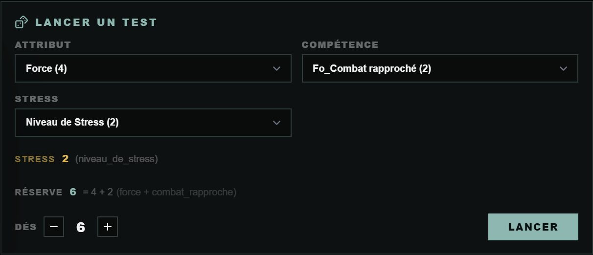
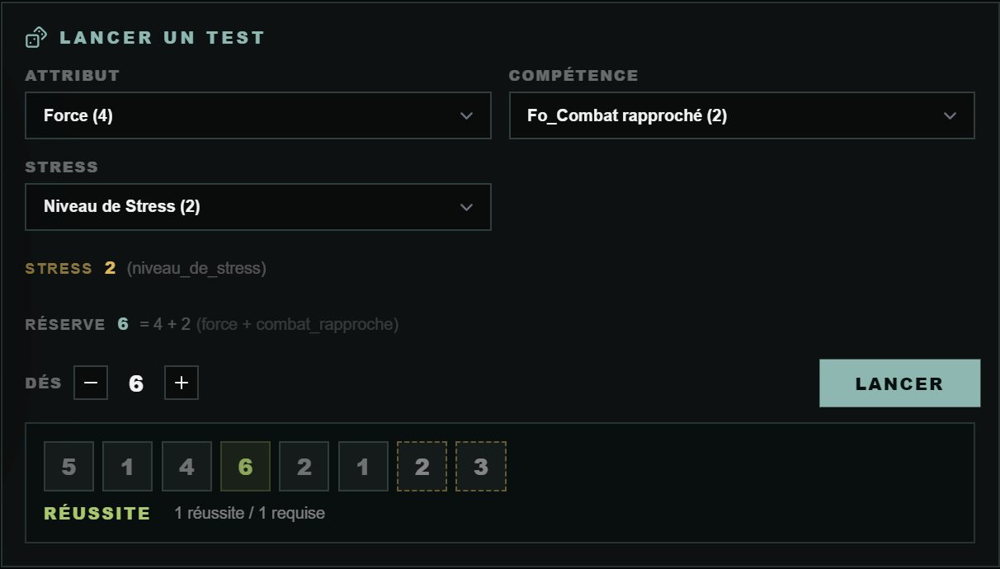

# 👽 Jeu — Alien

> **Pilote décrit :** « ALIEN, le jeu de rôle », exporté le 2026-10-13. Retour à [Les jeux et leurs mécaniques](./53-Les-jeux-et-leurs-mecaniques.md).

Le moteur Year Zero : une réserve de d6, et des **dés de Stress** qui font monter la peur.

---

## Le jet — la réserve et le Stress

- On retient un **Attribut** et une **Compétence** : leur somme donne les dés (jusqu'à 10).
- On retient aussi le **Niveau de Stress** : autant de **dés de Stress** se lancent avec les autres,
  **comptés à part**.
- Chaque **6** est une réussite.
- **Un 1 sur un dé de Stress déclenche la Panique.** Le panneau l'**annonce** et désigne le dé ;
  c'est à vous d'ouvrir la table de Panique.

---

## Combat et santé

- **Initiative :** des **cartes numérotées de 1 à 10**, une par combattant, dans l'ordre croissant.
- **Santé :** points de vie, dont le **maximum se lit sur la Force**.
- **Ressources suivies :** Niveau de Stress, Points de Récit, Air, Eau, Nourriture, Énergie.

---

## La fiche HTML

La fiche d'Alien se relie à son personnage GM-OS (« Fiche du jeu »). Les pistes en cases (Stress,
Santé, Radiation, Expérience, Points de Récit) se comptent, et les dix lignes d'équipement forment
l'inventaire. Voir [Fiche de personnage HTML](./63-Fiche-de-personnage-HTML.md).
