# 👽 Jeu — Alien

> **Pilote décrit :** « ALIEN, le jeu de rôle », exporté le 2026-10-20, corrigé A8 le 2026-10-22 (version 1.8.0, conserve A0–A7), puis complété le 2026-10-23 du **combat spatial** (version 1.9.0, `outils/alien/ajouter-combat-spatial.mjs`). Retour à [Les jeux et leurs mécaniques](./53-Les-jeux-et-leurs-mecaniques.md).

Le moteur Year Zero : une réserve de d6, et des **dés de Stress** qui font monter la peur.

**Ajout du 15/10/2026 — préparation des modules :** dans l’éditeur du pilote, **Modules du jeu**
permet de conserver ou retirer **MU/TH/UR 6000**, le **Détecteur de mouvement** et, depuis le 23/10, le **Combat spatial**. Un ancien pilote
Alien les propose par défaut, même avec un identifiant personnalisé. Le choix est sauvegardé et
exportable. Le cockpit possède aussi l’entrée **Modules du jeu** pour préparer et ouvrir ces outils.

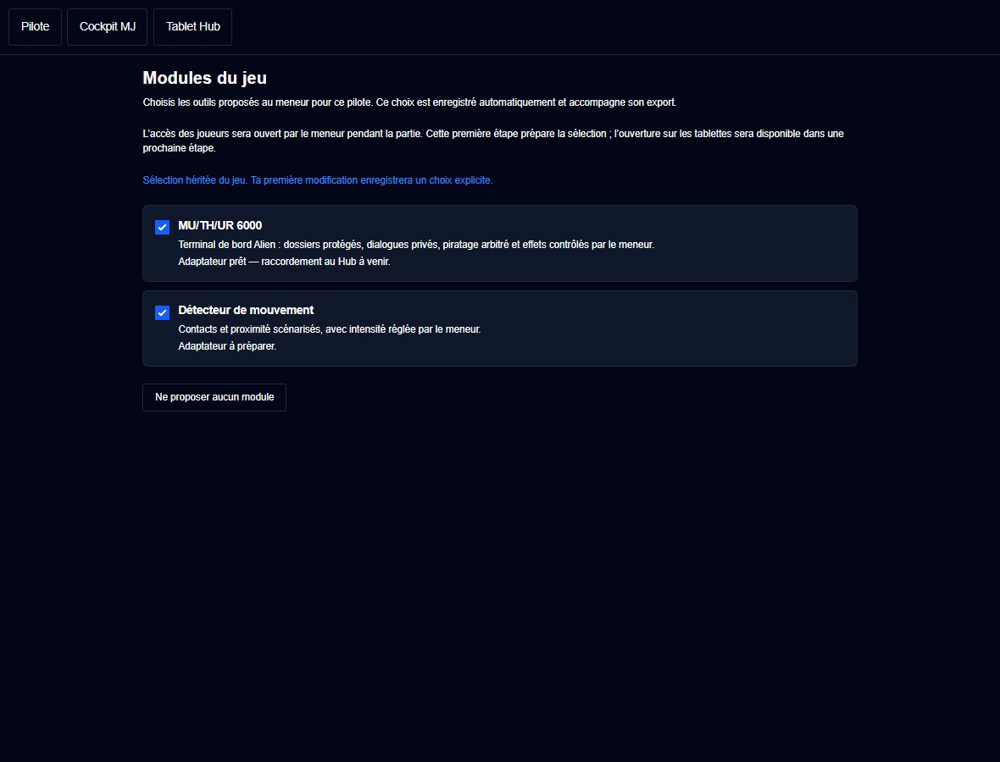

Les captures de cette section montrent les composants et le moteur réels dans un banc hors ligne,
avec données fictives. MU/TH/UR et le détecteur sont raccordés au Hub, avec des accès indépendants.

### Préparer et ouvrir MU/TH/UR

1. Ouvre **Cockpit › Modules du jeu › Ouvrir le pupitre**.
2. Prépare les **Dossiers**, **Protocoles** et **Réglages**. Les modifications sont enregistrées
   automatiquement ; une erreur d’écriture est signalée et garde les données précédentes.
3. Démarre une séance et coche les PJ dans **Accès des personnages**. Chaque joueur ouvre
   **Tablet Hub › Modules du jeu › Ouvrir MU/TH/UR 6000**, avec son personnage habituel.
4. Choisis un opérateur dans le pupitre pour répondre à ses questions ou arbitrer ses piratages.
   Ses réponses et ses dossiers déverrouillés restent privés.

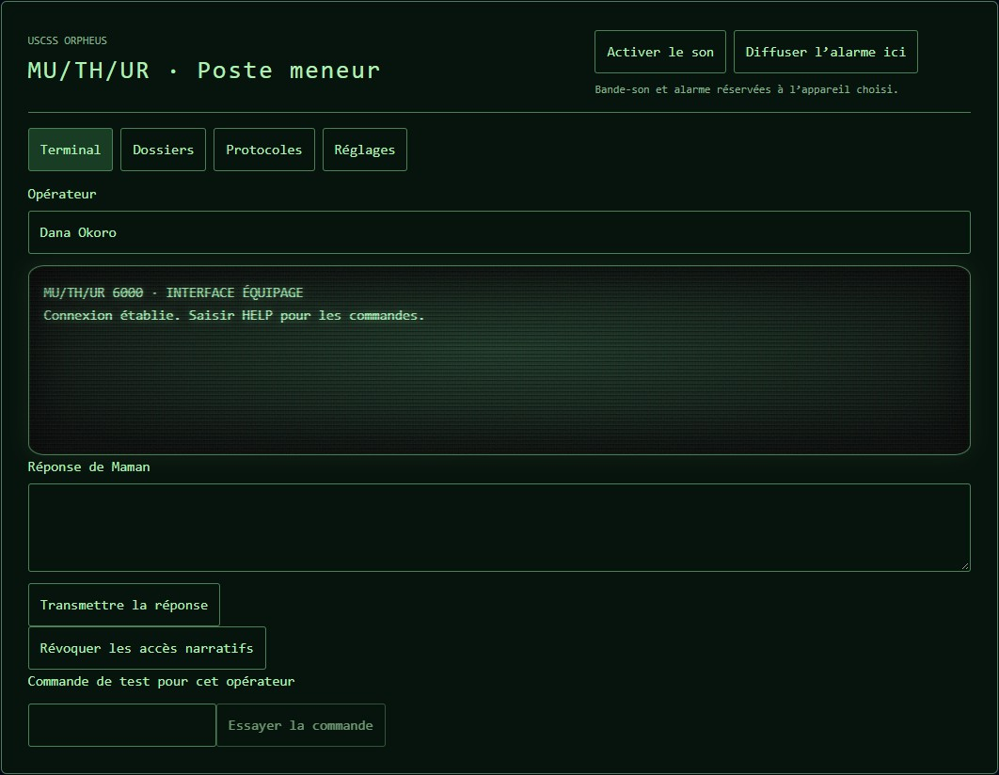

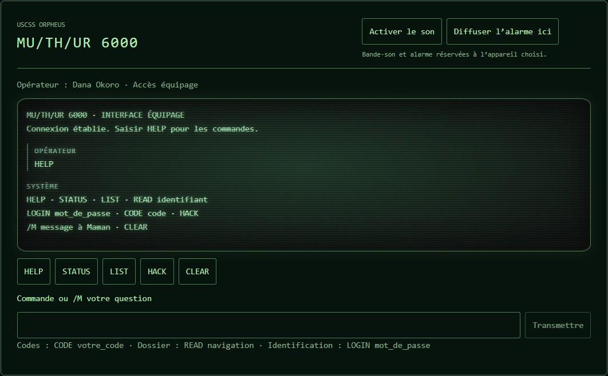

### Ranger les dossiers et traiter plusieurs demandes

Dans **Dossiers**, sélectionne un dossier puis **Monter le dossier** ou **Descendre le dossier**.
Cet ordre devient celui de la commande **LIST**. Pour supprimer, coche **Confirmer la suppression
du dossier**, puis **Supprimer le dossier**. Ses déverrouillages sont retirés ; les textes déjà
lus restent dans les dialogues. **Nouveau dossier…** permet d’en créer un autre.

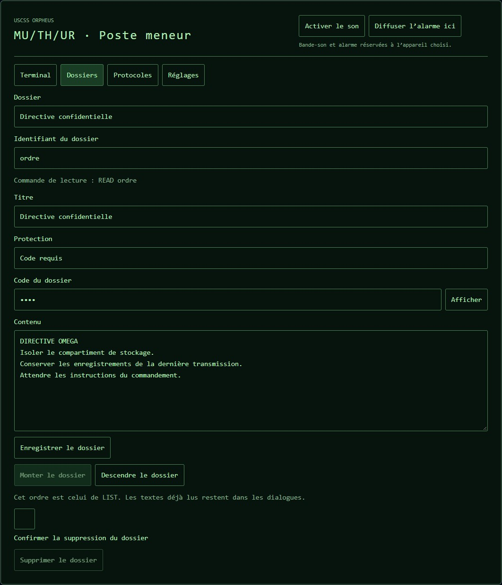

Dans **Terminal**, choisis l’opérateur puis la **Demande à traiter**. Chaque `/M question`
rejoint sa file privée ; plusieurs questions et un piratage peuvent attendre ensemble. Sélectionne
une question pour lui répondre ou le piratage pour l’autoriser/le repousser. **Message libre à cet
opérateur** transmet un message sans traiter de question. **Demandes traitées** garde le texte,
la réponse et le résultat. La révocation annule les demandes encore en attente.

La file accepte 32 demandes en attente par personnage et garde jusqu’à 128 demandes avec leur
historique. **CLEAR** nettoie le journal du joueur sans effacer les demandes. Les demandes sont
conservées à la reprise d’une campagne ; les autres personnages ne les reçoivent pas.

**HACK** brouille fortement le terminal pendant **cinq secondes dès son lancement**, puis
revient à l’affichage habituel en attendant le MJ. Une répétition pendant l’attente ne
prolonge pas le brouillage. Ce départ ne donne aucun privilège ; seul l’arbitrage du MJ
accorde ou refuse l’intrusion. Les réglages CRT/parasites et mouvements réduits s’appliquent.
Avec les mouvements réduits, le départ reste visible sous forme de parasites fixes
et de couleurs décalées, sans animation ni clignotement. Pour le brouillage animé,
activer **Parasites visuels** dans les réglages de MU/TH/UR et autoriser les animations
sur l’appareil. Le Hub calcule la durée depuis l’heure du PC MJ, même si la tablette
affiche une autre heure ; rouvrir le module ne relance pas un signal expiré.
Sur tablette et écran tactile, la trame CRT est plus large et le grain des parasites
plus contrasté, y compris en mouvements réduits où il reste fixe. Le refus de HACK
conserve son effet atténué pour laisser lire la réponse.

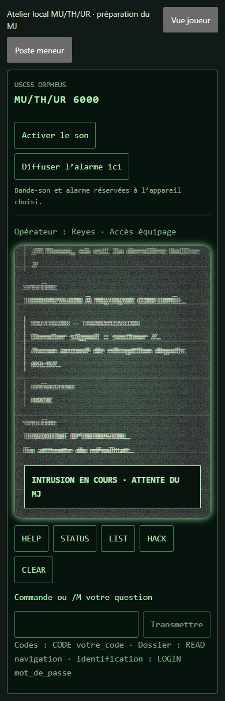

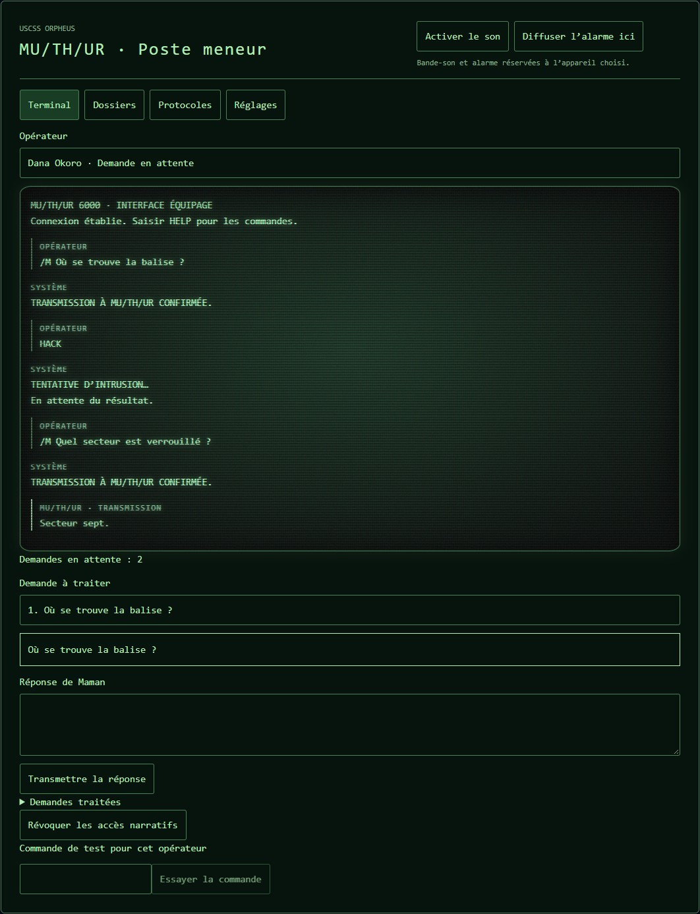

### Alerte et diffusion sonore

Les protocoles associent des codes exacts à un message et, éventuellement, à l’ouverture/fermeture
des portes fictives ou à l’autodestruction. Le code d’exemple **OMEGA-10** déclenche le film entier
du Nostromo : le compte à rebours dure au moins **12 min 56 s**. **OMEGA-STOP** annule la séquence.
Les codes se modifient dans **Protocoles**.

Dans la carte du module, **Son : nom de l’appareil** réserve la diffusion à une seule tablette
connectée et autorisée, ou à **Ce poste MJ**. Sur cet appareil, touche aussi **Activer le son**.
Les autres écrans restent muets. La bande-son du film a priorité ; si l’alerte continue ensuite,
la sirène et les annonces reprennent. La lecture automatique bloquée propose **Reprendre la vidéo**.

### Préparer et ouvrir le détecteur

1. Dans **Cockpit › Modules du jeu**, ouvre le pupitre de **Détecteur de mouvement**.
2. Prépare **Contacts** (0–9), **Proximité** (0 loin, 100 près), **Intensité**, **Volume des bips**
   et **Parasites**, puis **Enregistrer les réglages**. CRT et parasites se désactivent séparément.
3. Pendant une séance, coche ses destinataires, indépendamment des accès à MU/TH/UR.
   Autoriser l’instrument le laisse en veille ; **Démarrer le scan** le met en activité.
4. Chaque activation tire les positions au hasard dans la proximité choisie, identiques sur
   les appareils autorisés. **Faux écho · 9 s** ajoute un contact temporaire sans déplacer les autres.
5. Le joueur ouvre sa carte dans le Hub et touche **Activer les bips ici** s’il souhaite les entendre.
   Les bips sont locaux ; ils ne suivent pas le choix du diffuseur d’alarme MU/TH/UR.

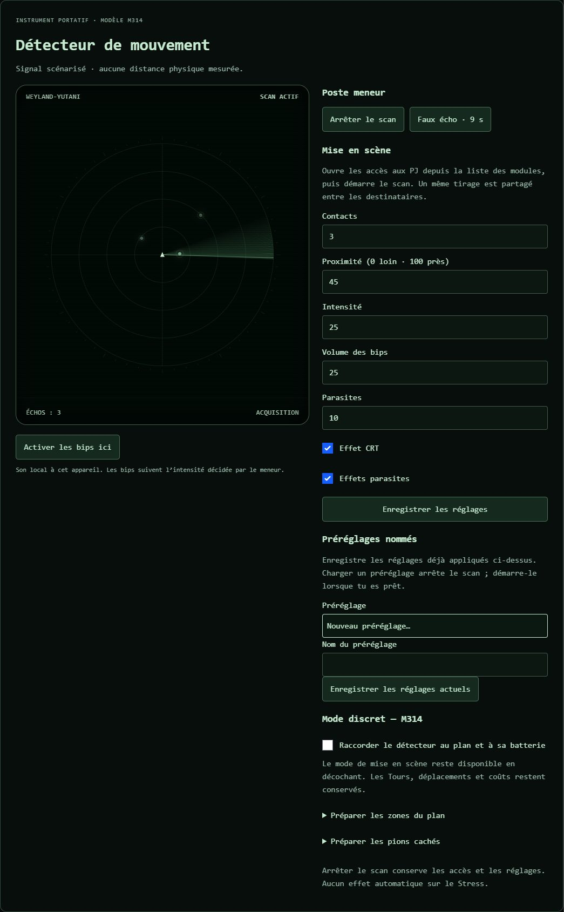

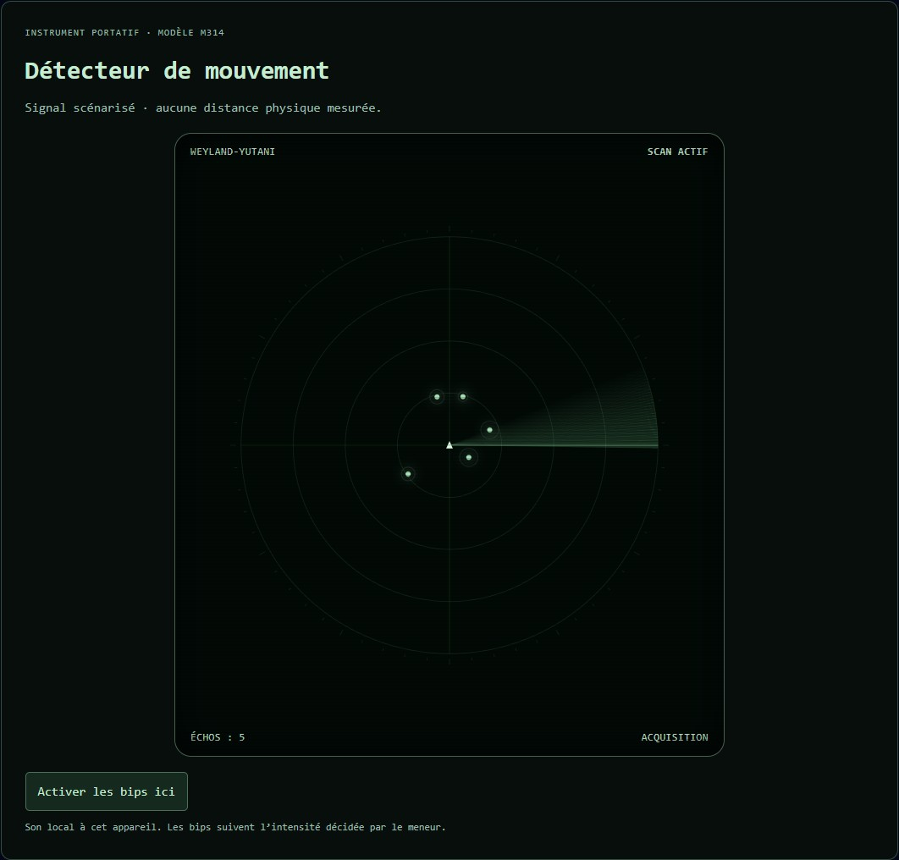

Pour préparer plusieurs ambiances, applique d’abord les réglages avec **Enregistrer les réglages**,
puis garde-les sous un nom dans **Préréglages** : depuis le 23/10, un préréglage garde aussi le plan
du mode discret. Son rappel remet le détecteur en veille, sans faux écho ; lance le scan au moment
voulu. Voir [Préréglages et remise à zéro](#préréglages-et-remise-à-zéro--23102026).

**Arrêter le scan** garde les accès et les réglages. Retirer un PJ ferme uniquement son instrument,
sans interrompre celui des autres ; le dernier retrait arrête le scan. Le détecteur est un
accessoire de mise en scène : aucune distance réelle mesurée, aucun jet ou Stress automatique.
Les mouvements réduits gardent le radar fixe. Un onglet masqué coupe ses bips.

### Fermer et reprendre

Décocher un PJ ferme son module et ses effets locaux. **Fermer tous les accès et couper les effets**
arrête aussi les effets de cet instrument. **Tout couper**, en haut de la page, ferme les deux
modules et arrête radar, faux écho et compte à rebours. La fin de séance, un changement de campagne et le redémarrage
ferment les accès et arrêtent les effets ; la préparation et les dialogues sont conservés.
Une reconnexion pendant la même séance retrouve les droits toujours ouverts, après vérification
de l’identité de l’appareil. Les commandes interrompues ne sont jamais rejouées automatiquement.
Après retour dans le détecteur, les bips nécessitent un nouveau clic local. Une coupure reste
effective en mémoire si le disque échoue ; l’erreur est signalée au MJ.

### Mode discret et batterie du M314 — A8

Dans le pupitre du détecteur, déplie **Préparer les zones du plan**, puis **Préparer les
pions cachés**. Donne un nom et des positions en mètres à chaque zone ; relie les passages
adjacents et franchissables. Ce plan schématique reste au MJ. Place les humains, créatures
et objets mobiles ; les noms et positions des pions ne sont jamais diffusés aux joueurs.

Coche **Raccorder le détecteur au plan et à sa batterie**. Confirme le **Porteur du M314**,
le terrain et sa réserve propre d'Énergie : **5 à pleine charge**. Cette batterie appartient
à cet appareil, indépendamment de la réserve d'un autre équipement suivi sur la fiche.
Décocher revient à la mise en scène habituelle, en conservant le suivi discret.

Pendant un Tour, déplace d'abord les PJ puis les ennemis en secret. **Déplacer d'une zone**
utilise un passage préparé et dépense un pas : **deux zones au maximum pour un humain**,
limite de l'espèce confirmée par Maman pour une créature. **Examiner pendant ce Tour** exige
de rester sur place pendant tout le Tour. Un déplacement rend le pion mobile ; pour un
objet bougeant sur place, confirme **En mouvement actuellement** dans sa préparation.
Décoche cette case si Maman décide qu'il s'immobilise avant le scan. **Objet de bonne taille
détectable** écarte les mouvements trop petits pour l'appareil.

**Scanner ce Tour et tester l'Énergie** ne s'utilise qu'une fois par Tour. Le M314 repère
les objets en mouvement jusqu'à **quatre zones et 100 m en intérieur ou terrain obstrué**,
ou **1 km en terrain découvert**. Le joueur reçoit les zones repérées et leurs échos,
sans nom, nature ni emplacement des pions immobiles. **Un écho n'accorde aucune ligne de vue** :
Maman arbitre l'Observation, les embuscades et le passage au combat.

Après chaque utilisation, le suivi lance la réserve d'Énergie, **six dés au maximum** :
chaque 1 retire un point, sans Stress ni Panique. Le scan qui épuise la dernière charge reste
consultable ; une batterie vide interdit le suivant. Fermer, rouvrir, changer de mode ou se
reconnecter ne permet pas de rescanner ou de repayer dans le même Tour.

**Valider le Tour suivant** remet les déplacements à disposition et efface les mouvements
du Tour précédent ; le scan attend une nouvelle utilisation. Ce compteur mesure l'exploration :
dans **Survie Alien**, valide aussi le Tour réellement écoulé pour les réserves et privations
concernées. Le temps réel et les alarmes n'avancent jamais ces compteurs.

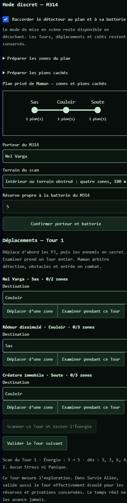

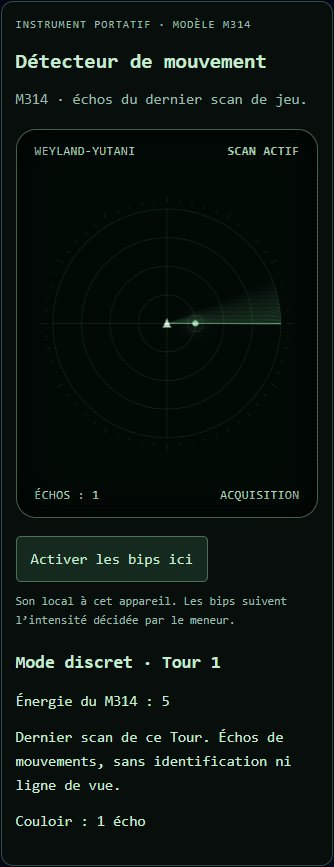

Le détecteur est aussi vérifié à [768 px](captures/jeu-alien-a8-detecteur-768.jpg) et
[1 180 px](captures/jeu-alien-a8-detecteur-1180.jpg).

### Préparer les dossiers et objectifs d'un acte — A8

Dans le pupitre **MU/TH/UR**, ouvre **Actes**. Renseigne un **Scénario (nom unique)** et
l'acte 1, 2 ou 3 ; **Préparation existante** retrouve les brouillons à la reprise.
Un dossier préparé reste invisible, même aux opérateurs administrateurs, jusqu'à
**Publier ce dossier dans MU/TH/UR**. Après publication, il suit les accès **Équipage**,
**Code** ou **Administrateur** choisis ; les modifications se font dans l'onglet **Dossiers**.
Changer d'acte ne retire pas ce qui a déjà été publié ou lu.

**Identifiant pour READ** donne un nom de lecture court au dossier, par exemple
`rapport-quarantaine` : lettres minuscules sans accent, chiffres et tirets.

Prépare l'**Objectif secret (MJ uniquement)** de son destinataire, puis **Remettre dans le
terminal privé**. Il apparaît dans le fil MU/TH/UR de cet opérateur seulement et revient
à sa reconnexion. La remise se conserve et ne se répète pas pour le même scénario, acte
et personnage. Elle ne traite pas une question de l'opérateur qui attend encore une réponse.

Les autres actes et objectifs restent privés. Piratages et protocoles ne publient pas
automatiquement ces brouillons ; Maman décide des révélations. Pour lire un dossier autorisé,
l'opérateur utilise **LIST**, puis **READ identifiant** ; un dossier protégé exige d'abord
**CODE son_code**. Les gains de Récit restent dans **Cinéma et Campagne Alien** (A7).
Choisis le canal de remise d'un objectif pour éviter de l'envoyer aussi par la messagerie A7.

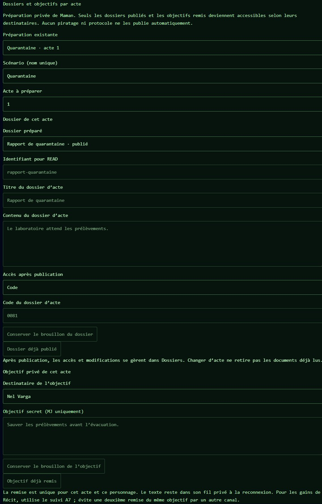

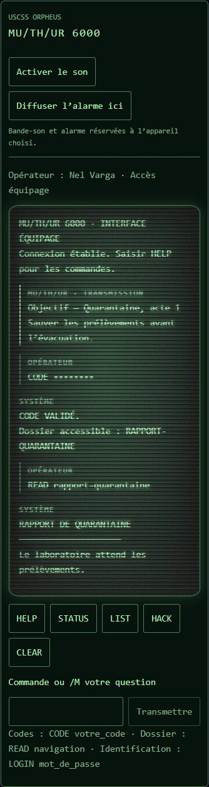

### Le combat spatial — 23/10/2026

Le module **Combat spatial** mène un affrontement entre vaisseaux (livre p. 188-201). Il
s'ajoute à MU/TH/UR et au détecteur dans **Modules du jeu** (pilote 1.9.0), avec ses propres
accès. Les dés roulent au poste de Maman ; la tablette déclare, règle ses dés et force son jet.

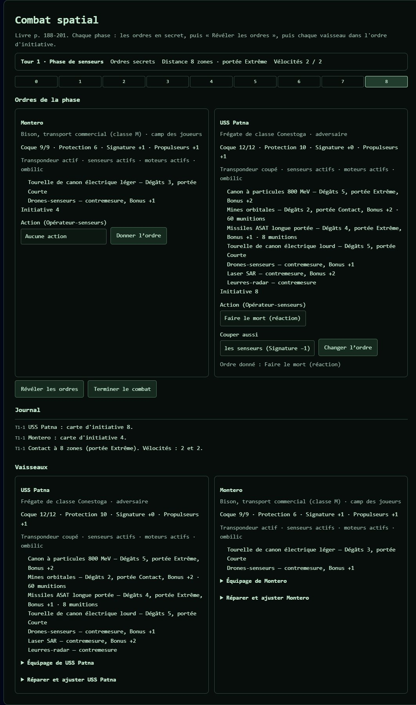

**Préparer.** Dans le pupitre, **Préparer un vaisseau** : un **modèle du livre** (Starcub,
Corvus, Bison cargo, remorqueur ou transport, frégate Conestoga) remplit Signature, Propulseurs,
Coque, Protection et armement, ou **Vaisseau libre**. Choisis le **camp** (joueurs ou adversaire),
le **transpondeur** (un vaisseau militaire le coupe) et l'**ombilic**. Puis, dans **Équipage**,
chaque poste — capitaine, opérateur-senseurs, pilote, artilleur, ingénieur — reçoit un
personnage de la séance ou reste à un PNJ (ou à MU/TH/UR), avec ses **dés de base**
(attribut + compétence : COMTECH, PILOTAGE, COMBAT À DISTANCE, MACHINES LOURDES), son
**Stress** et son talent : Commandant (deux cartes d'initiative), Artilleur (+2 au tir),
Mécano (+2 aux réparations).

**Engager.** Coche les vaisseaux, la **distance** (huit zones : la portée des senseurs) et les
**vélocités** (souvent deux zones par Tour, p. 189), puis **Démarrer le combat** : chaque
capitaine tire sa carte d'initiative. Coche aussi les PJ dans les accès du module.

**Un Tour, quatre phases** : senseurs, pilote (puis le déplacement), artilleur, ingénieur.

1. **Les ordres, en secret.** Chaque vaisseau reçoit l'ordre de la phase. Côté joueurs, le PJ
   qui tient le poste de la phase — ou le capitaine — le donne depuis sa tablette ; Maman donne
   ceux de l'adversaire. Les joueurs ne voient pas les ordres adverses.
2. **Révéler les ordres**, puis **Résoudre** chaque vaisseau dans l'ordre d'initiative. Le PJ du
   poste peut résoudre lui-même. Le jet d'un PJ attend : **Forcer le jet (Stress +1)** ou
   **Valider le jet**. Un 1 sur un dé de stress déclenche la **Panique spatiale** (D6 + Stress,
   table p. 201) ; il n'y a pas de forçage alors.
3. **Phase suivante** ; après la phase de pilote, les vaisseaux se déplacent ; après l'ingénieur,
   **Tour suivant**.

| Phase | Actions | Ce que le module calcule |
| --- | --- | --- |
| Senseurs | Verrouillage, Faire le mort, Rallumer les senseurs | COMTECH avec la portée et la Signature de la cible ; verrouillé, il le reste les Tours suivants sans jet, sauf s'il fait le mort ; faire le mort annule des succès et peut couper senseurs (−1) et moteurs (−2) |
| Pilote | Accélération, Décélération, Évasion, Éperonnage, Amarrage | PILOTAGE avec les Propulseurs ; l'évasion échange les cartes d'initiative et ses succès annulent ceux des tirs du Tour ; éperonnage et amarrage au contact seulement |
| Artilleur | Tir offensif, Contremesures | Cible verrouillée ou à transpondeur actif, portée de l'arme ; dégâts de l'arme + succès au-delà du premier ; Protection en dés (moitié contre un canon électrique) ; munitions décomptées |
| Ingénieur | Réparations d'urgence, Rallumer les moteurs, Ouverture du sas, Surcharge | Une avarie se répare test par test, pour un Quart ; la surcharge détruit le vaisseau à la fin du Tour suivant |

**Dégâts et avaries** (p. 197-199). Les dégâts vont sur la **coque** ; à la Coque atteinte, le
vaisseau est **Hors service** ; une seule attaque qui l'égale le **détruit**. Chaque attaque qui
porte cause une **avarie mineure** (D66), **majeure** (2D6) à la moitié de la Coque. Leurs effets
mécaniques s'appliquent : arme à −2 ou hors d'usage, instruments −1, senseurs −2 ou en panne,
Propulseurs −2, transpondeur coupé, plus de pilotage. Une avarie sans objet pour ce vaisseau se
**relance**. La ligne 55 vient de l'errata 2021 : unité de réfrigération endommagée.

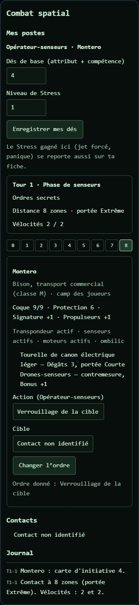

**Sur la tablette**, le PJ voit son vaisseau en entier, ses postes et ses dés, l'état du combat
et le journal. L'adversaire reste un **contact non identifié** tant que son transpondeur est coupé
et qu'aucun vaisseau des joueurs ne l'a verrouillé ; ni son équipage ni ses jets ne sont
transmis. Le **Stress** gagné en forçant ou en paniquant se reporte sur la fiche : le module
tient sa copie pour le combat.

**Après le combat**, **Terminer le combat** : les réparations d'urgence redeviennent des
avaries (elles ne tenaient qu'un Quart). Dans **Réparer et ajuster**, note la coque réparée
(un test de MACHINES LOURDES par Quart, chaque 6 répare un point) et marque une avarie **réparée**
(un test par ligne de la table, une pièce de rechange chacun, p. 200).

> Points tranchés, faute d'accord du livre avec lui-même : l'avarie mineure dès un point de
> dégâts (la table, contre le texte) ; les contremesures contre une attaque de portée Courte ou
> plus ; l'amarrage aux vélocités égales des deux camps. Les réactions et oppositions ne se
> forcent pas. Le corps à corps à bord se joue à part, en Rounds (p. 197).

### Préréglages et remise à zéro — 23/10/2026

Les trois modules ont le même panneau **Préréglages**, suivi de **Remise à zéro** : dans l'onglet
**Réglages** de MU/TH/UR, et au bas des pupitres du détecteur et du combat spatial. Un
préréglage garde **toute la préparation** sous un nom ; la remise à zéro remet le module à neuf
**sans toucher aux préréglages** ni aux accès des PJ.

| Module | Le préréglage garde | Le rappel | La remise à zéro efface |
| --- | --- | --- | --- |
| MU/TH/UR | Réglages, dossiers et codes, protocoles, actes (dossiers publiés, objectifs à remettre) | Remet le terminal à neuf puis pose la préparation ; les opérateurs restent, sans dialogues ni déverrouillages | Dossiers, codes, protocoles, actes, dialogues et accès ; les opérateurs restent |
| Détecteur | Réglages de mise en scène, effets visuels, plan du mode discret (zones, pions et leur place, porteur, batterie) | Arrête le scan et repart au Tour 1, sans pas dépensés ni scan | Réglages, plan, pions et Tours ; le scan s'arrête |
| Combat spatial | Vaisseaux et équipages : modèle, armes, munitions, coque, avaries, postes | Remplace les vaisseaux ; il attend la fin du combat | Tous les vaisseaux et le combat en cours |

1. Prépare le module comme pour une séance.
2. Dans **Préréglages**, garde **Nouveau préréglage…**, donne un nom, puis **Enregistrer la
   préparation actuelle**. Choisir un nom puis enregistrer **remplace** ce préréglage.
3. Pour rappeler, choisis le nom, coche **Confirmer le remplacement de la préparation actuelle**,
   puis **Rappeler ce préréglage**. La suppression a sa propre case de confirmation.
4. Pour repartir de zéro, coche **Confirmer la réinitialisation**, puis **Réinitialiser…**.

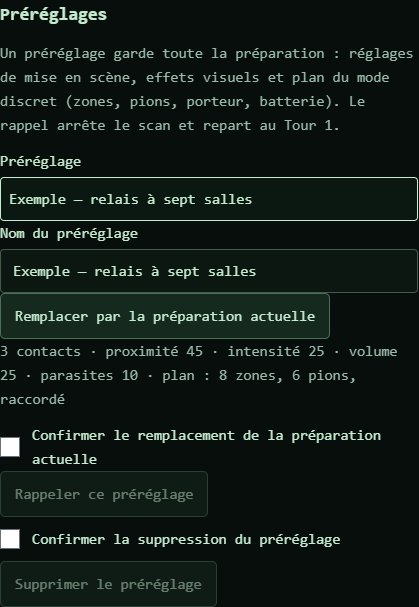

Le détecteur arrive avec **Exemple — relais à sept salles** : un plan intérieur raccordé, Rye
porteur du M314, une batterie à 5. Il montre les cas du mode discret en trois Tours :

| Tour | Ce que fait Maman | Ce que voit la tablette |
| --- | --- | --- |
| 1 | Xénomorphe : Laboratoire → Coursive B → Gaine technique ; **Scanner** | **Gaine technique : 1 écho**. La vermine (non détectable) ne compte pas ; le chien du hangar, à 125 m et cinq zones, est hors de portée |
| 2 | Davis : Sas → Coursive A ; **Examiner** pour le xénomorphe ; **Scanner** | **Coursive A : 1 écho** : c'est Davis, le M314 n'identifie personne ; la créature immobile disparaît |
| 3 | Xénomorphe : Gaine → Coursive A → Mess ; **Scanner** | **Mess : 1 écho** : la créature est passée derrière Davis |

Le synthétique immobile de l'infirmerie ne paraît jamais. Les trois zones par Tour de la créature
sont un choix de l'exemple : ajuste-les à sa fiche. Supprimé, l'exemple ne revient pas.

Jusqu'à 32 préréglages par module et par campagne. Ils restent au poste du MJ, dans le fichier
privé des modules, les sauvegardes et les exports de campagne ; aucune tablette ne les reçoit.
Les préréglages du détecteur faits avant le 23/10 ne gardent que les réglages de mise en scène :
leur rappel laisse le plan en place.

Les données privées sont stockées à part des campagnes diffusées aux tablettes. Les sauvegardes
complètes et exports de campagne incluent les dossiers, codes et dialogues ; un export de pilote
contient seulement les références aux modules. Les réglages du détecteur sont aussi conservés,
mais la reprise et l’import laissent le scan arrêté et ses accès fermés.
Le vrai transport HTTP/WebSocket est aussi éprouvé entre une instance Electron jetable
et deux sessions Edge isolées sur le même PC : huit parcours couvrent confidentialité,
droits, scan, déconnexion/reprise, vidéo et redémarrage/import, avec les dossiers, la file
de demandes et les préréglages. Le relais sonore après le film est aussi éprouvé avec une
horloge avancée et une voix simulée. Le décodage et le graphe
audio sont réels, avec sortie muette vers les enceintes. L’essai sur les tablettes,
leur Wi-Fi, le clavier virtuel et les haut-parleurs physiques reste à faire.

Pour cette dernière vérification, la [fiche de recette sur les appareils de David](../Planning/2026-10-16-recette-materielle-alien.md)
prévoit deux tours : iPad avec tablette Samsung, puis iPad Air avec smartphone. Elle détaille
le clavier virtuel, la rotation, les coupures Wi-Fi, la veille et le transfert du son. L’alerte
de quinze minutes permet d’écouter le film entier puis la sirène et les annonces restantes.
Les résultats se relèvent par appareil et navigateur ; la disponibilité d’une voix française
locale se vérifie sur chaque appareil choisi pour la diffusion.

---

## Le jet — la réserve et le Stress

- On retient un **Attribut** et une **Compétence** : leur somme donne les dés. Le profil A2
  conserve les bonus d'arme, d'outil, d'aide et de situation au-delà de dix dés.
- On retient aussi le **Niveau de Stress** : autant de **dés de Stress** se lancent avec les autres,
  **comptés à part**.
- Chaque **6** est une réussite.
- **Un 1 sur un dé de Stress déclenche la Panique.** Le panneau l'**annonce**, désigne le dé, et
  propose **« Test de Panique »** : 1D6 + Niveau de Stress. Sur le poste du meneur, la ligne de la
  table `Alien/test_de_panique` s'affiche sous le résultat (au-delà de 15, c'est la Catatonie) ;
  sur la tablette, le total remonte au meneur, qui lit la ligne.
- **Déjà en panique ?** Le total de la panique en cours se garde sur la fiche (« Panique en cours »).
  Le profil français A1 suit la p. 104 : un nouveau résultat **inférieur** donne la ligne juste
  au-dessus de l'ancienne ; une égalité garde l'effet égal. Les anciens profils sans les suites
  A1 conservent leur ancien cumul. Quand l'effet cesse, les gestes du panneau remettent la
  panique à zéro ; « Calmé » sur la carte reste disponible.
- **« Dépenser un Point de Récit »**, après le lancer : un **6** s'ajoute au jet (cerclé de vert) et
  la fiche perd un point. Il reste sur la table si l'on force ensuite.
- **A1 :** avec un 1 de Stress, le résultat est **provisoire** jusqu'au test de Panique.
  À **10+**, l'action initiale est annulée, même avec des six ; le Point de Récit reste bloqué.
  Sous 10, le verdict du test reprend ses droits après application de l'effet.

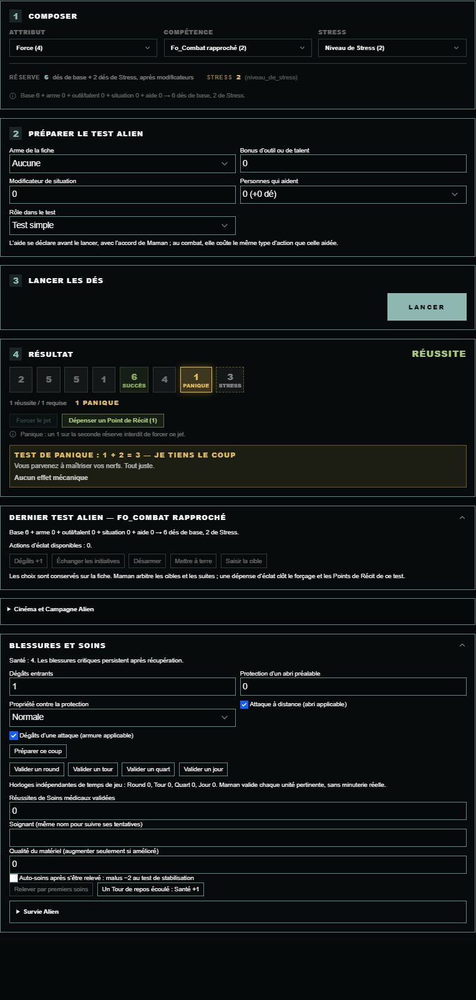

---

## Forcer le jet

Après le lancer, **« Forcer le jet »** :

- le **Niveau de Stress monte d'un point** sur la fiche, avant la relance, et le **nouveau dé de
  Stress** part avec elle ;
- les **6 restent** sur la table ; tout le reste se relance — les dés relancés sont **cerclés** ;
- **une fois par test**, ou **deux** avec le talent qui couvre l'attribut du jet (champ « Talent ») :
  Dépassement de soi et Cran (Force), Vif et Téméraire (Agilité), Ruse et Curiosité (Esprit),
  Compassion et Influence (Empathie). Le bouton se grise ensuite, et dit pourquoi.

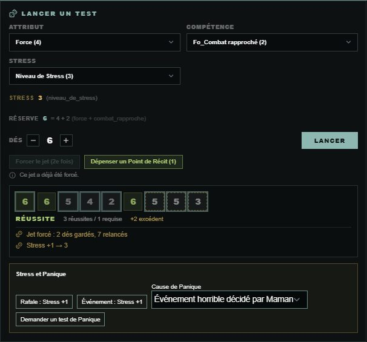

**Au pupitre** (et depuis la télécommande), « Forcer le jet » relance le dernier jet, ajoute le dé de
Stress et **annonce** « Stress +1 à reporter sur la fiche ».

**On ne force pas** après une Panique au premier lancer (le bouton le dit), ni avec un **androïde**
(case « Androïde » cochée sur la fiche). Une Panique sur la relance
se joue de même, avec le Stress déjà monté.

---

## Combat et santé

- **Initiative :** des **cartes numérotées de 1 à 10**, dans l'ordre croissant ; une par humain ou synthétique, une par point de Vitesse pour une créature xénomorphe.
- **Santé :** points de vie, dont le **maximum se lit sur la Force** pour les humains et synthétiques ; le maximum de l'espèce est confirmé pour un xénomorphe.
- L'export A0/A1 désigne explicitement **Santé** comme jauge principale : le combat suit la
  valeur courante de la fiche. Un coup qui fait effectivement perdre de la Santé ajoute
  **un** point de Stress, quel que soit le nombre de points perdus. Soins et dégâts nuls
  n'en ajoutent pas ; un androïde n'en reçoit pas. À zéro Santé, l'effet de Panique cesse.
- **Ressources suivies :** Niveau de Stress, Points de Récit, Air, Eau, Nourriture, Énergie.
- **Le Stress hors du jet**, sur la carte du combattant : − et +, puis **« Repos −1 »** (un Tour en
  lieu sûr). Depuis A7, le fétiche se joue dans **Cinéma et Campagne Alien**, avec suivi de l'usage.

---

## Stress et Panique — suivi A1

Dans l'onglet **Lancer un test** de la fiche, la carte **Stress et Panique**
conserve l'effet et son rappel. Les variations personnelles de Stress des résultats 7, 9–13
s'appliquent une seule fois. Tremblement retire deux dés aux tests d'Agilité, d'abord sur
la base puis sur le Stress. Nerfs d'acier réduit le test de Panique de deux. Avec Folie
meurtrière, la case **Ennemis en vue** permet de remplacer un résultat 11+.

Au poste MJ :

1. **Rafale : Stress +1** et **Événement : Stress +1** couvrent les situations résolues à la
   table. Avec A3, le mode automatique du panneau de tir ajoute déjà ce Stress : ne pas
   utiliser aussi le bouton de rafale. Ne pas ajouter un second Stress pour les dégâts
   déjà traités par le suivi de santé.
2. Choisir la cause puis **Demander un test de Panique** déclenche la procédure hors jet de
   compétence : blessure critique, tir qui cloue, créature inconnue, témoin ou horreur.
   La demande reste sur la fiche jusqu'à sa résolution, y compris sur tablette.
3. Pour une contagion, sélectionner les seuls PJ concernés selon le critère affiché
   (Courte portée, audition ou visibilité), puis **Appliquer la contagion**. Le geste clôt
   cette sélection ; **Aucun autre personnage concerné** permet de l'écarter. Les autres
   campagnes et les androïdes ne sont pas proposés. Chaque cible reçoit Stress +1 ou une
   demande de Panique, selon l'effet ; une reprise ne le lui inflige pas une seconde fois.
4. Résoudre à la table la perte d'action, l'objet lâché, la fuite ou le choix de cible.
   **Effet immédiat résolu**, **Round et action résolus**, **Commandement réussi**,
   **Tour écoulé** ou **Brisé** terminent l'effet selon sa durée. Cela ne récupère pas
   automatiquement du Stress. Les budgets d'actions ne sont pas décomptés par ce panneau.
5. Après 13+, le rappel de **fin de séance** persiste même une fois calmé. **Bilan de séance :
   tester l'Empathie** lance l'attribut seul, sans Stress ni compétence. Une réussite donne
   un traumatisme dans la table existante ; le bilan et le traumatisme sont conservés.
   À la clôture de la séance, une notification rappelle les personnages dont le bilan reste
   à résoudre, même si le journal n'enregistrait pas.

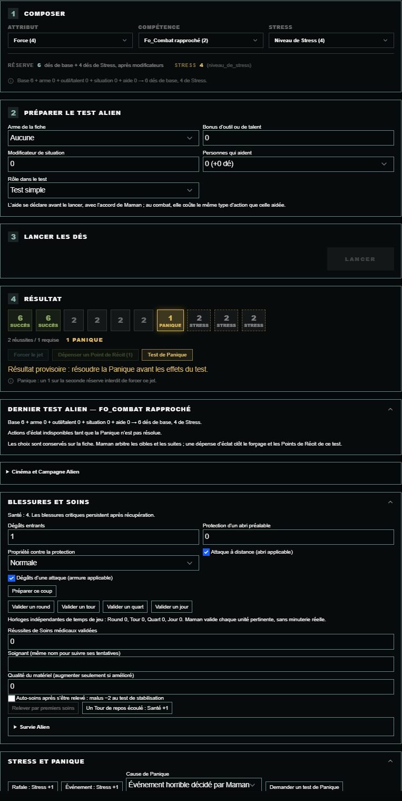

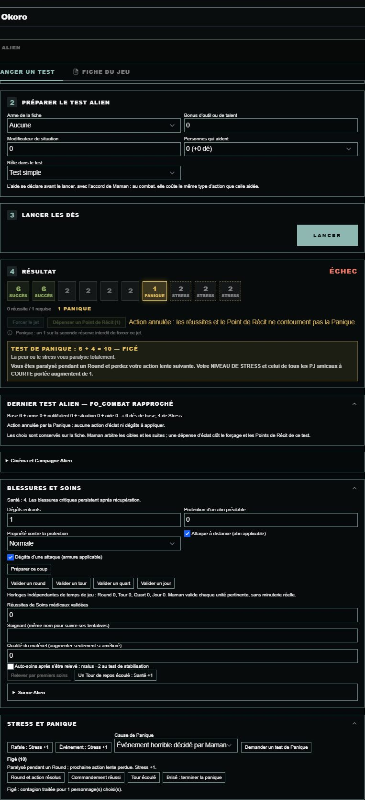

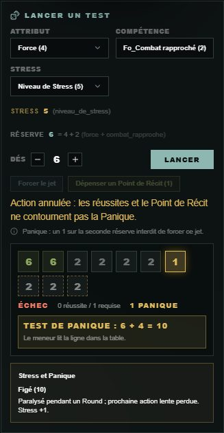

La tablette affiche l'effet, les demandes et les traumatismes de son personnage. Maman
conserve le choix des cibles de contagion, des fins d'effets et du moment du bilan de séance.
Les durées sont validées par ces gestes, pas par un minuteur caché. Le combat spatial garde
sa table distincte ; le profil A1 livré ici concerne la table du livre de base p. 105.

Importer **`Export Dirvers/corriges/Alien_driver_gmos_a0_a1.gmos-driver`** pour activer ce
suivi sur le pilote de David. Ses identifiants et les quarante clés GM-OS sont conservés ;
la fiche HTML reste inchangée. La saisie numérique de Stress n'est plus plafonnée à dix,
même si la piste imprimée de la fiche ne comporte que dix cases.

---

## Jets, équipement et actions d'éclat — A2

Dans la fiche, les **noms**, **bonus**, **dégâts** et **portées** des armes sont quatre
colonnes : une ligne par arme, dans le même ordre. Ces valeurs circulent aussi vers et
depuis la fiche HTML. L'ancien texte d'armes est conservé : répartir ses valeurs dans
les colonnes, sans perdre les notes existantes. Un bonus non numérique est signalé.

Avant de lancer, **Préparer le test Alien** permet de choisir l'arme puis de saisir le
bonus d'outil/talent, le modificateur de situation (positif ou négatif) et l'aide.
Maman valide leur pertinence. Chaque personne qui aide apporte +1, au plus trois,
déclarés avant le test ; au combat elle dépense le même type d'action que celle aidée.
Le détail du calcul est affiché. Un malus retire d'abord les dés de base puis, s'il
les dépasse, les dés de Stress : base 2, Stress 3 et malus −4 donnent zéro base et
un Stress. Sans aucun dé, le lancer se désactive et demande de changer de stratégie.

Pour un test opposé, choisir **Attaquant en opposition** ou **Défenseur en opposition**.
Le défenseur transmet les réussites de son propre lancer ; il ne peut pas forcer.
L'attaquant saisit ce nombre et touche **Résoudre l'opposition**. Les réussites de
défense annulent les siennes ; l'égalité est un échec pour l'attaquant. Une Panique
reste à résoudre avant cette procédure et une Panique 10+ annule toujours l'action.

Le **Dernier test Alien** propose les actions d'éclat de la compétence effectivement
lancée. Chaque choix dépense une réussite excédentaire ; **Dégâts +1** peut se répéter.
Le budget et les choix restent sur la fiche après reconnexion. Choisir un éclat clôt
le forçage et les Points de Récit de ce test. Maman choisit les cibles et applique les
suites (désarmement, déplacement, information, Panique d'une cible clouée…). Le panneau
prépare le total des dégâts avant protection ; leur application reste un geste séparé.
Commandement et Soins médicaux rappellent leurs usages propres de chaque réussite.

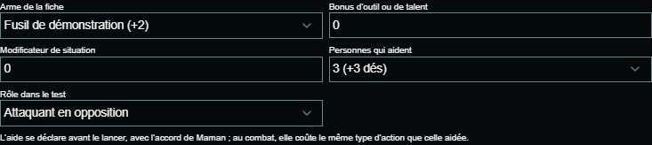

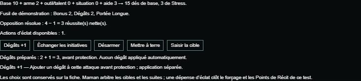

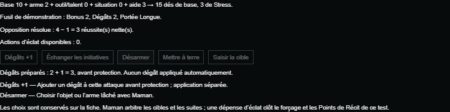

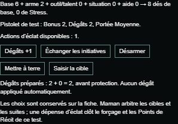

Importer **`Export Dirvers/corriges/Alien_driver_gmos_a2.gmos-driver`** pour activer A2.
Il conserve les identifiants et les quarante champs précédents et ajoute les trois
colonnes d'armes. A0/A1 restent inclus ; les profils précédents gardent leur comportement.

## Tir, protection, blessures et soins — A3

Importer **`Export Dirvers/corriges/Alien_driver_gmos_a3.gmos-driver`** pour activer A3 et
conserver A0–A2. Les identifiants et les 43 champs précédents restent identiques ; le nouveau
champ **Propriétés des armes** porte le total à 44. Il se renseigne dans GM-OS, une ligne
par arme dans le même ordre que les quatre colonnes existantes. Il n'ajoute pas une colonne
à la fiche HTML. Exemples de propriétés : **Munitions, mode auto, perce-armure** ;
**Tir unique** ; **Protection doublée**. Une arme sans la mention automatique ne permet
pas de sélectionner ce mode.

### Préparer le tir et les chargeurs

Dans **Préparer le test Alien**, choisir l'arme, la portée de la cible, sa taille et la
luminosité. Le calcul affiche les bonus et malus : viser +2, mode automatique +2,
Contact −3 (+3 si sans défense), Moyenne −1, Longue −2, Extrême −3 ; grande cible +2,
petite −2 ; pénombre −1, obscurité −2. Une portée supérieure à celle de l'arme bloque le tir.
Maman valide les circonstances et la dépense d'action ; A3 ne décompte pas le budget du round.

Pour une arme à munitions, confirmer d'abord son état chargé/vide et les **chargeurs pleins
de réserve**. Un 1 de Stress vide le chargeur **après la résolution du tir et de sa Panique**.
Le mode automatique ajoute un point de Stress avant de lancer ; les synthétiques n'en
reçoivent pas. Une arme à tir unique se vide après son utilisation. Il n'y a pas de décompte
balle par balle. **Recharger** consomme un chargeur plein : action lente, ou rapide avec
**Rechargement rapide**. Sans réserve ou avec une arme déjà chargée, le bouton reste bloqué.
La visée est retirée après le tir et doit être déclarée à nouveau pour le suivant.

Avec un tir automatique réussi, chaque réussite excédentaire peut acheter une cible
secondaire, à Courte portée de la première selon l'arbitrage de Maman. Choisir ensuite
la cible à laquelle attribuer les autres éclats. Le panneau affiche séparément leurs
dégâts préparés. Maman ouvre le suivi de santé de chaque victime pour appliquer ces dégâts.

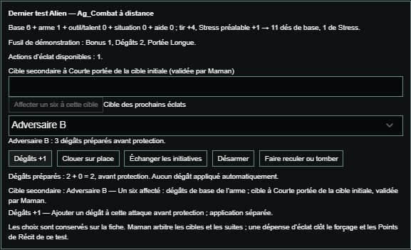

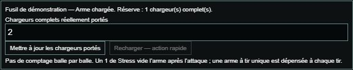

### Résoudre la protection et les dégâts

Au poste MJ, **Blessures et soins Alien** est disponible sur la fiche et sur la carte de
combat. Pour un PNJ, confirmer explicitement qu'il est humain pour activer ce suivi ;
les monstres ne deviennent pas humains par défaut. **Déclarer ce PNJ synthétique**
coche la case Androïde et active directement le suivi A4 décrit plus bas.

Saisir les **Dégâts entrants**, l'éventuel abri déjà occupé et la propriété de l'attaque,
puis **Préparer ce coup**. L'abri s'ajoute seulement à distance. Décocher **Dégâts d'une
attaque** pour un effet interne sans protection. **Lancer la Protection** jette les d6 :
chaque 6 absorbe un dégât ; perce-armure divise les dés par deux, arrondi supérieur ;
Protection doublée les double. Ce jet n'utilise ni Stress ni forçage.

**Appliquer les dégâts restants** retire une seule fois le résultat net de la Santé.
Un coup et son jet de protection restent conservés après reprise. Un coup préparé peut
être abandonné explicitement avant application. Les PJ humains gagnent un Stress par
coup dommageable ; les PNJ n'en gagnent pas. À zéro Santé, l'humain est **Brisé** et ne
peut plus lancer ses tests ordinaires : il n'est pas déclaré mort automatiquement.
Chaque nouveau coup dommageable reçu à zéro demande un nouveau critique.

### Critiques, Trépas et soins

**Tirer ce critique humain (D66)** tire deux d6 ordonnés et lit la table des blessures.
Le critique, son effet, sa durée de guérison et son échéance fatale restent sur la fiche,
même après récupération de Santé. Un critique déjà tiré ne se retire pas une seconde fois.
Les résultats 63–66 entraînent la mort immédiate. Les malus numériques de compétences
sont repris dans la préparation des tests. Les restrictions narratives et dégâts liés
à certains tests (notamment 32 et 45) sont affichés et restent à appliquer par Maman.

Les boutons **Valider un round/tour/quart/jour** avancent des compteurs indépendants de
temps de jeu. Valider seulement les unités pertinentes pour les blessures suivies :
ce ne sont ni une conversion automatique entre unités ni une liaison à Clock-OS.
Une échéance fatale atteinte propose le **Trépas**, sur Force + Endurance avec les malus
de blessure, sans Stress ni forçage. Un succès accorde le prochain sursis ; un échec tue.

Les soins partent d'un véritable test de **Soins médicaux** résolu à la table : reporter
ses réussites confirmées, le nom du soignant et la qualité de son matériel. Pour stabiliser,
appliquer au test le malus affiché et −2 en cas d'auto-soins après s'être relevé.

- **Relever par premiers soins** rend autant de Santé que de réussites. Cela ne stabilise
  pas la blessure fatale : les deux tests sont séparés et peuvent se faire dans les deux ordres.
- **Stabiliser** conserve la tentative de ce soignant, même ratée. Une nouvelle tentative
  du même soignant exige du meilleur matériel ; une réussite supprime les tests de Trépas.
- **Soins quotidiens réussis** divisent par deux la durée restante, une fois par jour de jeu.
  Le talent **Guérison rapide** divise déjà par deux la durée initialement tirée.
- **Soins de l'effet réussis** traite les cas particuliers 14, 15 et 56. Le résultat 56
  non traité devient permanent à la fin de sa durée.
- **Un Tour de repos écoulé : Santé +1** confirme un Tour réellement écoulé et rend un point,
  y compris pour se relever seul. Le même Tour ne peut pas être réutilisé. Les critiques restent.

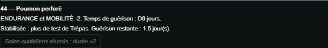

Sur tablette, le joueur retrouve son état et ses blessures. Les commandes de protection,
dégâts, temps et soins restent au poste MJ ; les résultats médicaux et circonstances
ne sont pas déduits automatiquement. Les armes, chargeurs et le dernier tir restent
conservés ; ne pas réordonner leurs lignes sans revérifier l'état des chargeurs associés.

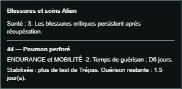

## Synthétiques — suivi A4

Cocher **Androïde** sur la fiche active les règles synthétiques du livre français,
p. 111. Une ancienne saisie de Stress reste conservée, mais **aucun dé de Stress**
n'est lancé. Le synthétique ne gagne ni Stress ni Panique, ne force pas et ne subit
pas les effets d'une ancienne panique humaine. Le tir automatique garde ses bonus
sans Stress ; un 1 ordinaire ne vide pas son chargeur. Les armes à tir unique
restent dépensées après utilisation.

À **zéro Santé**, le synthétique continue d'agir selon ses avaries. Il reste dans la
liste des combattants actifs. Chaque nouveau coup dommageable à zéro conserve une
demande de critique. **Tirer le prochain critique synthétique (D6)** traite les coups
dans leur ordre. Un résultat égal au **critique immédiatement précédent** augmente
d'un cran : 4 puis 4 donnent 4 puis 5. Le résultat et son effet restent conservés après
fermeture ou reconnexion ; un critique traité ne se retire pas une seconde fois.

La pompe à fluide fait perdre la prochaine action lente : **Confirmer l'action lente
perdue** acquitte cette conséquence. Les autres avaries rappellent les limites des
jambes, du bras, de la tête et du châssis. Maman applique ces restrictions aux actions
et aux équipements choisis ; le budget complet d'actions appartient au lot A6.
**Arrêt du système** bloque les tests ordinaires et retire le synthétique de la liste
des combattants actifs. Aucun critique humain ni test de Trépas n'est proposé.

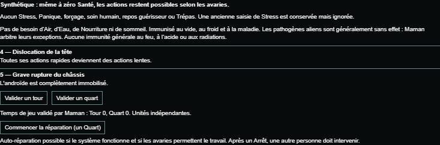

### Réparer ou réactiver

Les synthétiques ne guérissent pas par repos ou Soins médicaux. Dans leur suivi de santé :

1. Avec un système en fonctionnement, **Commencer la réparation (un Quart)** conserve
   l'échéance. Maman valide un Quart réellement passé à travailler, résout le test de
   **Comtech**, puis reporte ses réussites. Une réussite restaure **toute la Santé** et
   élimine **toutes les avaries**. L'auto-réparation est possible si les avaries permettent
   le travail. Les horloges Tour et Quart restent indépendantes.
2. Après un **Arrêt du système**, une autre personne confirme une **Source d'énergie
   disponible**, puis commence la **réactivation (un Tour)**. Après ce Tour et un Comtech
   réussi, le synthétique peut communiquer. Maman choisit et consigne son **trauma mental
   permanent** ; ses conséquences restent narratives et ne lui ajoutent aucun Stress.
3. La communication rétablie ne permet pas encore d'agir : **une réparation distincte**,
   avec un Quart et un nouveau Comtech, reste nécessaire. Elle conserve le trauma permanent.

Un échec termine l'intervention sans récupération. Une nouvelle tentative exige une
nouvelle durée de travail ; le même résultat confirmé ne s'applique pas deux fois.
**Abandonner cette intervention** l'arrête sans récupération, par décision de Maman.
Une intervention commencée et son échéance survivent à la fermeture du panneau.

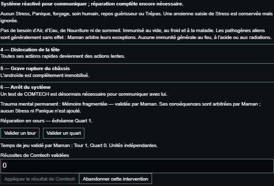

### Ressources et immunités

Un synthétique n'a besoin ni d'Air, d'Eau, de Nourriture ni de sommeil. Il est immunisé
au **vide**, au **froid** et à la **maladie**. Dans la préparation d'un coup, le choix
**Origine des dégâts** annule ces périls sans lancer de protection ni demander de critique.
Les impacts typés vide/vacuum, froid/cold et maladie/disease suivent aussi ces immunités.
Les pathogènes aliens sont **généralement** sans effet ; choisir leur exception demande
l'arbitrage de Maman. Aucune immunité générale n'est accordée au feu, à l'acide ou aux
radiations. Les consommables et échéances de survie complets appartiennent au lot A5.

Sur tablette, le joueur retrouve ses avaries, l'intervention en cours et ses traumatismes.
Les commandes de résolution, de temps et de réparation restent au poste MJ.

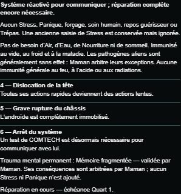

## Survie — suivi A5

Dans **Blessures et soins Alien**, déplier **Survie Alien**. Les quatre états
**Affamé, Déshydraté, Épuisé, Gelé** sont maintenant reliés aux cases de la fiche HTML.
Les commandes de résolution et de temps restent au poste MJ ; le joueur consulte le
même suivi sur sa tablette.

### Tester les réserves

Cocher **Suivre les consommables en pénurie** seulement lorsque Maman demande de les
compter. Renseigner les quantités réelles, puis demander les tests : **Air** par Tour,
**Eau** et **Nourriture** par jour ; **Effort terminé : Air et Eau** propose les tests
supplémentaires après un combat ou une activité éprouvante. **Énergie** se teste selon
l'appareil et son utilisation, sur demande de Maman.

Un test lance autant de d6 que la réserve, **six au maximum** ; chaque **1** retire un
point. Ces dés ne provoquent **aucune Panique**, même s'ils utilisent les faces de Stress.
Une réserve d'Air à 8 peut ainsi lancer six dés et passer à 6 avec deux 1.
Les réserves ne sont pas plafonnées à six : seul le nombre de dés l'est.

**Réserves communes à la campagne** utilise quatre stocks réellement partagés, distincts
des quantités personnelles. Maman choisit **une seule fiche** pour suivre les échéances
du groupe. Sur les autres fiches, cocher les réserves communes et laisser le suivi de
pénurie inactif pour consulter les mêmes stocks sans multiplier leurs échéances.
Changer de mode conserve les quantités individuelles ; traiter ou annuler les demandes
de réserve en attente avant ce changement.

Les boutons **Valider round/tour/quart/jour — survie** avancent les mêmes compteurs que
le suivi des blessures. Les unités sont indépendantes : valider celles effectivement
écoulées dans le récit. Une horloge réelle ou une alarme MU/TH/UR n'enlève aucune réserve.
Chaque échéance crée une demande conservée. Son résultat ne s'applique qu'une fois ;
Maman peut aussi l'annuler explicitement si la situation ne la justifie plus.

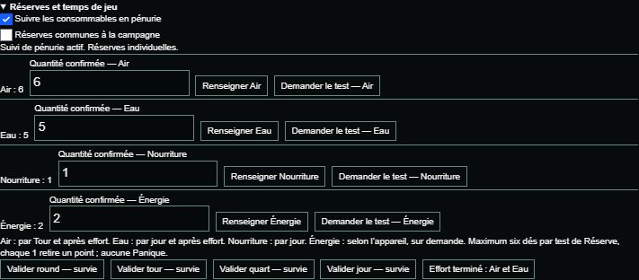

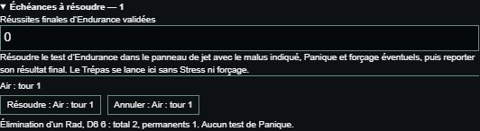

### Privations, repos et suffocation

Maman confirme **Affamé**, **Déshydraté** ou **Épuisé** après une journée sans alimentation,
boisson ou sommeil suffisant ; **Gelé** correspond à une protection insuffisante contre
le froid. Les cases de la fiche HTML ont le même effet que celles du panneau.

| État | Échéance et effet | Fin de l'état |
| --- | --- | --- |
| Affamé | Endurance quotidienne ; échec : un dégât et Stress +1. À zéro Santé : Trépas quotidien | Un Quart après un repas suffisant |
| Déshydraté | Chaque Quart : un dégât et Stress +1 ; à zéro Santé : Trépas à chaque Quart sans boire | Un Quart après avoir bu |
| Épuisé | Endurance quotidienne, malus égal aux jours sans sommeil ; échec : effondrement et sommeil d'un Quart | Un Quart de sommeil |
| Gelé | Endurance par jour au-dessus de 0 °C, par Quart sous 0 °C, par Tour dans le vide ; échec : un dégât et Stress +1. À zéro : Trépas à l'échéance suivante | Dès le retour au chaud |

**Affamé, Déshydraté et Gelé** empêchent de récupérer de la Santé et de soulager le
Stress. **Épuisé** empêche seulement de soulager le Stress. Le repos, les premiers soins,
les impacts de soin et les gestes de baisse du Stress sur la carte respectent ces
restrictions. Un soin médical ne retire pas les tests de Trépas dus à une privation.

Pour les tests de compétence, jouer **Endurance** dans le panneau de jet, avec le malus
indiqué, le Stress et les suites éventuelles de Panique/forçage. Reporter ensuite les
**Réussites finales d'Endurance validées** dans la demande correspondante. La soif
inflige ses dégâts sans test d'Endurance préalable. Les tests de **Trépas** sont lancés
par le suivi sans Stress ni forçage. Les dégâts de ces périls ne tirent pas de critique
humain et n'ajoutent pas deux fois le même point de Stress.

À court d'Air, le suivi propose la **suffocation** : Endurance sans malus au premier test,
puis −1, −2… aux suivants, par Tour ou après effort. L'échec fait tomber à zéro Santé
sans critique humain ni Stress de dégâts ajouté ; un Trépas est ensuite demandé à chaque
Round. **Environnement respirable retrouvé** met fin à cette cause. Les synthétiques
ignorent ces privations biologiques et gardent la gestion de leurs appareils à Énergie.

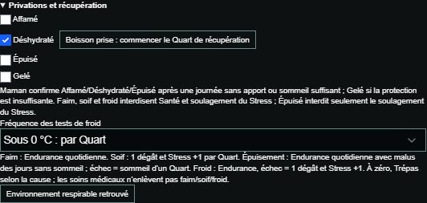

### Radiations

Le **total de Rads comprend les permanents**. La case **Rads permanents** est un champ
numérique distinct. La fiche HTML dispose de dix cases : les Rads au-delà de dix restent
conservés dans le suivi et sont comptés dans les tests, sans perdre le surplus lors de
la synchronisation.

Choisir **Zone irradiée** : faible = un Rad par Quart, forte = un Rad par Tour,
extrême = un Rad par Round. Chaque nouveau Rad reçu lance autant de dés que le
**nouveau total**, sans plafond à six ; chaque 1 inflige un dégât, sans Panique.
Si ces dégâts Brisent le personnage, les nouveaux Rads demandent aussi le Trépas
tant qu'il reste dans la zone. La récupération de Santé y est interdite.

Hors zone, chaque Quart propose l'élimination d'**un Rad temporaire** : sur 1, il reste
dans le total et devient permanent ; sur les autres faces, le total baisse d'un point.
Les Rads permanents ne sont jamais éliminés par cette récupération. Corriger une saisie
où les permanents dépassent le total avant de reprendre les tests. Aucune immunité
générale aux radiations n'est accordée aux synthétiques.
Une réparation synthétique ne peut pas être validée tant que la zone interdit la
récupération de Santé : l'intervention et les avaries restent conservées jusqu'à la sortie.

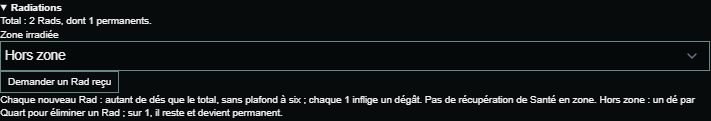

### Encombrement

Déplier **Encombrement** et renseigner les masses de chaque ligne d'inventaire et d'arme :
¼, ½, un ou plusieurs objets ordinaires ; un objet minuscule vaut zéro. Renseigner aussi
les autres charges réellement portées (armure, bouteilles, batteries) si elles ne figurent
pas déjà dans les listes. Aucun poids n'est deviné depuis le nom d'un objet. Une masse
manquante empêche de reporter un total incomplet.

Eau et Nourriture ajoutent chacune un objet par tranche de quatre points de réserve.
En mode collectif, les champs **personnellement portée** indiquent seulement la part
transportée par le personnage, indépendamment du stock commun. Le résultat peut être
reporté dans le champ **Encombrement** de la fiche HTML.
Si une ligne d'inventaire décrit déjà la même réserve d'Eau ou de Nourriture comptée
automatiquement, lui attribuer zéro pour éviter de compter deux fois cette charge.

La charge ordinaire vaut **Force ×2**, le maximum temporaire **Force ×4**. Entre les deux,
le suivi rappelle le test de Mobilité pour courir ou ramper : en cas d'échec, lâcher la
charge ou rester immobile. Maman résout ce test et les restrictions des avaries ; aucun
bonus ou malus arbitraire n'est appliqué à tous les jets.

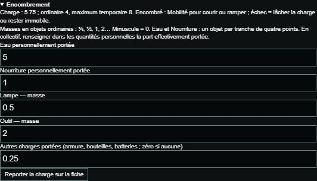

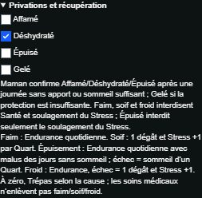

## Actions et xénomorphes — A6

Dans **Combat-OS**, ouvre **Actions Alien** sur la carte du combattant. Maman déclare
et paie les actions **avant de lancer les dés** : une lente et une rapide, ou deux
rapides. Le panneau de dés ne les paie pas une seconde fois. **Bloquer** dépense une
rapide, même avant son initiative ; elle reste dépensée quand la carte arrive.
L'aide consomme également le type d'action de la personne aidée.

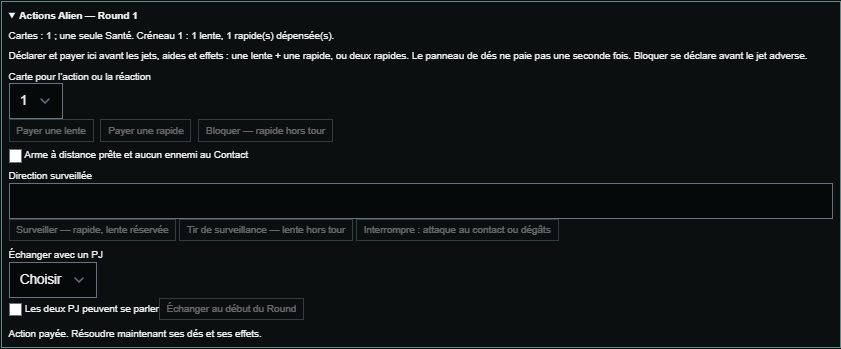

Pour la **Surveillance**, confirme l'arme prête et l'absence d'ennemi au Contact, puis
indique la direction. La rapide est payée, la lente conservée pour le tir hors tour.
Une autre action ou des dégâts interrompent la posture. Une attaque au contact qui
ne blesse pas se signale par **Interrompre**. La surveillance demeure jusqu'à la
prochaine initiative, même si le numéro du Round a changé.

Au début du Round, deux PJ capables de se parler peuvent échanger leurs cartes.
Le tirage ne remet aucune carte : si plus de dix sont nécessaires, Maman regroupe
d'abord les PNJ identiques. **Réinitialiser** prépare un nouveau tirage ; ce geste
ne sert pas à retrouver des actions pendant le même combat.

Sur une nouvelle créature, clique **Déclarer cette créature xénomorphe**, puis règle
Vitesse, Santé maximale, Protection naturelle et table des attaques de son espèce.
Ces valeurs viennent de sa description dans le livre. Les compétences propres se
mémorisent comme des réserves de dés, sans attribut humain, Stress ni forçage.

**Vitesse 2 donne deux cartes et deux créneaux, pour une seule fiche de Santé.** La
file d'initiative montre tous les créneaux ; **Suivant** les visite dans l'ordre.
Chaque carte donne une lente et une rapide. Maman tire une attaque spéciale D6,
ou la choisit, puis résout ses victimes et effets comme indiqué par la table.
Les attaques spéciales demandent généralement une arme ou un outil robuste pour être bloquées.

À zéro, la créature demande un **critique xénomorphe D6**, sans blessure humaine :

- **Indemne** : elle feint la mort ; sa prochaine initiative la relève à 1 Santé.
  Si elle est attaquée avant, Maman utilise le geste de relèvement et résout l'attaque.
- **Blessé** : elle reprend 1 Santé ; Vitesse baisse de un, minimum un, et la carte
  la plus basse est retirée. Maman teste sa tentative de fuite à chaque début de Round.
- **Réflexe désespéré** : une lente et une rapide immédiates hors tour. Le D6 indique
  fuite ou attaque ; Maman confirme ensuite fuite réussie ou dégâts effectivement infligés.
- **Dernier souffle** : attaque à la prochaine initiative, puis Maman confirme sa mort.
  Un nouveau dégât entretemps la tue directement. **En pièces** signifie la mort immédiate.

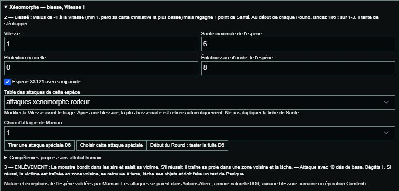

Le sang acide ne s'applique qu'aux espèces **XX121** déclarées, avec l'intensité de
leur description. Un coup qui les blesse crée une demande : intensité + dégâts subis.
Le **feu** ne la crée pas. Maman choisit les seules victimes **au Contact**, puis résout
l'attaque d'acide sur chacune ; les aspersions distinctes restent distinctes.
Les six de Protection absorbent les dégâts et rongent chacun un point d'armure.

Si l'attaque blesse, l'acide attaque encore au début du Round suivant avec moitié
moins de dés, arrondie à l'inférieur. Une attaque sans dégâts arrête cette aspersion.
L'acide qui Brise un humain entraîne un **Trépas par Round**, sans Stress ni forçage,
jusqu'aux Soins médicaux réussis. Un synthétique garde ses critiques propres.
Maman arbitre les effets sur les grenades, le sol et le décor.

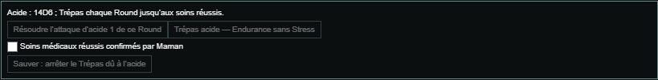

## Cinéma et Campagne — A7

Dans le formulaire de personnage, sous les dés, ouvre **Cinéma et Campagne Alien**.
Choisis le mode, puis renseigne un scénario, son acte et une séance. Garde les mêmes
noms en reprenant une partie : ils permettent de reconnaître les gains et usages déjà validés.

En **Cinéma**, prépare l'objectif secret de chaque acte dans ce panneau MJ,
puis **Remettre au seul personnage**. Il arrive dans la **messagerie privée du Hub**,
y compris après reconnexion. Les brouillons des autres actes restent au MJ.
Ne reporte pas cet objectif dans le champ imprimé **Objectif personnel**, qui sert
à la Campagne. Aucun objectif ni motif d'attribution n'est publié au journal ou aux projections.

À la fin de l'acte, Maman confirme les risques ou sacrifices consentis et valide :
**un Point de Récit** si mérité, **trois au maximum**. Une fin d'acte, avec ou sans gain,
ne se valide qu'une fois. La dépense de Récit dans les dés est proposée en mode Cinéma.

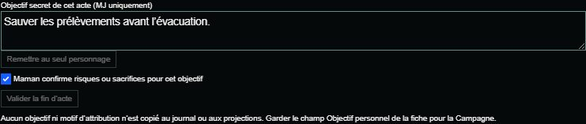

En **Campagne**, coche les réponses aux **neuf questions de fin de séance**, après
discussion avec le groupe. Chaque oui rapporte un PX ; Maman tranche les désaccords.
**Attribuer les PX de la séance** conserve le bilan et empêche une deuxième attribution.
Les réponses validées restent cochées et verrouillées après rechargement, comme le
mérite déjà confirmé d'une fin d'acte.

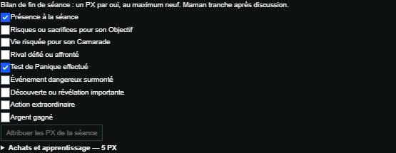

Entre deux séances, ouvre **Achats et apprentissage**, confirme cette période et
prépare un nouvel apprentissage. Chaque achat coûte **5 PX** :

- **Compétence +1**, maximum 5. À zéro, il faut un test réussi sans niveau pendant
  la partie, ou un enseignant de niveau 1+ pendant un Quart, confirmé par Maman.
- **Talent** : une journée d'entraînement et un test d'Esprit seul, sans Stress ni
  forçage ; avec un enseignant qui le possède, la réussite est automatique.
  Une tentative par jour de jeu ; l'échec ne dépense pas de PX. Le Jour se valide dans
  Blessures et soins. Un achat terminé ne se répète pas en recliquant ou en rechargeant.

Les achats sont bloqués pendant une séance active. Les PX conservent leur champ
historique, désormais numérique ; leur total peut dépasser les dix cases de l'HTML.
Le surplus reste conservé pour les dépenses suivantes.

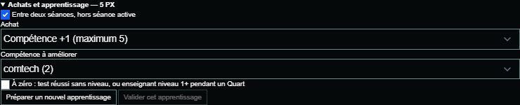

Après le bilan Campagne, choisis au plus un **Camarade** et un **Rival**, parmi les
autres PJ de la campagne. Les blessures et traumatismes demeurent ; le bilan de
Panique 13+ reste dans **Stress et Panique**.

Le bouton **Utiliser le fétiche — Stress −1** garde l'usage : une fois par **acte**
en Cinéma, une fois par **séance** en Campagne. Il paie une lente si le personnage
est au combat. Les immunités synthétiques et interdictions de récupération A5 restent
respectées. La tablette consulte le suivi ; Maman conserve les commandes de validation.

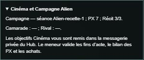

Le même suivi est vérifié à [768 px](captures/jeu-alien-a7-tablette-768.jpg) et
[1 180 px](captures/jeu-alien-a7-tablette-1180.jpg).

## La fiche HTML

La fiche d'Alien se relie à son personnage GM-OS (« Fiche du jeu »). Les pistes en cases (Stress,
Santé, Radiation, Expérience, Points de Récit) se comptent, et les dix lignes d'équipement forment
l'inventaire. Voir [Fiche de personnage HTML](./63-Fiche-de-personnage-HTML.md).

*Relu le 2026-10-22 pour A6/A7 : recette Electron A0–A7, carte de combat et vrai Hub Edge à
360, 768 et 1 180 px réussie ; neuf nouvelles captures A6/A7 vérifiées.
David a validé son essai A0/A1 le 20/10, A2 à A5 le 21/10.
Validation A4/A5 : « ok A4 et A5 tester c'est bon ».
David a validé A6/A7 le 22/10 : « ca marche pour A6 et A7 ».
Les huit parcours des accessoires du 16/10 ne sont pas rejoués par cette recette mécanique.*

*Complété le 2026-10-22 pour A8 : mode discret du M314, plan privé et batterie ; dossiers
et objectifs d'acte MU/TH/UR. Recette réelle A8 Electron/deux Hub Edge et quatre parcours
existants de scan, reconnexion et import réussis ; six captures A8 relues, détecteur à
360/768/1 180 px. Essai A8 de David validé le 23/10 (« ca marche A8 est testé ») ; le plan privé
paraît désormais dès la première zone.*

*Complété le 2026-10-23 du combat spatial (p. 188-201) : module, pilote 1.9.0, recette réelle
Electron et Hub Edge (ordres secrets, contact non identifié, verrouillage depuis la tablette,
360 px sans débordement), deux captures relues.*
