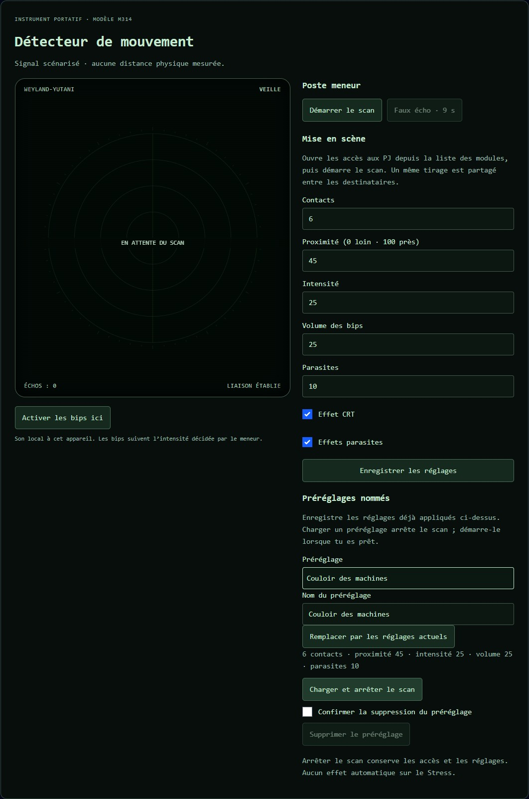

# 👽 Jeu — Alien

> **Pilote décrit :** « ALIEN, le jeu de rôle », exporté le 2026-10-14. Retour à [Les jeux et leurs mécaniques](./53-Les-jeux-et-leurs-mecaniques.md).

Le moteur Year Zero : une réserve de d6, et des **dés de Stress** qui font monter la peur.

**Ajout du 15/10/2026 — préparation des modules :** dans l’éditeur du pilote, **Modules du jeu**
permet de conserver ou retirer **MU/TH/UR 6000** et le **Détecteur de mouvement**. Un ancien pilote
Alien les propose par défaut, même avec un identifiant personnalisé. Le choix est sauvegardé et
exportable. Le cockpit possède aussi l’entrée **Modules du jeu** pour préparer et ouvrir ces outils.

Les captures de cette section montrent les composants et le moteur réels dans un banc hors ligne,
avec données fictives. MU/TH/UR et le détecteur sont raccordés au Hub, avec des accès indépendants.

### Préparer et ouvrir MU/TH/UR

1. Ouvre **Cockpit › Modules du jeu › Ouvrir le pupitre**.
2. Prépare les **Dossiers**, **Protocoles** et **Réglages**. Les modifications sont enregistrées
   automatiquement ; une erreur d’écriture est signalée et garde les données précédentes.
3. Démarre une séance et coche les PJ dans **Accès des personnages**. Chaque joueur ouvre
   **Tablet Hub › Modules du jeu › Ouvrir MU/TH/UR 6000**, avec son personnage habituel.
4. Choisis un opérateur dans le pupitre pour répondre à ses questions ou arbitrer ses piratages.
   Ses réponses et ses dossiers déverrouillés restent privés.

### Ranger les dossiers et traiter plusieurs demandes

Dans **Dossiers**, sélectionne un dossier puis **Monter le dossier** ou **Descendre le dossier**.
Cet ordre devient celui de la commande **LIST**. Pour supprimer, coche **Confirmer la suppression
du dossier**, puis **Supprimer le dossier**. Ses déverrouillages sont retirés ; les textes déjà
lus restent dans les dialogues. **Nouveau dossier…** permet d’en créer un autre.

Dans **Terminal**, choisis l’opérateur puis la **Demande à traiter**. Chaque `/M question`
rejoint sa file privée ; plusieurs questions et un piratage peuvent attendre ensemble. Sélectionne
une question pour lui répondre ou le piratage pour l’autoriser/le repousser. **Message libre à cet
opérateur** transmet un message sans traiter de question. **Demandes traitées** garde le texte,
la réponse et le résultat. La révocation annule les demandes encore en attente.

La file accepte 32 demandes en attente par personnage et garde jusqu’à 128 demandes avec leur
historique. **CLEAR** nettoie le journal du joueur sans effacer les demandes. Les demandes sont
conservées à la reprise d’une campagne ; les autres personnages ne les reçoivent pas.

**HACK** brouille fortement le terminal pendant **cinq secondes dès son lancement**, puis
revient à l’affichage habituel en attendant le MJ. Une répétition pendant l’attente ne
prolonge pas le brouillage. Ce départ ne donne aucun privilège ; seul l’arbitrage du MJ
accorde ou refuse l’intrusion. Les réglages CRT/parasites et mouvements réduits s’appliquent.

### Alerte et diffusion sonore

Les protocoles associent des codes exacts à un message et, éventuellement, à l’ouverture/fermeture
des portes fictives ou à l’autodestruction. Le code d’exemple **OMEGA-10** déclenche le film entier
du Nostromo : le compte à rebours dure au moins **12 min 56 s**. **OMEGA-STOP** annule la séquence.
Les codes se modifient dans **Protocoles**.

Dans la carte du module, **Son : nom de l’appareil** réserve la diffusion à une seule tablette
connectée et autorisée, ou à **Ce poste MJ**. Sur cet appareil, touche aussi **Activer le son**.
Les autres écrans restent muets. La bande-son du film a priorité ; si l’alerte continue ensuite,
la sirène et les annonces reprennent. La lecture automatique bloquée propose **Reprendre la vidéo**.

### Préparer et ouvrir le détecteur

1. Dans **Cockpit › Modules du jeu**, ouvre le pupitre de **Détecteur de mouvement**.
2. Prépare **Contacts** (0–9), **Proximité** (0 loin, 100 près), **Intensité**, **Volume des bips**
   et **Parasites**, puis **Enregistrer les réglages**. CRT et parasites se désactivent séparément.
3. Pendant une séance, coche ses destinataires, indépendamment des accès à MU/TH/UR.
   Autoriser l’instrument le laisse en veille ; **Démarrer le scan** le met en activité.
4. Chaque activation tire les positions au hasard dans la proximité choisie, identiques sur
   les appareils autorisés. **Faux écho · 9 s** ajoute un contact temporaire sans déplacer les autres.
5. Le joueur ouvre sa carte dans le Hub et touche **Activer les bips ici** s’il souhaite les entendre.
   Les bips sont locaux ; ils ne suivent pas le choix du diffuseur d’alarme MU/TH/UR.

Pour préparer plusieurs ambiances, applique d’abord les réglages avec **Enregistrer les réglages**.
Dans **Préréglages nommés**, choisis **Nouveau préréglage…**, donne un nom puis **Enregistrer les
réglages actuels**. Ils mémorisent contacts, proximité, intensité, volume et parasites du radar.
Sélectionne ensuite un nom et **Charger et arrêter le scan** : le détecteur revient en veille,
sans faux écho. Lance le scan au moment voulu. Tu peux remplacer le préréglage choisi par les
réglages actuels, le renommer ou le supprimer après confirmation. Jusqu’à 32 noms sont conservés
par campagne, dans les sauvegardes et exports ; ils restent réservés au MJ.

**Arrêter le scan** garde les accès et les réglages. Retirer un PJ ferme uniquement son instrument,
sans interrompre celui des autres ; le dernier retrait arrête le scan. Le détecteur est un
accessoire de mise en scène : aucune distance réelle mesurée, aucun jet ou Stress automatique.
Les mouvements réduits gardent le radar fixe. Un onglet masqué coupe ses bips.

### Fermer et reprendre

Décocher un PJ ferme son module et ses effets locaux. **Fermer tous les accès et couper les effets**
arrête aussi les effets de cet instrument. **Tout couper**, en haut de la page, ferme les deux
modules et arrête radar, faux écho et compte à rebours. La fin de séance, un changement de campagne et le redémarrage
ferment les accès et arrêtent les effets ; la préparation et les dialogues sont conservés.
Une reconnexion pendant la même séance retrouve les droits toujours ouverts, après vérification
de l’identité de l’appareil. Les commandes interrompues ne sont jamais rejouées automatiquement.
Après retour dans le détecteur, les bips nécessitent un nouveau clic local. Une coupure reste
effective en mémoire si le disque échoue ; l’erreur est signalée au MJ.

Les données privées sont stockées à part des campagnes diffusées aux tablettes. Les sauvegardes
complètes et exports de campagne incluent les dossiers, codes et dialogues ; un export de pilote
contient seulement les références aux modules. Les réglages du détecteur sont aussi conservés,
mais la reprise et l’import laissent le scan arrêté et ses accès fermés.
Le vrai transport HTTP/WebSocket est aussi éprouvé entre une instance Electron jetable
et deux sessions Edge isolées sur le même PC : huit parcours couvrent confidentialité,
droits, scan, déconnexion/reprise, vidéo et redémarrage/import, avec les dossiers, la file
de demandes et les préréglages. Le relais sonore après le film est aussi éprouvé avec une
horloge avancée et une voix simulée. Le décodage et le graphe
audio sont réels, avec sortie muette vers les enceintes. L’essai sur les tablettes,
leur Wi-Fi, le clavier virtuel et les haut-parleurs physiques reste à faire.

Pour cette dernière vérification, la [fiche de recette sur les appareils de David](../Planning/2026-10-16-recette-materielle-alien.md)
prévoit deux tours : iPad avec tablette Samsung, puis iPad Air avec smartphone. Elle détaille
le clavier virtuel, la rotation, les coupures Wi-Fi, la veille et le transfert du son. L’alerte
de quinze minutes permet d’écouter le film entier puis la sirène et les annonces restantes.
Les résultats se relèvent par appareil et navigateur ; la disponibilité d’une voix française
locale se vérifie sur chaque appareil choisi pour la diffusion.

---

## Le jet — la réserve et le Stress

- On retient un **Attribut** et une **Compétence** : leur somme donne les dés (jusqu'à 10).
- On retient aussi le **Niveau de Stress** : autant de **dés de Stress** se lancent avec les autres,
  **comptés à part**.
- Chaque **6** est une réussite.
- **Un 1 sur un dé de Stress déclenche la Panique.** Le panneau l'**annonce**, désigne le dé, et
  propose **« Test de Panique »** : 1D6 + Niveau de Stress. Sur le poste du meneur, la ligne de la
  table `Alien/test_de_panique` s'affiche sous le résultat (au-delà de 15, c'est la Catatonie) ;
  sur la tablette, le total remonte au meneur, qui lit la ligne.
- **Déjà en panique ?** Le total de la panique en cours se garde sur la fiche (« Panique en cours »).
  Une nouvelle panique plus haute la remplace ; plus basse ou égale, c'est la **ligne juste
  au-dessus** de l'ancienne. Quand la panique cesse, **« Calmé »** sur la carte du combattant la
  remet à 0.
- **« Dépenser un Point de Récit »**, après le lancer : un **6** s'ajoute au jet (cerclé de vert) et
  la fiche perd un point. Il reste sur la table si l'on force ensuite.

---

## Forcer le jet

Après le lancer, **« Forcer le jet »** :

- le **Niveau de Stress monte d'un point** sur la fiche, avant la relance, et le **nouveau dé de
  Stress** part avec elle ;
- les **6 restent** sur la table ; tout le reste se relance — les dés relancés sont **cerclés** ;
- **une fois par test**, ou **deux** avec le talent qui couvre l'attribut du jet (champ « Talent ») :
  Dépassement de soi et Cran (Force), Vif et Téméraire (Agilité), Ruse et Curiosité (Esprit),
  Compassion et Influence (Empathie). Le bouton se grise ensuite, et dit pourquoi.

**Au pupitre** (et depuis la télécommande), « Forcer le jet » relance le dernier jet, ajoute le dé de
Stress et **annonce** « Stress +1 à reporter sur la fiche ».

**On ne force pas** après une Panique au premier lancer (le bouton le dit), ni avec un **androïde**
(case « Androïde » cochée sur la fiche). Une Panique sur la relance
se joue de même, avec le Stress déjà monté.

---

## Combat et santé

- **Initiative :** des **cartes numérotées de 1 à 10**, une par combattant, dans l'ordre croissant.
- **Santé :** points de vie, dont le **maximum se lit sur la Force**.
- **Ressources suivies :** Niveau de Stress, Points de Récit, Air, Eau, Nourriture, Énergie.
- **Le Stress hors du jet**, sur la carte du combattant : − et +, puis **« Repos −1 »** (un Tour en
  lieu sûr) et **« Objet fétiche −1 »** (une fois par acte ou par séance).

---

## La fiche HTML

La fiche d'Alien se relie à son personnage GM-OS (« Fiche du jeu »). Les pistes en cases (Stress,
Santé, Radiation, Expérience, Points de Récit) se comptent, et les dix lignes d'équipement forment
l'inventaire. Voir [Fiche de personnage HTML](./63-Fiche-de-personnage-HTML.md).

*Relu le 2026-10-16 : étape 5 et volet logiciel de l’étape 6, huit parcours E2E validés. Recette pour iPad, iPad Air, tablette Samsung et smartphone préparée ; résultats physiques à relever.*
