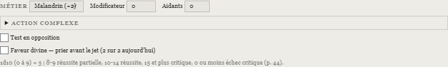
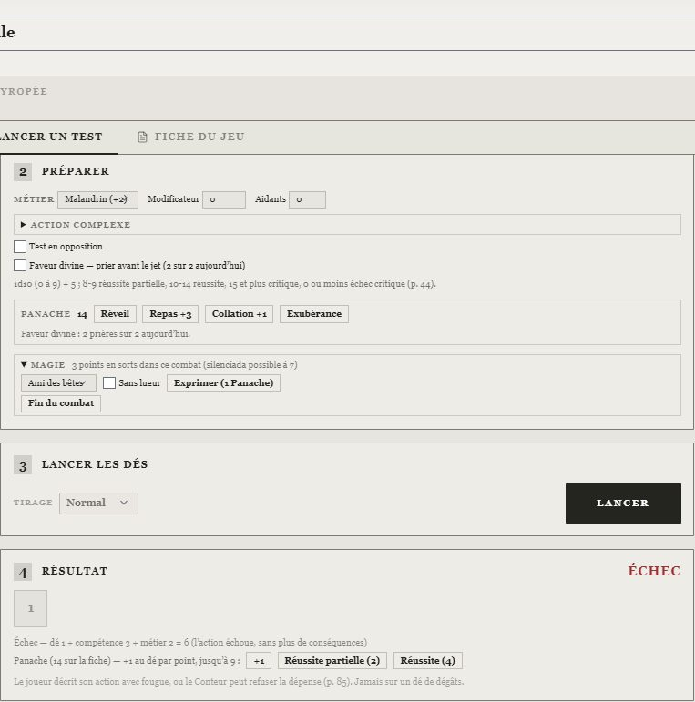
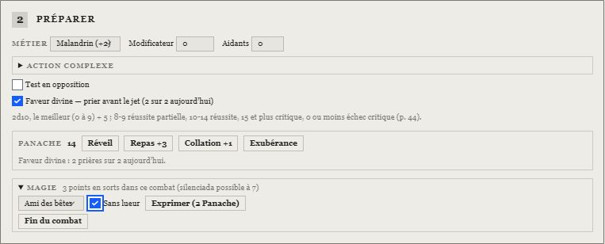
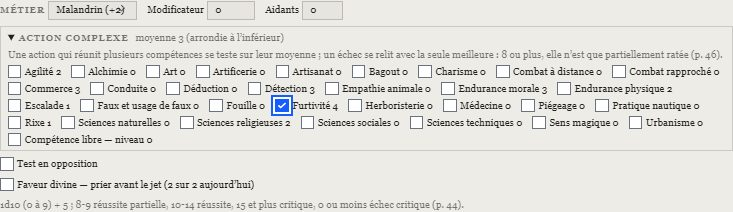
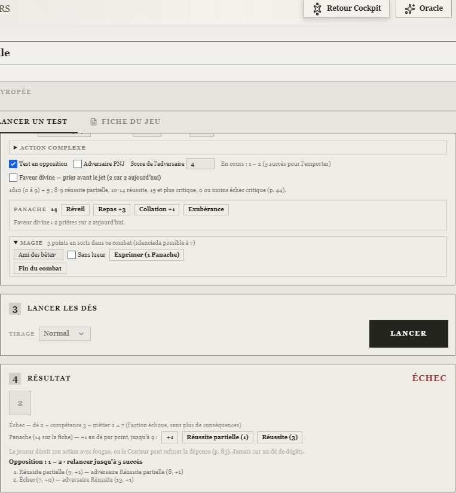
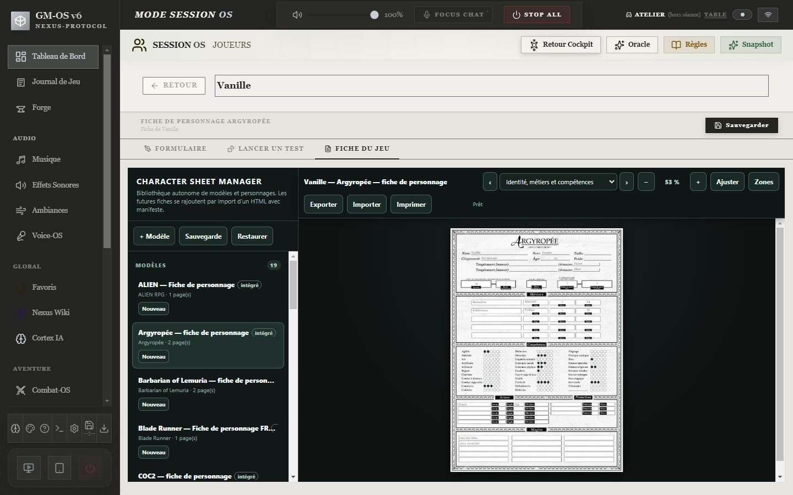
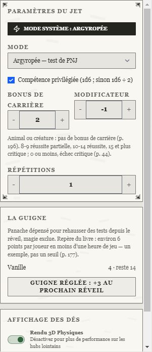

# 🏰 Jeu — Argyropée

> **Pilote décrit :** « Argyropée », forgé par David, exporté le 2026-11-08, **fini le
> 2026-11-08**, version **2.1.0** du 2026-11-09 (`Export Dirvers/corriges/Argyropee-2.1.0.gmos-driver`,
> construit par `outils/argyropee/finir_argyropee.mjs`). Thème `argyropee` et fiche de personnage HTML
> `argyropee-fr` livrés le même jour. Retour à [Les jeux et leurs mécaniques](./53-Les-jeux-et-leurs-mecaniques.md).

Un seul geste : le **test de compétence**, un d10 **numéroté de 0 à 9** additionné à la compétence et
au bonus du **métier**, lu sur cinq paliers fixes. Autour de lui : le modificateur du Conteur,
l'entraide, l'**action complexe**, le **test en opposition**, la **Faveur divine**, et le **Panache**,
dépensé après le tirage pour monter le dé. Le panneau du personnage tient aussi sa journée — réveil,
repas, **Exubérance** — et sa **magie** ; le pupitre du Conteur lance les **PNJ** et suit la
**Guigne**. La fiche HTML est reliée champ par champ.

> Règles relues contre le livre 2 *Règles & Bestiaire* le 2026-11-08 — pages imprimées 8-9,
> 19-62, 64-89, 101-133, 135-137, 176-226 (page du PDF = page imprimée + 1). Les vingt fiches du
> corpus `docs/systems/argyropee/rules/` sont relues ; le bestiaire (163 profils) et l'équipement
> (18 tableaux) sont réécrits d'après le livre (registre § 237).

**Réimporter le pilote avec « Remplacer ».** Le pilote forgé comparait le d10 seul à
« compétence + métier » et exigeait dix réussites d'un seul dé : **chaque test échouait**. La version
2.0.0 gardait son identifiant, mais **sa fiche changeait** : elle passait de 7 à 32 compétences et
reprenait une à une les 128 clés de la fiche HTML. La 2.1.0 (09/11) ajoute cinq champs propres à
GM-OS dans « Panache et santé » : prières du jour, Panache des sorts dans le combat, silenciada,
repère et offrande de la Guigne.

---

## Le test de compétence

- **Composer** : la **compétence** testée, parmi les 32 de la fiche (et la compétence libre).
- **Préparer** :
  - le **métier** dont relève la compétence, parmi ceux que porte la fiche — « Malandrin (+2) » ;
    **aucun** par défaut : le bonus de métier ne s'ajoute que si la compétence en relève (p. 44) ;
  - le **modificateur** du Conteur : chaque malus ou bonus va de −5 à +5, et ceux de plusieurs
    sources se cumulent (p. 45) ;
  - les **aidants** d'un test en coopération : +1 par aidant ayant au moins 1 point dans la
    compétence, +5 au plus (p. 45).
- **Lancer** : un d10 lu **de 0 à 9** — la face 10 du dé vaut 0.

Le total se lit sur les paliers du livre (p. 44) :

| Total | Résultat |
| :--- | :--- |
| **15 et plus** | **Réussite critique** : succès avec bonus ; au combat, dégâts lancés deux fois, ou une fois avec une manœuvre gratuite |
| **10 à 14** | **Réussite** |
| **8 à 9** | **Réussite partielle** : objectif atteint en partie, ou avec une petite complication |
| **1 à 7** | **Échec** sans plus de conséquences |
| **0 ou moins** | **Échec critique**, aux répercussions graves |

Un total négatif — possible sous un malus — est un échec critique : **décision de David du
2026-11-08** (le livre ne parle que de « test = 0 »).

## Le Panache

Sous le résultat, le panneau propose le **Panache** de la fiche. Il se dépense **après** le
tirage : chaque point ajoute 1 au dé, qui ne dépasse **jamais 9** (p. 84-85). Les boutons disent ce
que chaque palier coûte — « Réussite partielle (4) » — et la dépense s'écrit sur la fiche. Le joueur
décrit son action avec fougue, ou le Conteur peut refuser la dépense : l'outil compte, il
n'arbitre pas. Le Panache ne s'applique jamais à un dé de dégâts. Chaque point dépensé sur un test
entre au **repère de la Guigne** (voir plus bas).

## La journée : réveil, repas, Exubérance

Sous la préparation, une carte tient le Panache de la journée (p. 84-86) :

- **Réveil** : après 6 à 8 heures de sommeil, Panache = **1d10 (0 à 9) + 10 + bonus permanent**, plus
  les **3 points offerts par la Guigne** si elle a été réglée. Le reste de la veille est perdu. Le
  réveil ouvre aussi un nouveau jour : prières rendues, repère de la Guigne et magie du combat à zéro.
- **Repas +3** (un solide repas, midi ou soir) et **Collation +1** (un verre, un grignotage).
- **Exubérance** : sacrifier **tout** le Panache restant pour berner la mort, la sienne ou celle d'un
  allié, à tout moment, même hors de son tour. Il faut **au moins 3 points** et être **conscient**
  (santé à 0 ou plus) ; sinon le bouton se grise et dit pourquoi. Un second clic confirme
  (« Sacrifier 12 points ») ; le Conteur valide le récit.

## La Faveur divine

Dans « Préparer », **Faveur divine — prier avant le jet** : une courte prière à la Mère des Labours
ou au Père de l'Industrie, **avant** le jet. Le panneau lance **deux d10 et garde le meilleur**
(« dé 8 (Faveur divine : 3 et 8) »), compte la prière et décoche la case : une seule fois par dé,
autant de fois par jour que de points en **Sciences religieuses** (p. 81). La case dit les prières
qui restent ; le Réveil les rend. Le livre l'ouvre à tout dé : GM-OS la propose sur le test.

## La magie

La carte **Magie** liste les sorts que porte la fiche. **Exprimer** coûte 1 point de Panache avec la
lueur du sort, 2 **sans lueur** ; un personnage dont les deux tempéraments donnent le **même
domaine** lance chaque sort discret pour 1 point (p. 135-136). Le sort agit sur soi ou sur
l'environnement proche, jamais directement sur autrui.

Le Panache des sorts s'additionne pour le combat en cours. **Au sort qui le porte à 7**, GM-OS tire
une fois les **20 % de la silenciada** (d100 ≤ 20 : le personnage devient muet, 2 tests de Sens
magique réussis pour en guérir, p. 127) — **décision de David du 2026-11-09**. « Fin du combat »
remet le compte à zéro. Ce Panache-là ne compte pas pour la Guigne.

## L'action complexe

Dans « Préparer », **Action complexe** réunit à la compétence du jet d'autres compétences de la
fiche : le test se fait sur leur **moyenne, arrondie à l'inférieur** (p. 46). Un succès, même
partiel, accomplit parfaitement l'action. Un échec se relit avec la **seule meilleure compétence**
ajoutée au même dé : si ce total aurait réussi (8 ou plus), l'action n'est que **partiellement
ratée** ; sinon, elle rate complètement. Le métier, le modificateur et l'entraide restent dans ce
second calcul : seule la compétence change.

## Le test en opposition

**Test en opposition** et le **score de l'adversaire** (sa compétence, son métier et ses
modificateurs) : à chaque lancer, l'adversaire teste en même temps la même compétence. Une
réussite, même partielle, vaut **1 succès**, une réussite critique **2** ; le premier à **5 succès**
l'emporte, et si les deux y arrivent ensemble, ils n'arrivent pas à se mettre d'accord (p. 46). Le
panneau garde le compte manche par manche et le journal dit la manche de l'adversaire après celle
du personnage. Le Panache dépensé sur une manche relève son compte.

## Le combat

- **Initiative** : 1d10 + Agilité + Détection (+ le bonus d'initiative de la fiche), tirée une fois ;
  à égalité, le personnage joueur passe avant le PNJ (p. 46).
- **Attaquer** : un test de Combat à distance, de Combat rapproché ou de Rixe. À 3 mètres ou moins,
  même une arme à feu se sert en Combat rapproché (p. 48). La cible ne se défend qu'en ayant
  **déclaré une parade** à son tour (test d'Agilité).
- **Portées** : chaque arme a sa portée maximum ; au-delà, −1 par tranche de distance propre à
  l'arme (10 m pour l'arc court, 1 m pour l'arbalète de poing…). Combat-OS n'applique aucun malus
  générique : le Conteur le règle au modificateur.
- **Santé** : 2 + Endurance morale + Endurance physique. Sous 0, l'avatar tombe inconscient ; la mort
  est un acte volontaire, sauf péril absolu (p. 52-53).

## La fiche du personnage

La fiche fidèle au PDF (`docs/fiches/Argyropée/argyropee-fiche-interactive.html`, gabarit
`argyropee-fr`, moteur de fiches **version 25**) s'ouvre dans l'onglet **Fiche du jeu**. Ses
**128 clés** sont reliées une à une aux champs du pilote (`docs/systems/argyropee/fiche/correspondance.json`) :
identité, deux tempéraments, cinq métiers (nom, rang, bonus, salaire), 32 compétences et la
compétence libre, Panache et son bonus, santé, initiative, cinq armes, trois protections, quinze
sorts, cercles intimes, possessions, équipement et charges.

La fiche GM-OS a deux éléments que la fiche HTML n'imprime pas : le **Châtiment vermeil** (marques
de 0 à 9) et le **pécule** en florins, deniers et sous.

## Le bestiaire et le catalogue

Le corpus donne au **bestiaire** les **163 profils** du livre — 68 humains, 76 animaux,
13 créatures, 6 monstres — avec santé, protection, Panache, initiative et particularités
(Forge › Bestiaire › remplir depuis les fiches relues). Pour un PNJ, le degré d'une compétence se
tire à chaque test : voir « Le pupitre du Conteur » ci-dessous.
Le **catalogue** reçoit 349 objets : 86 armes et munitions, 19 protections, 234 objets, potions,
produits et pièges, 10 moyens de transport.

## Le thème

Le thème `argyropee` (papier clair, encre, ornements Renaissance) s'applique quand il est activé
dans la campagne ; matière, ornements et icônes demandent les **personnalités** allumées dans les
Paramètres. Accepté par le validateur sans erreur ni avertissement. La bannière et l'identité
visuelle sont dans `output/gmos-studio/argyropee/` (voir son `LIRE-MOI.md`).

## Le pupitre du Conteur : les PNJ et la Guigne

Dans une campagne d'Argyropée, le pupitre de Dice-OS s'ouvre sur **Argyropée — test de PNJ**. Un PNJ
n'a pas de degrés fixes : à chaque test, sa compétence se tire — **1d6** si elle est privilégiée,
**1d6 divisé par deux** sinon — plus son **bonus de carrière** (aucun pour un animal ou une
créature), puis le d10 lu de 0 à 9 et les paliers du livre (p. 185, 196). Le modificateur du
pupitre est celui du Conteur. Dans un **test en opposition**, la case **Adversaire PNJ** du panneau
fait de même à chaque manche : le score saisi n'est alors que la carrière et les modificateurs.

La carte **La Guigne** montre, pour chaque personnage, le Panache dépensé à rehausser des tests depuis
son réveil, sans alerte ni couleur : le livre donne « à peu près 6 points par joueur en moins d'une
heure de jeu » comme exemple, pas comme seuil, et la magie n'y compte pas (p. 177). Quand la
péripétie est réglée, **Guigne réglée** offre **3 points à chaque joueur au prochain réveil** et
remet les repères à zéro.

## Ce qui reste à la table

- **Le Châtiment vermeil** : une marque par meurtre, l'iris rougit (p. 177) ; la jauge se tient à
  la main.
- **La Faveur divine sur un dé de dégâts ou d'initiative** : à relancer à la main ; le panneau la
  propose sur le test.
- **Le Panache sur l'initiative** : il compte pour la Guigne, mais l'initiative se tire dans
  Combat-OS, sans dépense de Panache ; l'ajouter au repère à la main si besoin.

## La campagne d’essais

**Les Comptes de la marée**, préparée le 09/11/2026, propose douze séances d’enquête urbaine
et six ateliers directement accessibles dans le cinquième acte de la Trame. Un seul `.gmos`,
trois héros pour les joueurs existants et des personnages `[RECETTE]` réservés aux essais.
[Livraison, guide et cahier de 61 cas](../Planning/2026-11-09-campagne-recette-argyropee.md).

Le lot a été contrôlé par les fonctions et composants en mémoire ; son import natif Electron
et ses Hub réseau restent NON EXÉCUTÉS. Deux écarts du combat générique ont été reproduits :
les dégâts bornent la santé à zéro au lieu de conserver le négatif, et le d10 d’initiative
générique conserve la face10 au lieu de la lire0. Lire les anomalies du lot et tenir ces deux
valeurs à la main en attendant une correction spécifique. Les tests verts de diagnostic ne
valident pas ces deux règles comme conformes.

Pour refaire un cas, restaurer uniquement ses champs selon les états de référence.
**Guigne réglée** agit sur tous les PJ de la campagne, profils de recette compris ; ce geste
collectif ne remet pas un atelier seul à zéro. **Nexus Remplacer réimporte toute la campagne.**
