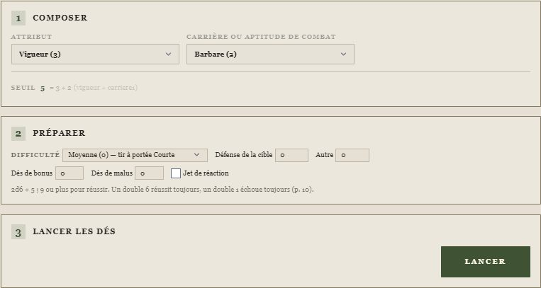
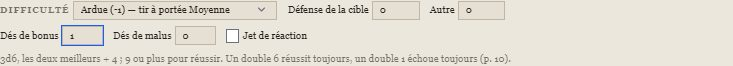
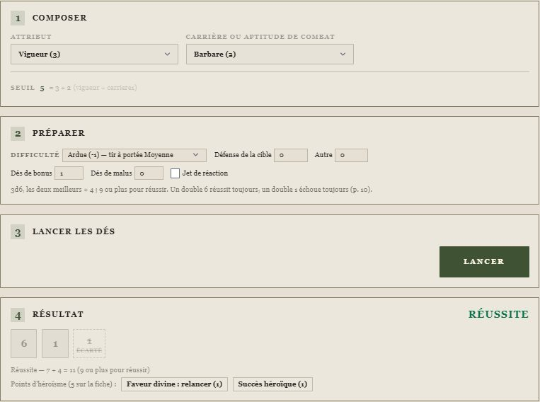
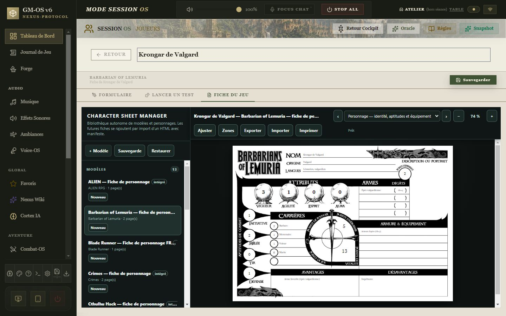

# 🌴 Jeu — Barbarians of Lemuria

> **Pilote décrit :** « Barbarians of Lemuria », forgé par David, exporté le 2026-10-27, **fini le
> 2026-10-27**, version 2.0.0 (`Export Dirvers/corriges/BOL_driver_gmos_2.0.0.gmos-driver`,
> construit par `outils/barbarian/finir_barbarian.py`). Thème `barbarian` et fiche de personnage
> HTML livrés le même jour. Retour à [Les jeux et leurs mécaniques](./53-Les-jeux-et-leurs-mecaniques.md).

Un seul geste : le **jet d'action**, deux dés à six faces **additionnés** à un attribut et à une
carrière ou une aptitude de combat, réussi sur **9 ou plus**. Autour de lui : la difficulté du
livre, les **dés de bonus et de malus**, les doubles 6 et les doubles 1, et les **points
d'héroïsme** qui relancent ou font d'une réussite un succès héroïque. La fiche HTML est reliée
champ par champ.

> Règles relues contre le livre français (édition Mythic) le 2026-10-27 — pages imprimées 8-17,
> 24, 37-38, 45, 49-66, 71-81, 132-139, 146-154, 161-165, 213. Les seize fiches du corpus
> `docs/systems/barbarian/rules/` sont corrigées d'après lui (registre § 184).

**Réimporter le pilote avec « Remplacer ».** Le pilote forgé comparait chaque dé à
« attribut + carrière + aptitude » et n'exigeait aucune réussite : **tout jet réussissait**. La
version 2.0.0 garde son identifiant, mais **sa fiche change** : cinq carrières nommées, quatre
armes, six lignes d'équipement, la Vitalité et son maximum, l'expérience. Un personnage créé avec
la fiche forgée garde ses anciennes valeurs, sans qu'elles paraissent.

---

## Le jet d'action

- **Composer** : un **attribut** (Vigueur, Agilité, Esprit, Aura) et, au choix, une **carrière**
  — sous son nom, « Barbare (2) » — ou une **aptitude de combat** (Initiative, Mêlée, Tir,
  Défense). Hors combat, la carrière ; en combat, l'aptitude (p. 10, 56). La seconde case peut
  rester vide : Krongar enfonce une porte avec sa seule Vigueur (p. 57).
- **Préparer** : la **difficulté** du livre, de Très facile (+2) à Héroïque (−8), avec la portée
  de tir qui lui correspond (p. 57) ; la **Défense de la cible**, qui se retire au jet d'attaque
  (p. 62) ; un **autre** modificateur (posture, horde, embuscade) ; les **dés de bonus** et
  **de malus**.
- **Lancer** : deux d6, plus un par dé de bonus ou de malus restant — ils s'annulent un à un. Avec
  des bonus, on garde les **deux meilleurs** ; avec des malus, les **deux pires** (p. 8, 16-17).

Le total se compare à **9** :

| Résultat | Quand |
| :--- | :--- |
| **Succès légendaire** | un succès héroïque sur double 6, plus 1 point d'héroïsme (p. 59) |
| **Succès héroïque** | un double 6 — sauf si seul un double 6 pouvait réussir : alors simple réussite (p. 56) |
| **Réussite** | 9 ou plus |
| **Échec** | 8 ou moins |
| **Échec automatique** | un double 1, quel que soit le total (p. 57) |
| **Échec critique** | un double 1 que le joueur choisit d'aggraver (p. 57) |

## Après le jet : les points d'héroïsme

Sous le résultat, le panneau propose ce que le livre permet, et **écrit sur la fiche** les points
d'héroïsme dépensés ou gagnés :

- **Faveur divine** (1 point) : tous les dés relancés, dés de bonus compris, et le second jet
  gardé — même sur un double 1 (p. 58).
- **Succès héroïque** (1 point) : sur une réussite simple (p. 59).
- **Succès légendaire** (1 point) : sur le succès héroïque d'un double 6 seulement. On ne monte
  pas une réussite achetée jusqu'au légendaire (p. 59).
- **Échec critique** : sur un double 1, au choix du joueur ; le héros est en difficulté ce round
  et le suivant, et le MJ peut **accorder 1 point d'héroïsme**, même au-delà de la réserve (p. 57).

Les autres usages des points d'héroïsme — Coup de chance, Défier la mort, Juste une égratignure,
Parade in extremis — restent à la table : ils ne touchent pas aux dés.

## Le jet de réaction

La case **Jet de réaction** fait du jet celui du début de combat : Esprit + Initiative, moins la
**plus haute Initiative** des coriaces ou rivaux adverses (p. 60). Le résultat dit la place du
héros dans l'**ordre de réaction** du livre : un succès agit avant tout le monde, un échec après
les rivaux et les coriaces mais avant la piétaille, un échec critique en dernier, interdit au
premier round. Combat-OS, lui, range les combattants par Esprit + Initiative, du plus haut au plus
bas ; le meneur ajuste selon les jets.

## La fiche du personnage

La fiche fidèle au PDF (`docs/fiches/Barbarian of Lemuria/`, gabarit `barbarian-of-lemuria-fr`,
moteur de fiches **version 19**) s'ouvre dans l'onglet **Fiche du jeu**. Ses 45 clés sont reliées
une à une aux champs du pilote, **sauf le portrait**, qui reste sur la fiche
(`docs/systems/barbarian/fiche/correspondance.json`). Les attributs et aptitudes vont de −1 à 5
(p. 12, 165) ; la Vitalité descend sous zéro : à 0 hors de combat, de −1 à −5 mourant, mort
en dessous (p. 65).

La fiche GM-OS a trois champs que la fiche HTML n'imprime pas : le **concept**, la **Vitalité
maximale** (10 + Vigueur, ± 2 pour Dur à cuire ou Chétif — elle plafonne la Vitalité et la jauge
de combat) et les **Points de création** de l'alchimiste.

## Le thème

Le thème `barbarian` (papier ivoire, encre, cadre de jungle, accent vert) s'applique quand il est
activé dans la campagne ; matière, ornements et icônes demandent les **personnalités** allumées
dans les Paramètres. Accepté par le validateur sans erreur ni avertissement.

## Ce qui reste à la table

- **Les dégâts** : catégorie de l'arme (d3, d6M, d6, d6B) plus la Vigueur ou sa moitié, moins
  l'armure (p. 62-63). La fiche porte les dégâts de chaque arme ; ils se lancent au pupitre.
- **La magie** : charmes et cercles, conditions d'incantation, points de pouvoir (p. 148-154) ;
  le jet se fait au panneau, Esprit + Sorcier, à la difficulté du cercle.
- **La foi et l'alchimie** : les points de foi donnent un dé de bonus ou de malus sans jet
  (p. 146) ; les points de création se reçoivent entre deux aventures (p. 139).
