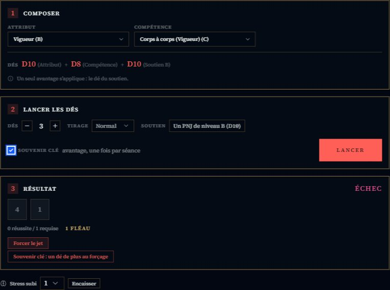
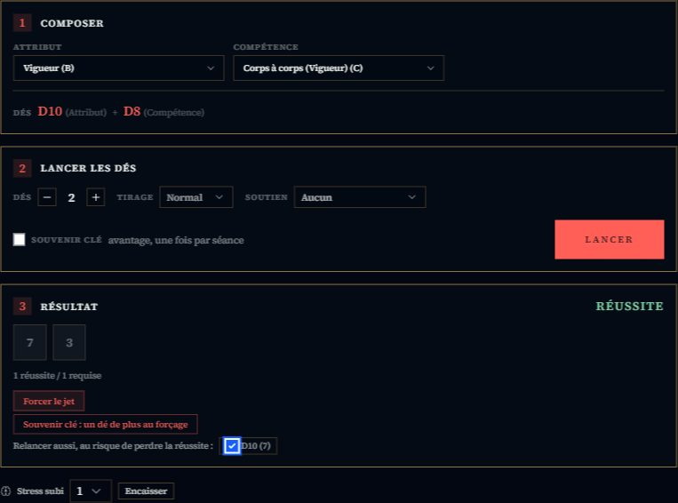
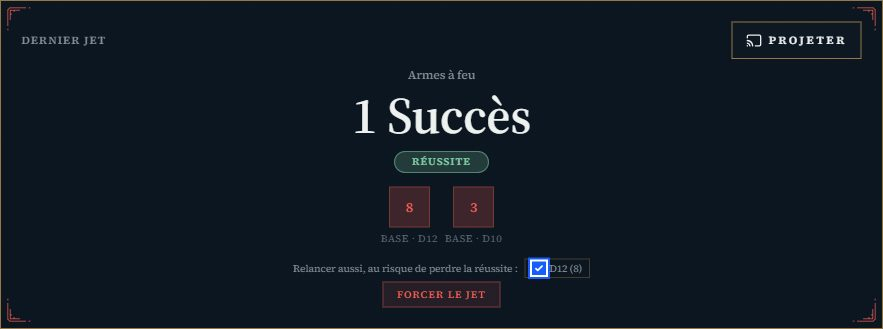
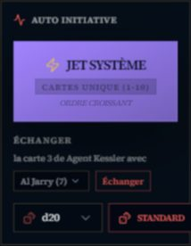
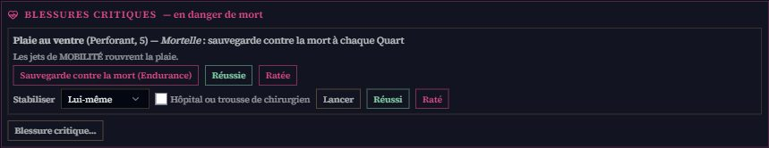
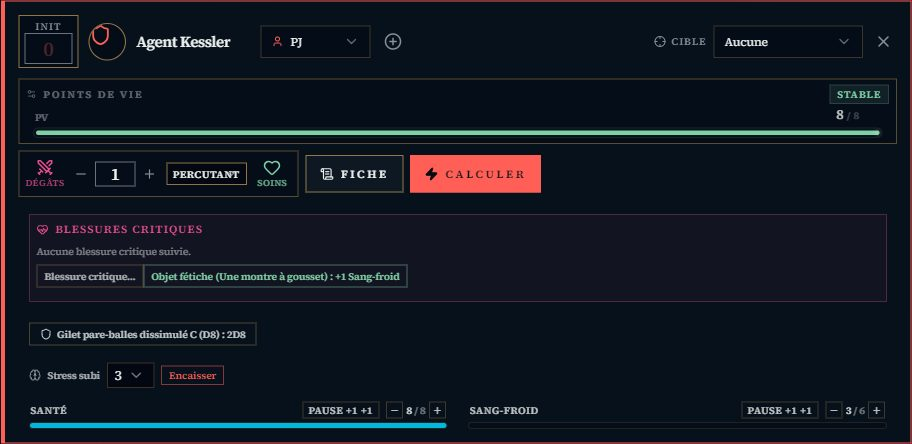

# 🌃 Jeu — Blade Runner

> **Pilote décrit :** « Blade Runner: Le Jeu de Rôle » **2.0.0**, exporté le 2026-10-24 (`Export Dirvers/corriges/BladeRunner_driver_gmos_finir.gmos-driver`), selon le livre de base français (Arkhane Asylum, pages imprimées). Il ajoute au pilote du 16/10 le **suivi des blessures critiques** (mort, stabilisation, guérison, secours), le **soutien**, le **souvenir clé**, l'**objet fétiche** et lève le plafond de deux D12. Réimportez-le avec **Remplacer** : aucun identifiant de champ ne change. Retour à [Les jeux et leurs mécaniques](./53-Les-jeux-et-leurs-mecaniques.md).

Le moteur Year Zero, en **dés échelonnés** : chaque valeur de la fiche est une lettre, et chaque
lettre est un dé.

---

## Le jet — les dés échelonnés

| Lettre | Dé |
| :---: | :---: |
| A | D12 |
| B | D10 |
| C | D8 |
| D | D6 |

- On retient un **Attribut** et une **Compétence** : chacun donne **un dé** de sa taille. Le
  panneau les nomme (« D10 (Attribut) + D8 (Compétence) ») : c'est là qu'on reconnaît son personnage.
- Chaque dé à **6 ou plus** réussit ; à **10 ou plus**, il en vaut deux (p. 54).
- **Avantage** : un troisième dé, du type du plus faible ; **désavantage** : le plus faible
  s'en va. Ils s'annulent, et deux avantages n'en font qu'un (p. 56).
- **Trois D12.** Le livre ne plafonne pas les D12 : un personnage A/A avec un avantage en lance
  trois. *Le SRD Year Zero les plafonne à deux ; ce pilote déclare qu'il n'en a pas.*

### Le soutien

Un allié présent apporte **le dé de son niveau dans la compétence du jet** — au lieu de doubler
le dé le plus faible (p. 57). Le menu **Soutien** propose les personnages du groupe (leur lettre
est lue sur leur fiche) ou un PNJ de niveau A à D. C'est un avantage : il annule un désavantage,
et avec un autre avantage, seul le dé du soutien s'ajoute. Le pupitre a aussi sa lettre **Soutien**.

### Le souvenir clé

Une fois par séance, la case **Souvenir clé** donne d'office un avantage (p. 56). Elle n'apparaît
que si la fiche porte un souvenir clé, et disparaît une fois servie : la séance est celle que la
campagne a ouverte, ou la journée faute de séance. On peut aussi l'appeler **après le jet, avant de
le forcer** : « Souvenir clé : un dé de plus au forçage » ajoute un dé du type du plus faible à la
relance. Si le jet échoue malgré lui et un forçage, le panneau propose **−1 Sang-froid** (le point
de stress du livre).

---

## Forcer un jet

Après le lancer, **« Forcer le jet »** relance tous les dés qui n'ont **ni réussi ni fait 1** —
les 1 (les crânes) restent sur la table. Les dés relancés sont **cerclés**. Puis **chaque 1, jet
initial compris**, coûte un point, décompté sur la fiche (p. 55) :

| Jet | Coût d'un 1 |
| :--- | :--- |
| Vigueur ou Agilité | 1 point de **Santé** |
| Intelligence ou Empathie | 1 point de **Sang-froid** |
| Réplicant, quel que soit l'attribut | 1 point de **Sang-froid** |

- Un **humain** force **une fois**, un **réplicant deux** (champ « Nature »). Au second forçage, un
  crâne déjà payé ne se repaie pas.
- Les cases **« Relancer aussi »** désignent les D10 ou D12 qui n'ont fait qu'une réussite (6 à 9) :
  relancés, ils visent deux réussites — ou les perdent, car le nouveau résultat s'applique.
- À zéro, le panneau dit **« Brisé, une fois l'action résolue »** : l'action va à son terme
  d'abord.
- Sans forçage, les 1 ne coûtent rien.
- **Brisé par le stress** au panneau : « Lancer l'effet critique (Empathie) » jette le dé
  d'Empathie sur la table des effets de stress critiques — humain ou réplicant selon la Nature — et
  **un 1** retire un point de Sang-froid maximal, à vie.

**Au pupitre** (Dice-OS), « Forcer le jet » relance le dernier jet selon la même règle et **annonce**
le prix (« −1 Santé ou Sang-froid à reporter ») : le pupitre ne sait pas quel attribut a servi.
Depuis le 24/10, il propose lui aussi **« Relancer aussi »** pour un D10 ou un D12 à une seule
réussite. *La télécommande force le dernier jet sans ce choix : elle ne voit pas les dés.*

---

## Combat et santé

- **Initiative :** des **cartes numérotées de 1 à 10**, dans l'ordre croissant (p. 65).
- **Surprise et embuscade.** Avant le tirage, le menu **Surprise** donne la carte 1 à un
  combattant ; les autres, son camp compris, tirent dans le reste du paquet (p. 65, 67).
- **Échanger sa carte.** Pendant son tour, avant d'agir, le combattant actif peut **échanger sa
  carte** avec un combattant qui n'a pas encore joué : celui-ci prend la carte et agit aussitôt, et
  ne peut pas l'échanger de nouveau avant le round suivant (p. 65). Le geste s'écrit au journal.
- **Santé** et **Sang-froid** sont suivis sur chaque carte de combattant, plafonnés à leur maximum
  de la fiche, avec un geste **« Pause +1 »** (un Quart de pause ; un réplicant récupère 2 en Santé,
  le second point s'ajoute avec +).
- **Distances** en zones.

### Brisé par les dégâts

À **zéro de Santé**, la carte du combattant — Blade Runner ou adversaire — montre **« Brisé par
les dégâts »** et son rappel : il s'effondre, ne peut que ramper, et **chaque nouveau coup est une
blessure critique** (p. 71).

### Les blessures critiques, suivies une à une

Le bloc **« Blessures critiques »** vit sur la carte de combat **et** sur la fiche du personnage
(carte « Blessures critiques et secours »). La tablette du joueur montre ses blessures et leur
état, sans aucun bouton.

1. **Tirer la blessure.** « Blessure critique… » s'ouvre aussi **avant zéro** : une touche à deux
   réussites inflige une blessure critique (p. 69–70). Choisissez la table (**Percutant**,
   **Perforant**), le **dé de critique** de l'arme (à mains nues ou arme percutante de mêlée : le dé
   de Vigueur de l'attaquant, p. 68), et le **nombre de dés** : un de plus par réussite au-delà de
   celles qu'exige la touche critique (**critiques aggravés**, p. 71). Avec plusieurs dés, on garde
   le résultat voulu. La blessure s'écrit au champ « Blessures critiques » de la fiche, avec son état.
2. **Une blessure mortelle** (p. 72–73) demande une **sauvegarde contre la mort** à chaque fin de sa
   limite de temps (un Round ou un Quart) : un jet d'**Endurance**. Pas Brisé, une sauvegarde ratée
   **se force** (les 1 coûtent la Santé, ou le Sang-froid d'un réplicant) ; Brisé, on lance sans
   forcer. Ratée : le personnage meurt. Certaines blessures tuent sur le coup.
3. **Stabiliser** : un jet d'**Assistance médicale**, aussi long que la limite. Réussi, la limite
   passe d'un Round à un Quart ; réussi sur un Quart, plus de sauvegarde. Raté, on retente après la
   sauvegarde. Hôpital ou trousse de chirurgien : avantage ; se stabiliser soi-même (pas Brisé) :
   désavantage. Brisé et mortellement blessé, il faut **deux jets séparés** : les premiers secours
   et la stabilisation.
4. **Soigner** : un Quart de soins et un jet d'Assistance médicale (matériel professionnel :
   avantage). Réussi, l'effet cesse **à la fin de sa durée** — une semaine ou un mois — ; raté, la
   blessure devient **permanente** (un implant médical y remédie, p. 193). Une durée « permanente »
   est incurable. Quand Clock-OS donne une date de jeu (hors calendrier imaginaire), l'**échéance**
   s'affiche, et le bouton « Guérie » s'allume quand elle est passée.

Chaque jet **se lance** depuis le bloc — le soigneur est le blessé, un personnage du groupe (sa
fiche donne ses dés) ou un PNJ dont on choisit les deux lettres — ou **se reporte** (« Réussi »,
« Raté ») quand il a été fait ailleurs, par exemple depuis la fiche du soigneur qui force son jet.

### Se relever

- **Premiers secours** (p. 71) : sur un Brisé par les dégâts seulement, une autre personne fait un
  jet d'Assistance médicale (colle médicale : avantage) ; il récupère **autant de Santé que de
  réussites**. Sans aide : **+1 Santé au bout d'un Quart**.
- **Main secourable** (p. 76) : sur un Brisé par le stress, un autre lui parle — Manipulation ; il
  récupère **autant de Sang-froid que de réussites**. Sans aide : +1 au bout d'un Quart.
- **Objet fétiche** (p. 76) : une fois par séance, s'il n'est pas Brisé, **+1 Sang-froid** sans
  pause. Le bouton nomme l'objet de la fiche.

### Brisé par le stress, en combat

Le Sang-froid tombé à **zéro sur la carte** — un stress subi, pas seulement un forçage — fait
paraître **« Brisé par le stress »** : **« Lancer l'effet critique »** jette le dé d'**Empathie**
sur la table des effets de stress critiques, **humain ou réplicant** selon la Nature ; **un 1**
retire un point de **Sang-froid maximal à vie** (p. 75–77). L'effet s'ajoute au champ **« Effets
de stress critiques »**.

### Le stress subi

Face à l'horreur, vous fixez un **facteur de stress** : **1** (menaces violentes, un allié qui subit
un critique mortel, une nouvelle angoissante), **2** (la mort d'un allié, un interrogatoire, une
révélation grave), **3** (un massacre, la torture, une découverte qui bouleverse son identité) (p. 75).

Sur la carte de combat d'un Blade Runner, et sous le panneau de jet de sa fiche : **« Stress subi »**,
le facteur, puis **« Encaisser »**. Le bouton lance l'**Empathie** et la **Psychologie** (le jet
réflexe du livre) ; **chaque réussite retire un point**, le reste se retire du **Sang-froid**.
L'historique dit le calcul. À zéro, le panneau **Brisé par le stress** paraît sur la carte. Les
autres pertes du livre (tir en automatique, Quarts sans pause) se retirent avec le − de la carte.

### La protection

Sur la fiche : **Protection** (son nom) et **Protection — niveau** (Sans protection, A à D). Une
protection donne un bouton sur la carte : **« Gilet pare-balles C : 2D8 »**. À chaque coup subi,
lancez-le : **chaque réussite retire un point de dégâts** (un 10 ou plus en vaut deux, comme tout
dé échelonné), et des dégâts ramenés à zéro **annulent la blessure critique** (p. 71). Saisissez
ensuite les dégâts restants. Elle n'absorbe jamais les dégâts d'un forçage et ne s'use pas.

### Les Points d'Humanité

Un champ **« Points d'Humanité »** sur la fiche, relié à la piste de la fiche HTML. Ils se gagnent
en fin de session (un par condition remplie) et servent à **améliorer une compétence** pendant un
Quart de pause : **5** (D → C), **10** (C → B), **15** (B → A). Les attributs ne s'améliorent pas (p. 37).

- **La Santé de la fiche fait foi** : un coup porté en combat la réécrit, et la barre de la carte
  part d'elle.
- La fiche HTML de Blade Runner se relie à son personnage GM-OS : voir
  [Fiche de personnage HTML](./63-Fiche-de-personnage-HTML.md). Blessures critiques, effets de
  stress critiques, protection et Humanité s'y relient.

## Ce qui reste à la main

- Les **touches critiques** elles-mêmes : le meneur dit quand une attaque en inflige une (deux
  réussites au tir, deux de plus que l'adversaire en mêlée) et ouvre le bloc.
- Le **moment** des sauvegardes et des Quarts : l'outil ne sait pas quand une limite de temps
  s'achève.
- Les points de **Promotion**, de **Chinyen** et d'**Humanité** se comptent à la main en fin de session.
- Les **poursuites** (manœuvres, obstacles) : les tables d'obstacles sont dans Table-OS, les
  manœuvres se jouent au jet ordinaire.
- La télécommande force sans relancer de réussite.
