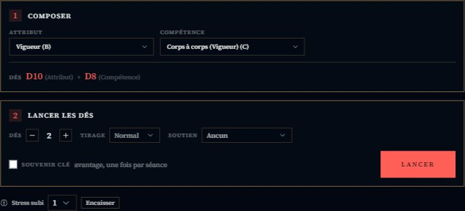
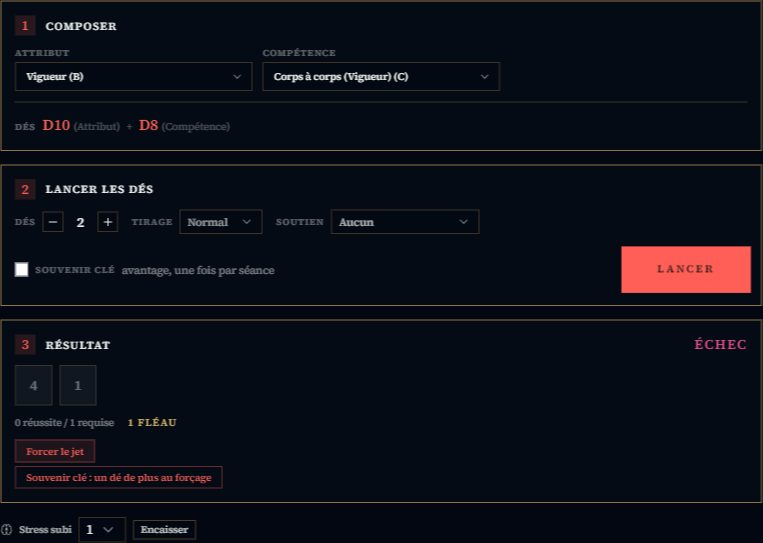

# 🌃 Jeu — Blade Runner

> **Pilote décrit :** « Blade Runner: Le Jeu de Rôle », exporté le 2026-10-14 ; Brisé ajouté le même soir. Retour à [Les jeux et leurs mécaniques](./53-Les-jeux-et-leurs-mecaniques.md).

Le moteur Year Zero, en **dés échelonnés** : chaque valeur de la fiche est une lettre, et chaque
lettre est un dé.

---

## Le jet — les dés échelonnés

| Lettre | Dé |
| :---: | :---: |
| A | D12 |
| B | D10 |
| C | D8 |
| D | D6 |

- On retient un **Attribut** et une **Compétence** : chacun donne **un dé** de sa taille. Le
  panneau les nomme (« D10 (Attribut) + D8 (Compétence) ») : c'est là qu'on reconnaît son personnage.
- Chaque dé à **6 ou plus** réussit ; à **10 ou plus**, il en vaut deux.
- **Avantage / Désavantage** ajoute ou retire un dé, comme le décrit le livre.

---

## Forcer un jet

Après le lancer, **« Forcer le jet »** relance tous les dés qui n'ont **ni réussi ni fait 1** —
les 1 (les crânes) restent sur la table. Les dés relancés sont **cerclés**. Puis **chaque 1, jet
initial compris**, coûte un point, décompté sur la fiche :

| Jet | Coût d'un 1 |
| :--- | :--- |
| Vigueur ou Agilité | 1 point de **Santé** |
| Intelligence ou Empathie | 1 point de **Sang-froid** |
| Réplicant, quel que soit l'attribut | 1 point de **Sang-froid** |

- Un **humain** force **une fois**, un **réplicant deux** (champ « Nature »). Au second forçage, un
  crâne déjà payé ne se repaie pas.
- À zéro, le panneau dit **« Brisé, une fois l'action résolue »** : l'action va à son terme
  d'abord.
- Sans forçage, les 1 ne coûtent rien.
- **Brisé.** À zéro de Santé, le panneau dit **Brisé par les dégâts** (il s'effondre, ne peut que
  ramper ; tout nouveau dégât est une blessure critique). À zéro de Sang-froid, **Brisé par le
  stress** : « Lancer l'effet critique (Empathie) » jette le dé d'Empathie sur la table des effets de
  stress critiques — humain ou réplicant selon la Nature — et **un 1** retire un point de Sang-froid
  maximal, à vie.
- **Au pupitre** (et depuis la télécommande), « Forcer le jet » relance le dernier jet selon la même
  règle, mais **annonce** le prix (« −1 Santé ou Sang-froid à reporter ») : le pupitre ne sait pas
  quel attribut a servi.

> ⚠️ Règle lue dans le corpus (« FORCER UN JET »), qui n'est pas encore relu contre le livre :
> on y suit la convention Year Zero — réussites et crânes restent, le reste se relance.

---

## Combat et santé

- **Initiative :** des **cartes numérotées de 1 à 10**, dans l'ordre croissant.
- **Santé** et **Sang-froid** sont suivis sur chaque carte de combattant, plafonnés à leur maximum
  de la fiche, avec un geste **« Pause +1 »** (un Quart de pause ; un réplicant récupère 2 en Santé,
  le second point s'ajoute avec +).
- **Distances** en zones. **Deux tables de butin** sont livrées avec le pilote.
- La fiche HTML de Blade Runner se relie à son personnage GM-OS : voir
  [Fiche de personnage HTML](./63-Fiche-de-personnage-HTML.md).
