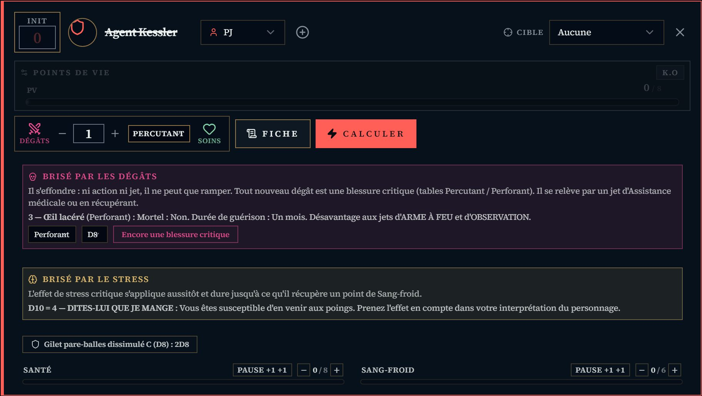

# 🌃 Jeu — Blade Runner

> **Pilote décrit :** « Blade Runner: Le Jeu de Rôle », exporté le 2026-10-16 et corrigé le jour même (Humanité, blessures critiques, protection, Brisé en combat). Retour à [Les jeux et leurs mécaniques](./53-Les-jeux-et-leurs-mecaniques.md).

Le moteur Year Zero, en **dés échelonnés** : chaque valeur de la fiche est une lettre, et chaque
lettre est un dé.

---

## Le jet — les dés échelonnés

| Lettre | Dé |
| :---: | :---: |
| A | D12 |
| B | D10 |
| C | D8 |
| D | D6 |

- On retient un **Attribut** et une **Compétence** : chacun donne **un dé** de sa taille. Le
  panneau les nomme (« D10 (Attribut) + D8 (Compétence) ») : c'est là qu'on reconnaît son personnage.
- Chaque dé à **6 ou plus** réussit ; à **10 ou plus**, il en vaut deux.
- **Avantage / Désavantage** ajoute ou retire un dé, comme le décrit le livre.

---

## Forcer un jet

Après le lancer, **« Forcer le jet »** relance tous les dés qui n'ont **ni réussi ni fait 1** —
les 1 (les crânes) restent sur la table. Les dés relancés sont **cerclés**. Puis **chaque 1, jet
initial compris**, coûte un point, décompté sur la fiche :

| Jet | Coût d'un 1 |
| :--- | :--- |
| Vigueur ou Agilité | 1 point de **Santé** |
| Intelligence ou Empathie | 1 point de **Sang-froid** |
| Réplicant, quel que soit l'attribut | 1 point de **Sang-froid** |

- Un **humain** force **une fois**, un **réplicant deux** (champ « Nature »). Au second forçage, un
  crâne déjà payé ne se repaie pas.
- À zéro, le panneau dit **« Brisé, une fois l'action résolue »** : l'action va à son terme
  d'abord.
- Sans forçage, les 1 ne coûtent rien.
- **Brisé.** À zéro de Santé, le panneau dit **Brisé par les dégâts** (il s'effondre, ne peut que
  ramper ; tout nouveau dégât est une blessure critique). À zéro de Sang-froid, **Brisé par le
  stress** : « Lancer l'effet critique (Empathie) » jette le dé d'Empathie sur la table des effets de
  stress critiques — humain ou réplicant selon la Nature — et **un 1** retire un point de Sang-froid
  maximal, à vie.
- **Au pupitre** (et depuis la télécommande), « Forcer le jet » relance le dernier jet selon la même
  règle, mais **annonce** le prix (« −1 Santé ou Sang-froid à reporter ») : le pupitre ne sait pas
  quel attribut a servi.

> ✅ Relu contre le carnet NotebookLM « Blade Runner » le 2026-10-16 (« Forcer un jet », p. 55) :
> *« relancer tous les dés à l'exception de ceux qui ont donné un résultat de 1 »* — les 1 restent, et
> les réussites restent si vous le souhaitez. ⚠️ Le livre permet aussi de **relancer un D10 ou un D12
> qui n'a fait qu'une réussite**, pour viser deux : GM-OS ne le propose pas, relancez-le à la main.

---

## Combat et santé

- **Initiative :** des **cartes numérotées de 1 à 10**, dans l'ordre croissant.
- **Santé** et **Sang-froid** sont suivis sur chaque carte de combattant, plafonnés à leur maximum
  de la fiche, avec un geste **« Pause +1 »** (un Quart de pause ; un réplicant récupère 2 en Santé,
  le second point s'ajoute avec +).
- **Distances** en zones. **Deux tables de butin** sont livrées avec le pilote.

> Règles relues contre le carnet NotebookLM « Blade Runner » le 2026-10-16 (« BRISÉ PAR LES
> DÉGÂTS », « BRISÉ PAR LE STRESS », « ÉQUIPEMENT DE PROTECTION », « Blessures critiques »,
> « Promotion et Humanité »).

### Brisé par les dégâts — les blessures critiques

À **zéro de Santé**, la carte du combattant — Blade Runner ou adversaire — montre **« Brisé par
les dégâts »** et son rappel : il s'effondre, ne peut que ramper, et **chaque nouveau coup est une
blessure critique**.

1. Choisissez la table : **Percutant** ou **Perforant**.
2. Choisissez le **dé de critique de l'arme** (D6 à D12 ; à mains nues, le dé de Vigueur de
   l'attaquant).
3. **« Blessure critique »** tire dans la table, l'écrit à l'historique et au journal, et
   **l'ajoute au champ « Blessures critiques »** de la fiche. Le bouton reste : **« Encore une
   blessure critique »** pour le coup suivant.

Une blessure critique peut aussi tomber **avant zéro**, sur une touche à deux réussites : tirez-la
dans Table-OS. Les sauvegardes contre la mort, la stabilisation et les durées de guérison restent
à la main.

### Brisé par le stress, en combat

Le Sang-froid tombé à **zéro sur la carte** — un stress subi, pas seulement un forçage — fait
paraître **« Brisé par le stress »** : **« Lancer l'effet critique »** jette le dé d'**Empathie**
sur la table des effets de stress critiques, **humain ou réplicant** selon la Nature ; **un 1**
retire un point de **Sang-froid maximal à vie**. L'effet s'ajoute au champ **« Effets de stress
critiques »**. Le même geste, au panneau de jet après un forçage, écrit lui aussi l'effet sur la
fiche.

### La protection

Sur la fiche : **Protection** (son nom) et **Protection — niveau** (Sans protection, A à D). Une
protection donne un bouton sur la carte : **« Gilet pare-balles C : 2D8 »**. À chaque coup subi,
lancez-le : **chaque réussite retire un point de dégâts** (un 10 ou plus en vaut deux, comme tout
dé échelonné), et des dégâts ramenés à zéro **annulent la blessure critique**. Saisissez ensuite les
dégâts restants. Elle n'absorbe jamais les dégâts d'un forçage et ne s'use pas.

### Les Points d'Humanité

Un champ **« Points d'Humanité »** sur la fiche, relié à la piste de la fiche HTML. Ils se gagnent
en fin de session (un par condition remplie) et servent à **améliorer une compétence** pendant un
Quart de pause : **5** (D → C), **10** (C → B), **15** (B → A). Les attributs ne s'améliorent pas.

- **La Santé de la fiche fait foi** (2026-10-16) : un coup porté en combat la réécrit, et la barre
  de la carte part d'elle — avant, la carte pouvait dire 0 / 10 pendant que la fiche disait 8 / 8.
- La fiche HTML de Blade Runner se relie à son personnage GM-OS : voir
  [Fiche de personnage HTML](./63-Fiche-de-personnage-HTML.md). Blessures critiques, effets de
  stress critiques, protection et Humanité s'y relient désormais aussi.

## Ce qui reste à la main

- Le **facteur de stress** (1 à 3) et le jet de **Psychologie** qui le réduit : retirez le
  Sang-froid avec le − de la carte.
- La relance optionnelle d'un D10 ou D12 à une seule réussite, au forçage.
- Sauvegardes contre la mort, stabilisation, durées de guérison des blessures critiques.
