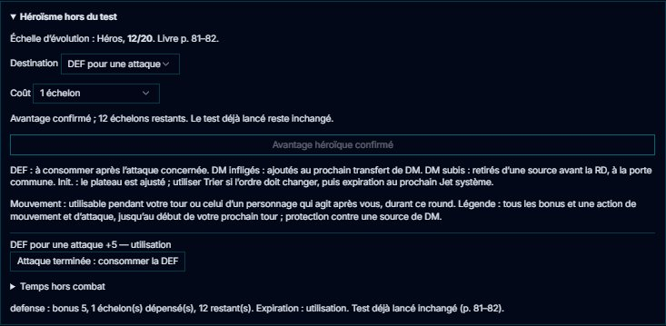
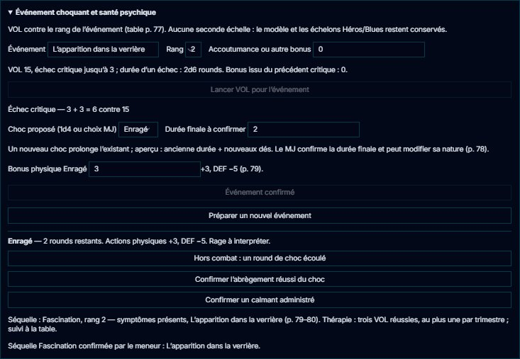
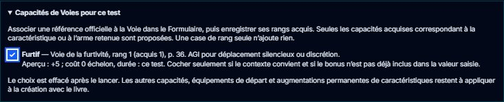
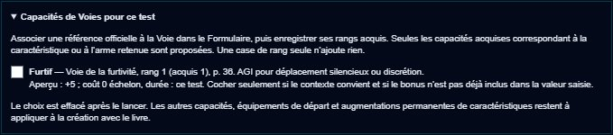
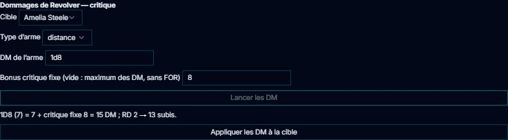
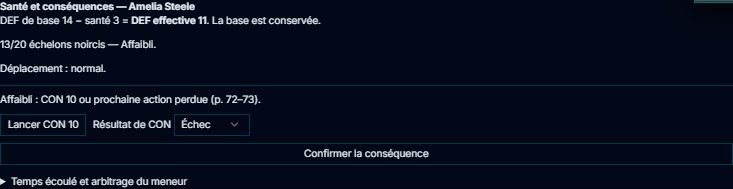
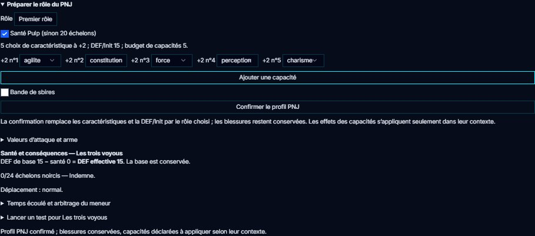
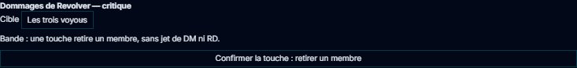

# 🎭 Jeu — Chroniques Oubliées Contemporain

> **Pilote décrit :** « coc », forgé par David, exporté le 2026-10-31, amélioré le 2026-11-04,
> version **2.2.0**, lots COC-A1 à COC-A6. Réimporter [la version d20](../../Export%20Dirvers/corriges/coc/COC-2.2.0-d20.gmos-driver)
> avec **Remplacer** ; [variante 3d6](../../Export%20Dirvers/corriges/coc/COC-2.2.0-option-3d6.gmos-driver).
> **Lots COC-A1 à COC-A6 testés et validés par David le 05/11/2026.**
> Générateurs : `outils/coc/ameliorer_coc.mjs` puis `etendre_coc.mjs`. Thème `coc`, fiche de personnage
> HTML, bannière et identité livrés le même jour par Codex. Retour à
> [Les jeux et leurs mécaniques](./53-Les-jeux-et-leurs-mecaniques.md).

Un seul geste : le **test**. On lance un **d20**, on ajoute **une caractéristique** — ou une
attaque, ou le bonus d'une arme — et les modificateurs, et le total doit atteindre la
**difficulté** (5 à 25) ou la **DEF** de la cible. Le **20 naturel** est une réussite critique,
le **1 naturel** un échec critique. Autour : le **dé bonus** et le **dé malus**, l'**échelle de
santé** en vingt cases noircies, et **une échelle d'évolution**, celle du héros ou celle du blues.
La fiche HTML est reliée champ par champ. Les figurants et seconds rôles explicitement déclarés
ne peuvent pas obtenir de réussite critique, même sur 20 ; leur échec critique reste possible.

> Règles relues contre le livre de règles de la 2e édition le 2026-10-31 — pages imprimées 8,
> 14-33, 55-111, 121. Les dix-huit fiches du corpus `docs/systems/coc/rules/` sont corrigées
> d'après lui.

**Réimporter le pilote avec « Remplacer ».** Le pilote forgé additionnait l'Agilité et
l'Intelligence pour en faire le seuil de chaque dé et exigeait **dix réussites d'un seul d20** :
**tous les tests échouaient**. Il comptait aussi un 1 pour deux réussites et un 20 pour une
complication, et faisait baisser l'échelle de santé comme des points de vie. La version 2.0.0
garde son identifiant, mais **sa fiche change** : trois lignes d'avantages et désavantages,
trois armes, la protection, six voies de cinq rangs et une seule échelle d'évolution remplacent
les zones de texte « Voies », « Avantages », « Armes » et les échelles du héros et du blues. Les
caractéristiques, l'identité, les rubriques de la personnalité et l'échelle de santé gardent leur
identifiant ; un personnage créé avec la fiche forgée garde ses anciennes valeurs, mais ses voies,
armes et traits sont à ressaisir. Sa santé passe aux cases au premier coup reçu.

**Anciennes fiches — NP-C2, 03/11/2026.** Le meneur peut maintenant préparer une
[reprise avec aperçu et sauvegarde](./63-Fiche-de-personnage-HTML.md#reprendre-une-ancienne-fiche)
depuis le formulaire du PJ. Les anciennes clés restent présentes ; les correspondances se
choisissent explicitement, sans déduire une conversion de leurs noms. Les notes et la santé
ne sont pas remises à zéro. L'import d'une campagne conserve un pilote de même ID et signale
les différences ; pour changer ce pilote, importer son .gmos-driver avec **Remplacer**.
252 tests ciblés et six parcours Electron passent le 03/11 ; huit captures relues.
Validation globale de David : « ok tout est testé, commit et pousse ».

---

## Le clip des mécanismes et du joueur sur tablette — 06/11/2026

[Voir le clip MP4 (3 min 52)](../../output/clips/coc-mecanismes-et-tablette.mp4) : huit chapitres, légendes françaises, sans voix.
Test, héroïsme, Voies, choc psychique, PNJ/bandes, dégâts et santé, puis le vrai Hub joueur
avec des touchers simulés par Playwright : choix de Furtif, jet, héros et édition de la fiche HTML.
Les jets et modifications sont vérifiés côté MJ. Écran émulé768×1024, sans tablette physique.
Aucun module indépendant COC au catalogue actuel ; les outils intégrés sont filmés.
Personnages fictifs, valeurs d’exercice et dés préparés ; pilote2.2.0 d20 inchangé.
[Repères des chapitres](../../output/clips/coc/chapitres.md).

## Le test

- **Composer** : une **caractéristique** (AGI, CON, FOR, PER, CHA, INT, VOL), l'**ATC** ou
  l'**ATD**, ou une **arme** de la fiche sous son nom — « Couteau (2) » —, dont le bonus est celui
  de la feuille, « bonus après 1D20 + » (p. 56, 87). La ligne **Bonus** dit ce qui s'ajoute au dé.
- **Préparer** :
  - la **difficulté** : Très facile 5, Facile 10, Moyenne 15 (par défaut), Difficile 20, Très
    difficile 25 (p. 58) ; pour une arme ou une attaque, le champ se nomme **DEF de la cible** ;
    pour un test en opposition, le total de l'adversaire ;
  - les **conditions** favorables moins défavorables : elles se compensent, une qui reste vaut
    ±2, deux ±5, trois et plus ±10 (p. 87-88) ;
  - les **aides** : +2 par allié (p. 61) ;
  - **Autre** : un rang de voie, le sentiment de l'interlocuteur, l'approche (p. 65-66) ;
  - le pire **état préjudiciable** : fatigué −2, épuisé −5, asphyxié −5, ralenti ou renversé −5
    en attaque, aveuglé −10 sur la vue (p. 63-65) ;
  - le **dé bonus** et le **dé malus** : deux d20, le meilleur ou le pire ; ils ne se cumulent
    pas et s'annulent (p. 59) ;
  - les **plages critiques** : réussite critique dès 18 en ciblant un organe vital ou au fusil de
    précision, échec critique jusqu'à 3 ou 6 face à un événement traumatisant (p. 77, 90, 94) ;
  - **prendre son temps** : 10 au lieu du dé, sans critique (p. 59) ; **rapide et furieux** :
    réussite sans lancer si le total atteint déjà la difficulté (règle optionnelle, p. 59).
- L'**état de santé** retire son malus aux **actions physiques** — AGI, CON, FOR et les
  attaques ; la case « Action physique » le corrige pour un autre test (p. 71).
- Le **blues** joue sur la VOL et la coercition (+), sur les autres interactions et la PER qui
  lit les émotions (−) (p. 84).

| Résultat | Quand (p. 58) |
| :--- | :--- |
| **Réussite critique** | le d20 dans la plage critique — 20 d'ordinaire —, quel que soit le total ; sur une attaque, le **bonus critique** de l'arme s'ajoute aux DM |
| **Réussite** | le total atteint la difficulté |
| **Échec** | le total reste en dessous |
| **Échec critique** | le d20 dans la plage d'échec — 1 d'ordinaire —, quel que soit le total |

Sous le résultat, la **marge** sert à une recherche à plusieurs seuils (10, 15, 20 : un, deux ou
trois indices, p. 68).

## L'échelle du héros, l'échelle du blues

Le livre donne à chaque univers **une** échelle d'évolution, et en propose deux (p. 80-84). La
fiche porte son **modèle**, « Héros » par défaut ou « Blues », et son échelon.

- **Héros** : après un test, le panneau propose de régresser d'un échelon pour **+2** (palier 1,
  dès le premier échelon) ou **+5** (palier 2, au 10e), de deux pour doubler. Le bonus s'ajoute au test qui vient d'être fait : le total peut franchir la
  difficulté, un 1 naturel reste un échec critique. Une réussite ou un échec critique propose
  **+1 échelon**. Les avantages hors du test et la Légende ont leur propre carte (p. 82).
- **Blues** : ses états (Perturbé à 5, Déstabilisé à 10, Tourmenté à 15, Cramé à 20) donnent ±1,
  ±3, ±5, ±10 au test préparé (p. 84). Le monter et le faire régresser reste au meneur.

## Héroïsme hors du test

Ouvrir la carte **Héroïsme hors du test** dans l’onglet du test. Choisir la destination,
vérifier l’aperçu et le coût, puis confirmer. Le même champ d’évolution est débité une seule
fois ; **Blues ne permet pas ces achats**. Une DEF achetée ici ne modifie pas le test déjà lancé.
Vérifier que le bonus n’a pas déjà été saisi à la main dans les valeurs de la fiche.

| Destination | Effet au palier Aventurier / Héros | Fin de l’effet |
| --- | --- | --- |
| Init. actuelle | +2 / +5, doublable pour deux échelons, après détermination de l’Init. | Prochain **Jet système** d’initiative ; le plateau est ajusté, utiliser **Trier** si nécessaire |
| DEF pour une attaque | +2 / +5, doublable ; DEF de base conservée | **Attaque terminée : consommer la DEF** |
| DM infligés après le jet | +2 / +5, doublable | Prochain transfert de DM depuis le panneau de l’arme |
| Une source de DM subis | −2 / −5, doublable, avant la RD | Premier impact confirmé ; soins exclus |
| Mouvement | Une action de mouvement au palier Héros, coût un échelon | Consommation explicite ou fin du round ; utilisable durant votre tour ou celui d’un personnage qui agit après vous |

**Légende**, au 20e échelon, coûte un échelon et ne se double pas. Elle donne **+10 à tous
les tests, Init., DEF et DM infligés**, réduit **une source de DM subis de 10** et accorde
une action de mouvement et une attaque supplémentaires. Les boutons consomment les actions
une fois ; tous ces effets expirent **au début de votre prochain tour**. Le bouton du résultat
qui n’ajoutait que +10 à un seul test est remplacé par ce parcours complet sur le pilote 2.2.

Les DM achetés s’ajoutent après les dés : 15 DM + héros 5 − RD 2 = 18 subis. En réception :
15 − héros 5 − RD 2 = 8. Les mêmes règles s’appliquent aux PJ, aux PNJ liés et aux adversaires
autonomes. Le rechargement ne consomme ni n’expire d’effet. Hors combat, les boutons du détail
**Temps hors combat** confirment le début du prochain tour ou la fin du round.

## Événement choquant et santé psychique

Le meneur prépare la carte **Événement choquant et santé psychique** : décrire l’événement,
choisir son rang, saisir l’accoutumance éventuelle, puis lancer VOL. Les capacités acquises
qui concernent cette VOL peuvent être cochées si leur contexte est pertinent.

| Rang | Difficulté d20 | Échec critique | Choc en cas d’échec |
| --- | --- | --- | --- |
| 1 | 10 | 1 | 1d6 rounds |
| 2 | 15 | 1–3 | 2d6 rounds |
| 3 | 20 | 1–6 | 3d6 rounds |

La table imprimée p. 77 fait référence ; l’exemple p. 78 qui donne 1–3 pour le rang 3 la
contredit. Une réussite surmonte l’événement ; un critique réussi donne **+5 à la prochaine
VOL d’événement choquant**, consommé à sa confirmation. Un échec propose un choc ; un échec
critique propose en plus une séquelle, confirmée séparément par le meneur.

Le tirage propose une nature sur 1d4 et une durée. Le meneur vérifie ou modifie ces valeurs,
puis confirme : **Brisé** est une crise à interpréter, sans malus chiffré ; **Enragé** donne
+3 aux actions physiques et −5 DEF ; **Paniqué** cherche à fuir, et devient inconscient si la
fuite est impossible ; **Tétanisé** est Immobilisé. Le pire malus de santé ou de choc s’applique
à la DEF. Le calme sous sédatif impose Ralenti pendant la durée restante : Init./DEF/attaques
−5, mouvement limité à 5 m ou une seule action par round. L’économie d’action et les critiques
automatiques contre un personnage Immobilisé/Inconscient restent à arbitrer à la table.

Un nouveau choc prolonge l’existant. L’aperçu additionne sa durée restante et les nouveaux dés ;
le livre ne détaille pas l’arithmétique du cumul, donc **le meneur confirme la durée finale**
et peut changer la nature du choc. **Tour suivant** compte les rounds du plateau ; hors combat,
un bouton confirme un round écoulé. Un rechargement ne compte pas de temps.

Après un round dans un lieu sûr, une VOL réussie à la difficulté du rang peut abréger le choc.
Un tiers peut consacrer un round au dialogue et remporter CHA contre VOL. Le bouton de fin du
choc confirme cet arbitrage ; il ne lance pas ces tests à votre place. Un calmant remplace les
effets par Ralenti, sans raccourcir le compteur.

Les séquelles **Amnésie, Déni, Fascination, Réminiscence** se choisissent ou se proposent sur
1d4, puis se confirment, avec symptômes immédiats ou différés. Leur interprétation, les
déclencheurs particuliers et la thérapie restent à la table (livre p. 79–80). Le Hub montre au
joueur le choc et les séquelles confirmés ; il ne les décide pas. Aucun de ces gestes ne crée
une seconde jauge ni ne dépense les échelons de Blues.

## Capacités de Voies pour ce test

Dans le **Formulaire**, associer une référence à une Voie, puis enregistrer les rangs acquis
dans l’ordre. Ce premier ensemble couvre **Armes de contact**, **Furtivité** et **Investigation**.
La référence est explicite : un nom libre ou un rang coché sans référence n’ajoute rien.
Une même référence placée dans deux Voies ne produit pas de bonus : corriger le doublon.

| Capacité | Conditions | Effet proposé |
| --- | --- | --- |
| Amateur, contact (rang 1, p. 29) | ATC avec arme de contact, ou VOL face à la violence de cet affrontement | +1 par rang acquis dans la Voie |
| Furtif (rang 1, p. 36) | AGI pour se déplacer silencieusement ou agir discrètement | +5 |
| Vigilant (rang 2, p. 36) | PER liée aux cinq sens ; PER 15 pour éviter surprise ou piège | +5 |
| Fin limier (rang 1, p. 37) | Fouille : preuve en PER, détail en INT | +1 par rang acquis dans la Voie |
| Spécialiste (rang 2, p. 37) | INT liée à la spécialité d’investigation choisie | Un dé bonus |

Dans l’onglet du test, choisir la caractéristique ou l’arme, ouvrir la carte des capacités,
puis **cocher seulement celles dont le contexte convient**. L’aperçu montre le bonus, sa source,
le coût **0 échelon** et la durée **ce test**. Ne pas ajouter une seconde fois un bonus déjà
inclus dans une valeur d’attaque. Après le lancer, les choix sont décochés ; la composition et
le journal gardent le nom et la page de la capacité employée.

Le Hub utilise les mêmes rangs enregistrés et le même calcul, et transmet le jet au journal
du meneur. Les autres capacités de ces Voies, les équipements de départ et les gains permanents
de caractéristiques ne sont pas automatisés par ce premier ensemble.

## L'échelle de santé

Les **DM** noircissent les cases de l'échelle de santé, vingt d'ordinaire (p. 71). Combat-OS
retire d'abord la **RD** de la protection écrite sur la fiche, sauf pour un dégât « sans
protection » (chute, feu, poison) (p. 88). Chaque état franchi se dit au journal avec ses effets
(p. 72) :

| État | Échelon | Malus | Ce que le livre ajoute |
| :--- | :--- | :--- | :--- |
| Contusionné | 5 | −1 | — |
| Affaibli | 10 | −3 | test de CON 10 pour ne pas perdre sa prochaine action |
| Blessé | 15 | −5 | déplacements réduits de moitié ; il perd sa prochaine action et fait un test de CON 15 |
| Mourant | 20 | −10 | inconscient 1d6 rounds, puis test de CON 20 — échec : coma, puis mort |

- Plus de **20 + CON** DM en un coup noircissent tout : **mort instantanée** ; un coup reçu par un
  mourant appelle le **coup de grâce**, un test de CON 20 (p. 73).
- Le malus de l'état s'applique aussi à l'**initiative** — 10 + INT + PER, sans dé — quand le
  Jet système la calcule (p. 71, 85).
- Un soin efface les cases ; la guérison au rythme de la CG (CON + 3 par semaine) se tient à la
  table (p. 73).

## De l’arme aux DM

Après une attaque réussie, **Dommages** reprend les valeurs de l’arme au moment du jet.
Choisir la cible et préciser son type. Les DM saisis doivent être ceux de l’arme **sans la FOR** :
GM-OS ajoute la FOR au contact, à mains nues et au lancer, puis le **bonus critique fixe**
en cas de critique. Ce bonus est le maximum des DM de l’arme, sans FOR ; le champ de la fiche
peut le préciser. Les dés ne sont pas doublés. Vérifier les anciens champs de DM qui incluaient
déjà la FOR pour éviter de l’ajouter deux fois.

**Appliquer les DM à la cible** transmet les DM bruts ; la porte commune retire la RD une fois.
Le coup est verrouillé après confirmation, y compris vers une autre cible et après rechargement.
L’exemple du livre donne 15 DM bruts, puis 13 échelons avec RD 2. Pour une bande, le bouton
confirme directement une touche sans lancer les DM. Les résistances particulières, les effets
de zone et les dommages aux structures restent à arbitrer : un explosif critique utilise le
maximum sans bonus supplémentaire, mais son éventuel test d’AGI et la réduction des DM restent
à résoudre avant une saisie dans le calculateur de dégâts commun.

**Le catalogue d'équipement** (depuis le 2026-11-06) : « Remplir depuis le corpus », dans
l'éditeur du pilote, section Équipement, lit la fiche
`equipement-armes-et-protections-du-livre-de-base.md`, transcrite depuis le livre : **36 armes**
(contact, distance légères et lourdes, explosifs ; p. 93-95) et **8 protections** (p. 96), avec
allonge ou portée, DM, bonus critique, magasin, RD et malus, et **une colonne de prix par époque**
(2025, 1985, 1945, 1905, 1865 ; p. 53-54) quand le nom de l'arme concorde. Les DM y sont écrits
comme le livre les imprime, « 1d6+FOR » : sur la fiche du personnage, saisir **1d6** (GM-OS ajoute
la FOR). Chaque objet porte son bouton « Livre, p. N ».

## Santé et conséquences

La carte **Santé et conséquences COC**, dans l’onglet du test, conserve la **DEF de base**
et montre la **DEF effective**, après le seul malus de santé le plus grave. Avant une attaque,
le sélecteur **Défenseur** permet de reprendre cette DEF comme difficulté, par un clic.

Un franchissement de seuil par des dégâts propose la conséquence. **Lancer CON** utilise le
moteur du jeu et le malus de santé ; le meneur peut aussi renseigner un résultat joué à la table,
puis **Confirmer la conséquence**. Affaibli : CON 10 ou prochaine action perdue. Blessé : action
perdue et CON 15, ou inconscience 1d6 rounds. Le déplacement est rappelé : moitié blessé,
impossible mourant. Les conséquences en attente et les incapacités bloquent un nouveau test.

**Consommer la prochaine action perdue** ne le fait qu’une fois. Pour une action physique
blessé ou mourant, **Préparer une action physique** propose CON 15 ou 20 ; sa réussite autorise
un test physique, qui consomme l’autorisation. L’échec blessé ajoute 1 DM sans RD et provoque
l’inconscience jusqu’à la fin du prochain tour (action engagée pendant son propre tour).

Mourant : confirmer 1d6 rounds d’inconscience, puis CON 20 au réveil. Le coma affiche son délai
en minutes ou en rounds ; une échéance propose la mort, à confirmer. Stabilisation et séquelle
restent des décisions explicites du meneur. **Tour suivant** avance les durées ; hors combat,
le détail **Temps écoulé** permet de compter les tours, rounds ou minutes. Ne pas compter deux
fois le même temps. Le rechargement n’avance rien. Les soins effacent les blessures sans rejouer
les conséquences ; ils ne consomment ni n’effacent une conséquence déjà confirmée. **Rectifier
le suivi** permet un arbitrage explicite, en conservant la santé.

## PNJ par rôle, Pulp et bandes

Dans Combat-OS, ouvrir **COC — rôles, santé et tests des adversaires**, puis choisir un PNJ
de la campagne ou un combattant autonome. Choisir son rôle, les caractéristiques à +2,
ses capacités Pro/Expert et, si souhaité, **Santé Pulp**. Confirmer le profil remplace ses
caractéristiques et sa DEF/Init ; les blessures et les autres champs restent conservés.
Les capacités ont un budget contrôlé ; leurs effets se renseignent et s’appliquent selon
leur contexte. ATC/ATD retiennent le bonus de capacité ou, à défaut, la caractéristique :
ne pas les additionner (p. 111). Les valeurs d’attaque et l’arme restent éditables ici.

| Rôle | Choix à +2 | DEF/Init | Budget Pro 1 / Expert 2 | Standard | Pulp | Critique |
| --- | --- | --- | --- | --- | --- | --- |
| Figurant | 1 | 10 | 1 | 20 | 4 | aucune réussite critique |
| Second rôle | 3 | 12 | 3 | 20 | 12 | aucune réussite critique |
| Premier rôle | 5, un choix peut être répété pour +4 | 15 | 5 | 20 | 24 | 20, plage ajustable selon capacité |

Les états du premier rôle Pulp arrivent à **6/12/18/24**. Une petite échelle ignore les états
déjà noircis à la création : Pulp 4 n’a que Mourant à 4 ; Pulp 12 a Affaibli à 2, Blessé à 7,
Mourant à 12. Rien n’active Pulp automatiquement, ni ne transforme un PJ en PNJ.

**Bande de sbires** remplace la santé individuelle par l’effectif initial. Une touche élimine
un membre, sans DM ni RD. Les conditions favorables de surnombre sont ajoutées aux conditions
du jet et se compensent avec les défavorables : trois membres donnent +5 en l’absence d’autre
condition. Ne pas reporter le surnombre une seconde fois dans « Autre » ou « Conditions ».
Une bande agit avec une attaque et un mouvement par tour ; la table gère leur consommation.

## La fiche du personnage

La fiche fidèle au PDF (`docs/fiches/COC/`, gabarit `coc2-fr`, moteur de fiches **version 22**)
s'ouvre dans l'onglet **Fiche du jeu**. Ses **151 clés** sont reliées une à une aux champs du
pilote (`docs/systems/coc/fiche/correspondance.json`). L'échelle de santé compte les échelons
noircis ; celle de la seconde page, l'échelon de l'échelle d'évolution.

La fiche GM-OS a des champs que la feuille n'imprime pas : les rubriques de « Donner corps à
votre personnage » (genre, taille, poids, statut social, personnalité, convictions, ambitions,
entourage, histoire, p. 15-18), le **modèle** de l'échelle d'évolution et les **points
d'expérience** (un par séance, p. 28).

## L'option du 3d6

Import 3d6, lancer et retour au d20 éprouvés le 03/11 ; les personnages et leurs valeurs restent conservés.

Le livre propose de remplacer le d20 par **3d6** pour un ton plus dramatique (p. 60-61). Le
pilote la règle dans `jet.coc.des` : la variante est prête,
`Export Dirvers/corriges/coc/COC-2.2.0-option-3d6.gmos-driver`,
à réimporter avec « Remplacer » — et la version au d20 de même pour revenir. Le panneau lance alors 3d6 (4d6 en gardant les trois meilleurs
avec un dé bonus, 2d6 avec un dé malus), propose les difficultés 8, 11, 14, 17 et 20, et ramène
les modificateurs de 2, 5 et 10 à 1, 3 et 5, ceux des échelles à 1, 2, 3 et 5. Le livre ne
chiffre pas le critique au 3d6 : GM-OS le lit sur **18**, l'échec critique sur **3**. Les points
de caractéristique et les voies (+1, +2, +3 aux rangs 1, 3, 5) se règlent à la création.

Les capacités contextuelles de la carte appliquent cette progression par rang au 3d6. Les
événements choquants utilisent difficultés **11/14/17** et plages d’échec **3/4/6**, en
appliquant les modifications de plage de la p. 60 à la convention de base 3. Le bonus +3
d’Enragé n’a pas de conversion chiffrée dans le livre : il est conservé, visible et modifiable
par le meneur, sans prétendre à une valeur canonique.

## Le thème

Le thème `coc` (papier ivoire, titres prune, cadre violet et accent orange) s'applique quand il
est activé dans la campagne ; matière, ornements et icônes demandent les **personnalités**
allumées dans les Paramètres. Accepté par le validateur sans erreur ni avertissement. La bannière
`COC Band.jpg` se choisit dans l'éditeur du pilote.

## Ce qui reste à la table

- Les **manœuvres de combat** (−5) se règlent en « Autre » (p. 90-92) ; les capacités demandent
  le contexte du livre. Les résistances spéciales, zones et structures ne sont pas automatisées.
- **Les poursuites** (p. 97-107), les symptômes et soins des séquelles psychiques (p. 79–80),
  les maladies et poisons : à la table, d'après le corpus. Les événements et chocs ont désormais
  leur parcours ; les capacités hors du premier ensemble restent à appliquer avec le livre.
- **Les égalités d'initiative** : les PJ avant les PNJ (p. 86), à ranger à la main.
