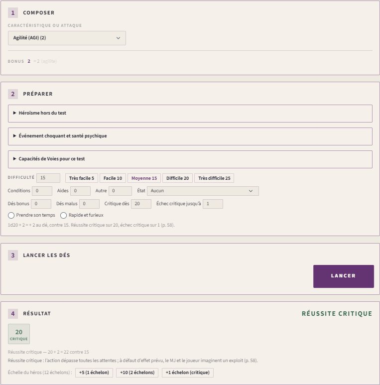
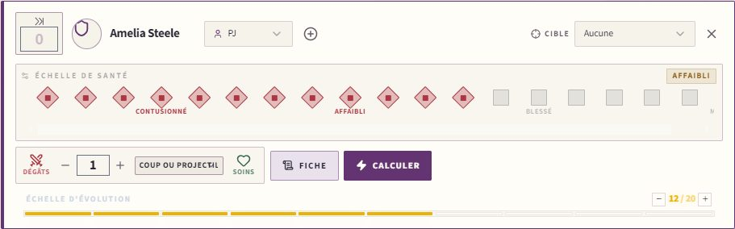
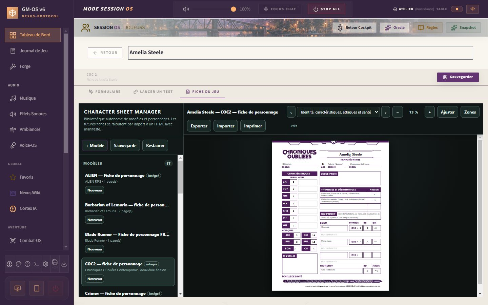
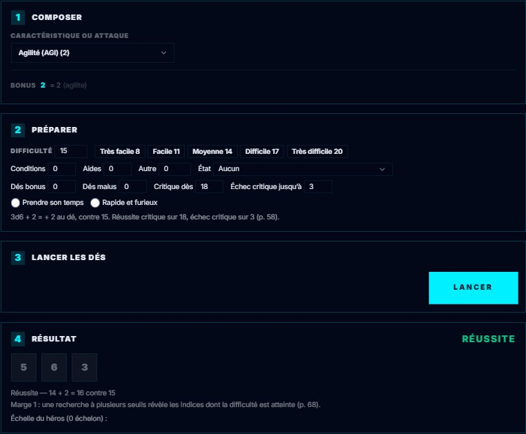

# 🎭 Jeu — Chroniques Oubliées Contemporain

> **Pilote décrit :** « coc », forgé par David, exporté le 2026-10-31, **fini le 2026-10-31**,
> version 2.0.0 (`Export Dirvers/corriges/coc/COC_driver_gmos_finir.gmos-driver`, construit par
> `outils/coc/finir_coc.py` ; la variante au 3d6 par `--3d6`). Thème `coc`, fiche de personnage
> HTML, bannière et identité livrés le même jour par Codex. Retour à
> [Les jeux et leurs mécaniques](./53-Les-jeux-et-leurs-mecaniques.md).

Un seul geste : le **test**. On lance un **d20**, on ajoute **une caractéristique** — ou une
attaque, ou le bonus d'une arme — et les modificateurs, et le total doit atteindre la
**difficulté** (5 à 25) ou la **DEF** de la cible. Le **20 naturel** est une réussite critique,
le **1 naturel** un échec critique. Autour : le **dé bonus** et le **dé malus**, l'**échelle de
santé** en vingt cases noircies, et **une échelle d'évolution**, celle du héros ou celle du blues.
La fiche HTML est reliée champ par champ.

> Règles relues contre le livre de règles de la 2e édition le 2026-10-31 — pages imprimées 8,
> 14-33, 55-111, 121. Les dix-huit fiches du corpus `docs/systems/coc/rules/` sont corrigées
> d'après lui.

**Réimporter le pilote avec « Remplacer ».** Le pilote forgé additionnait l'Agilité et
l'Intelligence pour en faire le seuil de chaque dé et exigeait **dix réussites d'un seul d20** :
**tous les tests échouaient**. Il comptait aussi un 1 pour deux réussites et un 20 pour une
complication, et faisait baisser l'échelle de santé comme des points de vie. La version 2.0.0
garde son identifiant, mais **sa fiche change** : trois lignes d'avantages et désavantages,
trois armes, la protection, six voies de cinq rangs et une seule échelle d'évolution remplacent
les zones de texte « Voies », « Avantages », « Armes » et les échelles du héros et du blues. Les
caractéristiques, l'identité, les rubriques de la personnalité et l'échelle de santé gardent leur
identifiant ; un personnage créé avec la fiche forgée garde ses anciennes valeurs, mais ses voies,
armes et traits sont à ressaisir. Sa santé passe aux cases au premier coup reçu.

**Anciennes fiches — NP-C2, 03/11/2026.** Le meneur peut maintenant préparer une
[reprise avec aperçu et sauvegarde](./63-Fiche-de-personnage-HTML.md#reprendre-une-ancienne-fiche)
depuis le formulaire du PJ. Les anciennes clés restent présentes ; les correspondances se
choisissent explicitement, sans déduire une conversion de leurs noms. Les notes et la santé
ne sont pas remises à zéro. L'import d'une campagne conserve un pilote de même ID et signale
les différences ; pour changer ce pilote, importer son .gmos-driver avec **Remplacer**.
252 tests ciblés et six parcours Electron passent le 03/11 ; huit captures relues.
Validation globale de David : « ok tout est testé, commit et pousse ».

---

## Le test

- **Composer** : une **caractéristique** (AGI, CON, FOR, PER, CHA, INT, VOL), l'**ATC** ou
  l'**ATD**, ou une **arme** de la fiche sous son nom — « Couteau (2) » —, dont le bonus est celui
  de la feuille, « bonus après 1D20 + » (p. 56, 87). La ligne **Bonus** dit ce qui s'ajoute au dé.
- **Préparer** :
  - la **difficulté** : Très facile 5, Facile 10, Moyenne 15 (par défaut), Difficile 20, Très
    difficile 25 (p. 58) ; pour une arme ou une attaque, le champ se nomme **DEF de la cible** ;
    pour un test en opposition, le total de l'adversaire ;
  - les **conditions** favorables moins défavorables : elles se compensent, une qui reste vaut
    ±2, deux ±5, trois et plus ±10 (p. 87-88) ;
  - les **aides** : +2 par allié (p. 61) ;
  - **Autre** : un rang de voie, le sentiment de l'interlocuteur, l'approche (p. 65-66) ;
  - le pire **état préjudiciable** : fatigué −2, épuisé −5, asphyxié −5, ralenti ou renversé −5
    en attaque, aveuglé −10 sur la vue (p. 63-65) ;
  - le **dé bonus** et le **dé malus** : deux d20, le meilleur ou le pire ; ils ne se cumulent
    pas et s'annulent (p. 59) ;
  - les **plages critiques** : réussite critique dès 18 en ciblant un organe vital ou au fusil de
    précision, échec critique jusqu'à 3 ou 6 face à un événement traumatisant (p. 77, 90, 94) ;
  - **prendre son temps** : 10 au lieu du dé, sans critique (p. 59) ; **rapide et furieux** :
    réussite sans lancer si le total atteint déjà la difficulté (règle optionnelle, p. 59).
- L'**état de santé** retire son malus aux **actions physiques** — AGI, CON, FOR et les
  attaques ; la case « Action physique » le corrige pour un autre test (p. 71).
- Le **blues** joue sur la VOL et la coercition (+), sur les autres interactions et la PER qui
  lit les émotions (−) (p. 84).

| Résultat | Quand (p. 58) |
| :--- | :--- |
| **Réussite critique** | le d20 dans la plage critique — 20 d'ordinaire —, quel que soit le total ; sur une attaque, le **bonus critique** de l'arme s'ajoute aux DM |
| **Réussite** | le total atteint la difficulté |
| **Échec** | le total reste en dessous |
| **Échec critique** | le d20 dans la plage d'échec — 1 d'ordinaire —, quel que soit le total |

Sous le résultat, la **marge** sert à une recherche à plusieurs seuils (10, 15, 20 : un, deux ou
trois indices, p. 68).

## L'échelle du héros, l'échelle du blues

Le livre donne à chaque univers **une** échelle d'évolution, et en propose deux (p. 80-84). La
fiche porte son **modèle**, « Héros » par défaut ou « Blues », et son échelon.

- **Héros** : après un test, le panneau propose de régresser d'un échelon pour **+2** (palier 1,
  dès le premier échelon) ou **+5** (palier 2, au 10e), de deux pour doubler, et au 20e la
  **Légende** (+10). Le bonus s'ajoute au test qui vient d'être fait : le total peut franchir la
  difficulté, un 1 naturel reste un échec critique. Une réussite ou un échec critique propose
  **+1 échelon**. Les autres avantages — l'Init., la DEF, les DM, l'action de mouvement — se
  règlent à la main (p. 82).
- **Blues** : ses états (Perturbé à 5, Déstabilisé à 10, Tourmenté à 15, Cramé à 20) donnent ±1,
  ±3, ±5, ±10 au test préparé (p. 84). Le monter et le faire régresser reste au meneur.

## L'échelle de santé

Les **DM** noircissent les cases de l'échelle de santé, vingt d'ordinaire (p. 71). Combat-OS
retire d'abord la **RD** de la protection écrite sur la fiche, sauf pour un dégât « sans
protection » (chute, feu, poison) (p. 88). Chaque état franchi se dit au journal avec ses effets
(p. 72) :

| État | Échelon | Malus | Ce que le livre ajoute |
| :--- | :--- | :--- | :--- |
| Contusionné | 5 | −1 | — |
| Affaibli | 10 | −3 | test de CON 10 pour ne pas perdre sa prochaine action |
| Blessé | 15 | −5 | déplacements réduits de moitié ; il perd sa prochaine action et fait un test de CON 15 |
| Mourant | 20 | −10 | inconscient 1d6 rounds, puis test de CON 20 — échec : coma, puis mort |

- Plus de **20 + CON** DM en un coup noircissent tout : **mort instantanée** ; un coup reçu par un
  mourant appelle le **coup de grâce**, un test de CON 20 (p. 73).
- Le malus de l'état s'applique aussi à l'**initiative** — 10 + INT + PER, sans dé — quand le
  Jet système la calcule (p. 71, 85).
- Un soin efface les cases ; la guérison au rythme de la CG (CON + 3 par semaine) se tient à la
  table (p. 73).

## La fiche du personnage

La fiche fidèle au PDF (`docs/fiches/COC/`, gabarit `coc2-fr`, moteur de fiches **version 22**)
s'ouvre dans l'onglet **Fiche du jeu**. Ses **151 clés** sont reliées une à une aux champs du
pilote (`docs/systems/coc/fiche/correspondance.json`). L'échelle de santé compte les échelons
noircis ; celle de la seconde page, l'échelon de l'échelle d'évolution.

La fiche GM-OS a des champs que la feuille n'imprime pas : les rubriques de « Donner corps à
votre personnage » (genre, taille, poids, statut social, personnalité, convictions, ambitions,
entourage, histoire, p. 15-18), le **modèle** de l'échelle d'évolution et les **points
d'expérience** (un par séance, p. 28).

## L'option du 3d6

Import 3d6, lancer et retour au d20 éprouvés le 03/11 ; les personnages et leurs valeurs restent conservés.

Le livre propose de remplacer le d20 par **3d6** pour un ton plus dramatique (p. 60-61). Le
pilote la règle dans `jet.coc.des` : la variante est prête,
`Export Dirvers/corriges/coc/COC_driver_gmos_finir_3d6.gmos-driver` (`outils/coc/finir_coc.py --3d6`),
à réimporter avec « Remplacer » — et la version au d20 de même pour revenir. Le panneau lance alors 3d6 (4d6 en gardant les trois meilleurs
avec un dé bonus, 2d6 avec un dé malus), propose les difficultés 8, 11, 14, 17 et 20, et ramène
les modificateurs de 2, 5 et 10 à 1, 3 et 5, ceux des échelles à 1, 2, 3 et 5. Le livre ne
chiffre pas le critique au 3d6 : GM-OS le lit sur **18**, l'échec critique sur **3**. Les points
de caractéristique et les voies (+1, +2, +3 aux rangs 1, 3, 5) se règlent à la création.

## Le thème

Le thème `coc` (papier ivoire, titres prune, cadre violet et accent orange) s'applique quand il
est activé dans la campagne ; matière, ornements et icônes demandent les **personnalités**
allumées dans les Paramètres. Accepté par le validateur sans erreur ni avertissement. La bannière
`COC Band.jpg` se choisit dans l'éditeur du pilote.

## Ce qui reste à la table

- **Les dégâts** : l'arme, sa FOR et son bonus critique se lancent et se saisissent à la main
  (p. 88) ; les manœuvres de combat (−5) se règlent en « Autre » (p. 90-92).
- **Les PNJ** : leur échelle de santé selon leur rôle (4, 12, 24 échelons en mode Pulp), les
  figurants et seconds rôles sans réussite critique (p. 108-109) — la plage critique se règle au
  jet.
- **Les poursuites** (p. 97-107), la **santé psychique** et ses états de choc (p. 77-80), les
  séquelles, les maladies et poisons : à la table, d'après le corpus.
- **Les égalités d'initiative** : les PJ avant les PNJ (p. 86), à ranger à la main.
