# 🕯️ Jeu — Crimes

> **Pilote décrit :** « Crimes », exporté le 2026-10-21, corrigé le 2026-10-22 pour le jet
> **Potentiel GARDE Compétence** (`outils/crime/corriger_le_jet_garde.py`), puis pour les
> **atteintes** et le **dépassement** (`outils/crime/ajouter_les_atteintes.py`), puis pour le
> **dossier d'enquête** et les **armes** (`outils/crime/ajouter_enquete_et_armes.py`), enfin le
> 2026-10-23 pour la **psychologie**, les **contacts**, la **fortune**, la **création** et les
> **munitions** (`outils/crime/completer_le_pilote.py` →
> `Export Dirvers/corriges/Crime_driver_gmos_complet.gmos-driver`). Retour à
> [Les jeux et leurs mécaniques](./53-Les-jeux-et-leurs-mecaniques.md).

Le **test**, où l'on lance des d10 et où l'on en **garde** une partie, et ses **circonstances** ;
les **atteintes** qui font baisser les Potentiels ; le **dépassement** ; la **psychologie** et ses
seuils ; le **dossier d'enquête** ; l'**attaque**, avec les armes et les manœuvres du livre ; les
**contacts** et la **fortune** ; la **création** et la **progression**. La fiche de personnage
HTML et ses spécialisations les nourrissent.

> Règles relues contre le livre *Crimes 2 — Manuel de l'Enquêteur* et le corpus
> `docs/systems/crime/`, dont les **19 fiches ont été relues une à une le 2026-10-23** (C0) :
> quatre bilans et non cinq, le jet sans compétence, la santé sans mort automatique (mais une
> consigne au meneur à −2, p. 393), les points d'enquête qui se cumulent sans se dépenser.

---

## Le test : Potentiel GARDE Compétence

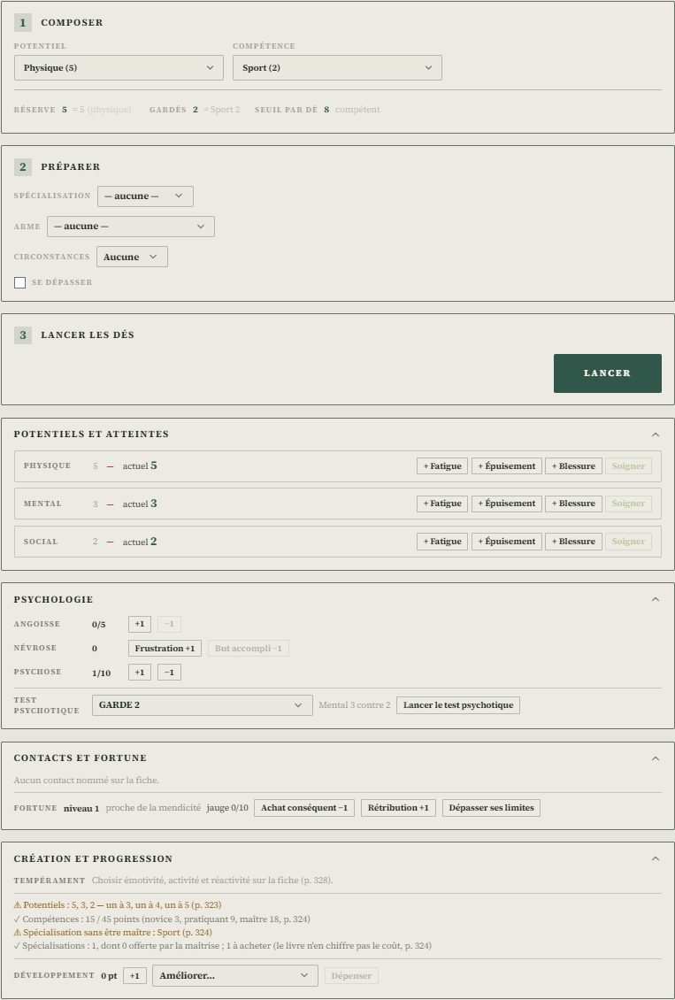

- À l'étape **Composer**, on retient un **Potentiel** (Physique, Mental, Social) et une
  **Compétence**. Le Potentiel donne le nombre de **d10** lancés, la Compétence le nombre de dés
  **gardés**. Sans la compétence (valeur 0), on n'en garde **qu'un**.
- Sous les menus, le panneau dit d'où sortent les nombres : **Réserve** (le Potentiel),
  **Gardés** (la Compétence) et **Seuil par dé** — **9** de base, **8** si le personnage a la
  compétence, **7** avec une spécialisation appropriée.
- Il n'y a **ni difficulté à régler, ni dés à acheter** : ce jeu ne compte pas des réussites
  contre un nombre.
- Au **pupitre de Dice-OS**, le pilote de Crimes choisit le mode **« Potentiel GARDE »** : trois
  champs, Potentiel, Gardés et Seuil (8 d'office), et le même bilan qu'au panneau.

### Les circonstances qui déplacent le seuil

À l'étape **Préparer**, le réglage **« Circonstances »** décale le seuil de chaque dé, de −2
(facile) à +2 (difficile). Avec une **arme à feu**, il devient **« Autre »** et trois réglages
s'ajoutent (p. 389-390) : la **distance**, la **cible** (immobile ou mobile) et sa **taille**. L'exemple du livre — une crapule lointaine (+1) mais
immobile (−1) — garde un seuil de 8. Le seuil reste entre 2 et 10, et la ligne « Seuil par dé »
dit le calcul : `= 8 + 1 (circonstances)`.

L'**angoisse du tireur** se lit sur la fiche : au-delà de 3, le tir est pénalisé de 1 d'office
(le livre dit de 1 à 2 ; le menu permet 2 ou rien). **À 3 d'angoisse et plus**, la case
**« Seuil de 9 imposé »** rend le seuil de base non modifiable pour viser (p. 412) : les
circonstances disparaissent.

### Les actions hermétiques

Certaines spécialisations sont **hermétiques** (en italique sur la fiche, p. 325) :
mathématiques, cryptographie, astronomie, médecine, pharmacie, aliénisme, anthropologie,
théologie, magnétisme, spiritisme, divination, langues, photographie, piégeage, mimétisme. À
l'étape Préparer, le menu **« Action hermétique »** dit si l'action en relève. Sans la
spécialisation, le panneau l'écrit et **le jet ne se lance pas** : « on ne peut tenter une action
qui relève d'une compétence hermétique » (p. 324).

### L'opposition

Sous le résultat, la ligne **« Opposition »** reçoit le test de l'adversaire : ses **réussites** et
ses **1 gardés**. Le panneau dit qui l'emporte et de combien, ou que les deux se neutralisent
(p. 385). Sur un **échec critique**, les 1 comptent aux succès de l'autre ; une case permet de ne
pas appliquer cette option du livre. Rien ne s'écrit.

### La spécialisation

À l'étape **Préparer**, le menu **Spécialisation** propose seulement les spécialisations que la
fiche **coche** pour la compétence retenue — Escalade et Équitation pour Sport, par exemple. Elle
baisse le seuil de chaque dé à 7. Au meneur de juger si elle s'applique à l'action ; « — aucune — »
la retire. Sans spécialisation cochée, le menu reste grisé.

### Le résultat : les dés gardés, et l'un des quatre bilans

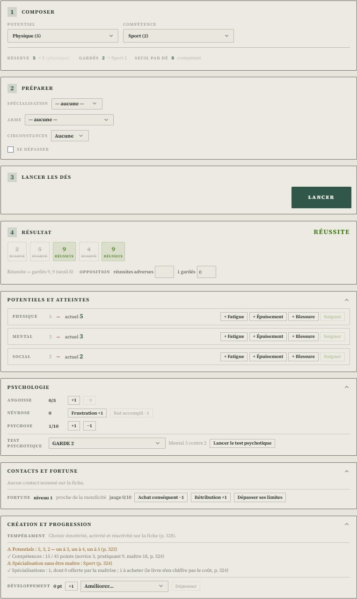

- Le panneau garde d'abord **tous les 1** — ils sont imposés et marqués **Un** —, puis les
  meilleurs dés. Les autres sont **Écartés**.
- Le bilan s'affiche en haut à droite, avec le nom du livre :
  - **Échec critique** : plus de 1 que de réussites parmi les dés gardés ;
  - **Échec** : aucune réussite gardée ;
  - **Réussite mitigée** : autant de 1 que de réussites ;
  - **Réussite** : plus de réussites que de 1 — et **succès important** à trois réussites gardées.
- Sous les dés, le panneau dit ce que le jet fait à la **Névrose** (p. 409) : +1 sur un échec, +1
  si des réussites n'ont pas pu être gardées, −1 sur un succès important. Au meneur, le bouton
  **« Noter : Névrose +1 »** l'écrit sur la fiche, une fois par jet.

### Changer sa garde

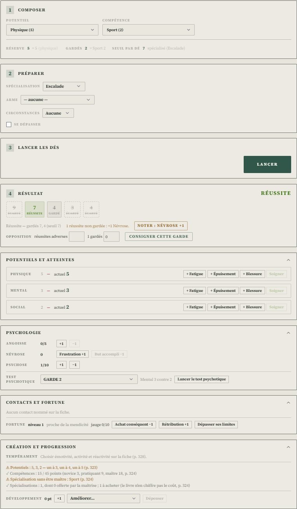

Le livre permet de garder de mauvais dés pour **échouer volontairement**. Cliquez un dé
**écarté** : il entre dans la garde à la place du meilleur dé gardé. Cliquez un dé **gardé** : il
sort, au profit du meilleur dé écarté. Les **1** ne s'échangent pas. Le bilan et la Névrose se
recalculent aussitôt.

Le journal a déjà reçu le jet tel qu'il est tombé. Pour y inscrire la garde choisie, cliquez
**Consigner cette garde** : le journal ajoute une ligne « … · garde choisie ». Sur la tablette,
le jet et la garde choisie remontent au meneur de la même façon.

---

## Les atteintes : fatigue, épuisement, blessures

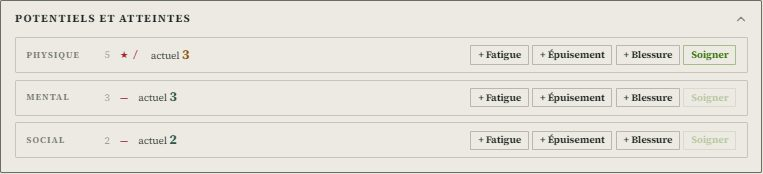

Les Potentiels sont des jauges (livre p. 395) : leur valeur de départ ne bouge pas, et l'on
teste avec la valeur **actuelle**. Trois marques la font baisser :

| Marque | Sur la fiche | S'efface |
| --- | --- | --- |
| **Fatigue** ／ | une action intense, un dépassement | à la **fin de la scène** |
| **Épuisement** ✕ | un effort durable, une nuit blanche | une croix par **bonne nuit** |
| **Blessure** ★ | un coup, une chute, un poison | par les **soins**, au jugement du meneur |

- Sous le panneau de jet, la carte **« Potentiels et atteintes »** montre, pour chaque Potentiel,
  sa valeur de départ, ses marques et sa valeur **actuelle**. Les boutons **+ Fatigue**,
  **+ Épuisement** et **+ Blessure** posent une marque ; **Soigner** retire un point de blessure.
  Chaque geste s'inscrit au journal.
- Une marque plus grave **prend la place** d'une marque moindre déjà notée, comme dans l'exemple du
  livre : deux fatigues puis un épuisement font une fatigue et un épuisement, pas trois marques.
  Une blessure remplace d'abord un épuisement, sinon une fatigue.
- Le jet lance le Potentiel actuel : sous « Composer », la réserve dit `= 5 − 2 (atteintes)`. À 0,
  il n'y a plus de dé à lancer.
- **Physique à 0** : la carte dit « Hors de combat ». **En dessous de −1** : « Blessure grave »,
  avec ce que le livre en dit (Physique de départ −1 jusqu'à une chirurgie, Psychose, Névrose, test
  psychotique). La mort n'est **jamais automatique** : à −2, le livre en fait une consigne au meneur —
  « implacable » pour une conduite idiote ou suicidaire, « logique » pour une blessure trop lourde,
  « évitée » après une action audacieuse et calculée (p. 393). L'outil ne tue personne.
- Sur la **fiche du jeu** (HTML), trois petits compteurs — Fatigue, Épuisement, Blessures — sont
  ajoutés sous chaque rangée de Potentiel, et reliés aux mêmes champs.

### Fin de scène et bonne nuit

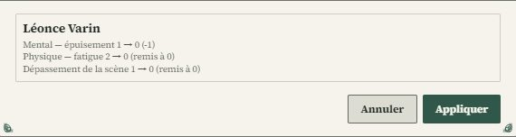

Dans le bandeau du meneur, **Fin de scène** efface toutes les fatigues et rend le dépassement de
la scène. **Bonne nuit** retire en plus une croix d'épuisement à chaque Potentiel qui en porte.
Les deux montrent d'abord, personnage par personnage, ce qui va changer ; **Appliquer** écrit.
Les blessures ne bougent jamais seules.

## Se dépasser

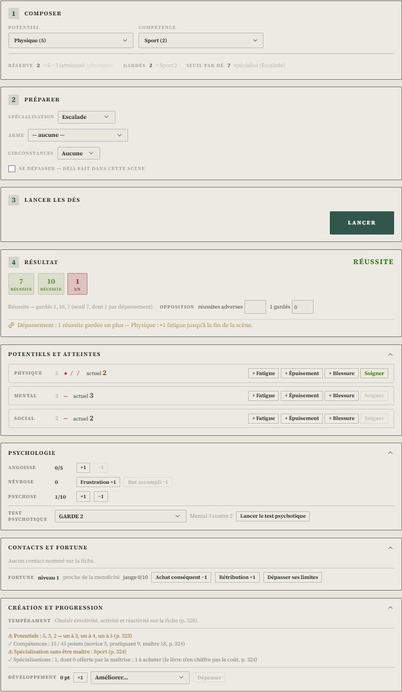

Quand une **passion** ou une **conviction** est engagée dans le test (ou une fois par combat,
quelles que soient les passions, p. 389), le personnage peut se dépasser : garder des réussites
qu'il ne pouvait pas garder, pour grandir son succès ou compenser un 1 (p. 385).

1. Le livre veut l'annonce **avant** de jeter les dés : cochez **« Se dépasser »** à l'étape
   Préparer. Le meneur juge si la passion ou la conviction invoquée vaut.
2. Après le lancer, si des réussites sont restées hors de la garde, le panneau propose
   **« Se dépasser : +1 réussite (1 fatigue) »**, « +2 réussites (2 fatigue) »… Le joueur choisit
   combien il en garde.
3. Chaque réussite gardée en plus pose **une fatigue** sur le Potentiel utilisé, jusqu'à la fin de
   la scène (p. 407). Le bilan et la Névrose se recalculent, le journal note « · dépassement ».
4. **Un seul dépassement par scène** : la case se grise (« déjà fait dans cette scène ») jusqu'à
   « Fin de scène » ou « Bonne nuit ». Si le meneur en accorde un autre, il remet à 0 le champ
   « Dépassement de la scène » du formulaire.

Après un dépassement, la garde ne se change plus d'un clic.

---

## La psychologie : angoisse, névrose, psychose

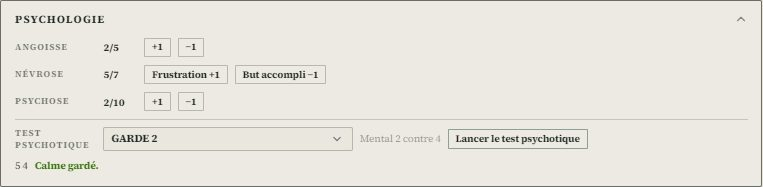

La carte **« Psychologie »**, sous le panneau de jet, tient les jauges de l'enquêteur (livre
p. 409-418). Chaque geste s'inscrit au journal.

- **Angoisse** (0 à 5) : **+1** pour une ambiance ou un événement angoissants, **−1** quand le
  danger est dominé. La **Névrose suit** : « quand l'une baisse l'autre aussi, et inversement »
  (p. 411). À 3, la carte rappelle ce qu'elle permet au meneur.
- **Névrose**, avec son seuil : **Frustration +1** (une passion frustrée, ou une passion taboue
  assouvie) et **But accompli −1** (p. 409).
- **Psychose** (0 à 10) : **+1** sur un échec critique de passion ou dans l'histoire, **−1** par une
  thérapie ou un succès important (p. 410).
- **Le test psychotique** : choisir la **GARDE** — 1 pour un proche ou une créature, le pire, 3 pour
  un inconnu ou un danger indistinct —, puis **« Lancer le test psychotique »**. Le Mental **actuel**
  (marques comprises) se lance contre un seuil de **psychose + angoisse** ; on ne peut pas s'y
  dépasser. Une réussite garde le calme ; sinon, l'état de folie se choisit selon l'inclinaison
  psychotique, et **« Noter +1 Psychose »** l'écrit (p. 410).
- **L'Innocence** des enfants (règle optionnelle, p. 414-416), si la fiche a un seuil :
  **Dépenser un point**, **Agit en adulte** (le seuil baisse, un Potentiel monte), **Agit en
  enfant** (le seuil monte, un Potentiel baisse).

### Les seuils, sous le bandeau du meneur

Quand une jauge atteint un seuil, une ligne paraît sous le bandeau du meneur. Rien ne s'écrit sans
lui, et un seuil traité ne se repropose pas avant que la jauge redescende.

- **Seuil de névrose** : +1 Psychose et un état de folie jusqu'à la fin de la scène. Le livre se
  contredit sur la Névrose qui redescend : à la **moitié** (p. 409, 411) ou à **zéro** (p. 418). Les
  deux boutons sont là ; le meneur choisit.
- **Psychose 6** : les états de folie deviennent intermittents (p. 410). **Psychose 10** : la
  **déchéance**, que le livre laisse au meneur de dire.
- **Angoisse 3**, puis **au-delà de 3** : les rappels du livre sur les jets exigés, la visée, le tir
  et le rechargement (p. 383, 389-390, 412).

## Le dossier d'enquête

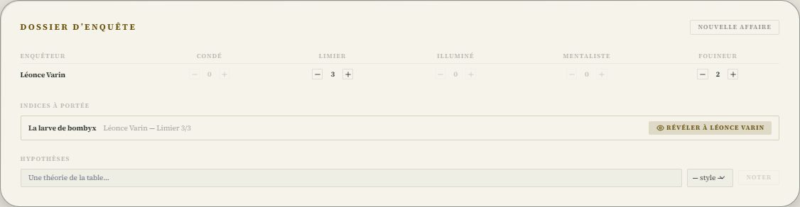

Les points d'enquête (livre p. 436–440) mesurent ce qu'un enquêteur a compris de l'affaire, dans
chacun de ses cinq styles : **Condé, Limier, Illuminé, Mentaliste, Fouineur**. Ils s'accumulent
et ouvrent des indices ; ils ne se dépensent pas.

- **Où** : dans l'éditeur de la campagne, section **Indices**. Le **dossier d'enquête** est en tête,
  au meneur seul.
- **Les points** : un tableau, un enquêteur par ligne, un style par colonne, avec **−** et **+**.
  Le chiffre est le compteur de la fiche (« Limier — compteur ») ; on ne gagne de points que dans
  un style que l'on **possède** (ses ronds sur la fiche, p. 437) : le **+** des autres est grisé.
  Chaque geste s'inscrit au journal.
- **Après un jet**, sur la fiche du meneur, le panneau propose les points du jet dans les styles
  de l'enquêteur : **+1** pour un succès, **+2** à deux réussites, **−1** sur un échec critique
  (p. 436). Un clic, si la routine a vraiment fait avancer l'enquête — c'est vous qui en jugez.
- **« Nouvelle affaire »** (avec confirmation) ramène les points de chacun au niveau de ses styles.

### Les indices et leurs seuils

Dans l'éditeur d'un indice, deux listes s'ajoutent :

- **Pour le découvrir** : les seuils — « Limier 3 », « Fouineur 4 » ; **un seul suffit**.
- **Ce qu'il rapporte** : les points qu'il donne à qui l'obtient (« Limier +1 »).

Un indice sans seuil est **évident** : il se révèle comme avant, à toute la table.

### L'affaire, par lieu et par témoin

Sous les points, le dossier range les indices de la campagne **par lieu** et **par témoin** (le
lieu et le PNJ choisis dans l'éditeur de l'indice), avec l'état de chacun : partagé, connu d'un
enquêteur, à portée, caché. La section **Hypothèses** garde les pistes de la table : on en note une,
avec le style qui l'a suggérée, puis on l'**écarte** ou on la **rouvre** ; chaque geste va au
journal.

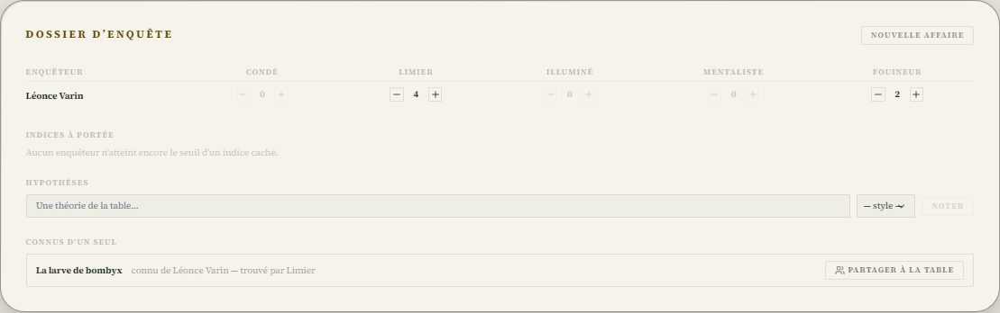

Dès qu'un enquêteur atteint un seuil, l'outil le dit (une notification, et la liste **Indices à
portée**) ; il ne révèle rien seul.

1. **« Révéler à Léonce Varin »** : l'indice part sur **sa seule tablette** (Archives, « Connu de
   vous seul — trouvé en Limier ») ; les autres tablettes et l'écran de table ne le reçoivent pas.
   Ses gains vont à Léonce, dans les styles qu'il possède.
2. **« Partager à la table »**, quand il en parle : l'indice devient public, et le journal garde
   **qui l'a trouvé**.

## Le combat : l'arme, la portée, les dégâts

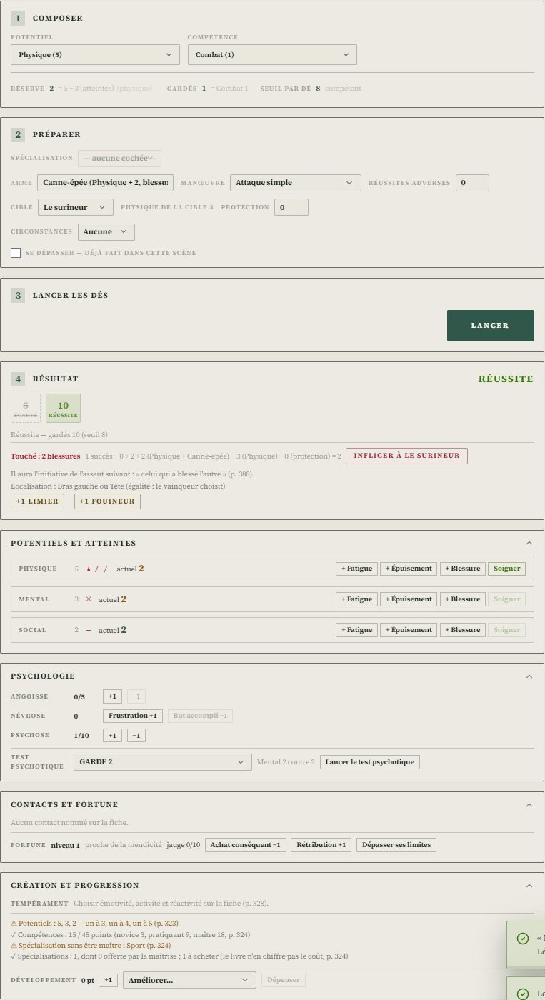

À l'étape Préparer, le panneau propose l'**attaque** (livre p. 344–395) :

- **Arme** : les armes blanches et les armes à feu des tableaux du livre, avec leurs dégâts. Une
  arme blanche frappe du **Physique de l'attaquant** plus son bonus ; une arme à feu a des dégâts
  fixes. On y lit aussi ses coups par assaut, ses munitions et son rechargement.
- **Distance** (arme à feu) : au-delà de la **portée utile**, une réussite de moins ; au-delà du
  **double**, « tir impossible » s'affiche (p. 389).
- **Réussites adverses** : le jet de l'adversaire en **opposition** (mêlée). 0 pour un tir sur une
  cible qui ne riposte pas.
- **Cible** : un combattant du plateau de Combat-OS. Son **Physique actuel** se lit sur sa fiche,
  marques comprises ; sans fiche, on le saisit.
- **Protection** : celle de la cible, **couvert compris** (de 1, petit obstacle, à 3, derrière un
  mur).

Après le lancer, le résultat dit **« Touché : 2 blessures »** et le calcul du livre — succès
excédentaires + arme − Physique de la cible − protection, **au moins 1** (p. 393). À égalité,
« pas de blessure ». **« Infliger à … »** écrit les marques sur la fiche de la cible avec la règle
des atteintes (une blessure prend la place d'une marque moindre), et le journal le note. Une
matraque ou un bâton infligent de l'**épuisement**.

Sur un **échec critique** avec une arme à feu, le panneau rappelle ses incidents — **E** enrayée,
**T** elle tombe, **C** une victime collatérale — et, à partir de deux 1 gardés, le risque
d'explosion. Le meneur choisit.

Les tranches de distance du plateau tactique suivent l'échelle des portées du livre (au contact,
10, 20, 50 et 400 m), sans modificateur : la pénalité dépend de l'arme.

### Les manœuvres, les munitions, l'initiative

Le menu **Manœuvre** (p. 391-394) :

| Manœuvre | Ce que le panneau calcule |
| --- | --- |
| **Attaque simple** | La localisation se lit dans le jet : le chiffre le plus fréquent (1-2 thorax, 3 abdomen, 4 et 6 bras droit, 5 et 7 bras gauche, 8 jambe droite, 9 jambe gauche, 10 tête) ; à égalité, le vainqueur choisit |
| **Viser une localisation** | Une réussite sacrifiée ; il faut **deux succès de plus** que l'adversaire pour toucher où l'on veut, sinon le coup porte au hasard |
| **Assommer** | La tête visée : la marge **doublée**, les dégâts comptés en **fatigue** — on maîtrise sans tuer |
| **Déséquilibrer** | Les jambes visées ; contre plus fort, autant de succès que l'écart de Physique ; la victime est à terre et abasourdie |
| **Immobiliser** | Réussites + Physique contre le Physique adverse ; aucun dégât |
| **Feinter** | Aucun dégât ; le panneau dit combien de Physique sacrifier, selon la maîtrise |

Avec une arme à feu, la ligne **Munitions** compte les coups de la fiche : **−1 munition** et
**Recharger**, d'un clic (le livre en fait une règle optionnelle, p. 390). Rien ne se retire seul.

Combat-OS calcule l'initiative comme le livre : **Physique + Combat − angoisse** (p. 388). Sous un
coup qui touche, le panneau rappelle la règle narrative : « celui qui a blessé l'autre aura
l'initiative de l'assaut suivant ». L'ordre se change à la main.

Sur la **carte de combat**, un combattant qui a une fiche montre son **Physique actuel** (« hors
de combat » à 0, « blessure grave » sous −1) ; sur sa fiche, le Physique actuel remplace les points
de vie.

---

## Les contacts et la fortune

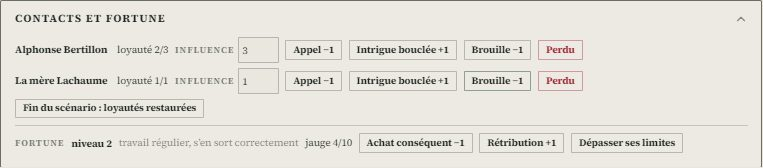

Les **contacts** sont au **meneur seul** : « ce point relève de la gestion du meneur pour que les
PJ n'en soient pas conscients » (p. 430). La carte **« Contacts et fortune »** liste ceux que la
fiche nomme :

- **Loyauté actuelle / de base** : chaque **Appel −1** retire un point **pour le scénario**, sans
  toucher la base. Une demande au-delà de ses moyens demande une contrepartie, ou un test de
  loyauté **Social GARDE X** (le panneau le rappelle, p. 429).
- **Influence** : le poids du PNJ, de 0 à 4, à côté de sa loyauté.
- **Intrigue bouclée +1** et **Brouille −1** changent la loyauté de base (p. 430).
- **Perdu** : la loyauté tombe à 0 ; un contact d'**au moins 3** coûte **+1 Psychose** (p. 430).
- **« Fin du scénario : loyautés restaurées »**, ou le bouton **Nouveau scénario** du bandeau,
  efface les appels.

La **fortune** se montre aussi au joueur : un **niveau** de 1 à 4 et une **jauge** (p. 431).
**Achat conséquent −1**, **Rétribution +1**, **Dépasser ses limites** (−1 quel que soit le résultat
du test, Mental ou Social). La jauge à son seuil fait monter le niveau, à zéro le fait descendre ;
elle repart alors à la moitié du seuil.

> Le livre ne chiffre pas le **seuil de la jauge** : le pilote retient **10**, la fin de la piste
> imprimée. Il se change dans le pilote (`garde.fortune.seuil`).

## La création et la progression

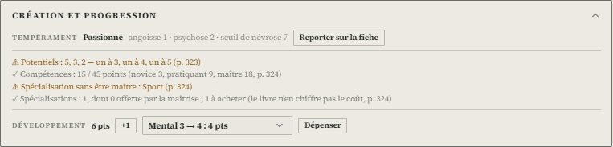

- **Tempérament** : les trois choix de Jung de la fiche — émotivité, activité, réactivité — donnent
  l'un des huit tempéraments (p. 328) et ses totaux : angoisse, psychose de base, seuil de névrose
  (p. 334). **« Reporter sur la fiche »** les écrit. Un personnage déjà joué (seuil de névrose
  rempli) garde son angoisse et sa psychose courantes.
- **Les règles de création**, vérifiées ligne par ligne : les Potentiels 3, 4 et 5 (un enfant :
  12 points avec son seuil d'Innocence) ; **45 points** de compétences — novice 3, pratiquant 9,
  maître 18 —, 24 ou 35 pour un enfant selon l'âge lu dans « Sexe et âge » ; une spécialisation
  seulement en **maîtrise**, une offerte par compétence maîtrisée (p. 324). Le livre ne chiffre pas
  le prix des autres : la carte les compte, sans prix.
- **Développement** : **+1** pour chaque point gagné (p. 404) ; le menu **« Améliorer… »** propose
  ce qui peut monter, avec son coût — un Potentiel coûte son **nouveau niveau** (de 4 à 5 :
  5 points), une compétence **3 points par degré** visé, ce qui retrouve les 3, 9, 18 de la création
  (p. 405). **Dépenser** écrit les deux. Le livre veut une justification dans l'histoire : au
  meneur.

## Ce qui reste au meneur

- Les variations de Névrose des **rivalités entre styles** (p. 437), le **tir multiple** et
  « intimider ».
- Les autres dépenses de développement (contact, passion, conviction, style d'enquête), et la
  **fortune commune** de l'équipe.
- Les états de folie eux-mêmes : la carte en rappelle l'inclinaison, le meneur les choisit.

Voir le registre `documentation/Planning/2026-10-19-registre-ameliorations-crimes.md`.
