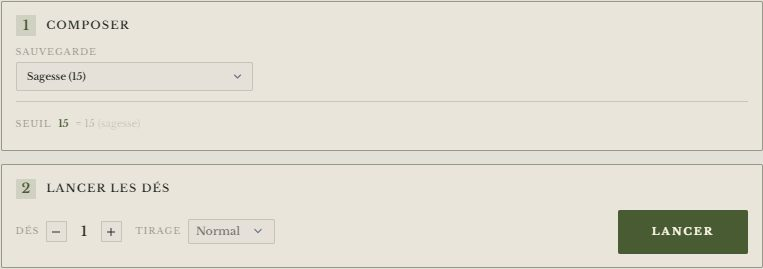
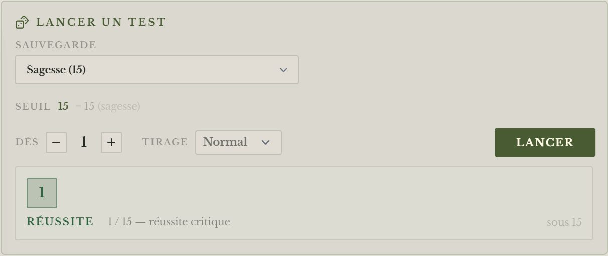
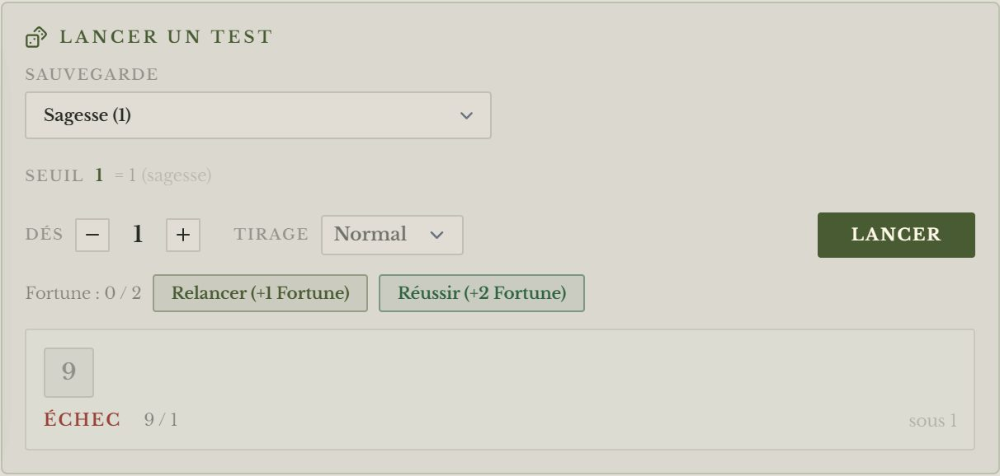
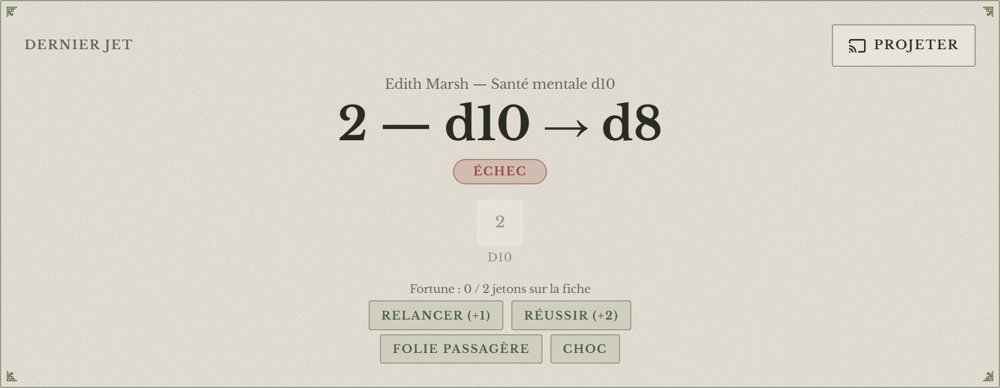
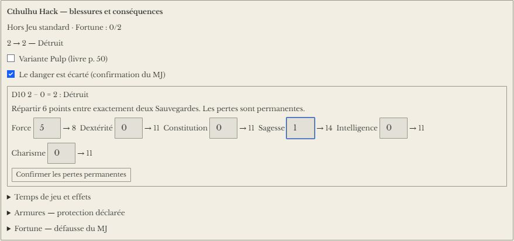
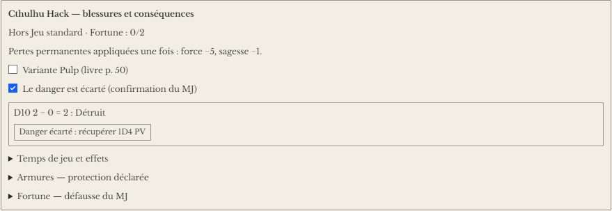
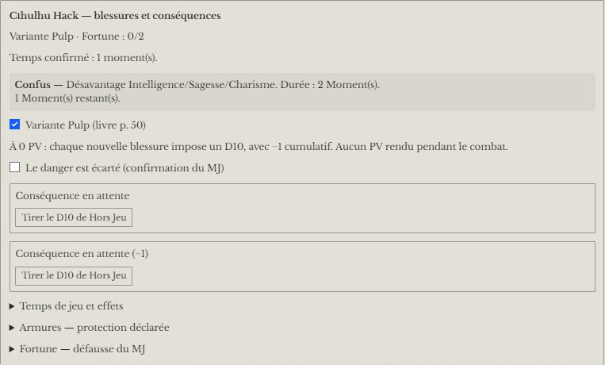
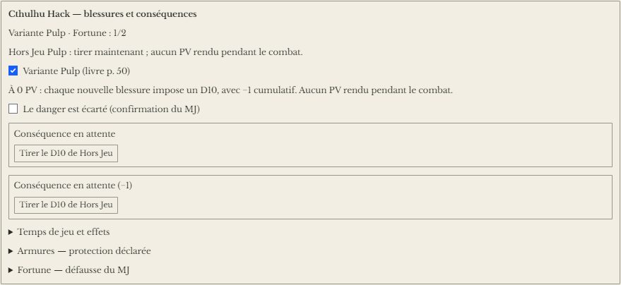
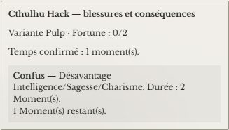

# 🐙 Jeu — Cthulhu Hack

> **Pilote décrit :** « Cthulhu Hack » **1.1.0**, corrigé contre le livre français fourni par David et essayé par David le 23/10/2026. Retour à [Les jeux et leurs mécaniques](./53-Les-jeux-et-leurs-mecaniques.md).

Deux gestes : la **Sauvegarde**, un d20 sous la caractéristique, et les **dés d'usure**, des
ressources qui sont des dés et qui s'épuisent. Autour d'eux : la **Fortune**, la **Folie
passagère** et le **Choc**, le **Hors Jeu**.

> Règles relues contre le carnet NotebookLM « Cthulhu Hack » le 2026-10-16 (sections « Fortune »,
> « Folie passagère », « Chocs », « Hors Jeu », « Conséquences du Hors Jeu », « Matériel et
> Richesse »). Les trois tables sont dans Table-OS, univers **Cthulhu Hack** : `folies_passageres`,
> `chocs`, `consequences_du_hors_jeu`.

---

## La Sauvegarde

- On retient une **caractéristique** : sa valeur est le seuil.
- On lance **1d20** : **sous ou égal au seuil**, la Sauvegarde réussit. Un **1** est un critique,
  un **20** une complication.
- **Avantage / Désavantage** : deux dés, on garde le meilleur ou le moins bon.

---

## La Fortune

Règle optionnelle du livre : le joueur **place** des jetons sur sa fiche (champ **Fortune**), et
n'en a **jamais plus de deux**.

| Après un jet raté | Jetons placés | Possible si la fiche en porte |
| :--- | :--- | :--- |
| **Relancer** la Sauvegarde ou la Ressource | 1 | 0 ou 1 |
| **Réussir** la Sauvegarde ou la Ressource | 2 | 0 |

- **Sur la fiche** (panneau de jet, chez vous ou sur la tablette) : sous une Sauvegarde ratée, les
  boutons **« Relancer (+1 Fortune) »** et **« Réussir (+2 Fortune) »**.

  
- **Au pupitre** : sous le dernier jet venu d'une fiche — une Sauvegarde demandée depuis la
  tablette, une ressource lancée depuis la carte de combat ou le pupitre — les mêmes deux boutons.
  Une **ressource** sauvée retrouve d'abord le dé qu'elle venait de perdre ; relancée, elle peut
  redescendre.
- **Le meneur défausse** un ou deux jetons depuis **« Fortune — défausse du MJ »** pour une
  complication : *1 jeton* — relancer un test réussi sans Désavantage, un innocent en danger, un
  sombre secret ; *2 jetons* — relancer un test réussi avec Désavantage, un **Choc** sans perte de
  Santé mentale, une nouvelle menace. La fiche s'en libère.

---

## Les dés d'usure

**Santé mentale, Torche, Bagou, Richesse** — et le **Matériel** : chacun est **un dé**, écrit sur
la fiche (« d8 »).

- On la lance quand on la sollicite. **Un 1 ou un 2 la fait descendre d'un cran** : d20 → d12 →
  d10 → d8 → d6 → d4 → épuisée.
- Le nouveau dé **s'écrit tout seul sur la fiche**.
- **Chez vous :** le mode « usure » de [Dice-OS](./34-Dice-OS-le-pupitre.md), ou le bouton de la
  ressource sur la carte de combat.
- **Sur la tablette :** les joueurs ont deux rangées de boutons, **Sauvegardes** et
  **Ressources**. Le jet part chez vous : vous le voyez, et il entre au journal.

### Folie passagère ou Choc

Quand la **Santé mentale** descend d'un cran, le pupitre propose **« Folie passagère »** et
**« Choc »** sous le jet : le livre applique la Folie passagère, et laisse au meneur le choix du
Choc, plus court. Le bouton tire **1d6** dans la table et écrit le résultat à l'historique et au
journal (« 6 — Hurlement : Attire immédiatement l'attention »). Une seule suite par jet.

### Le Matériel

La fiche porte **quatre emplacements** (section « Matériel ») : le **nom** de l'objet et son
**dé**, de d4 à d20 (d8 pour l'équipement standard). Un emplacement nommé devient une ressource
comme la Torche — sur la tablette, au pupitre. Le livre dit **quand** le tester : au premier moment
calme après usage, à la fin d'un combat pour une arme, chaque jour pour des rations, à chaque usage
pour des jumelles. Dans **« Armures — protection déclarée »**, le MJ indique les PA d'un objet
nommé. Quand son dé descend, il perd automatiquement **1 PA**. La Fortune qui sauve ce déclin
rend également le PA, une seule fois. Une correction manuelle du dé vers le bas compte comme
un déclin ; une réparation reste une modification explicite du dé et des PA.

---

## Combat et santé

- **Santé :** points de vie (PV).
- **Ressources suivies :** Santé mentale, Torche, Bagou, Richesse.
- **Hors Jeu.** À **0 PV**, une conséquence attend sur la fiche et la carte du personnage : 1d10
  dans la table des Conséquences (9+ Essoufflé, 8 Titubant, 7 Commotion, 6 Inconscient, 5 Os brisés,
  4 Estropié, 3 Ravagé, 2 Détruit, 1 Mort). La règle dit de tirer **une fois le danger écarté** :
  cochez **« Le danger est écarté »** avant de tirer. Un résultat permanent propose la répartition
  et les valeurs après perte : **Détruit**, 6 points entre exactement deux Sauvegardes ;
  **Ravagé**, 4 points de personnalité ; **Estropié**, 2 points physiques. La confirmation
  les applique une seule fois et conserve cette décision après rechargement. Une nouvelle chute
  ouvre une nouvelle conséquence. Un survivant récupère ensuite **1D4 PV**, une seule fois.

  

  
- **Les PV de la fiche font foi** (2026-10-16) : un coup porté en combat les réécrit, et la barre de
  la carte part d'eux ; leur maximum est la valeur par défaut du champ PV de la fiche.
- La fiche HTML de Cthulhu Hack se relie à son personnage GM-OS : voir
  [Fiche de personnage HTML](./63-Fiche-de-personnage-HTML.md).

---

## Fortune du MJ et durée des effets

Dans **« Lancer un test »**, le suivi **« Cthulhu Hack — blessures et conséquences »** propose
la **défausse du MJ** : relancer le dernier test réussi enregistré, mettre un innocent en danger,
demander un sombre secret, infliger un Choc sans perte mentale, ou introduire une Menace.
Les deux derniers coûtent deux jetons ; la relance coûte deux avec Désavantage, un autrement.
Les jetons retirés libèrent la fiche. Le MJ joue les conséquences narratives ; aucun secret n'est saisi.

Les Folies et Chocs tirés au pupitre gardent leur effet et leur durée sur la fiche. Dans
**« Temps de jeu et effets »**, le MJ confirme les Moments, minutes, heures,
fin de scène, fin de la prochaine journée ou fin de séance. Les Tremblements diminuent à chaque
Moment. Évanouissement et Délire gardent la plus longue durée entre le D20 explosif en minutes
et la scène. Les malus physiques, Désavantages généraux et incapacités se reportent au jet.
Les Moments se comptent séparément du temps en minutes et heures : aucune conversion n'est imposée.
Les effets liés à la perception ou à un sens demandent toujours l'appréciation du MJ.

## Variante Pulp

Le mode **standard** reste le choix initial. Le MJ peut cocher **« Variante Pulp »** en dehors
d'une chute en cours. À zéro PV, le premier D10 se tire immédiatement ; chaque nouvelle blessure
demande un nouveau D10 avec **−1 cumulatif**, résultat minimal 1. Un survivant reste actif à zéro.
La récupération attend la confirmation que le danger est écarté et ne se cumule pas pour les
différents tirages d'une même chute. Mort bloque l'activité et la récupération.

Sur tablette, le joueur lit le suivi de ses conséquences ; les commandes de décision restent au MJ.

## Ce qui reste à la main

- Le moment où tester le Matériel, les réparations et la déduction d'armure/couvert des dégâts.
- L'interprétation des Folies et effets narratifs de Fortune ; le test de Constitution et
  l'éventuelle perte de PV de l'Évanouissement.
- Les séquelles mentales définitives, la récupération mentale, les soins spéciaux et les cartes Contrecoups.
