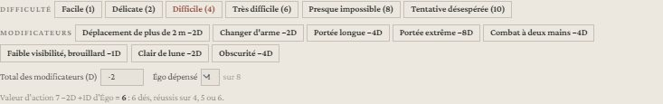
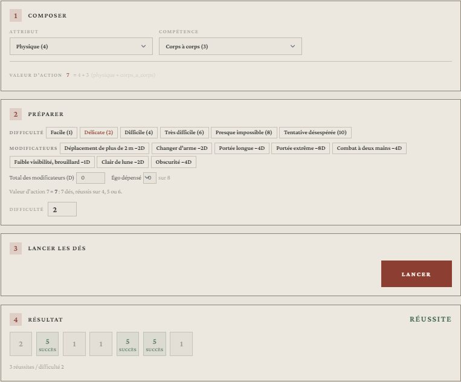
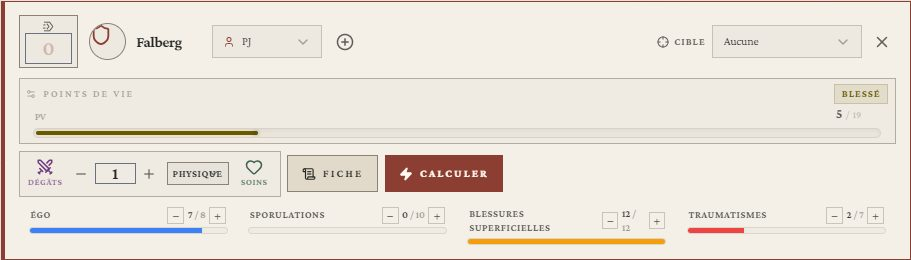
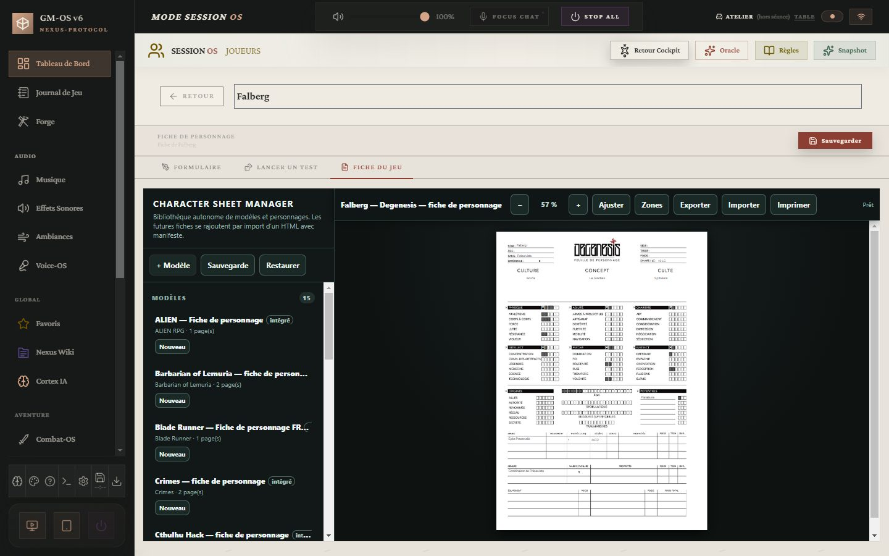

# 🍄 Jeu — Degenesis

> **Pilote décrit :** « Degenesis », forgé par David, exporté le 2026-10-30, **fini le
> 2026-10-30**, version 2.0.0 (`Export Dirvers/corriges/Degenesis_driver_gmos_finir.gmos-driver`,
> construit par `outils/degenesis/finir_degenesis.py`). Thème `degenesis`, fiche de personnage HTML
> et bannière livrés le même jour par Codex. Retour à
> [Les jeux et leurs mécaniques](./53-Les-jeux-et-leurs-mecaniques.md).

Un seul geste : le **test d'action**. On lance autant de d6 que la **valeur d'action** —
attribut + compétence, plus ou moins des dés —, chaque **4, 5 ou 6** est un succès, et les
succès doivent atteindre la **difficulté**. Les **6** sont aussi des **déclencheurs** : ils disent
la qualité d'une réussite et ajoutent leurs dégâts au combat. Autour : l'**Égo** dépensé, les
**Traumatismes** qui retirent des dés, la santé en **deux pistes** et l'**initiative** comptée en
succès. La fiche HTML est reliée champ par champ.

> Règles relues contre le livre français KatharSys le 2026-10-30 — pages imprimées 10-21, 94-113,
> 155-160, 186-190, 313-322. Les seize fiches du corpus `docs/systems/degenesis/rules/` sont
> corrigées d'après lui.

**Réimporter le pilote avec « Remplacer ».** Le pilote forgé prenait attribut + compétence pour le
seuil de chaque dé, **ne lançait aucun dé** et exigeait quatre succès. La version 2.0.0 garde son
identifiant, mais **sa fiche change** : les 36 compétences remplacent « Compétence 1 à 5 », et
s'ajoutent six Potentiels, trois armes, deux armures et six lignes d'équipement. Les attributs,
historiques, jauges et l'expérience gardent leur identifiant ; un personnage créé avec la fiche
forgée garde ses anciennes valeurs, mais ses compétences sont à ressaisir.

---

## Le test d'action

- **Composer** : un **attribut** et une **compétence** de n'importe quel attribut — le livre
  combine librement (« PHY+Force », « INS+Perception »). La ligne **Valeur d'action** en fait la
  somme.
- **Préparer** :
  - la **difficulté** du livre, en succès requis : Facile (1), Délicate (2, par défaut),
    Difficile (4), Très difficile (6), Presque impossible (8), Tentative désespérée (10)
    (p. 18) ;
  - les **modificateurs**, toujours en dés : déplacement de plus de 2 m (−2D), changer d'arme
    (−2D), portée longue (−4D), portée extrême (−8D), combat à deux mains (−4D), brouillard
    (−1D), clair de lune (−2D), obscurité (−4D) ; la maniabilité, l'encombrement ou un Potentiel
    se saisissent dans le total (p. 102-106) ;
  - l'**Égo dépensé**, jusqu'à 3 : un dé par point. Il se retire de la fiche au lancer et ne vaut
    que pour la première action du round (p. 100) ;
  - chaque **Traumatisme** de la fiche retire un dé, sans rien régler (p. 105).
- **Lancer** : douze dés au plus ; au-delà, chaque point de valeur d'action est un **succès
  d'office** (p. 18).

| Résultat | Quand (p. 19) |
| :--- | :--- |
| **Réussite** et sa qualité | autant de succès que la difficulté ; avec 1 à 6 déclencheurs : bien, remarquable, excellent, brillant, exceptionnel, légendaire |
| **Échec** | moins de succès que la difficulté ; les 6 ne déclenchent rien |
| **Échec critique** | un échec dont les 1 sont plus nombreux que les succès |

Sous le résultat, le panneau rappelle ce que valent les déclencheurs au combat (+1 dégât chacun,
p. 107). Sur un échec, il compte les 6 : à égalité de succès, ils départagent une
**confrontation** (p. 19).

## L'initiative

Le **Jet système** de Combat-OS lance **PSY+Réactivité** pour chacun, moins un dé par
Traumatisme : le **score est le nombre de succès**, du plus haut au plus bas. Le journal dit qui
gagne une action de plus — une par paire de déclencheurs (p. 100-101). L'Égo dépensé à
l'initiative ne se joue pas là : lancez PSY+Réactivité depuis la fiche avec l'Égo, et corrigez le
score sur la carte.

## La santé : deux pistes

Les **dégâts saisis**, armure déjà retirée, cochent d'abord les **Blessures superficielles**,
jusqu'à **(PHY+Résistance)×2** ; le reste devient des **Traumatismes**, jusqu'à **PHY+PSY**
(p. 94, 107). Chaque Traumatisme retire un dé à toute action ; au maximum, le personnage ne peut
plus être sauvé. La jauge **PV** de la carte est ce qui reste sur les deux pistes : elle tombe à
zéro avec la mort, et se recalcule sur les pistes à chaque coup, si l'une a été corrigée à la
main.

- Un **soin** efface les Blessures superficielles ; les Traumatismes se soignent à part, par la
  chirurgie ou dix jours de repos chacun (p. 112-113).
- Un dégât de type **« mental »** ne touche pas la chair : il se retire de l'**Égo**. À zéro, le
  personnage s'effondre ; PSY+Foi ou Volonté (2) le relève à 1 point, une seule fois (p. 107).
- Les **Sporulations** montent jusqu'à **(PSY+Foi/Volonté)×2** ; au-delà, un test par point en
  excès, et chaque échec donne un point permanent (p. 186) — cela reste à la table.

## La fiche du personnage

La fiche fidèle au PDF (`docs/fiches/Degenesis/`, gabarit `degenesis-fr`, moteur de fiches
**version 21**) s'ouvre dans l'onglet **Fiche du jeu**. Ses **129 clés** sont reliées une à une
aux champs du pilote (`docs/systems/degenesis/fiche/correspondance.json`). Sur les pistes, l'Égo
compte les **points restants** ; Sporulations, Blessures superficielles et Traumatismes ce qui a
été **subi**.

La fiche GM-OS a deux champs que la fiche HTML n'imprime pas : l'**Égo maximal** — à saisir,
(INT+Concentration)×2 ou (INS+Pulsions)×2 selon la compétence choisie (p. 94) — et la **santé
restante**, tenue par Combat-OS.

## Le thème

Le thème `degenesis` (papier de cendre, cadre noir mat, oxyde) s'applique quand il est activé dans
la campagne ; matière, ornements et icônes demandent les **personnalités** allumées dans les
Paramètres. Accepté par le validateur sans erreur ni avertissement. La bannière
`Degenesis Band.jpg` se choisit dans l'éditeur du pilote.

## Ce qui reste à la table

- **L'armure** : les dégâts se saisissent armure retirée. La fiche porte deux armures, et le livre
  ne dit pas si elles se cumulent.
- **La défense** : passive (1, +1 si actif et debout, +1 en mouvement, couvert +1 à +4) ou active,
  en confrontation (p. 102, 106) — le meneur règle la difficulté.
- **Les Potentiels**, les rangs de Culte et la **Brûlure** (Égo et Sporulation +Puissance,
  p. 187-190) ; les combinaisons de tests, où les déclencheurs du premier s'ajoutent au second
  (p. 20).
- **Les adversaires sans fiche** dans Combat-OS perdent leurs PV d'un bloc : les deux pistes ne se
  tiennent que sur une fiche.
