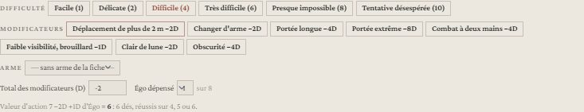
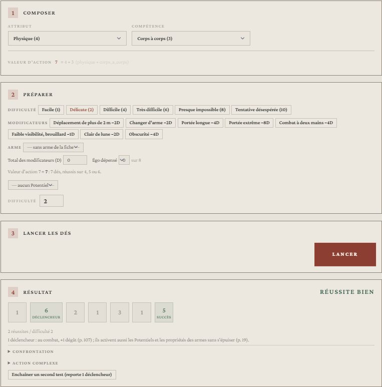
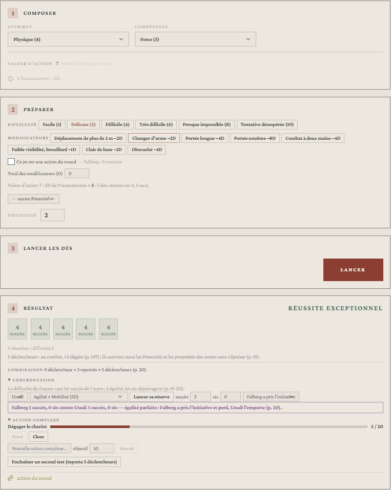
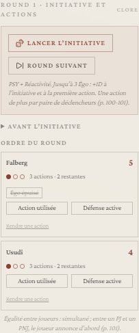
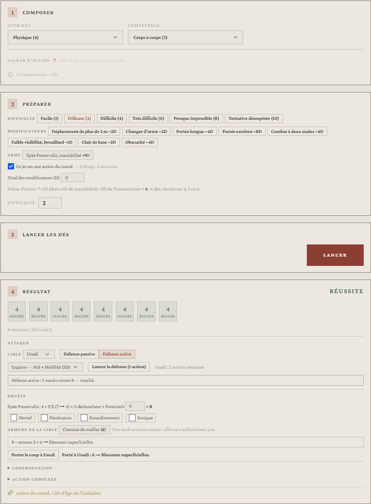
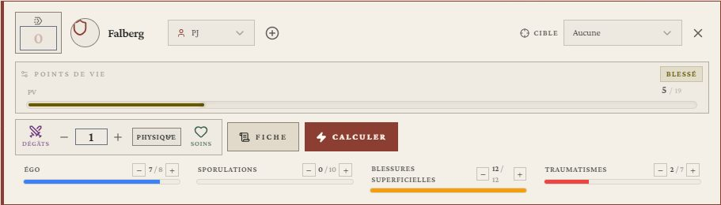
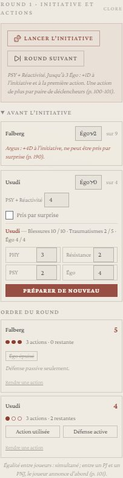
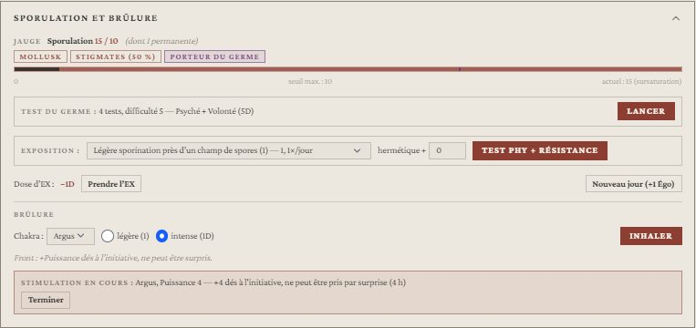
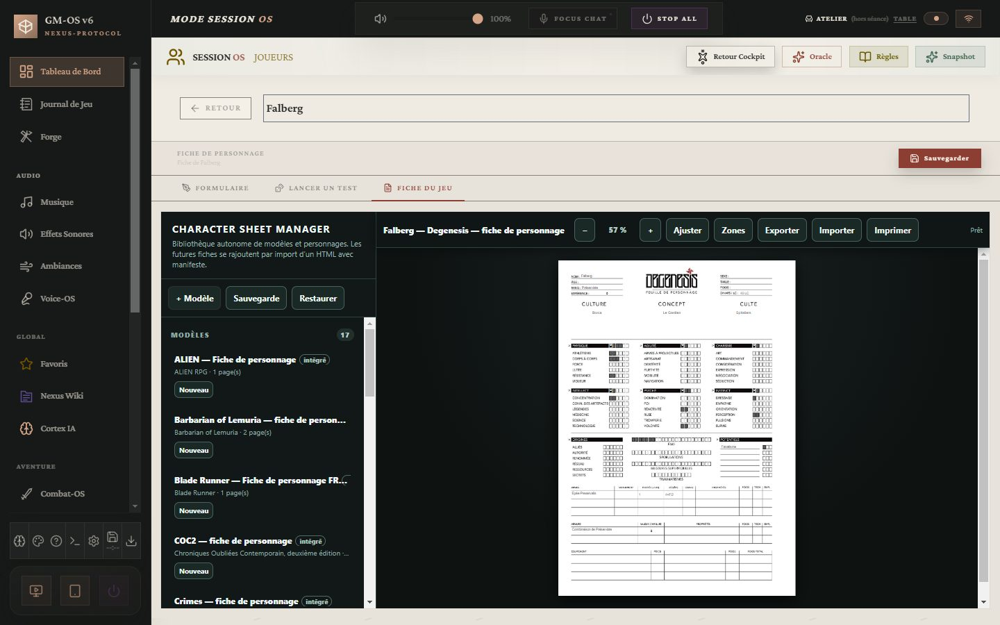
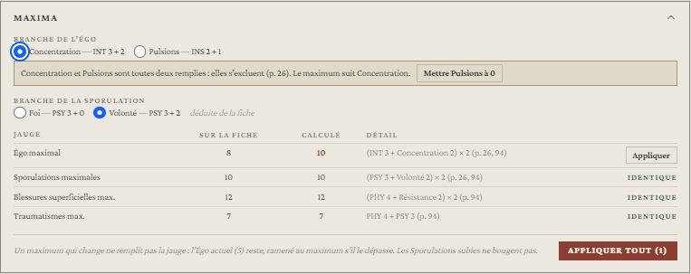

# 🍄 Jeu — Degenesis

> **Pilote décrit :** « Degenesis », forgé par David, exporté le 2026-10-30, **fini le
> 2026-10-30**, version 2.0.0 (`outils/degenesis/finir_degenesis.py`), puis **2.1.0 le 2026-11-03**
> pour le round et l'attaque, DEG-A1 et DEG-A2 (`outils/degenesis/combat_degenesis.py`), puis **2.2.0 le
> 2026-11-04** pour les maxima et les jets liés, DEG-A3 et DEG-A4 (`outils/degenesis/maxima_et_jets_lies_degenesis.py`), puis
> **2.3.0 le 2026-11-04** pour la Sporulation, la Brûlure et les adversaires sans fiche, DEG-A5 et DEG-A6
> (`outils/degenesis/contamination_degenesis.py` →
> `Export Dirvers/corriges/Degenesis_driver_gmos_finir.gmos-driver`, à réimporter avec « Remplacer »). Thème `degenesis`, fiche de personnage HTML
> et bannière livrés le même jour par Codex. Retour à
> [Les jeux et leurs mécaniques](./53-Les-jeux-et-leurs-mecaniques.md).

Un seul geste : le **test d'action**. On lance autant de d6 que la **valeur d'action** —
attribut + compétence, plus ou moins des dés —, chaque **4, 5 ou 6** est un succès, et les
succès doivent atteindre la **difficulté**. Les **6** sont aussi des **déclencheurs** : ils disent
la qualité d'une réussite et ajoutent leurs dégâts au combat. Autour : l'**Égo** dépensé, les
**Traumatismes** qui retirent des dés, la santé en **deux pistes** et l'**initiative** comptée en
succès. La fiche HTML est reliée champ par champ.

> Règles relues contre le livre français KatharSys le 2026-10-30 — pages imprimées 10-21, 94-113,
> 155-160, 186-190, 313-322. Les seize fiches du corpus `docs/systems/degenesis/rules/` sont
> corrigées d'après lui.

**Réimporter le pilote avec « Remplacer ».** Le pilote forgé prenait attribut + compétence pour le
seuil de chaque dé, **ne lançait aucun dé** et exigeait quatre succès. La version 2.0.0 garde son
identifiant, mais **sa fiche change** : les 36 compétences remplacent « Compétence 1 à 5 », et
s'ajoutent six Potentiels, trois armes, deux armures et six lignes d'équipement. Les attributs,
historiques, jauges et l'expérience gardent leur identifiant ; un personnage créé avec la fiche
forgée garde ses anciennes valeurs, mais ses compétences sont à ressaisir.

**Anciennes fiches — NP-C2, 03/11/2026.** Le meneur peut maintenant préparer une
[reprise avec aperçu et sauvegarde](./63-Fiche-de-personnage-HTML.md#reprendre-une-ancienne-fiche)
depuis le formulaire du PJ. Les anciennes clés restent présentes ; les correspondances se
choisissent explicitement, sans déduire une conversion de leurs noms. Les notes et la santé
ne sont pas remises à zéro. L'import d'une campagne conserve un pilote de même ID et signale
les différences ; pour changer ce pilote, importer son .gmos-driver avec **Remplacer**.
252 tests ciblés et six parcours Electron passent le 03/11 ; huit captures relues.
Validation globale de David : « ok tout est testé, commit et pousse ».

---

## Le test d'action

- **Composer** : un **attribut** et une **compétence** de n'importe quel attribut — le livre
  combine librement (« PHY+Force », « INS+Perception »). La ligne **Valeur d'action** en fait la
  somme.
- **Préparer** :
  - la **difficulté** du livre, en succès requis : Facile (1), Délicate (2, par défaut),
    Difficile (4), Très difficile (6), Presque impossible (8), Tentative désespérée (10)
    (p. 18) ;
  - les **modificateurs**, toujours en dés : déplacement de plus de 2 m (−2D), changer d'arme
    (−2D), portée longue (−4D), portée extrême (−8D), combat à deux mains (−4D), brouillard
    (−1D), clair de lune (−2D), obscurité (−4D) ; la maniabilité, l'encombrement ou un Potentiel
    se saisissent dans le total (p. 102-106) ;
  - l'**Égo dépensé**, jusqu'à 3 : un dé par point. Il se retire de la fiche au lancer et ne vaut
    que pour la première action du round (p. 100). **En combat, ce menu disparaît** : l'Égo se paie
    à l'initiative (voir [le round](#le-round--égo-et-actions)) ;
  - en combat, **« Ce jet est une action du round »** (cochée d'office) dépense une action du
    personnage ; sa première action reçoit les dés d'Égo payés à l'initiative, sans rien débiter ;
  - pour Corps à corps, Lutte et Armes à projectiles, l'**arme** de la fiche : sa **maniabilité**
    s'ajoute aux dés (p. 103) ;
  - chaque **Traumatisme** de la fiche retire un dé, sans rien régler (p. 105).
- **Lancer** : douze dés au plus ; au-delà, chaque point de valeur d'action est un **succès
  d'office** (p. 18).

| Résultat | Quand (p. 19) |
| :--- | :--- |
| **Réussite** et sa qualité | autant de succès que la difficulté ; avec 1 à 6 déclencheurs : bien, remarquable, excellent, brillant, exceptionnel, légendaire |
| **Échec** | moins de succès que la difficulté ; les 6 ne déclenchent rien |
| **Échec critique** | un échec dont les 1 sont plus nombreux que les succès |

Sous le résultat, le panneau rappelle ce que valent les déclencheurs au combat (+1 dégât chacun,
p. 107). Sur un échec, il compte les 6 : à égalité de succès, ils départagent une
**confrontation** (p. 19).

## Les jets liés : aide, combinaison, confrontation, action complexe

Avec le pilote 2.2.0, pour le meneur (DEG-A4, 04/11/2026 ; Stitch n'ayant rien rendu, les écrans
ont été validés sur ces captures) :

- **L'aide** (p. 21) : à la préparation, « **Ce jet aide un autre personnage** » et l'aidé choisi —
  la difficulté monte de 1. Si l'assistant réussit, ses **déclencheurs** sont mis de côté en dés
  pour l'aidé (« Retirer » les annule) ; au jet suivant de l'aidé, « **Aide de Kum (+2D)** » est
  cochée d'office, les dés entrent dans la valeur d'action — sous le plafond de 12 — et ne
  servent qu'une fois. Plusieurs assistants s'additionnent, chacun à +1 de difficulté.
- **La combinaison de tests** (p. 20) : après une réussite, « **Enchaîner un second test** »
  reporte ses déclencheurs au prochain test du même personnage. S'il réussit, ils s'ajoutent aux
  siens — « 1 déclencheur + 2 reportés = 3 » — et comptent pour l'attaque, la qualité et le
  journal ; s'il échoue, ils sont perdus. Le report ne sert qu'une fois.
- **La confrontation** (p. 19-20), dans le bloc dépliable du résultat : l'adversaire — un
  combattant du plateau ou un autre personnage — et sa réserve (un attribut et une de ses
  compétences, lus sur sa fiche, −1D par Traumatisme) ; « **Lancer sa réserve** », ou ses succès
  et ses six saisis. Le plus de succès l'emporte, puis le plus de six ; à égalité parfaite, statu
  quo, ou défaite de celui qui **a pris l'initiative** quand il faut un vainqueur.
- **L'action complexe** (p. 21) : « Nouvelle action complexe… », un nom et un objectif ; chaque
  jet, de n'importe quel personnage, y **verse** ses succès plus un par déclencheur, une fois ;
  la barre dit le cumul et « Objectif atteint ». « Clore » la retire.

> L'exemple du chariot (p. 21) oublie les deux déclencheurs du second Préserviste (« il reste 12 »
> au lieu de 10) mais compte celui de Falberg ; GM-OS suit la règle, qui les compte tous.

## Le round : Égo et actions

Avec le pilote 2.1.0, Combat-OS remplace le Jet système par le panneau **« Round de Degenesis »**
(DEG-A1, 03/11/2026, dessiné dans Stitch et validé par David).

1. **Avant l'initiative**, pour chacun : l'**Égo** dépensé, de 0 à 3 (« sur 8 » rappelle ce qu'il
   a), et **« Pris par surprise »**, qui interdit l'Égo (p. 100). Un adversaire sans fiche reçoit
   sa réserve **PSY + Réactivité** à la main — le « jet général » du MJ (p. 101).
2. **« Lancer l'initiative »** lance PSY + Réactivité + l'Égo, moins un dé par Traumatisme ;
   l'**Égo se retire de la fiche une seule fois**, ici. Le score est le nombre de succès ; une
   action, plus une par paire de déclencheurs ; aucun succès : une action à 0. Le plateau se
   range du plus haut au plus bas ; à égalité, les joueurs agissent ensemble (« simultané ») et
   annoncent avant un PNJ (p. 101). Le journal dit le tout.
3. **Pendant le round**, chaque ligne montre les actions dépensées et restantes, et le badge
   « +2D d'Égo — première action » tant que la première action n'a pas eu lieu. Le panneau de jet
   et la défense active dépensent les actions d'eux-mêmes ; **« Action utilisée »** le fait pour
   ce qui se joue sans jet (recharger, se déplacer à couvert…), **« Rendre une action »** corrige
   une erreur — sans rendre le bonus d'Égo. Sans action restante : **défense passive seulement**
   (p. 102).
4. **« Round suivant »** efface les actions et les déclarations d'Égo : l'initiative se relance à
   chaque round (p. 100).

## L'attaque, jusqu'aux dégâts nets

Au résultat d'un jet de **Corps à corps, Lutte ou Armes à projectiles**, pour le meneur, le bloc
**« Attaque »** (DEG-A2, 03/11/2026, dessiné dans Stitch et validé par David) :

- **La cible**, puis sa **défense** :
  - **passive** : la difficulté se compose — 1, +1 actif et debout (coché d'office), +1 couvert
    partiel ou bouclier, +4 couvert total, +1 en mouvement, ± divers ; touché si les succès
    l'atteignent (p. 106) ;
  - **active** : esquive AGI + Mobilité, ou parade PHY + Corps à corps ou PHY + Lutte (pas contre
    un tir). **GM-OS lance la réserve du défenseur depuis sa fiche** et lui **retire une action**
    du round (choix de David) ; il pare ou esquive **à égalité** ; sans action restante, le bouton
    se grise. Une parade au corps à corps gagnée avec **trois déclencheurs** blesse l'assaillant
    — le panneau le dit (p. 102, 106).
- **Les dégâts**, si le coup touche : ceux de l'arme — **F = PHY + Force**, « F/2 » arrondi au-dessus
  (p. 103, 156) — + les déclencheurs de l'attaque + les Potentiels saisis, moins **une seule armure**
  de la cible, choisie dans un menu : les deux de la fiche **ne s'additionnent pas**.
- **Les propriétés** de l'arme sont **lues dans la fiche** et se décochent (choix de David) :
  **Mortel** ignore l'armure et va **droit aux Traumatismes** ; une arme **sonique** (« 1+DC Trauma »,
  « 1+DC Égo ») ignore l'armure ; **Pénétration (N)** annule une armure de N ou moins ;
  **Étourdissement** va à l'**Égo**, armure comprise (p. 155-156, 160).
- **« Porter le coup »** envoie le net aux pistes de la cible — une seule fois, sans que l'armure
  soit retirée de nouveau.

## La santé : deux pistes

Les **dégâts saisis**, armure déjà retirée, cochent d'abord les **Blessures superficielles**,
jusqu'à **(PHY+Résistance)×2** ; le reste devient des **Traumatismes**, jusqu'à **PHY+PSY**
(p. 94, 107). Chaque Traumatisme retire un dé à toute action ; au maximum, le personnage ne peut
plus être sauvé. La jauge **PV** de la carte est ce qui reste sur les deux pistes : elle tombe à
zéro avec la mort, et se recalcule sur les pistes à chaque coup, si l'une a été corrigée à la
main.

- Un **soin** efface les Blessures superficielles ; les Traumatismes se soignent à part, par la
  chirurgie ou dix jours de repos chacun (p. 112-113).
- Un dégât de type **« mental »** ne touche pas la chair : il se retire de l'**Égo**. À zéro, le
  personnage s'effondre ; PSY+Foi ou Volonté (2) le relève à 1 point, une seule fois (p. 107).
- Les **Sporulations** montent jusqu'à **(PSY+Foi/Volonté)×2** ; au-delà, le test du Germe — voir
  [la Sporulation et la Brûlure](#la-sporulation-et-la-brûlure).

### Les adversaires sans fiche

Un combattant du plateau sans fiche de campagne (DEG-A6, 04/11/2026, dessiné dans Stitch et validé
par David) se **prépare** dans le panneau « Round de Degenesis », sous « Avant l'initiative » :
**PHY, Résistance, PSY et Égo**, puis « Préparer ». Ils s'écrivent sur sa fiche de plateau ; ses
maxima se calculent comme pour un PJ — Blessures (PHY+Résistance)×2, Traumatismes PHY+PSY — et
ses coups passent par **la même porte** : Blessures superficielles puis Traumatismes, « mortel »
droit aux Traumatismes, « mental » sur son Égo. La même attaque donne donc les mêmes pistes à un
PNJ de la Galerie et à un adversaire autonome. Le panneau dit ensuite « Blessures 10 / 10 ·
Traumatismes 2 / 5 · Égo 4 / 4 ». **Non préparé**, il est marqué « à préparer » : ses coups restent
en PV, et un avertissement le rappelle — GM-OS ne prétend pas calculer des pistes sans maxima.

## La Sporulation et la Brûlure

À l'onglet du test, la carte **« Sporulation et Brûlure »** (DEG-A5, 04/11/2026, dessinée dans
Stitch et validée par David) :

- **La jauge** des Sporulations, les points **permanents** en sombre ; les seuils (p. 186) :
  **Mollusk** dès 1, **Stigmates** à 50 % du maximum, **Porteur du Germe** dès un point permanent,
  **Léperos** quand la moitié de l'échelle est permanente.
- **Le test du Germe** : au-delà du maximum, un test de PSY + Foi ou Volonté (la branche des
  « Maxima ») par point d'excédent pas encore testé, de difficulté l'excédent ; GM-OS les lance
  (choix de David) et chaque échec ajoute un point permanent.
- **L'exposition** : le niveau du tableau de la p. 186 (légère sporination 1 … saturation 10), les
  succès d'office de l'**hermétique**, puis « Test PHY + Résistance » ; un échec ajoute 1 ou 1D.
- **La dose d'EX** retire 1D, jamais les points permanents, une fois par jour (p. 177) ;
  « **Nouveau jour** » rend 1 Égo au réveil et rouvre l'EX.
- **La Brûlure** : le Chakra (Bion, Gloire, Unité, Muse, Argus, Discordia), légère (Puissance 1) ou
  intense (1D), « Inhaler » — l'Égo remonte de la Puissance (sans dépasser son maximum), la
  Sporulation monte d'autant, et la **stimulation en cours** s'affiche ; la suivante la remplace,
  « Terminer » la retire, la Sporulation reste (p. 188-190). La **Discordia** n'en donne aucune :
  un attribut tiré au dé tombe à 1, ou monte à 6 sur un 6, pendant six heures (p. 190).

La stimulation se **propose aux jets** (choix de David), cochée d'office quand le jet correspond :
**Muse** +Puissance D à INS + Perception ou Empathie, **Unité** à CHA + Négociation ou Expression,
**Gloire** +Puissance succès d'office en PSY + Foi/Volonté et PHY +Puissance/2 (arrondi au-dessus)
sur un jet de Physique, **Bion** +Puissance succès d'office en PHY + Résistance, **Discordia**
l'écart de l'attribut touché. L'**Argus** ajoute ses dés à l'initiative du round, et la case « Pris
par surprise » disparaît. Au même endroit, un **Potentiel** de la fiche se choisit explicitement,
avec les dés que le meneur lui accorde ; son texte n'est pas interprété.

## La fiche du personnage

La fiche fidèle au PDF (`docs/fiches/Degenesis/`, gabarit `degenesis-fr`, moteur de fiches
**version 21**) s'ouvre dans l'onglet **Fiche du jeu**. Ses **129 clés** sont reliées une à une
aux champs du pilote (`docs/systems/degenesis/fiche/correspondance.json`). Sur les pistes, l'Égo
compte les **points restants** ; Sporulations, Blessures superficielles et Traumatismes ce qui a
été **subi**.

La fiche GM-OS a deux champs que la fiche HTML n'imprime pas : l'**Égo maximal** et la **santé
restante**, tenue par Combat-OS.

### Les maxima

À l'onglet du test, la carte **« Maxima »** (DEG-A3, 04/11/2026, pilote 2.2.0) :

- **La branche de l'Égo** — Concentration ou Pulsions — et **celle de la Sporulation** — Foi ou
  Volonté — se **déduisent** de la compétence remplie (« déduite de la fiche ») ; si les deux le
  sont, ou aucune, le meneur la **choisit**, et le choix se garde dans la fiche. Deux compétences
  exclusives remplies sont signalées (« elles s'excluent », p. 26), avec « **Mettre Pulsions à 0** ».
- **Le tableau** : Égo maximal (INT+Concentration)×2 ou (INS+Pulsions)×2, Sporulations
  (PSY+Foi ou Volonté)×2, Blessures superficielles (PHY+Résistance)×2, Traumatismes PHY+PSY
  (p. 26, 94) — chaque ligne avec son calcul.
- **« Appliquer »** écrit l'Égo maximal. Il **ne remplit pas** la jauge : l'Égo actuel reste, ramené
  au maximum seulement s'il le dépasse. Les trois autres maxima sont des formules du pilote : la
  carte les compare et dit l'écart (la jauge de Sporulation additionne Foi et Volonté si les deux
  sont remplies). Les Sporulations subies ne bougent jamais.

## Le thème

Le thème `degenesis` (papier de cendre, cadre noir mat, oxyde) s'applique quand il est activé dans
la campagne ; matière, ornements et icônes demandent les **personnalités** allumées dans les
Paramètres. Accepté par le validateur sans erreur ni avertissement. La bannière
`Degenesis Band.jpg` se choisit dans l'éditeur du pilote.

## Ce qui reste à la table

- **Sur la carte du combattant**, les dégâts se saisissent toujours armure retirée ; c'est le bloc
  « Attaque » du panneau de jet qui calcule le net.
- **La contre-attaque** d'une parade à trois déclencheurs est annoncée, pas lancée ; les attaques
  mentales (PSY + Foi ou Volonté, sans action) se règlent au panneau, sans bloc d'attaque.
- **Rafale, Régularité, Terrifiant, Incendiaire** et les autres propriétés restent au meneur.
- **Les effets des Potentiels** (dépense d'Égo, déclencheurs) et les rangs de Culte : le Potentiel
  se choisit au jet, ses dés se saisissent. La durée d'une stimulation se compte à la table
  (« Terminer ») ; la Gloire ne monte pas F aux dégâts ; le transfert de la Muse et la paix de
  l'Unité se jouent au récit.
- **L'aide d'un PNJ** : seuls les personnages des joueurs se proposent comme aidés ; un PNJ qui
  aide se règle en dés ajoutés à la main.
- **Un adversaire sans fiche non préparé** perd ses PV d'un bloc ; préparé au round, il a ses deux
  pistes. Sa défense active lit AGI et Mobilité sur sa fiche de plateau.

## Les campagnes de test

[La Station des Cendres et ses deux laboratoires](../Planning/2026-10-30-campagne-recette-degenesis.md)
sont livrés pour les trois joueurs de l’export : 21 nouveaux PJ, 66 cas humains **NON TESTÉS**.
Importer d’abord `01-La-Station-des-Cendres.gmos`, puis les laboratoires santé et réserves.
Les imports, le remplacement isolé, trois Hub et la persistance des fiches ont été éprouvés
en instance jetable ; **GM-05 reste en échec : des secrets de séance sont transmis aux Hub**.
Lire les anomalies du lot avant la table. Le matériel d’exercice a des valeurs choisies,
sans création novice ni profil d’arme officiel revendiqués.
