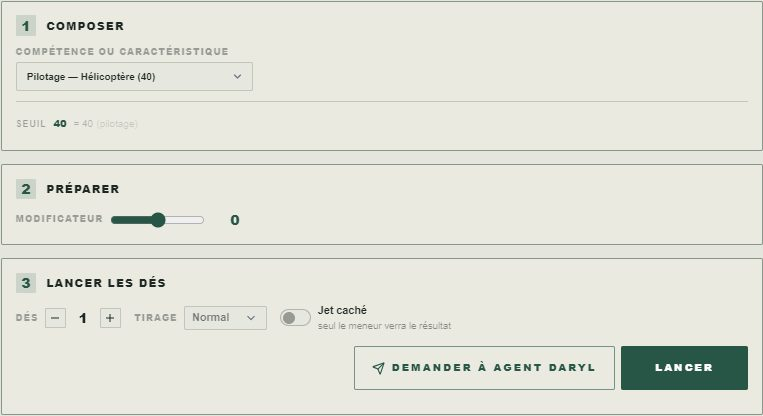
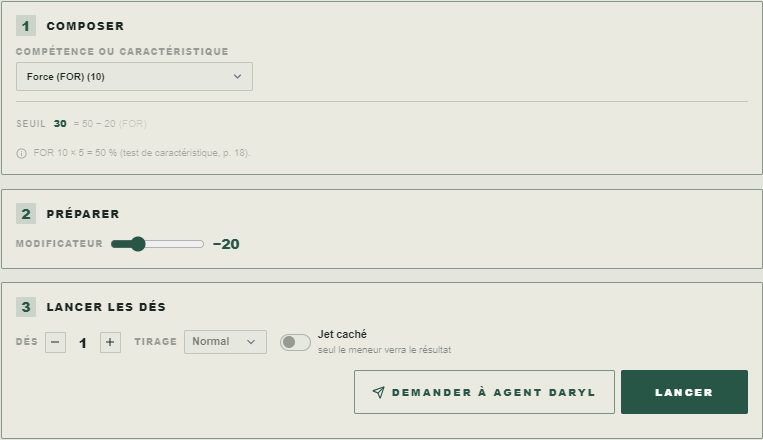
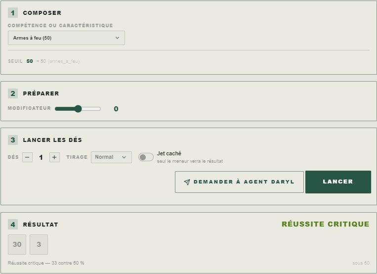
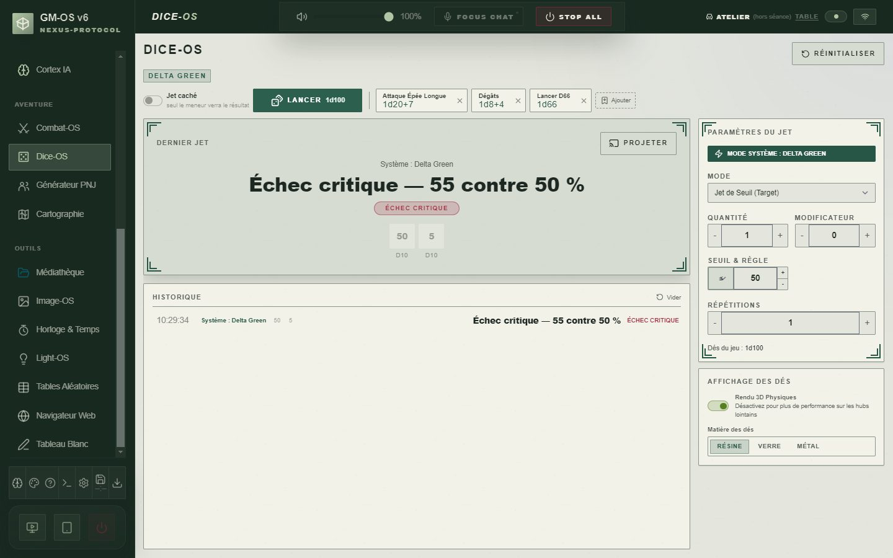
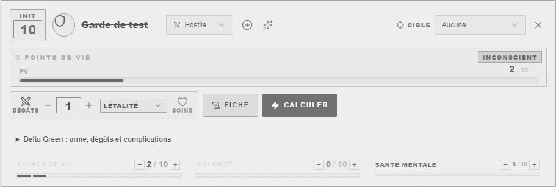
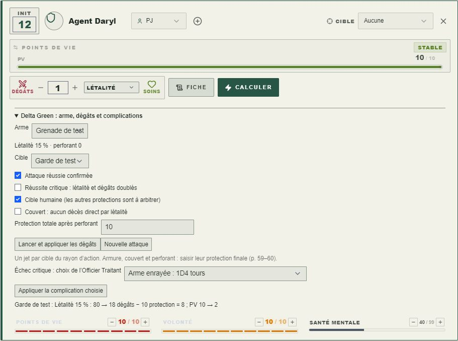
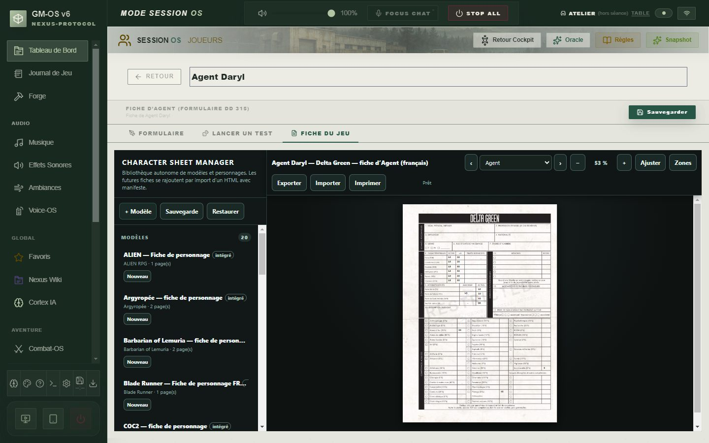
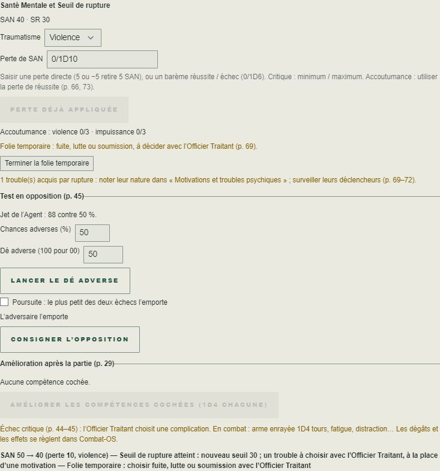
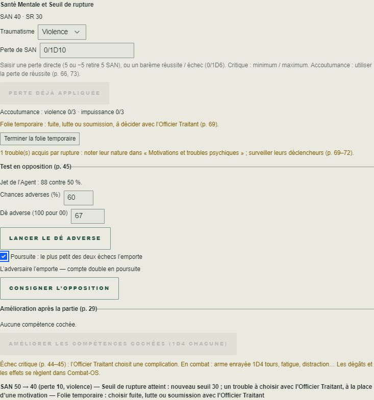

# 🟩 Jeu — Delta Green

> **Pilote décrit :** « Delta Green », forgé par David, exporté le 2026-11-12, version **2.1.0** du
> 2026-11-13 (`Export Dirvers/corriges/Delta-Green-2.1.0.gmos-driver`, construit par
> `outils/delta-green/finir_delta_green.mjs`). Thème `delta-green` et fiche d’Agent HTML
> `delta-green-agent-fr` préparés le même jour. Retour à
> [Les jeux et leurs mécaniques](./53-Les-jeux-et-leurs-mecaniques.md).

Un seul geste : le **test**, un d100 sous les chances de l’Agent. Ces chances sont une compétence,
ou une caractéristique multipliée par cinq, plus le bonus ou le malus de l’Officier Traitant. Le
résultat a quatre issues : réussite critique, réussite, échec, échec critique. **Les doubles et les
« 01 » / « 00 » décident des critiques.** Les points de vie, la Volonté et la Santé Mentale sont des
jauges ; la fiche d’Agent HTML (formulaire DD 315) est reliée champ par champ.

> Règles lues dans le *Manuel de l’Agent* (édition française) le 2026-11-12 : pages imprimées 18,
> 29, 43-44, 50 et 53 (page du PDF = page imprimée + 1 ; chemin dans
> `docs/systems/delta-green/livres.json`). Les dix-huit fiches du corpus
> `docs/systems/delta-green/rules/` ne sont **pas encore relues** en entier. Au 13/11 : une fiche
> relue sur dix-huit (accoutumance). Les suites ci-dessous ont été vérifiées directement contre
> les pages 29, 44–45, 52, 57–59 et 66–74 du livre.

**Réimporter le pilote avec « Remplacer ».** Le pilote forgé portait un critique sur 1 et une
complication sur 20, des valeurs de d20 : sur le d100, **aucun double ne comptait**. Sa fiche
nommait « Compétence 1 » à « Compétence 12 ». La version 2.0 garde son identifiant, et **sa fiche
change** : un personnage créé sur l’ancienne ne retrouverait pas ses compétences (aucun n’existait
au 12/11). La 2.0.1 corrige le menu du jet : en 2.0.0, Pilotage s’y affichait sous le nom de sa
spécialité (« +5 »), et Art, Artisanat, Pilotage, Science et Sciences militaires en disparaissaient
tant qu’aucune spécialité n’était saisie.

---

## Le test

Dans l’onglet **Lancer un test** de la fiche, choisir une **compétence**, une **caractéristique**
ou la **SAN** :

- **une compétence** se teste à son pourcentage. Art, Artisanat, Pilotage, Science et Sciences
  militaires affichent leur spécialité à la suite de leur nom, « Pilotage — Hélicoptère (40) », et
  restent au menu sans elle ; les six lignes libres, les langues et autres compétences, n’y
  apparaissent qu’une fois nommées, sous leur nom : « Russe (40) » ;
- **une caractéristique** se teste à sa valeur × 5 : FOR 15 donne 75 % (p. 18). Le panneau le
  dit sous les chances ;
- **la SAN** se teste à sa valeur courante.

L’étape **Préparer** règle le **bonus ou malus** de l’Officier Traitant, de −40 à +40 %. Le livre
cite surtout ±20 %, et plus rarement ±40 % (p. 43). Les chances modifiées restent entre **1 et
99 %**, et le panneau dit quand il les a ramenées.

**Une compétence à 0 % ne se tente pas** (p. 29). Le bouton reste gris et le panneau le dit : il
reste à demander un test de caractéristique × 5.

| Le dé | Ce qu’il donne (p. 44) |
| :--- | :--- |
| **01**, ou un **double** (11, 22… 99) sous les chances | **Réussite critique** — l’effet est doublé |
| Sous les chances ou égal | **Réussite** |
| Au-dessus des chances | **Échec** |
| **00** (100), ou un **double** au-dessus des chances | **Échec critique** — des répercussions catastrophiques |

Le résultat s’écrit avec ces mots : « Réussite critique — 33 contre 50 % ».

**Exemple du livre** (p. 44) : un Agent à 50 % obtient une réussite critique sur 01, 11, 22, 33 et
44, et un échec critique sur 55, 66, 77, 88, 99 et 00.

## Le pupitre de l’Officier Traitant

Dice-OS s’ouvre en **Jet de Seuil**, sous 50 % : régler le seuil sur les chances, puis lancer.
Le 01, les doubles et le 00 y comptent comme sur la fiche ; des chances saisies au-delà de 99 sont
ramenées à 99 %.

## Les jauges

| Jauge | Maximum (p. 18) |
| :--- | :--- |
| **Points de vie (PV)** — la santé principale | (FOR + CON) / 2, arrondi au supérieur |
| **Volonté (VOL)** | POU |
| **Santé Mentale (SAN)** | 99 − Inconcevable ; au départ, POU × 5 |
| **Seuil de rupture (SR)** | un nombre saisi : SAN − POU au départ |

Les coups portés depuis la console de dommage ou Combat-OS s’écrivent sur les PV de la fiche. Le
livre dit : *« Une fois à 2 PV, il perd connaissance, et à 0 PV, il meurt »* (p. 18). GM-OS
signale désormais l’inconscience à 1–2 PV, et la mort à 0. Une inconscience ne produit pas
de faux décès au journal. Un soin qui ramène à 3 PV fait disparaître l’indication d’inconscience.

Les **cinq Attaches** ont un nom, un score et la case « endommagée ». Les accoutumances à la
violence et à l’impuissance sont deux cases.

## Le combat

- **Initiative** : l’ordre de **DEX**, de la plus élevée à la plus basse ; à égalité, les actions
  sont simultanées (p. 50).
- **Portées** (p. 53) : +20 % à bout portant (3 m ou moins), −20 % de la portée de base de l’arme à
  son double, −40 % du double au quintuple, impossible au-delà. Les limites dépendent de l’arme :
  Combat-OS les nomme, l’Officier Traitant règle le malus au jet.
- **Armes** : sept lignes sur la fiche, avec compétence, portée de base, dégâts, perforant,
  létalité, rayon d’action et munitions. Sur la carte de l’attaquant, ouvrir **Delta Green : arme,
  dégâts et complications**, sélectionner son arme et sa cible, puis confirmer l’attaque réussie
  et la nature humaine de la cible. Cocher le critique si l’attaque était critique. Saisir la
  protection totale **après perforant**, et cocher le couvert s’il protège la cible.
- **Lancer et appliquer les dégâts** : dégâts ordinaires doublés sur un critique ; pour une arme
  à létalité, un d100 indépendant, sans critique propre. Réussite : 0 PV ; sinon somme des deux
  chiffres (0 vaut 10). Le critique de l’attaque double la létalité et la somme. Un couvert interdit
  le décès direct ; armure et couvert réduisent la somme. Recommencer pour chaque cible du rayon.
- **Complication** : l’Officier Traitant choisit. Enrayement 1D4 tours (remise en état, un tour par
  clic, arme inutilisable jusque-là), fatigue −1D6 PV, surcharge −1D6 VOL, distraction −20 % au
  prochain test de la fiche. Chute et tir accidentel sont consignés pour arbitrage. Cliquer sur
  **Nouvelle attaque** pour autoriser un nouveau traitement ; un double clic ne répète pas le coup.

## La fiche du personnage

La fiche d’Agent HTML (`docs/fiches/Delta Green/delta-green-fiche-agent-interactive.html`, deux
pages, 233 clés) est dans le moteur des fiches (version 26). **210 champs GM-OS** y sont reliés
(`docs/systems/delta-green/fiche/correspondance.json`), dont les 47 cases d’amélioration. Les **23 clés laissées à la fiche HTML**
ont chacune leur raison :
- les « × 5 », que le jet calcule lui-même ;
- les maximums, que le pilote calcule ;
- les formations particulières ;
- la signature.

Le **trouble psychique permanent** n’existe que dans GM-OS.

## Le thème

Le thème `delta-green` : papier de dossier, ornements, quinze icônes, et la bannière
`Delta Green Band.jpg`. Préparé par Codex le 12/11 et contrôlé : 0 erreur, 0 avertissement.

## Les suites du jet : SAN, opposition et amélioration

Dans **Lancer un test**, la carte **Delta Green : suites du jet** est commune au PC et à la tablette.

1. **SAN** : lancer le test de SAN, choisir Violence, Impuissance ou Inconcevable et saisir
   une perte directe (`5` ou `−5` retire 5 SAN), un dé seul (`1D6`) ou la perte réussite/échec,
   par exemple `1/1D6`. **Appliquer la perte de SAN** choisit la bonne
   branche ; critique réussi : minimum, critique raté : maximum. Le reçu du jet empêche une
   deuxième application. Une perte d’au moins 5 rappelle la folie temporaire ; l’atteinte du SR
   compte un trouble et pose immédiatement **SR = SAN restante − POU**. À 0 SAN, la folie
   permanente est signalée. Choisir les troubles avec l’Officier Traitant, remplacer une motivation
   et noter leur nature dans la fiche ; GM-OS rappelle les troubles sans en choisir un à votre place.
   Une saisie invalide ou une valeur indispensable absente de la fiche est signalée au-dessus du
   bouton ; corriger la saisie permet de réessayer sans relancer le test.

   
2. **Accoutumance** : après trois pertes du même type sans folie temporaire ni rupture,
   la case devient acquise. Violence : un seul D6 réduit le CHA et toutes les Attaches du même
   montant ; impuissance : un D6 réduit le POU, et la VOL est ramenée à son maximum. Une crise
   remet à zéro la progression concernée. L’Inconcevable n’a aucune accoutumance. Un Agent
   accoutumé utilise la **perte de réussite**, qui peut être supérieure à zéro.
3. **Opposition** : saisir les chances et le dé de l’adversaire, ou lancer son dé. Le critique
   surpasse la réussite ordinaire ; entre réussites de même qualité, le résultat le plus haut
   l’emporte. Deux échecs : personne ne réussit, ou cocher l’option de poursuite pour retenir le
   plus petit. Les critiques comptent double en poursuite ; une égalité reste à départager.

   
4. **Amélioration** : un jet de compétence raté coche automatiquement sa case, hors Inconcevable
   et compétence à 0 %. Après la partie, **Améliorer les compétences cochées** ajoute un D4 à
   chacune (maximum 99 %) puis décoche les cases. Aucun gain au deuxième clic.

Les résultats conservent « Réussite critique » et « Échec critique » dans le journal, au pupitre,
sur la tablette et dans les cartes de résultat.

## Ce qui reste à arbitrer

La projection sur une Attache et la répression d’une crise, les effets détaillés du trouble choisi,
les protections des cibles massives ou transcendantes, les soins et les autres règles non décrites
restent à la table. Le catalogue d’équipement et la relecture intégrale du corpus restent à faire.

*Mis à jour le 2026-11-13 ; pilote 2.1.0, perte directe de SAN et boutons validés par David : « ok c’est bon tout est testé ». Captures de l’application réelle (`e2e/capturesDesJeux.spec.ts`, pilote 2.1.0, profil jetable).*
