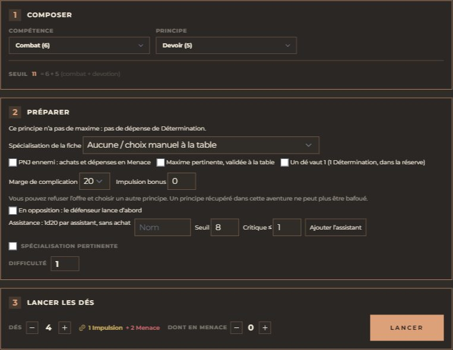
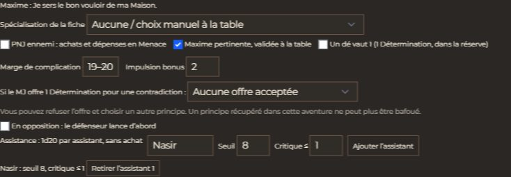
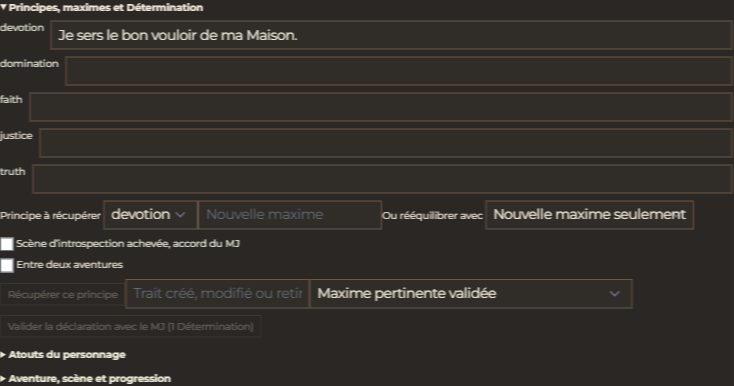
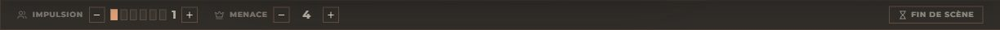
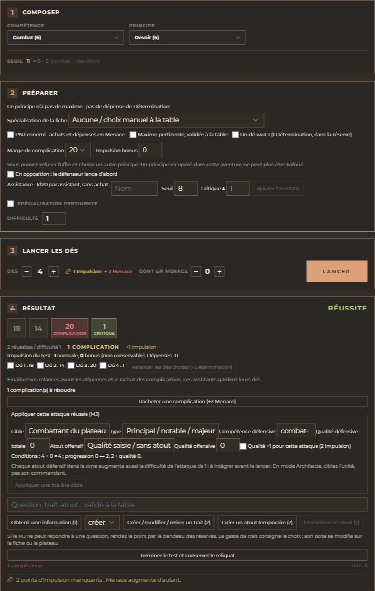
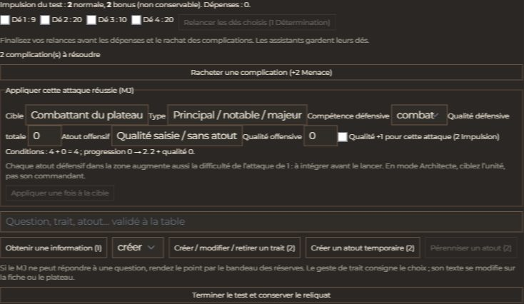
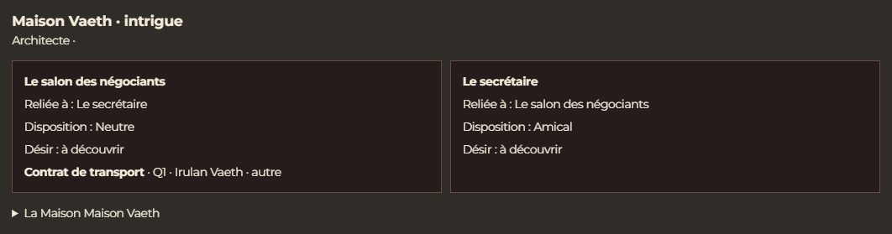
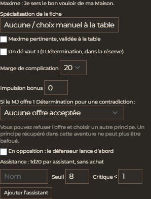

# 🏜️ Jeu — Dune

> **Pilote décrit :** « Dune », exporté le 2026-10-25, version **2.0.0**.
> Export : `Export Dirvers/corriges/Dune_driver_gmos_2.0.0.gmos-driver`.
> Retour à [Les jeux et leurs mécaniques](./53-Les-jeux-et-leurs-mecaniques.md).

Réimportez le pilote dans la Forge avec **Remplacer**. Les clés existantes sont conservées,
y compris Mobilité (`mob`), Rhétorique (`rhetoric`) et les principes de l'ancien export.
Le champ de points de vie erroné disparaît du gabarit. La préparation de cet export ne modifie
aucune campagne. Une fiche HTML fidèle reste un travail Studio distinct.

## Lancer un test

Choisissez Compétence et Principe. Leur somme est le seuil de chaque d20 ; la difficulté
compte les réussites exigées. Un résultat inférieur **ou égal** au seuil est une réussite.
Un 1 compte double. Une **Spécialisation pertinente** étend ce double à la valeur de la
compétence. Son adéquation reste à décider à la table ; notez les spécialisations sur la fiche,
une par ligne.

La réserve contient deux à cinq d20. Les dés achetés coûtent successivement 1, 2 et 3 points.
**Dont en Menace** permet de payer tout ou partie de l'achat en Menace, même avec de l'Impulsion
disponible. Pour un ennemi, le MJ coche **PNJ ennemi** : ses achats dépensent sa Menace.

Chaque assistant lance son d20 avec son propre seuil et son propre critique, sans achat.
Ses réussites comptent seulement si le personnage principal en obtient au moins une ; ses
complications comptent toujours. Les relances du principal ne relancent jamais l'aide.

En **opposition**, saisissez les réussites du défenseur qui a lancé en premier, les facteurs
qui le gênent et les ajustements contre l'actif. La difficulté calculée peut dépasser 5.
La marge de complication peut aller de 20 seul à 16–20.

## Détermination et maximes

Dans **Dune : principes, atouts et progression**, ouvrez **Principes, maximes et Détermination**.
Inscrivez les maximes. Avant une dépense de Détermination, confirmez qu'une maxime pertinente
soutient l'action, avec l'accord de la table.

- Avant le jet, **Un dé vaut 1** remplace un dé de la réserve sans ajouter de dé.
- Après le jet, cochez les dés à relancer et dépensez un point. Les nouveaux résultats
  remplacent les anciens, conformément à l'errata ; faites les relances avant les dépenses.
- Une **déclaration** coûte un point : le MJ valide le trait créé, modifié ou retiré ; le
  carnet la consigne, puis vous modifiez le texte du trait sur la fiche.
- Dans l'alternance de Combat-OS, une maxime pertinente permet une **action supplémentaire**
  pour un point, même après rétention.

Si le MJ offre un point pour une maxime en contradiction avec l'action, choisissez **Respecter**
(complication) ou **Bafouer**. Vous pouvez aussi refuser l'offre et changer de principe.
Le principe bafoué devient indisponible **à la fin du test**, après les relances.

La récupération demande une scène d'introspection autorisée par le MJ, sans échange de
Détermination, ou se fait entre aventures. Choisissez une nouvelle maxime ou rééquilibrez
avec le principe immédiatement inférieur. Un principe récupéré ne peut plus être bafoué
dans cette aventure. **Début d'aventure** remet la Détermination à 1 explicitement ; changer
de scène ne la remet jamais à 1.

## Impulsion : dépenser, puis conserver

L'Impulsion générée reste **sur le test** jusqu'à **Terminer le test et conserver le reliquat**.
Vous pouvez donc la dépenser même si la réserve commune est pleine. Le bilan sépare l'Impulsion
normale du bonus annoncé avant le lancer : **le bonus ne se conserve jamais**. Le reliquat normal
rejoint la réserve plafonnée à 6 ; un PNJ ennemi convertit le sien en Menace. Le journal explique
le versement et les pertes.

Après un test réussi, précisez l'effet souhaité : information (1 point par question), trait
(2 points), atout temporaire de qualité 0 (2 points), pérennisation d'un atout (2 points).
Les dépenses consomment d'abord le bonus, puis l'Impulsion du test, puis la réserve commune.
Pour modifier un trait, indiquez `ancien => nouveau`. Pour pérenniser un atout, indiquez son
nom exact. Les effets narratifs restent à valider avec le MJ. Si le MJ ne peut répondre à une
question, rendez le point par l'ajustement explicite du bandeau.

Le rachat d'une complication offre 2 Menace pour un PJ ou dépense 2 Menace pour un ennemi.
Une **réussite mitigée** autorisée par le MJ laisse le test en échec et ajoute les complications
annoncées : aucune Impulsion du test ni dépense d'amélioration. En opposition ratée, le panneau
indique l'Impulsion du défenseur ; ses dépenses immédiates et la conversion éventuelle du
reliquat se gèrent au bandeau. **Fin de scène** retire 1 Impulsion de la réserve commune.

## Conflit : l'ordre d'action

Le MJ choisit le camp qui ouvre. Un départ ennemi peut être justifié par le récit ou payé
2 Menace avec le bouton dédié. Les camps alternent. Après l'action, indiquez son résultat.
Une attaque ou un déplacement raté interdit la rétention ; un déplacement discret réussi
la rend gratuite. La rétention normale coûte 2 Impulsion, ou 2 Menace concédées, pour les PJ ;
les ennemis dépensent 2 Menace.

Vous pouvez conserver pour un allié encore inactif ou **rejouer le même personnage**. Ce dernier
reçoit +1 à la difficulté de son nouveau test ; l'allié ne reçoit pas ce surcoût. Une rétention
ne peut pas être répétée avant qu'un ennemi ait agi. La Détermination offre sa propre action
supplémentaire.

## Attaquer, survivre et récupérer

Après un test réellement réussi, le MJ peut appliquer une attaque à un combattant du plateau.
Sélectionnez la cible, sa catégorie, sa compétence défensive et la qualité de ses défenses.
Le panneau montre les conditions et la progression **avant** l'application.

- Une cible mineure est vaincue par une attaque réussie.
- Une cible principale/notable/majeure, ou un atout militaire en guerre, emploie une tâche
  étendue : compétence défensive + qualité défensive, sans plafonner ce bonus à 8.
- Progression : 2 + qualité offensive ; 2 Impulsion augmentent la qualité de 1 pour cette
  attaque. Chaque atout défensif dans la zone augmente aussi la difficulté de 1,
  à intégrer **avant** le lancer.

La cible devient **vaincue**, jamais morte automatiquement. Sur sa carte, **Défaite et
récupération Dune** permet de survivre une fois par scène pour 1 + qualité offensive en
Impulsion/Menace, avec une complication choisie. Nommez d'abord sa scène dans le carnet.
Les exceptions de talents sont validées explicitement par le MJ.

Si une conséquence durable a été choisie, une aide réussie de difficulté 2 peut l'empêcher
sans remettre la cible en jeu. Sans effet durable, suivez la tâche de récupération à
4 + qualité de l'atout qui l'a vaincue. Il ne s'agit jamais de soins en points de vie.

## Le plateau de zones et la Maison

Dans **Cockpit → Modules du jeu → Dune : conflits et Maison**, ouvrez le pupitre. Préparez des
zones reliées et les atouts avec propriétaire, qualité, usage, nature et durée. Choisissez
duel, escarmouche, espionnage, guerre ou intrigue ; choisissez aussi Agent ou Architecte.
Les zones n'ont aucune conversion métrique automatique.

Le MJ déplace les atouts sur les liens adjacents, neutralise les tangibles et détruit les
intangibles. Au changement de scène, les atouts temporaires disparaissent et les tangibles
permanents neutralisés redeviennent disponibles. Le panneau rappelle les procédures de
discrétion, d'audace et de mouvement supplémentaire ; tests et paiements restent explicites.

En intrigue, une zone peut être une personne ou une faction. Une disposition connue peut
être affichée. Un désir reste secret jusqu'à sa révélation ou l'achèvement de la tâche
d'enquête : conditions Discipline, progression Analyse − 2 par test réussi. Les zones et
atouts cachés, ainsi que les désirs non révélés, sont absents des données des joueurs.

Cochez les personnages autorisés dans **Accès des personnages** : leurs tablettes consultent
le plateau. Le MJ reste seul à commander. Le module se sauvegarde avec la campagne.

Sur la tablette, les choix du test et les paiements suivent les mêmes règles. Le jet et les
mouvements de réserve remontent au meneur.

La fiche de Maison du pupitre conserve type, monde, domaines, rôles, alliés, ennemis et atouts.
**Début de séance** propose la Menace selon les joueurs présents : 0/1/2/3 par joueur pour une
Maison naissante/mineure/majeure/Grande Maison, avec ajustement du MJ. Le clic remplace la
réserve ; ouvrir le pupitre ne la remet pas à zéro.

## Progression

Le carnet propose les gains pour défaite, échec de difficulté 3+, dépense d'au moins 4 Menace,
ambition et récompense du groupe. Le MJ valide ces gains et le carnet les historise.

Acquérez une seule progression entre deux aventures : compétence, spécialisation, talent,
atout permanent ou qualité. Les coûts et plafonds viennent du livre ; améliorer un atout coûte
**deux fois sa nouvelle qualité**, selon l'errata 1.1. La reconversion diminue le prix de moitié,
arrondi au supérieur, en abandonnant la capacité indiquée. Les principes évoluent par leur propre
procédure de récupération.

*Relu le 2026-10-25 contre le livre français et les errata 1.0 fourni et 1.1 de l'éditeur.
La recette automatisée et les captures ne remplacent pas l'essai de David en séance.*
