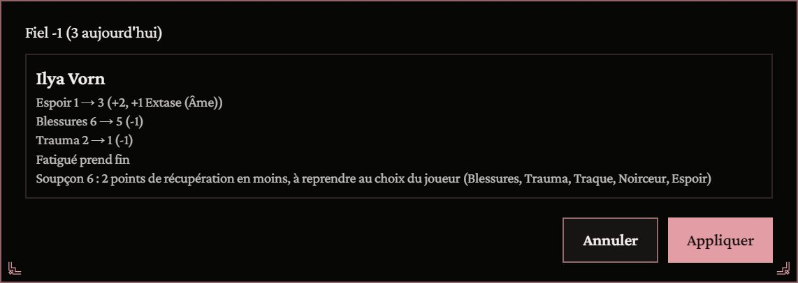
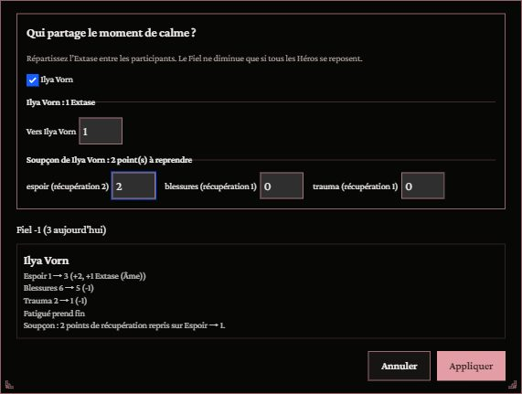
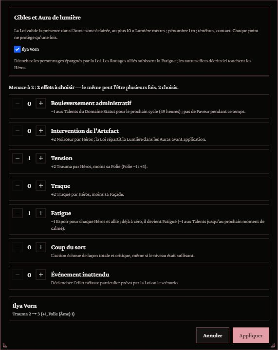
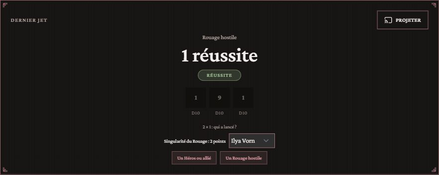
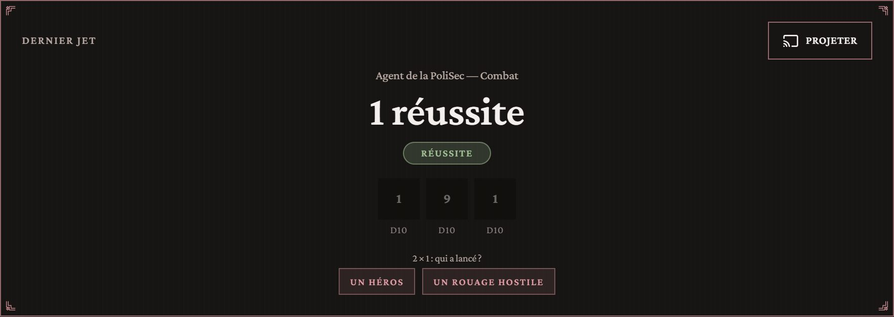
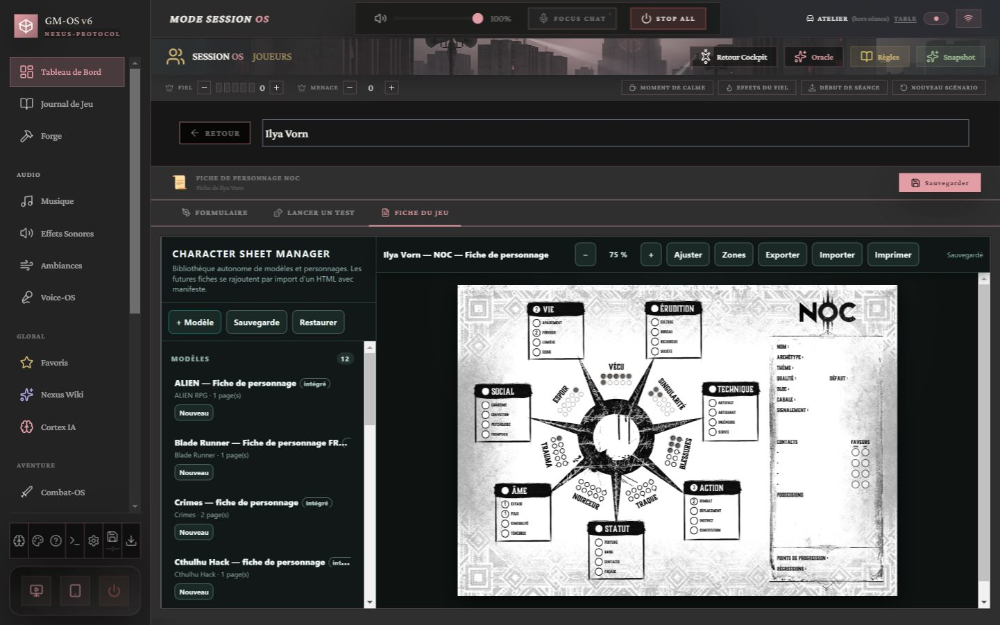

# 🌌 Jeu — NOC

> **Pilote décrit :** « NOC » **2.0.0**, exporté le 2026-10-25, amélioré contre le livre de base et les règles de Cabale de *Diffractions obsidionales*. Export : `Export Dirvers/corriges/NOC_driver_gmos_2.0.0.gmos-driver`. Retour à [Les jeux et leurs mécaniques](./53-Les-jeux-et-leurs-mecaniques.md).

Les Héros résistent dans un monde enfermé dans l'Artefact. Trois choses rendent ce jeu différent
dans GM-OS : les **dés de destin**, le **Fiel** qui déborde en **Menace**, et la **Cabale**, la
cellule commune à toute la table.

---

## Le Fiel et la Menace — le bandeau des réserves

| Réserve | Ce qu'elle fait dans GM-OS |
| :--- | :--- |
| **Fiel** (0 à 5) | Une goutte par 1 sur un dé de destin. Les joueurs la voient et la font monter eux-mêmes, depuis leur tablette. **À la cinquième goutte, la jauge se vide et la Menace monte de 1** ; un message le dit, c'est le moment où la Loi applique autant d'effets du Fiel que la Menace |
| **Menace** (sans plafond) | Aux mains de la Loi, visible des joueurs. **« Début de séance »** lui retire un point ; **« Nouveau scénario »** la remet à zéro |

Les gouttes **s'ajoutent seules** quand un dé de destin fait 1, depuis le panneau de jet. Au
pupitre, deux boutons demandent si le jet est celui d'un Héros ou d'un Rouage hostile (voir plus
bas) ; le + et le − du Fiel restent là pour le reste.

Si le Fiel est à 4 et reçoit 3 gouttes, la jauge se vide une fois et **reste à 2** : les gouttes
se posent une à une. Les règles ne tranchent pas ce cas.

---

## Le jet — le Talent, et provoquer le destin

1. On retient le **Talent** et son **Domaine**. Le Talent donne le **niveau** ; le Domaine, le
   **plafond des dés de destin**.
2. On règle la **difficulté** : le niveau de Talent que la Loi estime nécessaire (le livre ne fixe
   pas de difficulté par défaut ; le panneau part de 0, la maîtrise basique).
3. **Provoquer le destin** : on lance **de zéro au plafond** de dés à dix faces. Sans dé, le Talent
   seul affronte la difficulté.
4. Chaque **8, 9 ou 10** élève le niveau d'un point ; un **10 propose un dé de plus**, que l'on peut refuser ; **chaque
   1 verse une goutte dans le Fiel**, automatiquement — et la jauge déborde en Menace à cinq.
5. Le résultat se dit en entier : « Réussite, marge 1 — niveau 2 + 3 réussites (5 dés de destin) =
   5 contre difficulté 4 · 1 goutte de Fiel ». Un **seul degré d'échec** peut devenir un échec
   partiel : c'est la Loi qui tranche.

### Les réserves du Héros

La section **« Puiser dans ses réserves »** se lit sur la fiche du Héros et s'y décompte :

| Réserve | Ce qu'elle donne |
| :--- | :--- |
| **Vécu** | +1 au niveau — **un seul point par test** |
| **Espoir** | 3 dés de destin de plus par point ; avec **Ferveur 4 ou plus**, autant de dés que son niveau de Ferveur |
| **Singularité** | Chaque point **annule un 1** avant qu'il ne rejoigne le Fiel ; **seuls les points qui servent sont dépensés** |

### Les malus de péril

Les quatre jauges de péril pénalisent le jet, et **leurs malus se cumulent** :

| Jauge | À 5 points | À 8 points |
| :--- | :--- | :--- |
| Blessures | **Choqué** : −1 au Domaine | **Blessure lourde** : −1 au Talent |
| Trauma | **Choqué** : −1 au Domaine | **Traumatisé** : −1 au Talent |
| Traque | Signalé (sans malus au jet) | **Recherché** : −1 au Talent |
| Noirceur | Teinté (sans malus au jet) | **Possédé** : −1 au Talent |

Le panneau les nomme avant de lancer : « Malus : −1 au Domaine — Choqué (Blessures) ».

---

## La Cabale — la fiche du groupe

La Cabale est **un personnage de plus, commun à toute la table** (règle :
`docs/systems/noc/rules/la-cabale.md`). Sa fiche appartient à la campagne.

- **Chez vous :** le bouton **Cabale** de la carte de campagne, dans le cockpit, ouvre sa feuille.
  La première fois, **« Créer une fiche pour Cabale »**.
- **Sur une tablette :** l'onglet **Cabale**, à côté de « Ma fiche ». Ce que le joueur y écrit
  remonte chez vous.
- Son **nom** est celui qu'on écrit dans le champ « Nom » de la feuille.

### Puiser dans la Cabale

Au panneau de jet, la section **« Puiser dans la Cabale »** offre cinq apports :

| Apport | Ce qu'il donne | D'où il est pris |
| :--- | :--- | :--- |
| **Dés de la Cabale** | 1 dé par point | Le Domaine de la Cabale qui correspond au Domaine retenu par le Héros. **Rechargé par « Nouveau scénario »** |
| **Espoir de la Cabale** | 3 dés par point | La piste Espoir de la feuille, qui descend |
| **Vécu de la Cabale** | +1 au niveau — **un seul point par test** | La piste Vécu de la feuille, qui descend |
| **Atout de la Cabale** | +1 au niveau — **un seul point par test** | L'Atout choisi dans la liste (seuls les Atouts garnis sont proposés). **Rechargé par « Nouveau scénario »**. Une Faille (Atout à −1) ne fournit rien |
| **Singularité de la Cabale** | Annule un 1 par point | La piste Singularité de la feuille, qui descend — après celle du Héros |

> **Relu contre le carnet NotebookLM « NOC » le 2026-10-13** : les Domaines, les Atouts, l'Espoir,
> le Vécu et la Singularité de la Cabale **se rechargent au début de chaque scénario**, un point
> d'Atout donne +1 au Talent lié, **un seul par test** (sauf l'Atout Capital, sur le Talent Fortune — voir
> plus bas). **« Nouveau scénario » recharge aussi ses pistes** (2026-10-16), chacune jusqu'au
> niveau de l'Atout qui la donne : l'**Espoir** au **Credo**, le **Vécu** aux **Légendes**, la
> **Singularité** à l'**Observatoire**. Une piste déjà au-dessus de son Atout n'est pas ramenée. La
> Traque, la Noirceur, la Dégradation et la Division ne bougent pas.

---

## Combat et santé — les dix cases Blessures

- **Santé : la jauge Blessures, dix cases** qu'on coche de gauche à droite. Un coup en coche autant
  que ses dégâts ; « Soins » en décoche.
  - à **5** cases : **Choqué** (−1 à tous les Domaines) ;
  - à **8** : **Lourdement blessé** (−1 aux Talents, un point permanent) ;
  - à **10** : **Agonie**, puis la mort en dix minutes.
- **La jauge « Blessures » de la fiche suit les cases** : ce qu'on coche au combat s'y reporte, sur
  la fiche HTML comme sur la tablette.
- **Trauma, Traque et Noirceur** sont suivis sur chaque carte de combattant.
- **Initiative :** l'Instinct, du plus haut au plus bas.
- **Types de dégâts :** Choc, Perforant, Tranchant, Multiple, Quantique, Énergie noire, Chutes,
  Brûlures, Asphyxie, Poisons.

---

## Le moment de calme, les effets du Fiel, le Vécu — 2026-10-16

> ⚠️ **Ces gestes demandent le pilote corrigé du 16/10** : sa fiche gagne une section **États**
> (Fatigué, Bouleversement administratif) et une section **Séquelles** (une par jauge de péril),
> et il déclare `gestesDesHeros` et le Capital libéré. Tant qu'il n'est pas réimporté, le bandeau
> ne les montre pas. Règles relues contre le carnet NotebookLM « NOC » le 2026-10-16.

**Moment de calme** (bouton du bandeau). Un aperçu dit, Héros par Héros, ce qui va changer, puis
**« Appliquer »** écrit les fiches, dans l'ordre du livre :

1. le **Fiel** perd une goutte ;
2. chaque Héros regagne **1 Espoir + son Extase**, sans dépasser le plafond de sa **Ferveur**
   (−1 → 1, 0 → 3, 1 → 5, 2 → 7, 3 → 9, 4 et plus → 10) ;
3. chaque **jauge de péril** perd un point, jamais sous ses **Séquelles** (voir ci-dessous) ;
4. **Fatigué** prend fin.

### La Séquelle, à 8 points

Quand une jauge de péril — Blessures, Trauma, Traque, Noirceur — **atteint 8**, une ligne paraît
sous le bandeau : le Héros, l'état du livre (Blessure lourde, Traumatisé, Recherché, Possédé) et la
séquelle qui serait notée. **« Noter »** ajoute le point au champ « Séquelles » de la jauge et le
consigne au journal ; **« Écarter »** le laisse de côté. La ligne ne revient pas — ni au
rechargement, ni quand une tablette se reconnecte — tant que la jauge ne redescend pas sous 8 :
le passage suivant est un nouveau franchissement, et se propose de nouveau.

Le **Soupçon** (Cabale Dykovienne) ampute la récupération : à 5, 8 et 10 points, le Héros
récupère 2, 4 ou 6 points de moins, **au choix du joueur**. Dans l'aperçu, répartissez ces points
entre les récupérations réellement possibles ; **Appliquer** reste indisponible tant que la
répartition est incomplète. On ne reprend jamais davantage que ce qui aurait été récupéré.

Choisissez les participants au repos et répartissez leur **Extase**. Un point donné à un allié
ne recharge plus son propriétaire ; le plafond de Ferveur du bénéficiaire s'applique. Un repos
partiel n'enlève pas de Fiel collectif. Les Rouages alliés de la campagne possédant une réserve
d'Espoir peuvent aussi être sélectionnés.

**Effets du Fiel** (bouton du bandeau). Quand le Fiel déborde, choisissez autant d'effets que
vaut la **Menace** — le même plusieurs fois si vous le voulez — puis appliquez :

| Effet | Ce que GM-OS écrit sur chaque Héros |
| :--- | :--- |
| **Bouleversement administratif** | La case **Bouleversement** : −1 aux Talents du Domaine **Statut**, au panneau de jet. Décochez-la au bout du cycle (49 heures) ; pas de Faveur pendant ce temps |
| **Intervention de l'Artefact** | +2 Noirceur. Répartissez la **Lumière** de chaque source entre soi-même et les bénéficiaires dans son Aura ; les sources se cumulent |
| **Tension** | +2 Trauma, moins sa **Folie** (Folie −1 : +3) |
| **Traque** | +2 Traque, moins sa **Façade** |
| **Fatigue** | −1 Espoir ; déjà à zéro, la case **Fatigué** se coche : −1 à tous les Talents jusqu'au prochain moment de calme |
| **Coup du sort / Événement inattendu** | La Loi décrit l'échec critique total ou déclenche l'événement prévu ; ces choix ne fabriquent pas automatiquement de dommages ni de conséquence narrative |

Un même effet choisi deux fois **cumule ses pertes avant la résistance** : deux Tensions avec
Folie 1 font 4 − 1 = 3 points de Trauma. La Loi décoche les personnages épargnés. Les Rouages
alliés subissent la **Fatigue** ; les autres effets de cet écran concernent les Héros.
La Loi confirme la portée des Auras : zone éclairée, au plus 10 × Lumière mètres ; pénombre,
1 mètre ; ténèbres, contact direct. Une même unité de Lumière ne protège qu'une fois.

**Le Vécu.** « Début de séance » rend **+1 Vécu** à chaque Héros (jusqu'à 3) ; « Nouveau
scénario » le remet **plein**. Un Vécu agrandi par le Développement n'est jamais ramené à 3.

**L'Atout Capital** se dépense **sans limite** de points sur un même test, mais seulement sur le
Talent **Fortune** ; tous les autres Atouts restent à un point par test.

**Le jet d'un Rouage, au pupitre.** Après un jet de dés de destin qui fait des 1, le pupitre
demande **qui a lancé** : « Un Héros » verse les gouttes dans le Fiel, « Un Rouage hostile » en
retire autant. Si le Fiel ne suffit pas, choisissez le **Héros bénéficiaire** avant de valider :
la Singularité restante est écrite sur sa fiche et consignée. Le même jet ne s'attribue qu'une fois.
Les 1 ne retirent jamais de réussites au pupitre : ils alimentent seulement le Fiel. Les dés
offerts par les 10 s'y choisissent comme sur la fiche, avant l'attribution des gouttes.

---

## Ce qui manque encore

Les neuf points du chantier du 19/10 sont terminés et validés par David le 25/10 : « ok tout fonctionne ».
Les conséquences narratives des Séquelles et les soins lourds restent arbitrés par la Loi.

- La **Séquelle** se propose à 8, mais son **effet** (le trait Criminel, le second trait de
  Noirceur) et son **traitement lourd** lors d'un Passage se reportent à la main.
- Les **Blessures** passent par les dix cases de santé : le moment de calme en décoche une, comme
  « Soins ».

## Les Faveurs du Réseau et les pistes — 25/10/2026

La feuille de Cabale garde son dessin original. Son complément **Réseau et Faveurs de la Cabale**,
chez le meneur et sur la tablette, suit chaque Contact de l'Atout Réseau : deux Faveurs par
Contact, rechargeables au Nouveau scénario (*Diffractions obsidionales*, p. 134).
Nommez les Contacts, cochez ceux à solliciter, puis dépensez une petite (1), grande (3) ou énorme
(5) faveur. Plusieurs Contacts peuvent contribuer ; la Loi apprécie le délai d'une heure par
Contact mobilisé. Une baisse de Réseau conserve les anciennes données des Contacts devenus inactifs.

Sur la fiche du Héros, les neuf pistes sont **numériques et cumulatives** : cliquer le sixième
rond en remplit six ; recliquer le niveau actuel remet la piste à zéro. Les 78 anciennes clés
restent conservées et synchronisées pour les sauvegardes et imports antérieurs. Les valeurs
numériques supérieures au nombre de ronds restent conservées, même si la feuille ne les affiche
pas toutes. Le modèle intégré garde son identifiant `noc-reference` ; le moteur passe à 18.

*Relu le 2026-10-25 contre le livre de base p. 220, 231–234, 248 et Diffractions p. 134 ; validé par David le 25/10/2026.*
