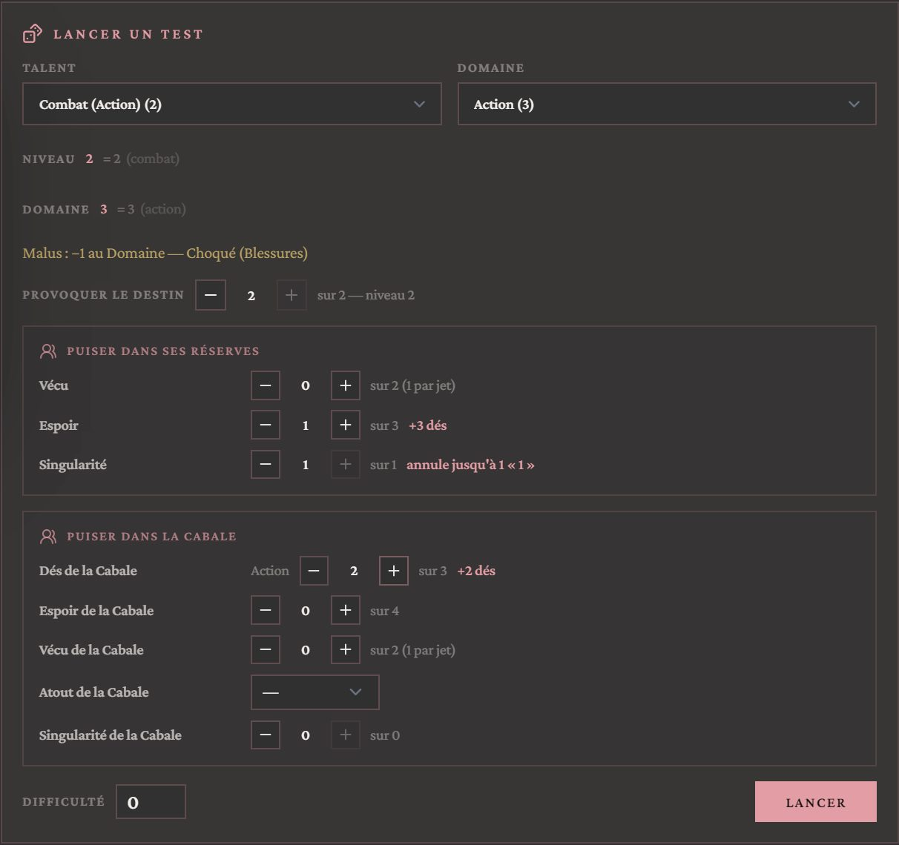
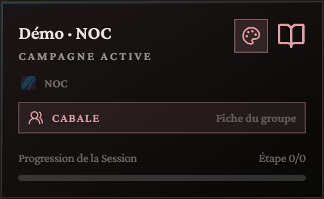
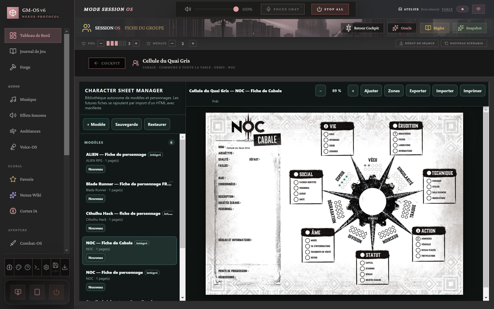
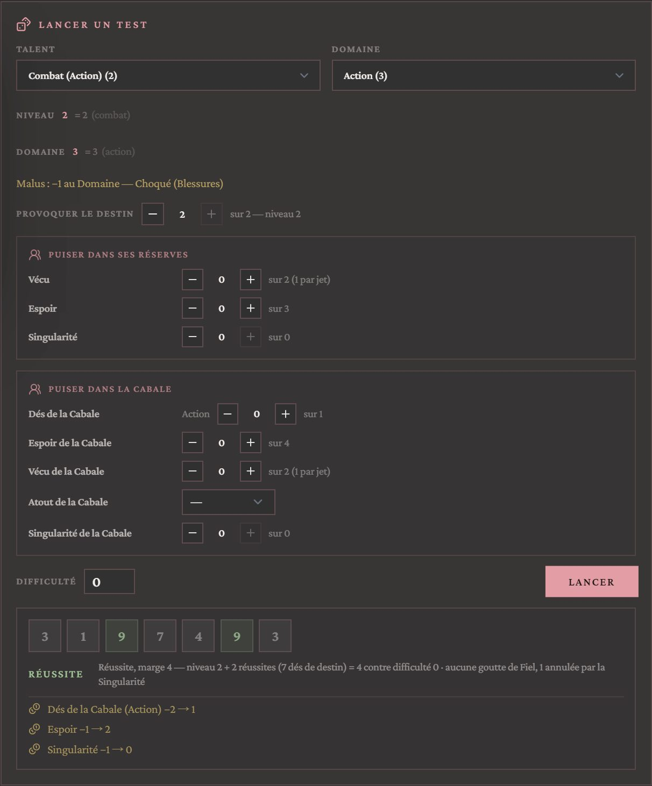
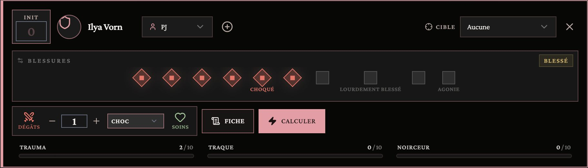

# 🌌 Jeu — NOC

> **Pilote décrit :** « NOC », exporté le 2026-10-13. Retour à [Les jeux et leurs mécaniques](./53-Les-jeux-et-leurs-mecaniques.md).

Les Héros résistent dans un monde enfermé dans l'Artefact. Trois choses rendent ce jeu différent
dans GM-OS : les **dés de destin**, le **Fiel** qui déborde en **Menace**, et la **Cabale**, la
cellule commune à toute la table.

---

## Le Fiel et la Menace — le bandeau des réserves

| Réserve | Ce qu'elle fait dans GM-OS |
| :--- | :--- |
| **Fiel** (0 à 5) | Une goutte par 1 sur un dé de destin. Les joueurs la voient et la font monter eux-mêmes, depuis leur tablette. **À la cinquième goutte, la jauge se vide et la Menace monte de 1** ; un message le dit, c'est le moment où la Loi applique autant d'effets du Fiel que la Menace |
| **Menace** (sans plafond) | Aux mains de la Loi, visible des joueurs. **« Début de séance »** lui retire un point ; **« Nouveau scénario »** la remet à zéro |

Les gouttes **s'ajoutent seules** quand un dé de destin fait 1, depuis le panneau de jet ; le + du
Fiel reste là pour un 1 tiré ailleurs (au pupitre, par un Rouage).

Si le Fiel est à 4 et reçoit 3 gouttes, la jauge se vide une fois et **reste à 2** : les gouttes
se posent une à une. Les règles ne tranchent pas ce cas.

---

## Le jet — le Talent, et provoquer le destin

1. On retient le **Talent** et son **Domaine**. Le Talent donne le **niveau** ; le Domaine, le
   **plafond des dés de destin**.
2. On règle la **difficulté** : le niveau de Talent que la Loi estime nécessaire (le livre ne fixe
   pas de difficulté par défaut ; le panneau part de 0, la maîtrise basique).
3. **Provoquer le destin** : on lance **de zéro au plafond** de dés à dix faces. Sans dé, le Talent
   seul affronte la difficulté.
4. Chaque **8, 9 ou 10** élève le niveau d'un point ; un **10 fait lancer un dé de plus** ; **chaque
   1 verse une goutte dans le Fiel**, automatiquement — et la jauge déborde en Menace à cinq.
5. Le résultat se dit en entier : « Réussite, marge 1 — niveau 2 + 3 réussites (5 dés de destin) =
   5 contre difficulté 4 · 1 goutte de Fiel ». Un **seul degré d'échec** peut devenir un échec
   partiel : c'est la Loi qui tranche.

### Les réserves du Héros

La section **« Puiser dans ses réserves »** se lit sur la fiche du Héros et s'y décompte :

| Réserve | Ce qu'elle donne |
| :--- | :--- |
| **Vécu** | +1 au niveau — **un seul point par test** |
| **Espoir** | 3 dés de destin de plus par point |
| **Singularité** | Chaque point **annule un 1** avant qu'il ne rejoigne le Fiel ; **seuls les points qui servent sont dépensés** |

### Les malus de péril

Les quatre jauges de péril pénalisent le jet, et **leurs malus se cumulent** :

| Jauge | À 5 points | À 8 points |
| :--- | :--- | :--- |
| Blessures | **Choqué** : −1 au Domaine | **Blessure lourde** : −1 au Talent |
| Trauma | **Choqué** : −1 au Domaine | **Traumatisé** : −1 au Talent |
| Traque | Signalé (sans malus au jet) | **Recherché** : −1 au Talent |
| Noirceur | Teinté (sans malus au jet) | **Possédé** : −1 au Talent |

Le panneau les nomme avant de lancer : « Malus : −1 au Domaine — Choqué (Blessures) ».

---

## La Cabale — la fiche du groupe

La Cabale est **un personnage de plus, commun à toute la table** (règle :
`docs/systems/noc/rules/la-cabale.md`). Sa fiche appartient à la campagne.

- **Chez vous :** le bouton **Cabale** de la carte de campagne, dans le cockpit, ouvre sa feuille.
  La première fois, **« Créer une fiche pour Cabale »**.
- **Sur une tablette :** le bouton **Cabale**, à côté de « Ma fiche ». Ce que le joueur y écrit
  remonte chez vous.
- Son **nom** est celui qu'on écrit dans le champ « Nom » de la feuille.

### Puiser dans la Cabale

Au panneau de jet, la section **« Puiser dans la Cabale »** offre quatre apports :

| Apport | Ce qu'il donne | D'où il est pris |
| :--- | :--- | :--- |
| **Dés de la Cabale** | 1 dé par point | Le Domaine de la Cabale qui correspond au Domaine retenu par le Héros. **Rechargé par « Nouveau scénario »** |
| **Espoir de la Cabale** | 3 dés par point | La piste Espoir de la feuille, qui descend |
| **Vécu de la Cabale** | +1 au niveau — **un seul point par test** | La piste Vécu de la feuille, qui descend |
| **Atout de la Cabale** | +1 au niveau — **un seul point par test** | L'Atout choisi dans la liste (seuls les Atouts garnis sont proposés). **Rechargé par « Nouveau scénario »**. Une Faille (Atout à −1) ne fournit rien |
| **Singularité de la Cabale** | Annule un 1 par point | La piste Singularité de la feuille, qui descend — après celle du Héros |

> **Relu contre le carnet NotebookLM « NOC » le 2026-10-13** : les Domaines, les Atouts, l'Espoir,
> le Vécu et la Singularité de la Cabale **se rechargent au début de chaque scénario**, un point
> d'Atout donne +1 au Talent lié, **un seul par test** (sauf l'Atout Capital, que le pilote ne
> distingue pas encore). **L'Espoir, le Vécu et la Singularité de la Cabale sont des pistes de sa
> feuille : remettez-les à leur valeur en début de scénario** — « Nouveau scénario » ne recharge que
> les Domaines et les Atouts.

---

## Combat et santé — les dix cases Blessures

- **Santé : la jauge Blessures, dix cases** qu'on coche de gauche à droite. Un coup en coche autant
  que ses dégâts ; « Soins » en décoche.
  - à **5** cases : **Choqué** (−1 à tous les Domaines) ;
  - à **8** : **Lourdement blessé** (−1 aux Talents, un point permanent) ;
  - à **10** : **Agonie**, puis la mort en dix minutes.
- **La jauge « Blessures » de la fiche suit les cases** : ce qu'on coche au combat s'y reporte, sur
  la fiche HTML comme sur la tablette.
- **Trauma, Traque et Noirceur** sont suivis sur chaque carte de combattant.
- **Initiative :** l'Instinct, du plus haut au plus bas.
- **Types de dégâts :** Choc, Perforant, Tranchant, Multiple, Quantique, Énergie noire, Chutes,
  Brûlures, Asphyxie, Poisons.

---

## Ce qui manque encore

- **L'Atout Capital**, le seul dont on peut dépenser plusieurs points sur un test, est borné à un
  comme les autres.
- **L'état Fatigué** (−1 aux Talents quand l'Espoir est épuisé par un effet du Fiel) ne se suit
  pas : ajoutez 1 à la difficulté à la main.
- **Les Rouages** qui tirent un 1 retirent une goutte de Fiel : le − du bandeau.
- **Le Soupçon** (Cabale Dykovienne) est sur la fiche, de 0 à 10 ; ses effets jouent sur la
  récupération aux moments de calme, que GM-OS ne compte pas.
