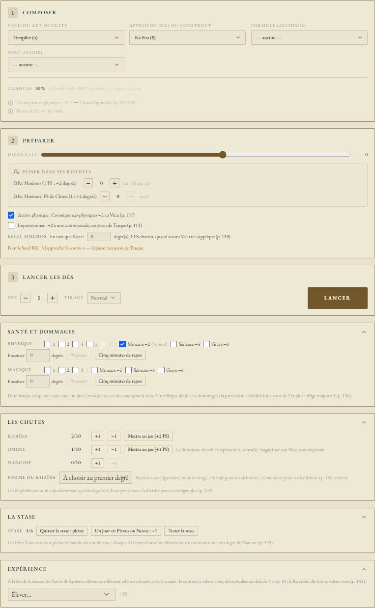
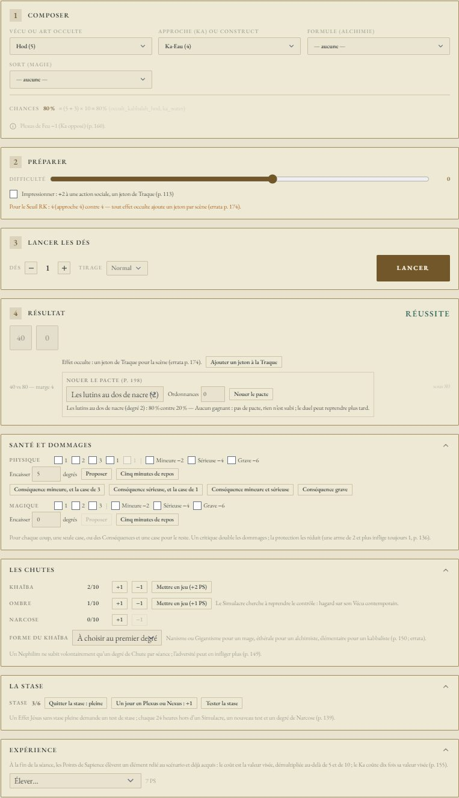
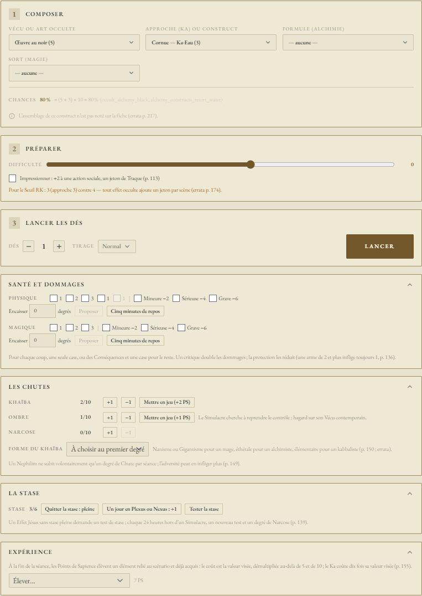
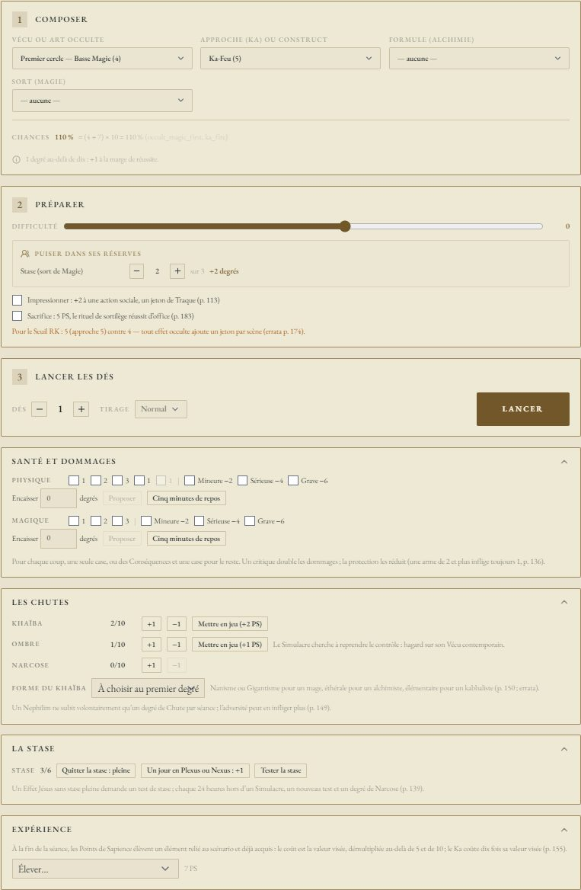
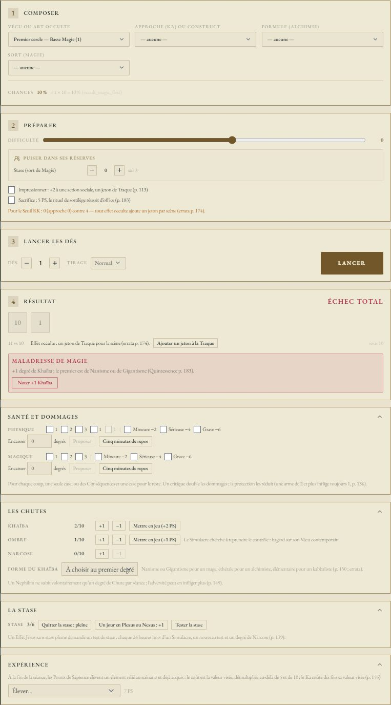
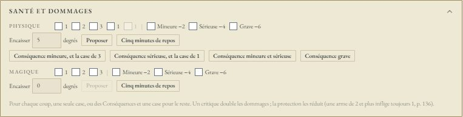
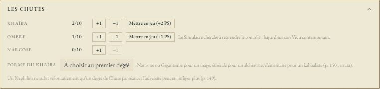
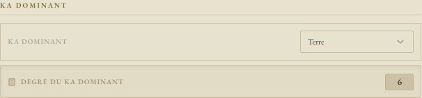
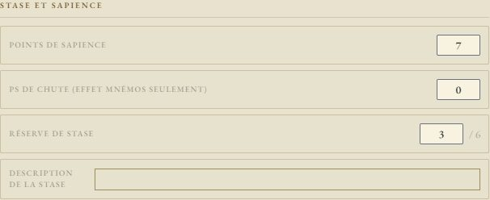

# ✨ Jeu — Nephilim Légende

> **Pilote décrit :** « Nephilim », exporté le 2026-10-22, **complété le 2026-10-23** (version 2.0.0,
> `outils/nephilim-vecus/finir_nephilim.py`) : Conséquences au jet, lieu magique et conjonction,
> métamorphe, Effet Mnémos en tant que Vécu, Sacrifice, interdits du Khaïba, pacte de Kabbale, santé en
> cases nommées, Chutes, stase et expérience. Il conserve tout ce qu'apportait la version du 18/10
> (Arts au jet, suites des critiques, Stase et Effet Mnémos de bonus, Ka dominant, Alchimie et
> Materiae Primae). Captures du 2026-10-23. Retour à
> [Les jeux et leurs mécaniques](./53-Les-jeux-et-leurs-mecaniques.md).

Un **d100 sous une cible en degrés** : le Vécu — ou l'Art occulte —, plus le Ka de l'approche,
multipliés par dix. Autour : la **Traque** des Arcanes Mineurs, qui plafonne au **Seuil RK** du lieu,
les trois **Chutes**, une santé en **cases temporaires** puis en **Conséquences**, et les **Vécus
passés** reliés aux **époques d'incarnation** du livre.

> Règles relues contre le corpus du jeu, `docs/systems/nephilim/rules/`, **corrigé par l'errata
> officiel V1.3** le 2026-10-18 (fiche « Errata Quintessence V1.3 »). Vécus et époques extraits du
> *Livre 0 — Quintessence*, p. 62 à 98. Carnet NotebookLM : « Nephilim ».

---

## Le jet

- **Vécu ou Art occulte** : un seul menu, rangé en sous-groupes.
  - **Les Vécus**, par leur **nom** tel qu'il est écrit sur la fiche (« Templier (4) »,
    « Infirmière (5) »). Le Vécu contemporain du Simulacre vient en tête ; un Vécu dont le nom n'est
    pas écrit n'apparaît pas. Sous les menus, GM-OS rappelle ce que le livre dit du Vécu retenu.
  - **Magie — cercles** : Basse Magie, Haute Magie, et le troisième cercle sous le **nom** saisi sur
    la fiche.
  - **Kabbale — Sephiroth** : les sept Sephiroth, et les trois du troisième cercle sous leur nom.
  - **Alchimie — Œuvres** : Œuvre au noir, au blanc, et l'Œuvre au rouge sous son nom.

  Un Art du troisième cercle **sans nom saisi** n'apparaît pas, comme un Vécu vide : écrivez son nom
  sur la fiche.
- **Approche (Ka) ou construct** : facultative. Le Ka-élément s'ajoute au Vécu ou à l'Art. Pour un
  sort ou une invocation, c'est le **Ka de l'élément du sort** ; pour une **transmutation**, le Ka
  du **construct** dans l'élément de la formule (sous-groupe « Alchimie — constructs » :
  « Cornue — Ka-Eau (3) »).
- **Les chances** : (Vécu + Ka) × 10, dites sous les menus — `(4 + 5) × 10 = 90 %`.
- **Sort (Magie)** : le menu des sortilèges de la fiche, sous leur nom. Le **degré du sort se retire**
  seul de la cible : Art + Ka du sort − degré (p. 183). GM-OS dit si le Ka de l'approche n'est pas celui
  du sort.
- **Difficulté** : les **circonstances, en degrés**. Le livre va de −5 (difficulté extrême) à +5
  (facilité extrême). Le curseur descend jusqu'à −10, pour un sort ou une formule notés hors des menus.

### Ce que le jet sait de plus — 2026-10-23

| Ce qui joue | Ce que fait GM-OS | Livre |
| :--- | :--- | :--- |
| **Conséquences physiques** | Sur une **action physique** (case cochée d'office quand une Conséquence l'est), leur malus se retire du Vécu, jamais sous 0, **puis** l'approche s'ajoute | p. 137 |
| **Conséquences magiques** | Leur malus se retire seul de tout **Art occulte** | p. 138 |
| **Malus égal au Vécu** | GM-OS rappelle que chaque approche coûte alors un degré de dommages magiques, sans soins | p. 137 |
| **Lieu magique** (bandeau) | Plexus : +1 au Ka du Plexus, −1 à ses opposés ; Nexus : +3. Seulement si le jet use d'un Ka (approche, Art) | p. 160 ; errata |
| **Conjonction** (bandeau) | +1 au Ka de la conjonction ; une Grande conjonction de +2 à +5, et autant de malus aux Ka opposés | p. 160 |
| **Métamorphe** | Sur une approche du **Ka dominant**, « Exprimer N degrés » : +1 par degré, sans les degrés devenus visibles — les métamorphoses cochées « permanente » (section Incarnations). Une maladresse propose d'en cocher une de plus | p. 112 |
| **Impressionner** | +2 à une action sociale, un jeton de Traque payé au lancer | p. 113 |
| **Effet Mnémos en tant que Vécu** | Quand aucun Vécu ne s'applique : N degrés pour N PS, au plus le degré du Vécu passé choisi. Les PS d'une Chute mise en jeu partent d'abord | p. 118-119, 152 |
| **Sacrifice** | Sur un sort de Magie : 5 PS, le rituel **réussit d'office**, quels que soient les dés ; pas au-delà de l'Art | p. 183 |
| **Interdits du Khaïba** (5 et plus) | Nanisme : pas de sort de degré 5 ou plus. Gigantisme : pas de Magie du Ka dominant. Éthérale : pas de formule du Ka dominant. Élémentaire : pas d'invocation du Ka dominant. **GM-OS refuse de lancer** | p. 150-151 |
| **Seuil RK** | Sous les options : approche + métamorphe exprimé et visible + Khaïba et Narcose au-delà de 4, contre le Seuil RK | errata p. 146 |

Après le lancer, sous le résultat :

- **Un jeton de Traque** proposé d'un bouton : pour tout effet occulte (un par scène, errata p. 174) ou
  quand le Seuil RK est dépassé.
- **Sort raté** (pas une maladresse) : **Retenter (1 PS)** ou **Retenter (1 degré de stase)** paie et
  relance aussitôt (p. 183). Pas depuis un focus : c'est à la table de le dire.
- **Critique d'un Art occulte** : le Point de Sapience peut **soigner aussitôt un degré de Chute** (Khaïba,
  Ombre ou Narcose −1) ; il ne se note plus alors (p. 149).

### Le pacte de Kabbale

Une invocation réussie propose **Nouer le pacte** (p. 198 ; errata). Choisissez l'invocation de la fiche,
corrigez au besoin les **ordonnances** respectées (lues sur la fiche), puis le bouton : le kabbaliste
(Art de la Sephirah + Ka, + ordonnances) et la créature (son degré) jettent chacun leur d100, lus sur la
**table des actions opposées** (p. 123) :

| Kabbaliste \ Créature | Critique | Succès | Échec | Maladresse |
| :--- | :--- | :--- | :--- | :--- |
| **Critique** | la plus haute marge | kabbaliste | kabbaliste | kabbaliste |
| **Succès** | créature | la plus haute marge | kabbaliste | kabbaliste |
| **Échec** | créature | créature | personne | kabbaliste |
| **Maladresse** | créature | créature | créature | personne |

Gagné : le pacte est noué. Perdu : des **dommages magiques égaux au degré** de la créature, à encaisser
dans la carte Santé. Une maladresse **bannit** du fief jusqu'à un degré de plus dans la Sephirah.

### Une transmutation d'Alchimie

Ka-élément du construct + Art de l'Œuvre − degré de la formule (p. 220) : choisissez l'**Œuvre** au
premier menu, le **Ka du construct** au second, et la **formule** au troisième, « Formule
(Alchimie) » — elle s'y présente sous son nom, « Brume du Léthé (4) », et son degré **se retire**
de la cible. Pour une formule de l'Œuvre au blanc, prenez le moins développé des deux Ka du
construct.

Les **Materiae Primae** de l'élément de la formule — autant que son degré — **se retirent seules
au lancer** sur une réussite, un échec ou une maladresse (« Materiae Primae Eau −4 → 2 » sous le
résultat), et sont **conservées sur un critique**. Une formule de l'**Œuvre au blanc** a un **second
Ka-élément** sur la fiche : ses deux jauges perdent le degré de la formule (deux fois la même pour un
« double Ka-Lune »), et le jet prend **le Ka le moins développé** des deux du construct (p. 220).
La section **Alchimie — assemblage des constructs** note avec quelle Œuvre chacun est assemblé
(errata p. 217) : GM-OS refuse une transmutation d'une Œuvre supérieure à l'assemblage. Une jauge trop courte s'arrête à zéro, et GM-OS
dit ce qui manquait : à prendre sur le Ka du construct, du Pentacle ou de la stase (p. 218). La
maladresse a deux cartes : +1 Khaïba, et « Construct abîmé » — **Noter −1** au Ka du construct
retenu.

### Puiser dans ses réserves : la Stase et l'Effet Mnémos

Sous les menus, « Puiser dans ses réserves » propose ce qui convient **au jet retenu** :

| Réserve | Quand | Ce qu'elle donne | Ce qu'elle coûte |
| :--- | :--- | :--- | :--- |
| **Stase (sort de Magie)** | un cercle de **Magie** est retenu | **+1 degré** de Ka par degré de stase (p. 183) | les degrés engagés, sur la fiche |
| **Effet Mnémos (1 PS : +2 degrés)** | un **Vécu** est retenu | **+2 degrés**, une fois par test (p. 119) | 1 Point de Sapience |
| **Effet Mnémos, PS de Chute** | un **Vécu** est retenu | **+2 degrés**, une fois par test | 1 PS de Chute (une Chute mise en jeu, p. 152) |

Les degrés s'ajoutent à la cible, et les chances le disent : `(4 + 7) × 10 = 110 %`. La réserve se
débite **au lancer, quel que soit le résultat**. Racontez l'Effet Mnémos : de quel Vécu passé vient
ce souvenir ?

Après le lancer :

| Le dé | Ce que dit GM-OS |
| :--- | :--- |
| Sous ou égal à la cible | **Réussite**, avec sa **marge** : le chiffre des dizaines (« 86 » → marge 8) |
| Un **double** réussi (11, 22… 99) | **Réussite critique** |
| Au-dessus de la cible | **Échec** |
| Un **double** raté, ou **00** | **Maladresse** — le 00 lu sur les dés échoue toujours, même au-delà de 100 % |

Au-delà de dix degrés (une cible de plus de 100 %), chaque degré en trop **ajoute un point à la
marge**, et GM-OS le dit sous les chances.

---

## Maladresses et critiques : les suites

Une maladresse ou un critique n'a pas la même suite selon **ce qui a été lancé**. Sous le résultat,
une carte rappelle la règle, avec sa page, et propose **un bouton** : rien ne s'écrit sur la fiche
sans vous.

| Ce qui a été lancé | Résultat | La carte | Le bouton |
| :--- | :--- | :--- | :--- |
| Un cercle de **Magie** | Maladresse | +1 Khaïba ; le premier est de Nanisme ou de Gigantisme (p. 183) | **Noter +1 Khaïba** |
| Une Sephirah de **Kabbale** | Maladresse | +1 Khaïba ; le premier est de forme élémentaire (errata p. 198) | **Noter +1 Khaïba** |
| Une Œuvre d'**Alchimie** | Maladresse | +1 Khaïba, de forme éthérale si c'est le premier ; Materiae Primae consommées, rien produit, Ka du construct −1, formule à ne plus retenter du scénario (errata p. 220) | **Noter +1 Khaïba** |
| Le **Vécu du Simulacre** | Maladresse | +1 Ombre | **Noter +1 Ombre** |
| Un **Art occulte** | Critique | +1 Point de Sapience, à dépenser aussitôt pour soigner un degré de Chute si l'on veut | **Noter +1 Sapience** |
| Un **Vécu passé** | Maladresse | rien : la règle ne la fait rien coûter | — |

Une fois noté, le bouton laisse place à ce qui a changé (« Khaïba : 2 → 3 »). La jauge ne dépasse
jamais son maximum.

---

## La Traque et le Seuil RK

Six réserves au bandeau :

| Réserve | À qui | Ce qu'elle fait |
| :--- | :--- | :--- |
| **Seuil RK** | au meneur, de 2 à 9 | La tolérance occulte du **lieu** : 2–3 zone surveillée, 8–9 zone sauvage. **Réglez-la en changeant de lieu** |
| **Jauge de Traque** | aux joueurs | Elle a **autant de cases que le Seuil RK**. À ce seuil, GM-OS la vide et fait monter l'Intensité d'un cran **aussitôt** |
| **Intensité de la Traque** | au meneur, de 1 à 5 | 1 : aucun interdit · 2 : un Vécu ou une approche sacrifiés · 3 : un élément interdit · 4 : une discipline bloquée · 5 : Pentacle interdit |
| **Lieu magique** | au meneur | Aucun, un **Plexus** de chaque élément, un **Nexus** : il s'affiche par son nom ; les jets y gagnent leur bonus (p. 160) |
| **Conjonction** | au meneur | Aucune, ou l'élément du jour ; le meneur en décide, le livre dit que la mécanique astrologique est brisée (p. 159) |
| **Intensité** | au meneur, de 1 à 5 | 1 : conjonction simple (+1) ; 2 à 5 : Grande conjonction (±2 à ±5) |

La Traque monte d'un jeton par scène d'approche, de Science occulte, de Vécu passé ou de recherche
au-delà du Seuil RK : c'est vous qui l'ajoutez, GM-OS ne devine pas une scène. Pour juger du
dépassement, ajoutez à l'approche ou au Vécu les degrés de métamorphe visibles, et ceux de Khaïba et
de Narcose **au-delà de 4** (errata p. 146).

L'errata V1.3 (p. 146) fait monter l'Intensité **à l'aube** suivante, et non dès que le palier est
plein. GM-OS la fait monter **tout de suite** — choix de David (2026-10-18) : le rappel vaut mieux
qu'un oubli. Si la scène l'exige, reportez la montée à l'aube à la main.

**Début de séance** (au bandeau, meneur) : chaque jauge de **Materiae Primae** revient à son
maximum, lu sur la fiche (« MP Max ») — elles « reviennent à leur maximum entre chaque session de
jeu » (p. 219). Les **mises en jeu** des Chutes et les **PS de Chute** non dépensés s'effacent (p. 152). Le geste s'applique **aussitôt**, sans aperçu ; un message dit combien de fiches
ont été mises à jour.

---

## Combat et santé

- **Initiative** : Ka-Eau × 2. L'option du livre (+1d6, « initiative variable ») reste à la table.
- **Santé physique** en six cases sur la carte de combat : les **trois cases temporaires**, puis
  **Conséquence mineure (−2)**, **sérieuse (−4)**, **grave (−6)**. Pour encaisser selon le livre,
  servez-vous de la carte **Santé et dommages** de la fiche (ci-dessous).
- Le malus des Conséquences se retire **seul au jet** depuis le 23/10 (voir « Ce que le jet sait de plus »).
- **Les Chutes** — Khaïba, Ombre, Narcose, de 0 à 10 — sont des jauges sur la carte ; leurs paliers se
  lisent dans la carte **Les Chutes** de la fiche.
- Préparer un sort prend **1 round**, une invocation **autant de rounds que son degré** (sauf
  Invocation rapide), sans autre action pendant ce temps (errata p. 127).

### Les cartes de la fiche — 2026-10-23

Dans l'onglet **Lancer un test**, sous le jet, quatre cartes repliables.

**Santé et dommages** (p. 135-139). Deux pistes, **physique** et **magique** : les cases de 1, 2 et 3 —
et, sur la piste physique, les cases de 1 que donne le Ka-Terre (5 et plus, 10 et plus) —, puis les trois
Conséquences. **Encaisser N degrés**, puis **Proposer** : GM-OS ne propose que ce que le livre permet,
**une seule case** de valeur suffisante (la plus petite libre), ou des **Conséquences** et une case pour
le reste ; un clic coche, et le compte des cases suit sur la fiche. Rien ne suffit : **hors de combat**
(physique), ou **un degré de Chute** au choix (magique). **Cinq minutes de repos** décoche les cases
d'une piste. Une Conséquence cochée dit sa durée de guérison (11 − Ka-Terre, en jours, semaines, mois ;
en heures, jours, semaines pour le magique). Une Conséquence magique se **transfère à la stase**, qui perd
autant de degrés (p. 139). Le critique double les dommages et la protection les réduit : c'est vous qui
dites le total.

**Les Chutes** (p. 148-152). Chaque Chute dit son **palier** : à 5-7 ses effets (selon la **forme du
Khaïba**, choisie au premier degré), à 8 le joueur confie son Nephilim au MJ, à 10 la perte est
définitive. **Mettre en jeu** une Chute de 1 à 4, une fois par séance, donne autant de **PS de Chute**,
seulement pour un Effet Mnémos, perdus en fin de séance. Le meneur seul monte ou baisse les degrés.

**La stase** (p. 113, 139 ; errata). Le degré et son plafond, le Ka dominant ; **Quitter la stase :
pleine**, **Un jour en Plexus ou Nexus : +1** (errata p. 160 : un degré par jour, et non par heure),
**Tester la stase** (son Ka actuel, sans modificateur) après un Effet Jésus ou un jour hors d'un
Simulacre. Vide, la carte rappelle le test de Ka quotidien et ses Conséquences.

**Expérience** (p. 154-155), au meneur, en fin de séance : choisissez un Vécu, un Art, le métamorphe,
une quête, un Ka ou un maximum de Materiae Primae, et GM-OS dit ce que coûte le degré suivant — la
valeur visée, démultipliée au-delà de 5 et de 10 (10, 15, 20, 30, 50, puis 100) ; dix fois la valeur
visée pour un Ka, 100 de plus par degré au-delà de 10 ; 1 PS pour une jauge de MP. Le premier degré
d'un élément s'acquiert par un Effet Mnémos permanent, pas ici.

---

## La fiche de personnage

La fiche GM-OS reprend **exactement les clés de la fiche HTML** « Nephilim Légende — fiche de
personnage » (gabarit `nephilim-legende-fr`) : ce qu'on saisit sur l'une remonte sur l'autre — **après
« Sauvegarder »**. En passant de la fiche GM-OS à la fiche du jeu, GM-OS propose d'enregistrer ce
qui ne l'est pas encore.

**Sept pages** : la fiche principale, les effets et le Simulacre, puis la **Magie** (page 3), la
**Kabbale** (l'Arbre en page 4, les invocations en page 5) et l'**Alchimie** (les constructs et la
Materiae Primae en page 6, les formules en page 7).

⚠️ **Les degrés des Sephiroth, le Monde, la voie et les trois Œuvres se saisissent en page 2.**
L'Arbre de la page 4 et les Œuvres de la page 6 en sont des **copies calculées**, en lecture seule.
Une même valeur n'a qu'un seul endroit où l'écrire (choix de David, 2026-10-17).

### Le Ka dominant et la Stase

La section **Ka dominant**, sous le Pentacle, porte le **choix** de l'élément dominant (Feu, Air,
Eau, Lune, Terre) et son **degré**, calculé sur le Pentacle. La **Stase** ne peut pas le dépasser :
la saisie s'arrête au plafond, affiché à côté (« / 5 ») ; une Stase restée au-dessus (le Ka a baissé)
s'affiche en rouge.

Sur la **fiche HTML** (page 1), le Ka dominant se marque d'un clic **sous le
nom de l'élément**, sur le Pentacle : seul l'élément choisi s'allume, et le choix passe d'une fiche
à l'autre (après « Sauvegarder »). Le degré et le plafond, eux, ne se calculent que dans GM-OS.

### Incarnations et Vécus

La section **Incarnations** vient avant **Les Vécus** : on choisit d'abord les époques, puis les
Vécus qui en viennent.

- **Les 31 époques d'incarnation** du livre, des sept ères (du *Sentier d'or* au *Grand Réveil*),
  sont proposées aux huit champs « Incarnation ». ⓘ affiche l'ère, la page, les dates et lieux, et le
  coût en Points d'Incarnation.
- **Les 155 Vécus passés** — cinq par époque, un par Ka-élément — sont proposés aux seize champs de
  Vécu, **d'abord ceux des époques incarnées**. ⓘ affiche le Ka-élément, l'époque, la page et la
  description du livre.
- Sous chaque Vécu, une étiquette dit de quelle incarnation il vient (« ↳ Incarnation 2 — La Chute
  de l'Atlantide · Ka-élément : Feu »), ou **alerte** si son époque n'est pas parmi les incarnations.
  Sous chaque incarnation : « Vécus de cette incarnation : Héros (4) · Sage (2) ».
- On peut toujours écrire un Vécu hors de la liste : la liste propose, elle n'interdit pas.
- **Sur la tablette**, dans la vue synthétique : les Incarnations et les Vécus se choisissent de
  même, avec les suggestions, ⓘ (description du livre comprise) et les étiquettes d'incarnation.
  Le choix part au meneur une fraction de seconde après la dernière frappe, ou en fermant la
  fiche. La vue calcule aussi le degré du Ka dominant et montre la Stase « / plafond ».

Les noms et descriptions suivent le livre **et l'errata V1.3** : à *L'Éveil*, la Policière et la
Journaliste ; aux *Chroniques de l'Apocalypse*, le Publicitaire et le Prof. Le livre imprime sous
le **Druide** (*Le sanctuaire des Tuatha de Danann*) la description du Chasseur : GM-OS le signale.

> Quatre époques ont changé de nom le 2026-10-18, en passant du carnet au livre : *Le premier
> peuple*, *L'empire magique des Perses*, *L'empire lunaire de Carthage*, *L'empire profane de
> Rome*. Une incarnation saisie sous l'ancien nom perd son bouton ⓘ, et ses Vécus s'affichent en
> alerte (« absente des incarnations ») : choisissez-la de nouveau dans la liste.

---

## Ce qui reste à la main

- La **priorité d'initiative** pour 1 PS, les **Effets Mnémos permanents** (+5 PS) et celui qui réduit
  le temps d'une enquête (3 PS).
- L'**activation** des constructs (un degré de Ka donné, ou une Materia Prima transmutée par un test) et
  leur assemblage d'un mois (p. 216-217) : notez le résultat sur la fiche.
- La **protection**, l'**orichalque**, les **poisons** : le total des dommages se dit à la carte Santé.
- La **remise en stase** et l'**Effet Jésus** se racontent ; la carte Stase lance le test.
- **Deuxième chance** : une nouvelle approche pour retenter une action ratée (p. 122).
- Les cases de santé nommées, les mises en jeu et les PS de Chute vivent sur la fiche GM-OS seule : la
  fiche HTML garde le compte des cases, que GM-OS tient à jour. La **forme du Khaïba** (page 1), le
  **second Ka-élément** des formules (page 7) et l'**assemblage** des constructs (page 6) sont sur les
  deux fiches depuis le 23/10 au soir ([consigne au Studio](../Planning/2026-10-23-consigne-studio-nephilim-finir.md)) :
  un choix fait sur l'une se retrouve sur l'autre, après « Sauvegarder ».
