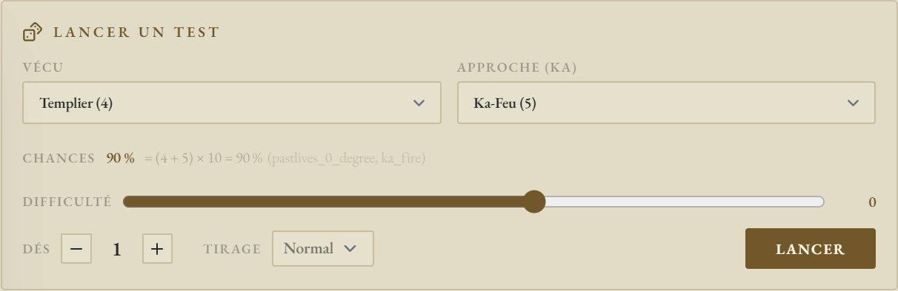
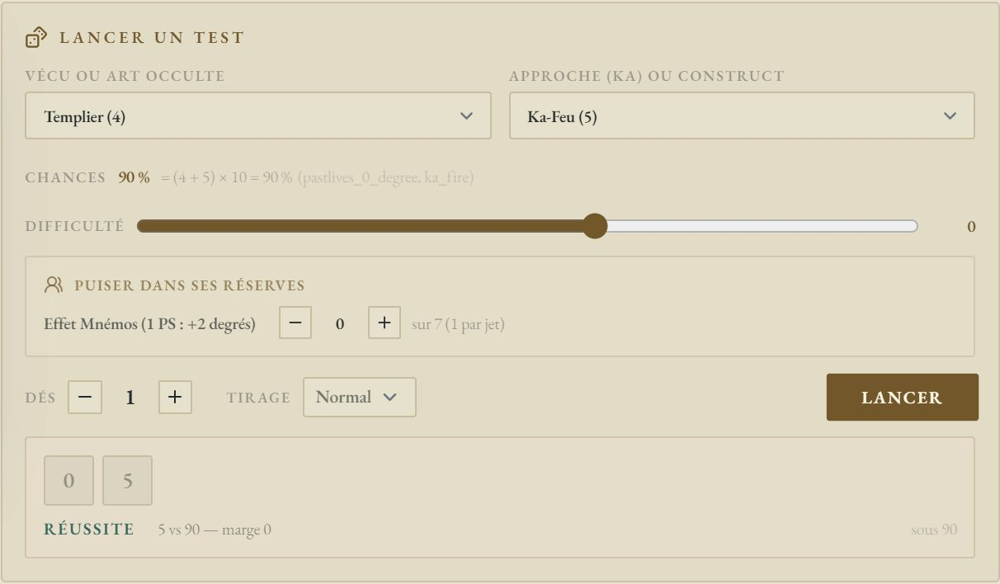
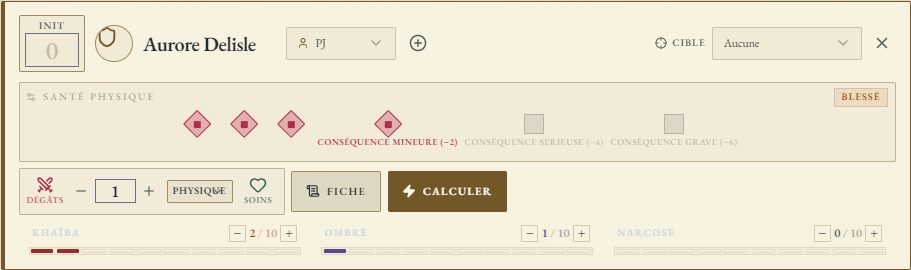

# ✨ Jeu — Nephilim Légende

> **Pilote décrit :** « Nephilim », exporté le 2026-10-18 et corrigé le jour même (Arts occultes au
> menu du jet, suites des maladresses et des critiques, rappels d'après l'errata V1.3, Stase et Effet
> Mnémos au jet, Ka dominant). Retour à
> [Les jeux et leurs mécaniques](./53-Les-jeux-et-leurs-mecaniques.md).

Un **d100 sous une cible en degrés** : le Vécu — ou l'Art occulte —, plus le Ka de l'approche,
multipliés par dix. Autour : la **Traque** des Arcanes Mineurs, qui plafonne au **Seuil RK** du lieu,
les trois **Chutes**, une santé en **cases temporaires** puis en **Conséquences**, et les **Vécus
passés** reliés aux **époques d'incarnation** du livre.

> Règles relues contre le corpus du jeu, `docs/systems/nephilim/rules/`, **corrigé par l'errata
> officiel V1.3** le 2026-10-18 (fiche « Errata Quintessence V1.3 »). Vécus et époques extraits du
> *Livre 0 — Quintessence*, p. 62 à 98. Carnet NotebookLM : « Nephilim ».

---

## Le jet

- **Vécu ou Art occulte** : un seul menu, rangé en sous-groupes.
  - **Les Vécus**, par leur **nom** tel qu'il est écrit sur la fiche (« Templier (4) »,
    « Infirmière (5) »). Le Vécu contemporain du Simulacre vient en tête ; un Vécu dont le nom n'est
    pas écrit n'apparaît pas. Sous les menus, GM-OS rappelle ce que le livre dit du Vécu retenu.
  - **Magie — cercles** : Basse Magie, Haute Magie, et le troisième cercle sous le **nom** saisi sur
    la fiche.
  - **Kabbale — Sephiroth** : les sept Sephiroth, et les trois du troisième cercle sous leur nom.
  - **Alchimie — Œuvres** : Œuvre au noir, au blanc, et l'Œuvre au rouge sous son nom.

  Un Art du troisième cercle **sans nom saisi** n'apparaît pas, comme un Vécu vide : écrivez son nom
  sur la fiche.
- **Approche (Ka)** : facultative. Le Ka-élément s'ajoute au Vécu ou à l'Art. Pour un sort ou une
  invocation, c'est le **Ka de l'élément du sort**.
- **Les chances** : (Vécu + Ka) × 10, dites sous les menus — `(4 + 5) × 10 = 90 %`.
- **Difficulté** : les **circonstances, en degrés**. Le livre va de −5 (difficulté extrême) à +5
  (facilité extrême). Pour un **sort** ou une **formule**, retirez-y aussi le **degré du sort** :
  Art + Ka − degré. Le curseur descend jusqu'à −10 pour cela.

### Puiser dans ses réserves : la Stase et l'Effet Mnémos

Sous les menus, « Puiser dans ses réserves » propose ce qui convient **au jet retenu** :

| Réserve | Quand | Ce qu'elle donne | Ce qu'elle coûte |
| :--- | :--- | :--- | :--- |
| **Stase (sort de Magie)** | un cercle de **Magie** est retenu | **+1 degré** de Ka par degré de stase (p. 183) | les degrés engagés, sur la fiche |
| **Effet Mnémos (1 PS : +2 degrés)** | un **Vécu** est retenu | **+2 degrés**, une fois par test (p. 119) | 1 Point de Sapience |

Les degrés s'ajoutent à la cible, et les chances le disent : `(3 + 2) × 10 = 50 %`. La réserve se
débite **au lancer, quel que soit le résultat**. Racontez l'Effet Mnémos : de quel Vécu passé vient
ce souvenir ?

Après le lancer :

| Le dé | Ce que dit GM-OS |
| :--- | :--- |
| Sous ou égal à la cible | **Réussite**, avec sa **marge** : le chiffre des dizaines (« 86 » → marge 8) |
| Un **double** réussi (11, 22… 99) | **Réussite critique** |
| Au-dessus de la cible | **Échec** |
| Un **double** raté, ou **00** | **Maladresse** — le 00 lu sur les dés échoue toujours, même au-delà de 100 % |

Au-delà de dix degrés (une cible de plus de 100 %), chaque degré en trop **ajoute un point à la
marge**, et GM-OS le dit sous les chances.

---

## Maladresses et critiques : les suites

Une maladresse ou un critique n'a pas la même suite selon **ce qui a été lancé**. Sous le résultat,
une carte rappelle la règle, avec sa page, et propose **un bouton** : rien ne s'écrit sur la fiche
sans vous.

| Ce qui a été lancé | Résultat | La carte | Le bouton |
| :--- | :--- | :--- | :--- |
| Un cercle de **Magie** | Maladresse | +1 Khaïba ; le premier est de Nanisme ou de Gigantisme (p. 183) | **Noter +1 Khaïba** |
| Une Sephirah de **Kabbale** | Maladresse | +1 Khaïba ; le premier est de forme élémentaire (errata p. 198) | **Noter +1 Khaïba** |
| Une Œuvre d'**Alchimie** | Maladresse | +1 Khaïba, de forme éthérale si c'est le premier ; Materiae Primae consommées, rien produit, Ka du construct −1, formule à ne plus retenter du scénario (errata p. 220) | **Noter +1 Khaïba** |
| Le **Vécu du Simulacre** | Maladresse | +1 Ombre | **Noter +1 Ombre** |
| Un **Art occulte** | Critique | +1 Point de Sapience, à dépenser aussitôt pour soigner un degré de Chute si l'on veut | **Noter +1 Sapience** |
| Un **Vécu passé** | Maladresse | rien : la règle ne la fait rien coûter | — |

Une fois noté, le bouton laisse place à ce qui a changé (« Khaïba : 2 → 3 »). La jauge ne dépasse
jamais son maximum.

---

## La Traque et le Seuil RK

Trois réserves au bandeau :

| Réserve | À qui | Ce qu'elle fait |
| :--- | :--- | :--- |
| **Seuil RK** | au meneur, de 2 à 9 | La tolérance occulte du **lieu** : 2–3 zone surveillée, 8–9 zone sauvage. **Réglez-la en changeant de lieu** |
| **Jauge de Traque** | aux joueurs | Elle a **autant de cases que le Seuil RK**. À ce seuil, GM-OS la vide et fait monter l'Intensité d'un cran **aussitôt** |
| **Intensité de la Traque** | au meneur, de 1 à 5 | 1 : aucun interdit · 2 : un Vécu ou une approche sacrifiés · 3 : un élément interdit · 4 : une discipline bloquée · 5 : Pentacle interdit |

La Traque monte d'un jeton par scène d'approche, de Science occulte, de Vécu passé ou de recherche
au-delà du Seuil RK : c'est vous qui l'ajoutez, GM-OS ne devine pas une scène. Pour juger du
dépassement, ajoutez à l'approche ou au Vécu les degrés de métamorphe visibles, et ceux de Khaïba et
de Narcose **au-delà de 4** (errata p. 146).

⚠️ **L'errata V1.3 (p. 146) fait monter l'Intensité à l'aube** suivante, et non dès que le palier
est plein ; GM-OS, lui, la fait monter tout de suite. En attendant, à la table : quand la jauge
atteint le seuil en cours de journée, reportez la montée à l'aube.

---

## Combat et santé

- **Initiative** : Ka-Eau × 2. L'option du livre (+1d6, « initiative variable ») reste à la table.
- **Santé physique** en six cases : les **trois cases temporaires**, puis **Conséquence mineure
  (−2)**, **sérieuse (−4)**, **grave (−6)**. Le livre fait choisir au joueur une case de valeur
  égale ou supérieure aux dommages ; GM-OS ne connaît pas cette valeur : **cochez à la main**, avec
  « Dégâts » et « Soins ».
- Le malus d'une Conséquence n'est **pas retiré seul** au jet : passez-le en circonstances.
- **Les Chutes** — Khaïba, Ombre, Narcose, de 0 à 10 — sont des jauges sur la carte. Leurs seuils
  (5–7, 8–9, 10) restent à la table.
- Préparer un sort prend **1 round**, une invocation **autant de rounds que son degré** (sauf
  Invocation rapide), sans autre action pendant ce temps (errata p. 127).

---

## La fiche de personnage

La fiche GM-OS reprend **exactement les clés de la fiche HTML** « Nephilim Légende — fiche de
personnage » (gabarit `nephilim-legende-fr`) : ce qu'on saisit sur l'une remonte sur l'autre — **après
« Sauvegarder »**. En passant de la fiche GM-OS à la fiche du jeu, GM-OS propose d'enregistrer ce
qui ne l'est pas encore.

**Sept pages** : la fiche principale, les effets et le Simulacre, puis la **Magie** (page 3), la
**Kabbale** (l'Arbre en page 4, les invocations en page 5) et l'**Alchimie** (les constructs et la
Materiae Primae en page 6, les formules en page 7).

⚠️ **Les degrés des Sephiroth, le Monde, la voie et les trois Œuvres se saisissent en page 2.**
L'Arbre de la page 4 et les Œuvres de la page 6 en sont des **copies calculées**, en lecture seule.
Une même valeur n'a qu'un seul endroit où l'écrire (choix de David, 2026-10-17).

### Le Ka dominant et la Stase

La section **Ka dominant**, sous le Pentacle, porte le **choix** de l'élément dominant (Feu, Air,
Eau, Lune, Terre) et son **degré**, calculé sur le Pentacle. La **Stase** ne peut pas le dépasser :
la saisie s'arrête au plafond, affiché à côté (« / 5 ») ; une Stase restée au-dessus (le Ka a baissé)
s'affiche en rouge. Le Ka dominant n'existe que sur la fiche GM-OS : la fiche HTML ne le porte pas
encore, et passer par elle ne l'efface pas.

### Incarnations et Vécus

La section **Incarnations** vient avant **Les Vécus** : on choisit d'abord les époques, puis les
Vécus qui en viennent.

- **Les 31 époques d'incarnation** du livre, des sept ères (du *Sentier d'or* au *Grand Réveil*),
  sont proposées aux huit champs « Incarnation ». ⓘ affiche l'ère, la page, les dates et lieux, et le
  coût en Points d'Incarnation.
- **Les 155 Vécus passés** — cinq par époque, un par Ka-élément — sont proposés aux seize champs de
  Vécu, **d'abord ceux des époques incarnées**. ⓘ affiche le Ka-élément, l'époque, la page et la
  description du livre.
- Sous chaque Vécu, une étiquette dit de quelle incarnation il vient (« ↳ Incarnation 2 — La Chute
  de l'Atlantide · Ka-élément : Feu »), ou **alerte** si son époque n'est pas parmi les incarnations.
  Sous chaque incarnation : « Vécus de cette incarnation : Héros (4) · Sage (2) ».
- On peut toujours écrire un Vécu hors de la liste : la liste propose, elle n'interdit pas.

Les noms et descriptions suivent le livre **et l'errata V1.3** : à *L'Éveil*, la Policière et la
Journaliste ; aux *Chroniques de l'Apocalypse*, le Publicitaire et le Prof. Le livre imprime sous
le **Druide** (*Le sanctuaire des Tuatha de Danann*) la description du Chasseur : GM-OS le signale.

> Quatre époques ont changé de nom le 2026-10-18, en passant du carnet au livre : *Le premier
> peuple*, *L'empire magique des Perses*, *L'empire lunaire de Carthage*, *L'empire profane de
> Rome*. Une incarnation saisie sous l'ancien nom perd son bouton ⓘ, et ses Vécus s'affichent en
> alerte (« absente des incarnations ») : choisissez-la de nouveau dans la liste.

---

## Ce qui reste à la main

- Les **Points de Sapience** hors de l'Effet Mnémos de bonus : priorité d'initiative, Effet Mnémos
  **en tant que Vécu** (1 PS par degré, quand aucun Vécu ne s'applique), **Sacrifice** (5 PS, un sort
  réussi d'office), Effets Mnémos permanents (+5 PS).
- La **recharge** de la Stase — pleine en la quittant, puis un degré par jour en Plexus ou Nexus —
  et les **Materiae Primae** : la fiche les porte, rien ne les recharge ni ne les débite.
- Le **Ka du construct** qui baisse sur une maladresse d'Alchimie : le jet ne sait pas quel
  construct a servi.
- Le **pacte de Kabbale** : un test en opposition, Art de la Sephirah + Ka contre le degré de
  l'invocation, que GM-OS ne compare pas.
- Les seuils des Chutes, les malus des Conséquences, et la montée de la Traque **à l'aube**.
- Sur **tablette**, la fiche n'a pas les suggestions de Vécus et d'époques.
