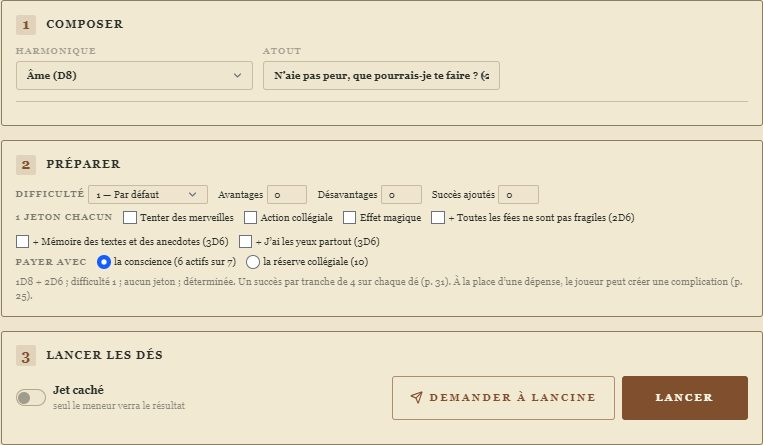
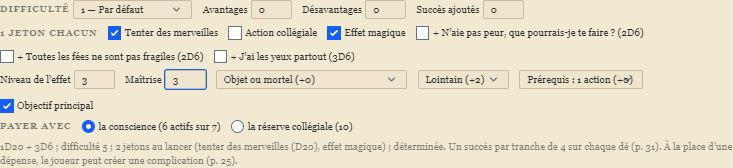
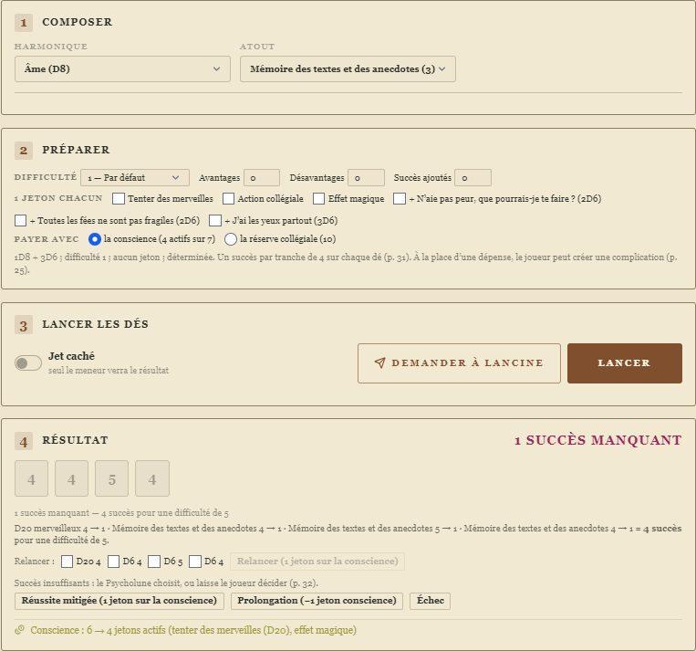
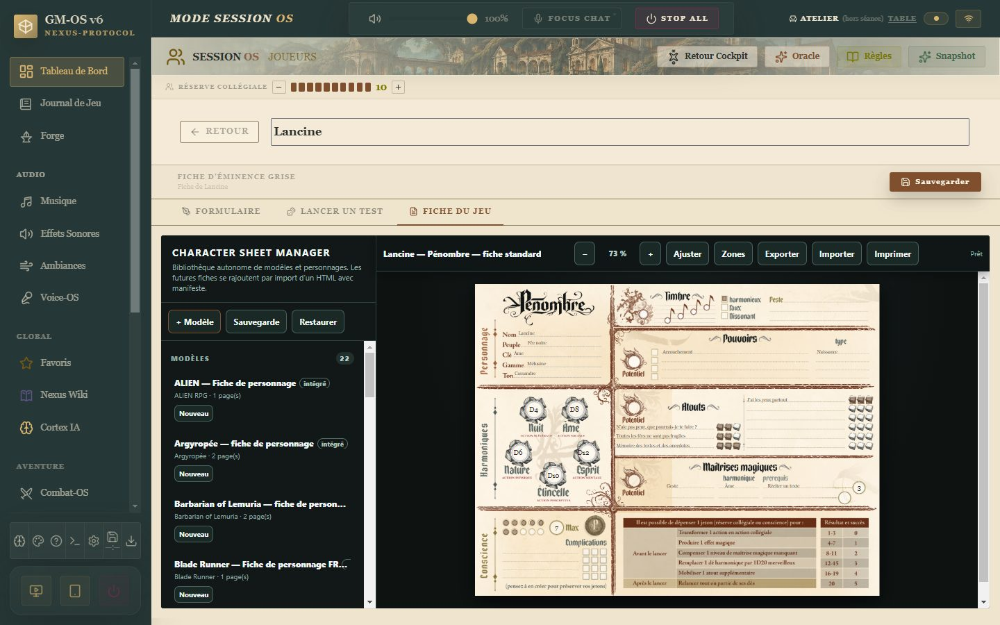

# 🎭 Jeu — Pénombre

> **Pilote décrit :** « Pénombre », forgé par David, exporté le 2026-11-22, **fini le
> 2026-11-22**, version 2.2.0 (`Export Dirvers/corriges/Penombre_driver_gmos_2.2.0.gmos-driver`,
> construit par `outils/penombre/finir_penombre.py` ; la 2.1.0 ajoute le recompte de la réserve
> collégiale, la 2.2.0 relie la résilience du bestiaire à la santé d'un adversaire ; toutes deux
> gardent le bestiaire et l'identité visuelle de l'export de David). Thème `penombre`, fiche standard HTML,
> bannière et identité visuelle livrés le même jour par GM-OS Studio. Retour à
> [Les jeux et leurs mécaniques](./53-Les-jeux-et-leurs-mecaniques.md).

Un seul geste : l'**action**. Le joueur lance le **dé de l'harmonique** que son action désigne —
de D4 à D12 — plus **autant de D6 que le niveau d'un atout** ; **chaque dé se lit à part** et
donne un succès par tranche de 4. Autour de lui : les **jetons** de conscience et de la **réserve
collégiale**, qui achètent un atout de plus, le **D20 merveilleux**, une relance, une action
collégiale ou un effet magique ; les trois issues d'un jet insuffisant ; la fausse note,
l'envolée, l'incident magique et la **merveille**, qui fait évoluer la partition et le timbre.

> Règles relues contre le livre de base (Æther Labs) le 2026-11-22 — pages imprimées = pages du
> PDF : 22-47, 50-59, 76-87, 102-103, 174, 318-326, 340-364. Les dix-neuf fiches du corpus
> `docs/systems/penombre/rules/` sont corrigées d'après lui (registre § 270).

**Réimporter le pilote avec « Remplacer ».** Le pilote forgé écrivait ses dés
« 1d harmonique + 1-3d atout », que le moteur ne sait pas lire : **chaque jet rendait des dés
vides et un total NaN**. La version 2.0.0 garde son identifiant, mais **sa fiche change** : elle
reprend une à une les 69 clés de la fiche HTML (neuf atouts, deux maîtrises, quatre pouvoirs,
quatre complications, la partition, le timbre, la peste, le potentiel). Un personnage créé avec la
fiche forgée garde ses anciennes valeurs, sans qu'elles paraissent : il faut ressaisir ses
harmoniques (« D8 »), ses atouts et sa conscience.

---

## L'action

- **Composer** : l'**harmonique** de l'action — âme (sociale), esprit (mental), étincelle
  (sensorielle), nature (physique) ou nuit (scélérate), avec le dé que la fiche lui donne (p. 28) ;
  et, au choix, **un atout**, proposé sous son nom, qui ajoute autant de D6 que son niveau (p. 31).
- **Préparer** : la **difficulté** du livre, de 1 (par défaut) à 20 (digne d'une muse), et les
  éléments **avantageux** (−1) ou **désavantageux** (+1) (p. 30) ; les **succès ajoutés** — une
  modification d'une action précédente, une riposte (+1), les succès des autres participants d'une
  action collégiale (p. 34, 44-45). Puis ce qui coûte **1 jeton** chacun (p. 29, 31) :
  - **tenter des merveilles** : le D20 merveilleux remplace le dé harmonique ;
  - **action collégiale** ;
  - **effet magique**, plus 1 jeton par niveau de maîtrise manquant ; son niveau, sa cible, sa
    distance et le temps du prérequis calculent sa difficulté, jamais sous le niveau de l'effet
    (p. 30) ;
  - **un atout de plus**, cochable, autant de fois qu'il y a d'atouts.
  Enfin **qui paie** : la conscience, ou la réserve collégiale.
- **Lancer** : chaque dé à sa taille. Les jetons se dépensent au lancer.

| Valeur sur un dé | Succès |
| :--- | :--- |
| 1-3 | 0 |
| 4-7 | 1 |
| 8-11 | 2 |
| 12-15 | 3 |
| 16-19 | 4 |
| 20 | 5 |

**Une Éminence grise troublée** (tous ses jetons inactifs) ne peut plus rien payer : cocher une
dépense bloque le lancer. **Épuisée** (tous ses jetons perdus), elle ne peut plus agir (p. 25).
Une **dissonante** ne paie pas en jetons collégiaux (p. 103).

## Le résultat

Les succès se comparent à la difficulté. Quand ils manquent, la carte propose les trois issues
du livre, que le Psycholune choisit ou laisse choisir (p. 32-33) :

| Issue | Ce que la carte écrit |
| :--- | :--- |
| **Réussite mitigée** | les succès manquants se paient en jetons, sur la conscience ou la réserve collégiale |
| **Prolongation** | autant de jetons conscience **perdus** (jamais de jeton collégial) ; la difficulté de l'action suivante devient le nombre de succès manquants |
| **Échec** | rien ; le Psycholune laisse ouverte une autre voie |

**Relancer** : on coche les dés à relancer, pour 1 jeton (p. 31). Les conséquences déjà obtenues
restent acquises (p. 34).

Les **conséquences supplémentaires** paraissent sous le résultat, avec leur geste (p. 34-37) :

- **Fausse note** (1 sur le dé harmonique) : « Perdre 1 jeton », les inactifs d'abord ;
- **Envolée** (score maximal du dé harmonique) : réactiver un jeton conscience, ou un jeton
  collégial — pas pour une dissonante ;
- **Incident magique** (1 sur le D20) : le rappel selon le timbre — incident narratif, ou
  contamination par une peste si l'Éminence grise est dissonante ou pestiférée ;
- **Merveille** (20 sur le D20) : « Cocher la partition » applique l'arbre de la p. 37 — case
  « clé » et un pouvoir si l'harmonique est la clé, sinon une case « note » ; le timbre se rétablit
  ou se dégrade ; une partition complète donne +1 en conscience et s'efface. Le 20 vaut 5 succès
  par la table : la merveille n'en ajoute aucun.

## Les jetons

La fiche GM-OS tient la conscience en trois nombres : la **conscience** (sa valeur, 7 à la
création), les **jetons restants** (ceux qui ne sont pas perdus) et les **jetons actifs** (ceux
qu'on peut encore dépenser). Dépenser retourne un jeton actif ; perdre retire un jeton, les
inactifs d'abord (p. 24). Combat-OS suit les jetons restants comme santé.

La **réserve collégiale** est une ressource de table, posée au bandeau et que les joueurs peuvent
manipuler. Elle ne se perd jamais. Sa **taille** suit les timbres du groupe : 10 jetons si toutes
les Éminences grises sont harmonieuses, 5 si une est fausse, aucun si une est dissonante (p. 24,
102). Une seconde ressource, hors du bandeau, porte cette taille et sert de plafond.

**Le recompte** (pilote 2.1.0) se fait chez le meneur :

- **de lui-même**, quand « Cocher la partition » change le timbre d'une Éminence grise ;
- **par le bouton** « Recompter la réserve collégiale » de l'étape « Préparer », qui dit la taille
  actuelle et celle que demandent les timbres des fiches de la campagne — pour un timbre changé à
  la main, ou par une merveille lancée sur une tablette.

La réserve gagne ou perd l'écart de taille : les jetons déjà dépensés restent dépensés (le livre
ne dit pas ce qu'ils deviennent). La variante « réserve héroïque » n'est pas gérée.

## Les affrontements dans Combat-OS

Le Psycholune ne lance jamais (p. 40-45). Sur la carte d'un adversaire, le bouton s'appelle
**« Affronter »** ; il ouvre la fiche du combattant sur quatre gestes :

- **Le profil** : adversité (la difficulté des Éminences grises contre lui), résilience et jetons de
  dissonance, lus au bestiaire pour un adversaire posé depuis « Livre ». Un adversaire fabriqué fait
  saisir son adversité. Posé depuis le bestiaire, il naît à sa résilience — Antrustion 15, Mandigo
  20 (pilote 2.2.0) ; sa jauge s'appelle « Conscience / résilience ».
- **Encaisser une attaque** : une Éminence grise a réussi son attaque contre l'adversité, même de
  justesse (elle lance depuis sa fiche ou sa tablette) ; ses succès se saisissent et retirent autant
  de résilience (p. 44).
- **Action adverse**, réussie d'office (p. 42) : choisir l'action du livre — sa perte et ses cibles
  se préremplissent quand l'effet les chiffre —, ou l'action calibrée par défaut : la cible perd
  autant de jetons que l'adversité, ou toutes les Éminences grises la moitié arrondie au supérieur.
  « Annulés par une défense » retire un jeton par succès d'une défense (p. 44). Les jetons inactifs
  partent d'abord (p. 24) ; une complication peut remplacer la perte, à noter sur la fiche (p. 25).
- **Dissonance** : à 0 de résilience, tant qu'il reste des jetons de dissonance, « Jouer la
  dissonance » remet la résilience au maximum et retire un jeton ; ses actions de dissonance sont
  rappelées (p. 43). Sans jeton, l'adversaire est vaincu.
- **Opéra harmonique** : sa difficulté est la résilience actuelle ; « Opéra réussi » annule la
  dissonance, « La dissonance revient » la rétablit quand l'effet cesse (p. 45).

La riposte d'une Éminence grise (+1 succès) et une modification se reportent dans « Succès ajoutés »
de son panneau de jet.

## La fiche HTML

La fiche standard (`penombre-standard-fr`) est intégrée au moteur de fiches (version 28) et reliée
par `docs/systems/penombre/fiche/correspondance.json` : les 69 clés, une à une ; le timbre traduit
`harmonious` / `false` / `dissonant` en Harmonieux / Faux / Dissonant. Les **jetons actifs**
n'ont pas de case sur la fiche imprimée : ils restent dans GM-OS. Une saisie GM-OS ne part vers la
fiche HTML qu'après « Sauvegarder ».

## Ce qui n'est pas dans le pilote

- Les **conséquences techniques** d'une réussite (invocation d'allié, protection, soin, soutien,
  p. 34) se règlent à la main ; l'ordre du tour (les Éminences grises d'abord, p. 40) aussi.
- Les **complications** se notent à la main sur la fiche, à la place d'une dépense ou d'une perte
  (p. 25).
