# 🐉 Jeu — Rêves de Dragons

> **Pilote décrit :** « Rêve de Dragon », exporté le 2026-10-18, version R0 consolidée selon le livre 2.3.1, avec suivis R1 fatigue, R2 blessures, R3 ouvrages, R4 repos et module TMR raccordé aux fiches dans GM-OS. Retour à [Les jeux et leurs mécaniques](./53-Les-jeux-et-leurs-mecaniques.md).

Un d100 sous un **pourcentage**, lu dans la **table de résolution** du jeu, qui croise une
caractéristique et un ajustement.

## La fiche du Voyageur — reprise et calculs

La fiche consolidée se reçoit en réimportant le pilote R0 avec cette version de GM-OS.
Elle garde les identifiants du jeu et du modèle : les personnages restent rattachés à leur fiche.

À la première ouverture, le panneau **« Reprendre la fiche du Voyageur »** présente les anciennes
saisies qui se contredisent. Choisissez la valeur à conserver pour chacune, puis cliquez sur
**« Appliquer la reprise et les calculs »**. Aucune valeur n'est choisie à votre place en cas de
conflit. Les anciennes données restent conservées avec le personnage, y compris les valeurs
remplacées par un calcul. Un export de campagne les conserve également.

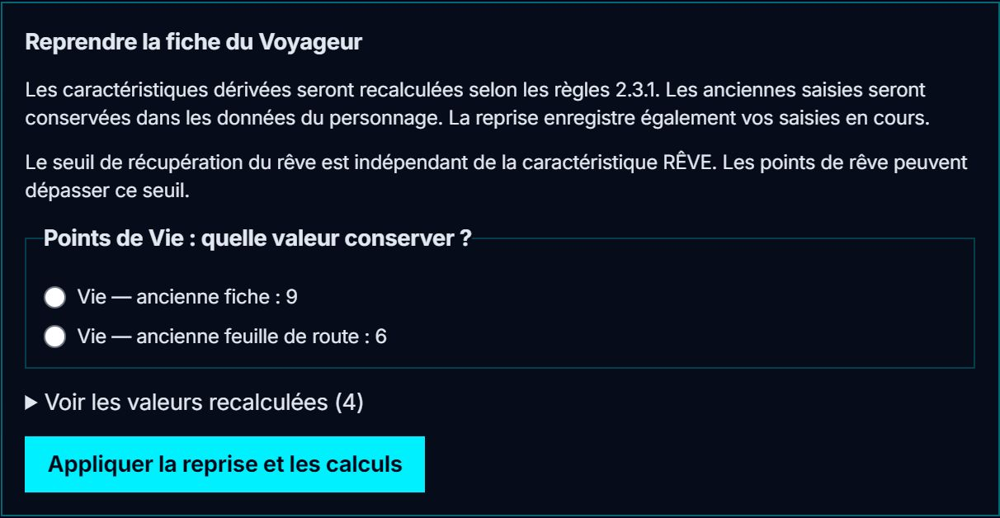

Les doubles zones ont disparu. **Mêlée, Tir, Lancer, Dérobée, vie maximale, endurance maximale,
SC, sustentation, encombrement et bonus dommages** sont recalculés depuis les caractéristiques.
Après une modification, **Sauvegarder** transmet aussi les valeurs calculées aux jets et au
combat. Les points de vie ou d'endurance déjà perdus ne sont pas restaurés par le recalcul.
Hors du domaine des tables de création imprimées, un message le signale et les champs concernés
(SC, sustentation, bonus dommages) restent ajustables manuellement.

Trois valeurs distinctes apparaissent pour le rêve :

- **RÊVE** est la caractéristique ;
- **Points de rêve** est la réserve actuelle ;
- **Seuil de récupération du rêve** est la limite de récupération, qui peut varier indépendamment
  de RÊVE. Les points actuels peuvent la dépasser.

Le repère **« Éclatement du rêve au-delà de »** vaut trois fois ce seuil. Il n'applique aucun
éclatement automatiquement. **Chance** et **Points de chance** restent également distincts.
L'heure de naissance propose les douze heures draconiques.

---

## Le jet — la table de résolution

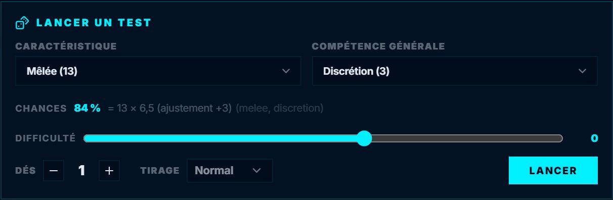

- On retient une **caractéristique** et une **compétence**. Toutes les familles de compétences sont
  proposées (générales, particulières, spécialisées, connaissances, combat, draconic), rangées par
  famille.
- La **difficulté** s'ajoute à la compétence pour former l'ajustement. Le panneau affiche les
  **chances** et leur calcul (« 84 % = 13 × 6,5, ajustement +3 »).
- Le résultat se lit en **degrés** (réussite significative, particulière…), comme dans la table du
  livre.

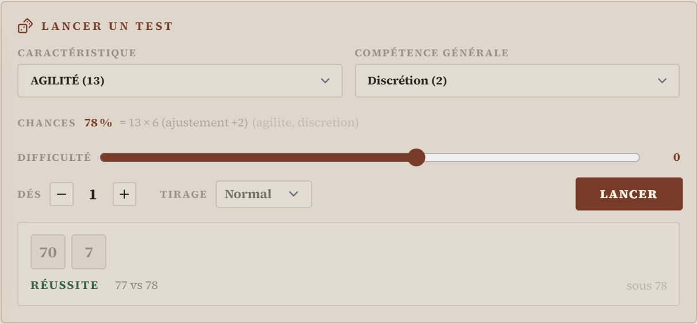

---

## Fatigue et état général — R1

Le pilote **R0 consolidé déjà importé convient** : ce suivi est apporté par GM-OS. Après la
reprise R0, cliquez sur **« Activer le suivi de fatigue »** dans chaque fiche concernée.
Les compteurs actuels sont conservés, avec une copie des saisies avant activation.

La piste comporte huit lignes et douze segments. Sa capacité vaut **deux fois l’endurance
maximale**, avec la répartition du livre pour les endurances de 16 à 30, ou des segments égaux
pour les multiples de six. Hors de ce domaine, un message demande un suivi manuel.
Le malus commence dès la première case de la ligne concernée.
Le choix **Suivi manuel → Revenir au suivi manuel** désactive les automatismes et conserve
les compteurs et les traces. Le malus est alors à reporter dans la difficulté du jet.
Ce retour au mode manuel n’est plus proposé après activation des blessures R2, qui utilisent
le lien entre pertes d’endurance et fatigue.

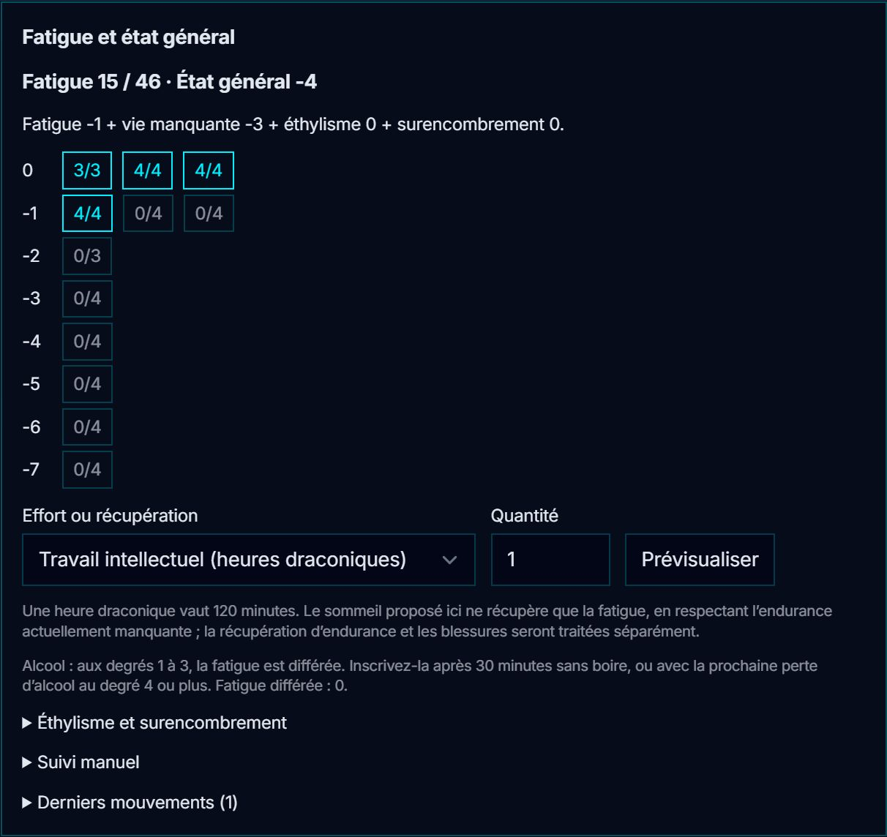

Choisissez l’effort, sa quantité, puis **Prévisualiser**. **Appliquer le mouvement** inscrit
les nouveaux compteurs et une trace consultable dans **Derniers mouvements**. La veille et le
travail intellectuel coûtent une case par heure draconique ; le travail physique moyen, deux.
Pour le travail exténuant, le gardien choisit de deux à six cases par heure. Le choix TMR compte
une case par round ou case, sans déplacer un demi-rêve ni lancer de sort.

Une baisse d’endurance saisie dans le formulaire ajoute la fatigue correspondante. Côté MJ,
**Sauvegarder** transmet les deux valeurs ensemble. Une remontée d’endurance n’efface pas la fatigue.
Pour les pertes dues à l’alcool aux degrés 1 à 3, utilisez le choix spécifique : la fatigue
est différée. Le compteur différé peut être inscrit après trente minutes sans boire ; une
nouvelle perte d’alcool au degré 4 ou plus inscrit aussi le reliquat.

Le choix **Sommeil : fatigue seule** propose la récupération par heures de **120 minutes**.
Il tient compte du segment partiel et ne descend pas sous les cases bloquées par l’endurance
actuellement manquante. Il ne remonte pas l’endurance : utilisez **Repos et Château Dormant**
pour une récupération complète tenant compte des blessures. À piste pleine, le personnage est signalé assommé de fatigue ;
le signal persiste jusqu’à récupération d’au moins un segment.

L’état général détaille **fatigue + vie manquante + éthylisme + surencombrement**. Le degré
d’éthylisme et les points excédentaires retenus par le gardien se règlent dans le panneau ;
ils ne sont pas déduits d’un inventaire incomplet.

Après activation, le panneau de jet inclut cet état **une seule fois** dans l’ajustement, en plus
de la compétence et de la difficulté. Le choix CHANCE l’écarte automatiquement, ainsi que la
compétence. **Nature du jet** permet d’écarter l’état pour la guérison, le stress et la résistance
à la magie ; il ne réalise pas leurs procédures particulières. Le choix éthylisme utilise
la fatigue et la vie manquante. Le dernier résultat garde le seuil effectivement utilisé.

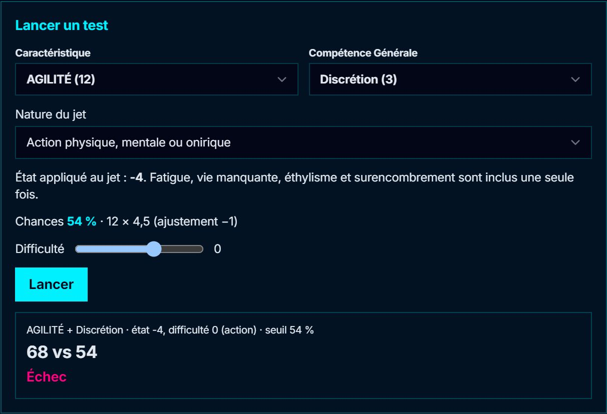

Les mêmes propositions sont disponibles sur la tablette. Les mouvements remontent au meneur ;
recharger la fiche ne répète aucune dépense.

---

## Combat et santé

### Encaissement et blessures — R2

Le pilote R0 reste valable. Après activation de la fatigue, cliquez sur **Activer le suivi des
blessures**. Reportez les blessures déjà présentes, les premiers soins ou soins complets déjà
accomplis, leur répit restant et leur bonus. Cette reprise conserve vie et endurance ; elle
n’inflige pas de nouveau les blessures. Un répit restant de zéro signifie qu’il est expiré.

Dans **Encaisser une agression**, renseignez le bonus aux dommages, la protection et, si besoin,
**Coups non mortels**. GM-OS tire **2d10 + dommages − protection**, détermine la blessure et tire
la perte d’endurance appropriée. Les dés physiques peuvent aussi être inscrits dans **Dés de table**,
dans l’ordre de lecture de l’aperçu. La localisation est facultative et reste narrative.

**Appliquer les conséquences** est la seule étape qui modifie la fiche. L’aperçu détaille les
dés, les pertes et la promotion éventuelle d’une blessure : la sixième légère devient grave,
la troisième grave devient critique. Un aperçu périmé est refusé. Les valeurs de vie, d’endurance
et de fatigue sont écrites ensemble ; les mouvements restent dans **Historique de santé** et,
pendant un enregistrement, dans le journal du meneur.

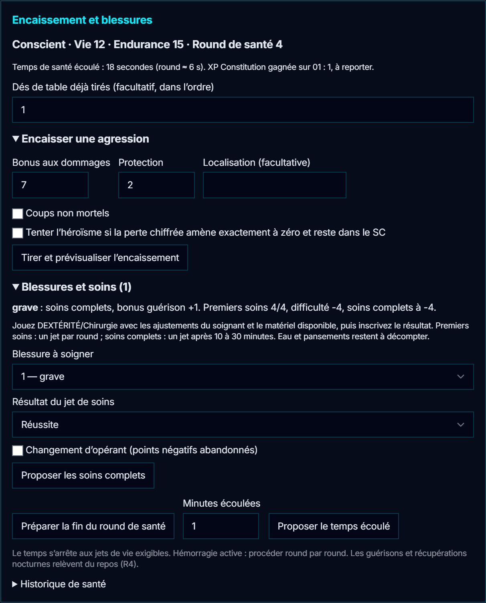

Les points importants du suivi :

- Une perte d’au moins deux points d’endurance pendant le round fait proposer le **jet
  d’endurance au d20**. Le 20 échoue toujours ; le 01 réussit et inscrit un point d’XP Constitution
  à reporter. L’échec rend **sonné** pour le reste du round et le round suivant.
- Le panneau de jet exige alors une significative pour réussir une action. Une particulière
  est ramenée à significative. Cochez **Action offensive** pour appliquer aussi l’aggravation
  des échecs. Le résultat garde son degré brut dans son contexte et transmet le degré effectif.
- À zéro d’endurance, le personnage devient inconscient et perd le point de vie prévu. Les
  résultats de table « endurance à zéro » comprennent déjà leur perte de vie : elle n’est pas
  ajoutée deux fois. L’**héroïsme** peut être choisi avant le tirage pour les pertes chiffrées
  amenant exactement à zéro et ne dépassant pas le SC.
- À zéro de vie et jusqu’à **−SC inclus**, le personnage est dans le coma. Il meurt en dessous
  de −SC, sur un 20 au jet de vie ou sur une seconde critique. Le coma n’est pas inscrit comme
  un décès dans le journal. Après une critique, les pertes d’endurance des autres encaissements
  sont reportées en pertes de vie.

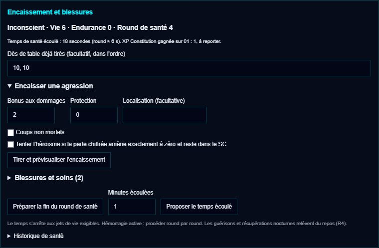

### Phase santé et soins

Le **round de santé** est un compteur persistant du suivi des blessures. Après les actions,
utilisez **Préparer la fin du round de santé**, puis validez. Cela traite l’hémorragie grave,
les obligations et la durée de « sonné ». Cela ne fait pas avancer l’initiative de Combat-OS :
traitez la phase santé une fois par round. Hors combat, **Proposer le temps écoulé** avance le
temps déclaré, s’arrête au prochain jet de vie exigible et refuse de sauter une hémorragie
qui demande encore un traitement round par round. Rien ne dépend du temps réel de l’ordinateur.

Les jets de vie se proposent selon la gravité et l’état du blessé. Un 01 accorde le répit
prévu tant que le personnage n’est pas dans le coma. Plusieurs plaies n’imposent pas plusieurs
jets de vie simultanés au même blessé.

Dans **Blessures et soins**, choisissez la blessure et inscrivez le résultat du jet de
DEXTÉRITÉ/Chirurgie du soignant. Les premiers soins cumulent les points de tâche, à raison
d’un jet par round pour cette blessure ; les malus d’échec total et l’excédent sont conservés.
Le changement d’opérant abandonne les points négatifs, en gardant les autres ajustements.
Les premiers soins arrêtent le décompte dans le round où ils s’achèvent et ouvrent le répit
de SC heures draconiques. Les soins complets enregistrent le bonus de guérison ou relancent
l’hémorragie sur un échec total. Eau, pansements et durée des soins restent à déclarer à la table.

Un blessé grave ranimé par les premiers soins reste alité avec un point d’endurance ; les soins
complets permettent de reprendre une activité modérée. Un critique reste alité jusqu’à guérison.
Les récupérations et tests de guérison après plusieurs jours se traitent dans **Repos et Château Dormant**.

Dans **Combat-OS**, le bouton **Encaisser / soins RdD** de la carte ouvre ce même suivi, pour un
PJ, un PNJ de campagne ou un adversaire autonome. Les tablettes utilisent les mêmes calculs ;
les conséquences et leur trace remontent au meneur. Un rechargement ne répète aucune perte.

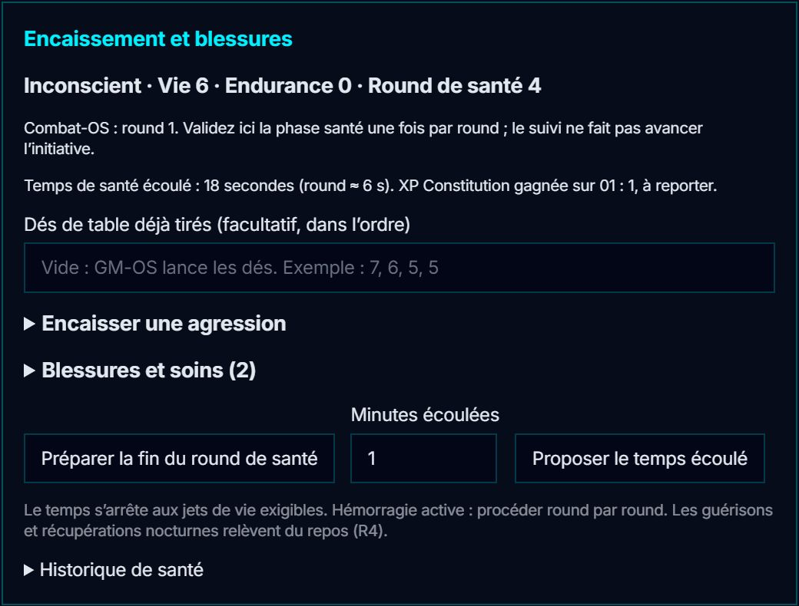

### Initiative et valeurs de référence

- **Initiative actuelle du pilote :** tri par Agilité. La procédure complète du livre — arme,
  compétence, dé et phases du round — reste à réaliser ; ce tri ne la remplace pas.
- **Santé :** points de vie, dont le **maximum vaut la moyenne de Taille et Constitution,
  arrondie au supérieur**. Le combat utilise le maximum de la fiche consolidée.
- **Endurance maximale :** le plus grand de Taille + Constitution et Vie maximale + Volonté.
- **Ressources suivies :** Endurance et Points de Rêve, distincts de leurs valeurs de référence.

Les sept phases et l’initiative par arme restent à réaliser ; R2 traite la santé du combat.

## Ouvrages et points de tâche

Après la reprise R0, **Ouvrages et points de tâche → Nouvel ouvrage** permet de fixer nom,
participants, objectif, difficulté, durée d'une période et, si nécessaire, temps limite ou seuil
éliminatoire négatif. Suivez un ouvrage collectif dans un seul carnet ; chaque participant
apporte son résultat au même fonds à la fin d'une période. Le temps n'est compté qu'une fois.

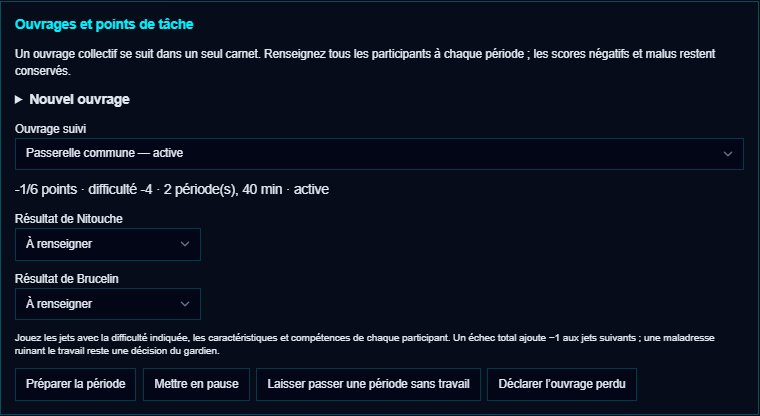

Jouez les jets avec les caractéristiques et compétences de chacun et la difficulté indiquée,
puis renseignez chaque résultat, ou **Ne participe pas à cette période** pour un absent.
Depuis **Jet du Voyageur**, **Conserver ce résultat pour une
tâche** permet de le retrouver dans le carnet avec **Utiliser le jet conservé pour…**.
Un même jet ne contribue qu'une fois. **Préparer la période** montre les conséquences ;
**Valider cette opération** les enregistre et efface les sélections pour la période suivante.

Les réussites particulière, significative et normale donnent respectivement +3, +2 et +1 point.
L'échec normal donne zéro, le particulier −2, le total −4. Chaque échec total ajoute aussi −1
aux jets suivants. Les scores négatifs restent conservés. Une **pause** garde le fonds et les
malus ; **Laisser passer une période sans travail** fait avancer le délai sans contribution.
Le temps de pause n'est pas ajouté automatiquement. Le gardien peut **Déclarer l'ouvrage perdu**
si une maladresse a ruiné le travail. Une échéance expirée ou un seuil négatif atteint arrête
l'ouvrage ; l'objectif atteint le termine. Le carnet fonctionne aussi sur la tablette du porteur.

## Repos et Château Dormant

Le MJ active le suivi après celui des blessures. Pour chaque ancienne blessure ayant reçu des
soins complets, il déclare les jours restant jusqu'au prochain test : **0 signifie ce soir**.
Il précise si les PV sont déjà éligibles à récupération ce soir ; une blessure ou maladie qui
vient de disparaître aujourd'hui impose d'attendre le lendemain. L'activation ne remonte aucun
compteur. Aucun nouveau pilote n'est à importer.

**Préparer un repos** distingue le repos éveillé, par multiples de cinq minutes, et une heure
complète de sommeil de **120 minutes**. Le plafond d'endurance tient compte des PV manquants,
des graves et des critiques ; un personnage déjà au-dessus de ce plafond ne perd pas cet excédent.
Le sommeil récupère d'abord l'endurance, puis la fatigue, sans effacer les cases encore bloquées.
Procédez heure par heure. Une hémorragie ou un jet de santé exigible interrompt le repos.

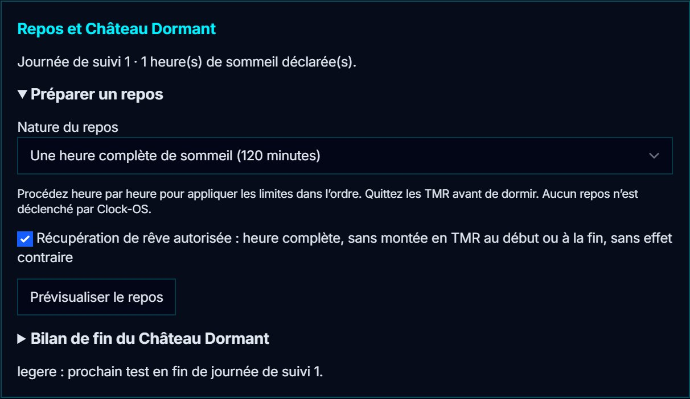

Quittez les TMR avant de déclarer le sommeil. Si la récupération de rêve est autorisée et que
les points actuels sont sous le seuil, tirez le DDR ou reportez les dés physiques, sous la forme
de valeurs 0 à 7. Chaque 7 est relancé et ajouté. Pour un Rêve de Dragon, résolvez sa maîtrise à
la table avant l'aperçu, avec l'état après repos. À zéro rêve, c'est un échec total automatique.
L'excédent de rêve est conservé ; queues, têtes et souffles éventuels restent visibles jusqu'à
ce que leurs conséquences aient été traitées et marquées résolues par le gardien.

**Bilan de fin du Château Dormant** traite une journée à la fois. Donnez à chaque nuit un nom
ou une date unique. Résolvez d'abord stress et famine ; vérifiez moral du matin, chance et
enchantements selon l'ordre rappelé. Ces opérations restent manuelles. L'assistant prépare
les tests de guérison exigibles, la récupération éventuelle des PV et la perte d'un point de
rêve s'il reste supérieur au seuil, après le stress. Il n'avance pas Clock-OS.

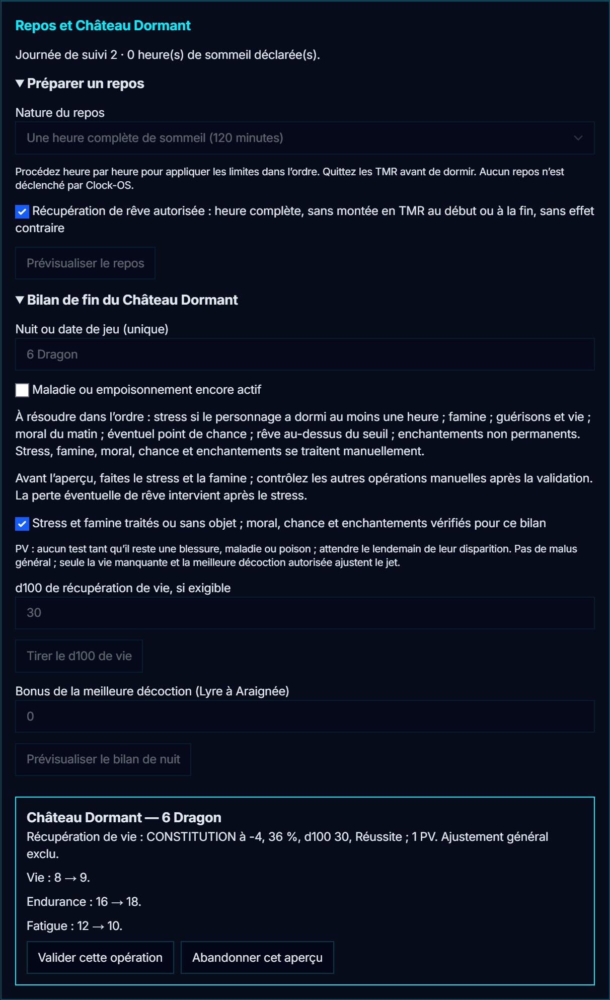

Le jour des soins ne compte pas. Les premiers tests ont lieu après 2, 4 ou 6 jours pour une
légère, grave ou critique. Une réussite rétrograde la blessure et fixe le délai de la nouvelle
gravité ; un échec normal ou particulier reporte au lendemain ; un échec total retire un PV et
impose à nouveau le délai entier. Les bonus de soin et d'herbe sont consommés par ce test.

Aucun PV ne se récupère tant qu'il reste une blessure, maladie ou poison actif, ni le jour où
disparaît la dernière atteinte. Le lendemain, CONSTITUTION ajustée aux PV manquants, avec la
meilleure décoction autorisée, donne deux PV sur particulière, un sur normale/significative,
zéro sur échec et −1 sur échec total. L'état général est exclu. Les points d'endurance et de
fatigue associés à la vie récupérée sont traités dans le même aperçu.

Chaque opération exige une validation et garde son reçu. Un aperçu périmé est refusé, le
rechargement n'applique rien une deuxième fois. La tablette du joueur lit le suivi et les
échéances ; le MJ valide repos et bilans. Les opérations sont consignées au journal du meneur.

## Terres Médianes du Rêve — carte et coûts sur la fiche

Dans l'éditeur du pilote, ouvrez **Modules du jeu** et cochez **Terres Médianes du Rêve**.
Le choix s'enregistre automatiquement ; aucun nouvel import du pilote n'est nécessaire.
Au cockpit, **Modules du jeu → Ouvrir le pupitre** permet de choisir un haut-rêvant et de
placer son demi-rêve. Reprenez sa position existante ; ne le replacez pas arbitrairement.
Pendant une séance, ouvrez l'accès aux personnages choisis. Chacun retrouve le module dans
l'onglet **Modules du jeu** de son Hub et ne reçoit que son propre carnet.

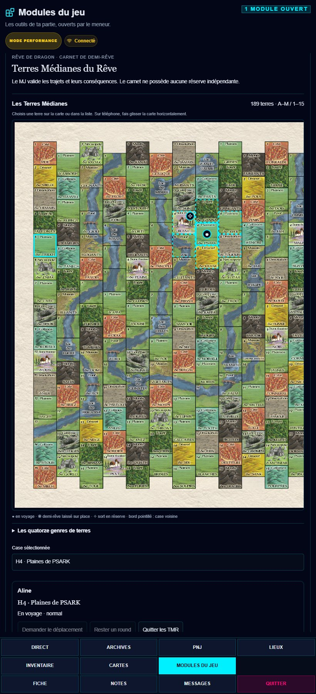

La carte officielle en couleur est intégrée au module et reste disponible sans connexion.
Choisissez une terre sur l'image ou dans la liste des coordonnées. Sur un petit écran,
faites défiler la carte horizontalement ; les repères de position et de réserve restent
superposés à leur case. Une demande de montée,
de déplacement voisin, d'attente ou de descente attend le MJ. La carte conserve la position
précédente jusqu'à sa validation. Le mode accéléré se choisit avant la montée.

**Le raccord à la fiche est disponible sur le poste MJ.** Une demande fait apparaître un panneau
au-dessus de la carte. Choisissez **Prévisualiser le coût sur la fiche** : le rêve et la fatigue
avant/après sont affichés. Vérifiez concentration, round et absence d'effet modifiant les coûts,
puis cliquez sur **Débiter la fiche et valider le trajet**. La fiche doit avoir été reprise en R0
et le suivi de fatigue R1 activé. Un aperçu périmé est refusé sans débit ; une opération engagée
est bloquée jusqu'à confirmation ou annulation vérifiée. Aucun nouveau pilote n'est à importer.

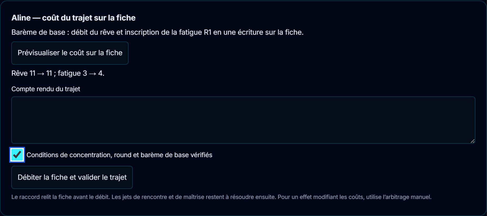

Le rêve et la fatigue restent ceux de la fiche, sans second compteur dans le module. La position
n'est validée qu'après relecture du reçu enregistré avec le coût. À zéro rêve, le personnage dort
et sort des TMR ; à fatigue pleine, il sort également. Le panneau de jet bloque les actions à zéro
rêve. La récupération reste à résoudre, sans minuterie automatique.

**L'arbitrage manuel reste disponible** pour les effets modifiant les coûts : résolvez les dépenses
sur la fiche puis cochez **Coûts, jets et conséquences résolus sur la fiche** avant **Valider le
trajet**. Ce bouton ne débite rien. Ne payez pas manuellement un trajet puis avec le raccord.
Les rounds, les jets de rencontre, les maîtrises et le lancer des sorts restent à votre main.

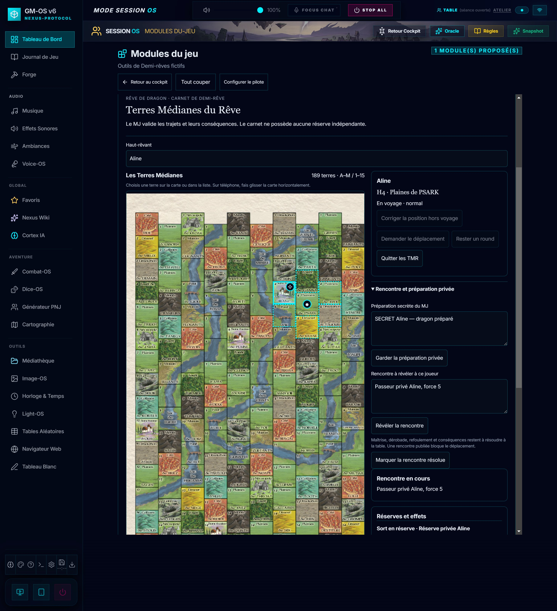

Le MJ peut préparer une rencontre en privé, puis publier seulement le texte destiné au joueur.
Une rencontre publiée bloque les déplacements jusqu'à sa résolution. Les sorts déjà mis en
réserve sont consignés sur leur case ; queues et souffles se notent avec leurs détails et échéances.
Leur déclenchement et leurs conséquences restent manuels. **Crédits et licences** mentionne
Cyol et Kroc, dont les données cartographiques ont été adaptées sous CC BY 3.0 France,
ainsi que la provenance de la carte officielle et les crédits de l'édition Scriptarium.

Un rechargement retrouve la position sans refaire le trajet. Au redémarrage de GM-OS, à l'import
ou à la coupure générale, les voyages et demandes en attente sont arrêtés, les positions et
carnets conservés ; le MJ rouvre les accès. Une écriture engagée avant l'interruption est conservée
pour rapprochement : si son reçu existe, le trajet est terminé sans repayer, en restant hors TMR ;
si rien n'a été payé, elle est annulée sans dépense. Après une panne disque, **Reprendre la
confirmation** réessaie l'enregistrement du même reçu. **Annuler si aucun débit n'a eu lieu**
ne rembourse pas une opération déjà payée : elle termine sa confirmation. Si la fiche a été
supprimée, restaurez-la avant de rapprocher l'opération.

*Relu le 2026-10-18 — R0, R1 et R2 : consolidation, fatigue, encaissement, états et soins vérifiés
dans le Livre des Voyageurs 2.3.1, p. 42–45, 50–51, 78, 88–99, 120 et 162 ; rêve, p. 206–208.
R3 et R4 : tâches et repos, p. 84–94 et 98–102 ; bilans, p. 87 ; rêve, p. 187 et 206–208.
R8 : carte, déplacements et raccord aux fiches, Livre du Haut-Rêve 2.3.1, p. 178–183 et 208.*
