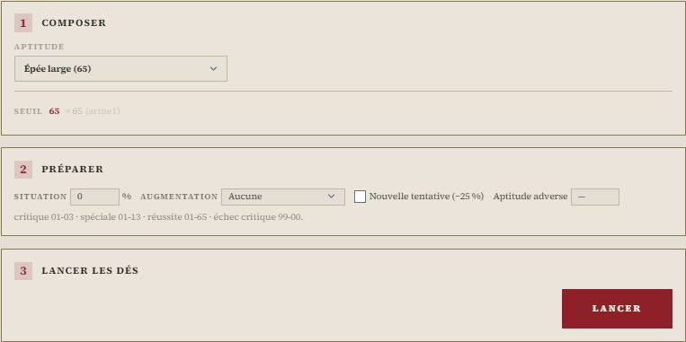
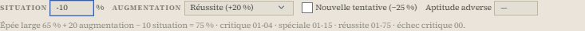
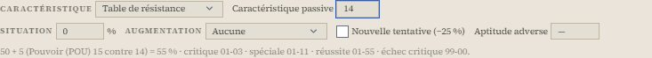
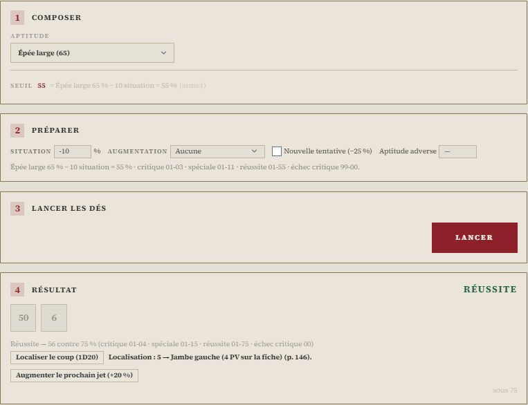
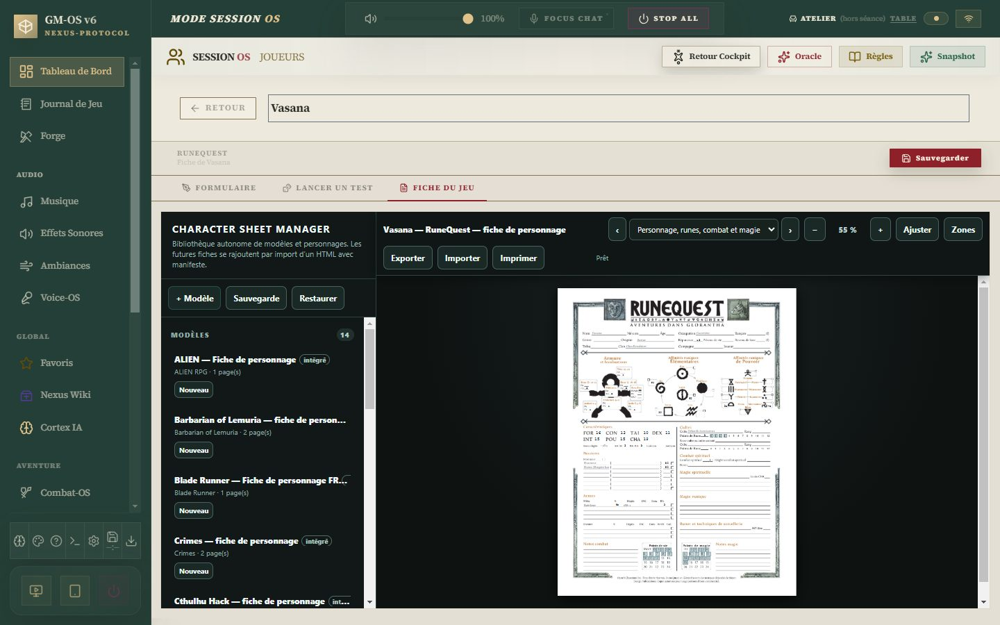
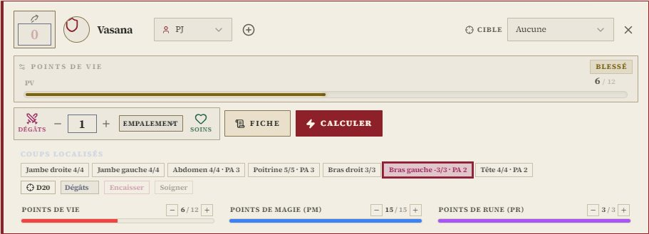

# 🏺 Jeu — RuneQuest

> **Pilote décrit :** « RuneQuest », forgé par David, exporté le 2026-10-30, **fini le
> 2026-10-30**, version 2.1.0 — les coups localisés de Combat-OS ajoutés le même jour
> (`Export Dirvers/corriges/RQ_driver_gmos_finir.gmos-driver`, construit par
> `outils/runequest/finir_runequest.py`). Thème `runequest` et fiche de personnage
> HTML `runequest-fr` livrés le même jour, la fiche reliée champ par champ. Retour à [Les jeux et leurs mécaniques](./53-Les-jeux-et-leurs-mecaniques.md).

Un seul geste : le **test d'aptitude**, un D100 sous une compétence, une Rune, une Passion, la
Réputation ou une caractéristique. Le résultat se lit en **cinq niveaux**, calculés sur les
chances **modifiées** : réussite critique, réussite spéciale, réussite, échec, échec critique.
Autour de lui : le test de caractéristique, la table de résistance, l'augmentation, la nouvelle
tentative, l'opposition et la localisation du coup. Dans Combat-OS, les **coups localisés** :
l'armure de la zone, ses points de vie et ceux du total, et l'effet du livre.

> Règles relues contre le livre de base français (Deadcrows, 7e édition) **et son errata** le
> 2026-10-30 — pages imprimées 6-12, 45-63, 82, 137-161, 191-224, 227-238, 244-257, 275,
> 313-315, 381-388. Les dix-sept fiches du corpus `docs/systems/runequest/rules/` sont relues et
> corrigées d'après lui.

**Réimporter le pilote avec « Remplacer ».** Le pilote forgé ne rendait que réussite ou échec,
lançait une caractéristique sous sa valeur brute (FOR 13 = 13 %) et réussissait un 97 à 120 %.
La version 2.1.0 garde son identifiant, mais **sa fiche change entièrement** : les compétences du
livre au lieu des sept catégories, les compétences d'armes, les Runes une à une, l'Honneur et sept
Passions nommées, deux cultes, les sept localisations. Un personnage créé avec la fiche forgée garde ses anciennes valeurs, sans qu'elles
paraissent : il faut le ressaisir.

---

## Le test d'aptitude

- **Composer** : une **aptitude** dans un seul menu — les compétences par catégorie (Agilité,
  Communication, Connaissances, Magie, Manipulation, Perception, Discrétion), les armes sous leur
  nom, les Runes élémentaires, de Pouvoir et de Forme, les Passions sous leur objet, la
  Réputation, et les sept caractéristiques. Les dégâts et le rang d'action d'une arme ne s'y
  proposent pas : ils se lisent, ils ne se lancent pas.
- **Préparer** : la **situation**, en pourcentage ; l'**augmentation**, le niveau d'un test
  d'augmentation lancé d'abord (+50, +30, +20, −20, −50 %, p. 144-145) ; la **nouvelle
  tentative** après un échec (−25 %, p. 142) ; l'**aptitude adverse** d'une opposition.
- **Lancer** : un D100. Pas d'avantage ni de désavantage : RuneQuest règle tout en pourcentage.

La ligne sous les réglages dit le calcul et les **plages** du jet, comme la table du livre :

| Niveau | Quand (p. 142-143) |
| :--- | :--- |
| **Réussite critique** | jusqu'à 5 % des chances modifiées, arrondi au plus proche ; 01 au moins |
| **Réussite spéciale** | jusqu'à 20 % des chances modifiées, arrondi au plus proche ; 01 au moins |
| **Réussite** | jusqu'aux chances ; **01-05 réussit toujours** |
| **Échec** | au-dessus ; **96-00 échoue toujours**, même à 120 % |
| **Échec critique** | les 5 % supérieurs des chances d'échec, arrondis ; **00 toujours** |

À 56 %, un 02 est une réussite critique (01-03), un 11 une spéciale (01-11), un 57 un échec, un 99
ou un 00 un échec critique — l'exemple du livre. Au-delà de 95 %, la réussite reste plafonnée,
mais critique et spéciale continuent de s'élargir : 120 % critique sur 01-06.

## La caractéristique et la table de résistance

Retenir une **caractéristique** fait paraître un menu :

- **×5 à ×0,5** : le **test de caractéristique**, d'Action simple à Presque impossible (p. 141).
  CON 12 donne 60 %, et non 12 %.
- **Table de résistance** : la caractéristique retenue est **active** ; on saisit la
  **passive** — le POU de la cible d'un sort, la TAI d'un objet, la PUI d'un poison. Chances :
  50 % + 5 % par point d'écart (p. 145), 1-5 réussit et 96-00 échoue toujours (errata p. 147).

## Après le jet

- **Jet de l'adversaire** (quand une aptitude adverse est saisie) : on tape son D100, et
  **« Trancher »** dit qui l'emporte. Selon l'**errata** (p. 142, 144), le **meilleur niveau de
  réussite** gagne ; deux niveaux égaux font une **égalité** ; deux échecs, deux perdants.
  Au-delà de 100 %, l'excédent de la meilleure aptitude s'est retiré **aux deux camps** avant le
  jet, et critique et spéciale se lisent sur le score réduit (p. 144).
- **Localiser le coup (1D20)** : la table du livre, de la jambe droite (1-4) à la tête (19-20),
  avec les points de vie de la zone lus sur la fiche (p. 146). Au meneur, une ligne de plus :
  la **cible** — par défaut celle du combattant dont c'est le tour —, les **dégâts**, et
  **« Porter le coup »**, qui passe par l'armure et la zone de la cible comme sur sa carte de
  combat (ci-dessous). Pas sur la tablette d'un joueur.
- **Augmenter le prochain jet** : ce jet était un test d'augmentation ; son niveau s'inscrit dans
  la préparation du jet suivant, **pour ce seul jet** (p. 144-145). Par une Rune ou une Passion,
  l'**inspiration** a ses propres suites en cas d'échec — tourment, désespoir, perte de 1D10 % —
  que la table applique (p. 229, 236).
- **Tenter à nouveau (−25 %)**, sur un échec, si la meneuse le permet (p. 142).

Rien ne s'écrit sur la fiche du lanceur : la localisation et l'issue d'une opposition vont au
journal ; un coup porté s'écrit sur la fiche de la cible.

## La fiche du personnage

La fiche fidèle au PDF de Deadcrows (`docs/fiches/RuneQuest/`, gabarit `runequest-fr`, quatre
pages, moteur de fiches **version 20**) s'ouvre dans l'onglet **Fiche du jeu**. Ses 735 clés sont
toutes décidées (`docs/systems/runequest/fiche/correspondance.json`) : **327 sont reliées** à la fiche
GM-OS — identité, caractéristiques, attributs, Runes, Passions, compétences, armes, cultes et
points de Rune, localisations, magie, matériel, richesse, notes —, les autres **restent sur la
fiche** : famille, ascendance, compagnon, propriétés, récoltes, états Mort et Inconscient, et les
coches d'expérience. Une saisie GM-OS ne part vers la fiche qu'après **Sauvegarder**.

La fiche GM-OS suit la même feuille (p. 52-63) :

- les **sept caractéristiques** et les **attributs** : points de vie maximum, points de magie
  (le POU), points de Rune, bonus aux dégâts, dégâts de combat spirituel, vitesse de guérison,
  ENC maximum, rangs d'action de DEX et de TAI, déplacement en DÉP (8, soit 24 m) ;
- les **sept modificateurs de catégorie** ;
- les **six Runes élémentaires** et les **cinq paires** de Pouvoir et de Forme — chaque paire
  totalise 100, 50/50 au départ ;
- l'**Honneur** et **sept Passions** avec leur nature et leur sujet (Haine — Empire lunar), et la
  **Réputation** ;
- **deux cultes**, leur rang et leurs points de Rune ;
- les **compétences du livre**, à leur valeur de base (p. 61) ; celles qui se précisent — Monte,
  Langue étrangère, Connaissance du culte, Artisanat, Vénération — se lancent sous le nom saisi ;
- les **compétences d'armes** de la feuille (Dague, Épée large, Arc composite, boucliers, armes
  naturelles et lignes libres) et **quatre armes de mêlée, trois à distance et le bouclier** en
  main, avec dégâts, rang d'action, ENC, durabilité, portée et cadence ;
- les **sept localisations**, points de vie, armure et **dégâts reçus** — ces derniers n'existent
  que dans GM-OS, la feuille n'a pas de case pour eux ;
- les jauges de **points de vie**, **de magie** et **de Rune**, plafonnées par les maximums.

Les dérivés ne se calculent pas seuls : on les saisit d'après les tables du livre. Les points de
vie maximum, le déplacement et le rang d'action d'une arme à distance n'ont pas de case sur la
feuille : ils vivent dans GM-OS.

## Le thème

Le thème `runequest` (papier calcaire clair, encre charbon, titres cinabre, cadre vert-de-gris) s'applique quand il est activé dans la
campagne ; matière, ornements et icônes demandent les **personnalités** allumées dans les
Paramètres. Accepté par le validateur sans erreur ni avertissement.

## Le combat

Combat-OS range les combattants par **rang d'action de DEX + rang d'action de TAI**, du plus bas
au plus haut (p. 57, 193) ; le rang de l'arme s'ajoute à la table. La santé suivie est celle des
**points de vie totaux**, plafonnés par la fiche. Les portées sont les catégories de poursuite du
livre, de Côte à côte à Hors de portée (p. 152-153), sans modificateur : celui d'une arme à
distance dépend de sa portée (p. 213).

### Les coups localisés

Sous la santé de chaque combattant — PJ, PNJ ou adversaire fabriqué —, les **sept zones** avec
leurs points de vie restants et leur armure (PA). La teinte dit l'état : entamée, hors d'usage,
au double.

1. **Choisir la zone** : **D20** sur la table du livre, ou un clic sur la zone.
2. **Saisir les dégâts** du jet, armure **non** retirée, puis **Encaisser**.

GM-OS fait le reste, d'après le livre (p. 146-148) :

- **l'armure** de la zone se retire ;
- **un membre** (bras, jambe) ne prend jamais plus du **double** de ses points de vie en un
  coup : l'excédent est perdu, total compris — un bras à 2 points touché pour 5 n'en perd que 4 ;
- la **zone** et le **total** perdent ce qui reste, la carte et la jauge suivent ;
- **l'effet** se dit, au message et au journal :

| La zone a perdu… | Membre | Tête, poitrine, abdomen |
| :--- | :--- | :--- |
| ses points de vie | hors d'usage : la jambe fait tomber, le bras lâche ce qu'il tient | abdomen : les jambes ; poitrine : ni agir ni se soigner ; tête : inconscient — tous mortels sans soin |
| le double | **en un seul coup** : neutralisé, en état de choc | **coups cumulés** : inconscient, −1 PV par round |
| le triple, **en un seul coup** | tranché, hors combat | mort sur le coup |

Au total, **1 ou 2 points** : inconscient ; **0 ou moins** : mort à la fin du round, sauf soin
(p. 146-147) — la carte l'écrit en rouge.

**Soigner** rend des points à la zone choisie **et** au total, jamais plus que la zone n'a perdu.

Les boutons **Dégâts** et **Soins** du panneau de santé restent ceux du **total seul** : un
poison, une chute, une hémorragie ne visent pas de zone (« sauf cas particuliers », p. 146).

## Ce qui reste à la table

- **Les dégâts spéciaux** : empalement, lacération, écrasement sur une spéciale ; maximum sans
  armure sur une critique (p. 202-204).
- **La magie** : POU×5 pour la magie spirituelle, l'affinité runique pour un sort runique, la
  compétence du sort en sorcellerie ; ces tests se font au panneau, sous l'aptitude voulue.
- **Les effets d'une localisation** se disent, ils ne s'appliquent pas seuls : le combat au sol
  (attaque divisée par deux, +40 % pour l'adversaire), l'hémorragie et ses minutes, le PV perdu
  à chaque round d'une tête au double se jouent à la table (p. 147-148).
