# 🏺 Jeu — RuneQuest

> **Pilote décrit :** « RuneQuest », forgé par David, exporté le 2026-10-30, **fini le
> 2026-10-30**, version **2.3.0** — les coups localisés de Combat-OS ajoutés le même jour,
> affichage des PV de la cible corrigé le **2026-11-01** dans l'application ; **dégâts de
> l'attaque et rangs d'action selon l'action** le **2026-11-03** (RQ-A3, RQ-A4) ; **attributs
> calculés, magie, inspiration et expérience** le même jour (RQ-A5, RQ-A6)
> (`Export Dirvers/corriges/RQ_driver_gmos_finir.gmos-driver`, construit par
> `outils/runequest/finir_runequest.py`). Thème `runequest` et fiche de personnage
> HTML `runequest-fr` livrés le même jour, la fiche reliée champ par champ. Retour à [Les jeux et leurs mécaniques](./53-Les-jeux-et-leurs-mecaniques.md).

Un seul geste : le **test d'aptitude**, un D100 sous une compétence, une Rune, une Passion, la
Réputation ou une caractéristique. Le résultat se lit en **cinq niveaux**, calculés sur les
chances **modifiées** : réussite critique, réussite spéciale, réussite, échec, échec critique.
Autour de lui : le test de caractéristique, la table de résistance, l'augmentation, la nouvelle
tentative, l'opposition et la localisation du coup. Dans Combat-OS, les **coups localisés** :
l'armure de la zone, ses points de vie et ceux du total, et l'effet du livre. Depuis la
version 2.2.0, une attaque prépare ses **dégâts** — arme, bonus, dégâts spéciaux, parade ou
esquive — jusqu'au coup porté, et Combat-OS compose le **rang d'action** selon l'action déclarée.
Depuis la 2.3.0, les **attributs** se calculent depuis les caractéristiques, un **sort** se paie
selon le niveau du jet, l'**inspiration** tient toute la situation, et l'**expérience** se coche
puis se teste en fin de saison.

**Pilote 2.3.0 — 03/11/2026, à réimporter avec « Remplacer ».** Même identifiant, même fiche de
320 champs : rien n'est à ressaisir. Le pilote nomme ce que lisent les attributs calculés
(`jet.runequest.derives`), la magie des deux cultes (`jet.runequest.magie`) et la progression
— Runes, paires opposées, Passions, modificateur de chaque section (`jet.runequest.progression`).

**Pilote 2.2.0 — 03/11/2026.** Le pilote nomme désormais les armes de la feuille (score,
nom, dégâts, RA, durabilité), le bonus aux dégâts et la CON (`jet.runequest`), et passe Combat-OS
en mode **rangs d'action** (`combat.rangsDAction`). Le lot de recette de `output/` reste en 2.1.0.

**Campagnes de recette révisées le 01/11/2026 :** le lot dans
`output/campagnes-tests/runequest/` embarque le pilote **2.1.0, 320 champs**, 21 PJ et
78 cas, dont douze **RQ-LOCAL** pour les coups localisés. Si le pilote installé est encore
2.0.0, importer d'abord le fichier `RuneQuest-2.1.0.gmos-driver` avec **Remplacer** : une
campagne Nexus conserve une dépendance déjà présente du même ID. Pour retrouver les états
préparés, remplacer uniquement le laboratoire voulu ; préserver une aventure déjà jouée.
Les maxima de zone et les dégâts reçus sont distincts : C07 bras 0/3, C08 tête −4/4.

> Règles relues contre le livre de base français (Deadcrows, 7e édition) **et son errata** le
> 2026-10-30 — pages imprimées 6-12, 45-63, 82, 137-161, 191-224, 227-238, 244-257, 275,
> 313-315, 381-388. Les dix-sept fiches du corpus `docs/systems/runequest/rules/` sont relues et
> corrigées d'après lui.

**Réimporter le pilote avec « Remplacer ».** Le pilote forgé ne rendait que réussite ou échec,
lançait une caractéristique sous sa valeur brute (FOR 13 = 13 %) et réussissait un 97 à 120 %.
La version 2.1.0 garde son identifiant, mais **sa fiche change entièrement** : les compétences du
livre au lieu des sept catégories, les compétences d'armes, les Runes une à une, l'Honneur et sept
Passions nommées, deux cultes, les sept localisations. Un personnage créé avec la fiche forgée garde ses anciennes valeurs, sans qu'elles
paraissent : il faut le ressaisir.

**Anciennes fiches — NP-C2, 03/11/2026.** Le meneur peut maintenant préparer une
[reprise avec aperçu et sauvegarde](./63-Fiche-de-personnage-HTML.md#reprendre-une-ancienne-fiche)
depuis le formulaire du PJ. Les anciennes clés restent présentes ; les correspondances se
choisissent explicitement, sans déduire une conversion de leurs noms. Les notes et la santé
ne sont pas remises à zéro. L'import d'une campagne conserve un pilote de même ID et signale
les différences ; pour changer ce pilote, importer son .gmos-driver avec **Remplacer**.
252 tests ciblés et six parcours Electron passent le 03/11 ; huit captures relues.
Validation globale de David : « ok tout est testé, commit et pousse ».

---

## Le test d'aptitude

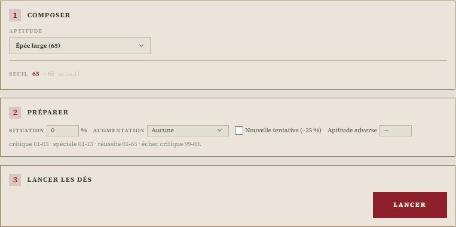

- **Composer** : une **aptitude** dans un seul menu — les compétences par catégorie (Agilité,
  Communication, Connaissances, Magie, Manipulation, Perception, Discrétion), les armes sous leur
  nom, les Runes élémentaires, de Pouvoir et de Forme, les Passions sous leur objet, la
  Réputation, et les sept caractéristiques. Les dégâts et le rang d'action d'une arme ne s'y
  proposent pas : ils se lisent, ils ne se lancent pas.
- **Préparer** : la **situation**, en pourcentage ; l'**augmentation**, le niveau d'un test
  d'augmentation lancé d'abord (+50, +30, +20, −20, −50 %, p. 144-145) ; la **nouvelle
  tentative** après un échec (−25 %, p. 142) ; l'**aptitude adverse** d'une opposition.
- **Lancer** : un D100. Pas d'avantage ni de désavantage : RuneQuest règle tout en pourcentage.

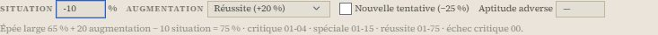

La ligne sous les réglages dit le calcul et les **plages** du jet, comme la table du livre :

| Niveau | Quand (p. 142-143) |
| :--- | :--- |
| **Réussite critique** | jusqu'à 5 % des chances modifiées, arrondi au plus proche ; 01 au moins |
| **Réussite spéciale** | jusqu'à 20 % des chances modifiées, arrondi au plus proche ; 01 au moins |
| **Réussite** | jusqu'aux chances ; **01-05 réussit toujours** |
| **Échec** | au-dessus ; **96-00 échoue toujours**, même à 120 % |
| **Échec critique** | les 5 % supérieurs des chances d'échec, arrondis ; **00 toujours** |

À 56 %, un 02 est une réussite critique (01-03), un 11 une spéciale (01-11), un 57 un échec, un 99
ou un 00 un échec critique — l'exemple du livre. Au-delà de 95 %, la réussite reste plafonnée,
mais critique et spéciale continuent de s'élargir : 120 % critique sur 01-06.

## La caractéristique et la table de résistance

Retenir une **caractéristique** fait paraître un menu :

- **×5 à ×0,5** : le **test de caractéristique**, d'Action simple à Presque impossible (p. 141).
  CON 12 donne 60 %, et non 12 %.
- **Table de résistance** : la caractéristique retenue est **active** ; on saisit la
  **passive** — le POU de la cible d'un sort, la TAI d'un objet, la PUI d'un poison. Chances :
  50 % + 5 % par point d'écart (p. 145), 1-5 réussit et 96-00 échoue toujours (errata p. 147).

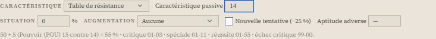

## Après le jet

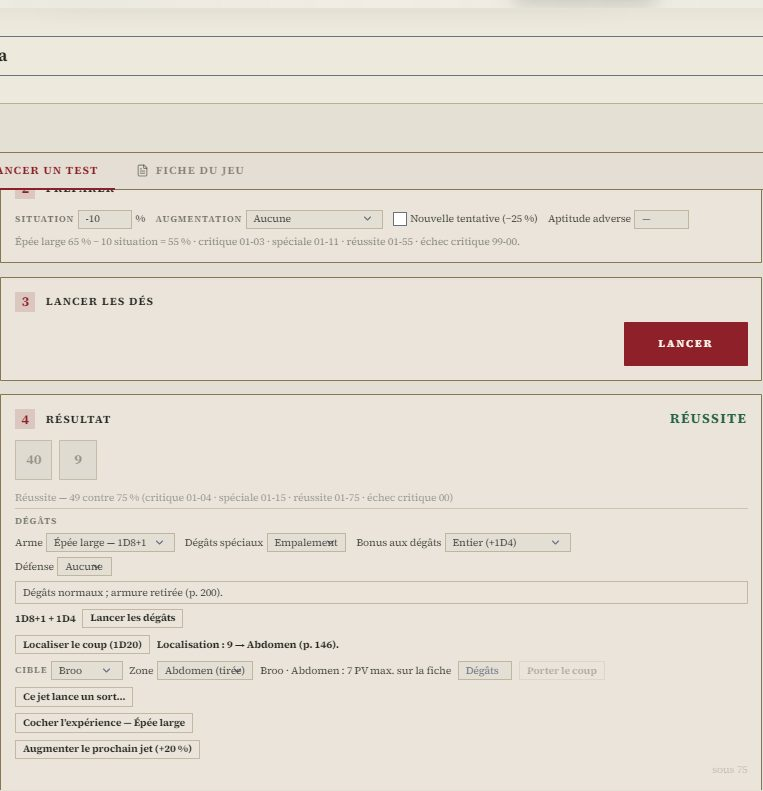

- **Jet de l'adversaire** (quand une aptitude adverse est saisie) : on tape son D100, et
  **« Trancher »** dit qui l'emporte. Selon l'**errata** (p. 142, 144), le **meilleur niveau de
  réussite** gagne ; deux niveaux égaux font une **égalité** ; deux échecs, deux perdants.
  Au-delà de 100 %, l'excédent de la meilleure aptitude s'est retiré **aux deux camps** avant le
  jet, et critique et spéciale se lisent sur le score réduit (p. 144).
- **Localiser le coup (1D20)** : la table du livre, de la jambe droite (1-4) à la tête (19-20)
  (p. 146). Au meneur, une ligne de plus : la **cible** — par défaut celle du combattant
  dont c'est le tour — et les **PV maximum de la zone sur sa fiche**. Changer la cible
  actualise ces PV sans relancer le D20. Ce sont les maxima, pas les PV restants après
  blessures ; une valeur absente est indiquée comme inconnue. Puis viennent les **dégâts** et
  **« Porter le coup »**, qui passe par l'armure et la zone de la cible comme sur sa carte de
  combat (ci-dessous). Pas sur la tablette d'un joueur.
- **Augmenter le prochain jet** : ce jet était un test d'augmentation ; son niveau s'inscrit dans
  la préparation du jet suivant, **pour ce seul jet** (p. 144-145). Par une Rune ou une Passion,
  l'**inspiration** a ses propres suites en cas d'échec — tourment, désespoir, perte de 1D10 % —
  que la table applique (p. 229, 236).
- **Tenter à nouveau (−25 %)**, sur un échec, si la meneuse le permet (p. 142).

La localisation et l'issue d'une opposition vont au journal ; un coup porté s'écrit sur la fiche
de la cible. Sur la fiche du lanceur ne s'écrit que ce que la meneuse décide par un geste : le
sort payé, l'inspiration, la coche d'expérience (ci-dessous).

### Lancer un sort

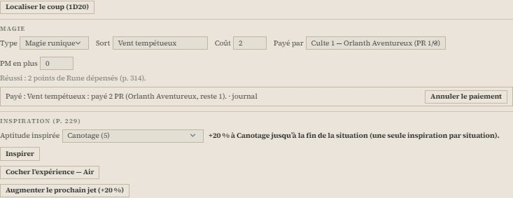

Un test sous le **POU** ouvre le bloc **Magie** en magie spirituelle, une **Rune** en magie
runique ; pour un autre jet (une compétence de sorcellerie), **« Ce jet lance un sort… »**
l'ouvre. On y saisit le type, le nom, le coût, le culte qui paie et les PM ajoutés ; le coût
suit le **niveau du jet**, comme le livre le dit :

| Magie | Réussite critique | Réussite | Échec | Échec critique |
| --- | --- | --- | --- | --- |
| Spirituelle (p. 254) | les PM du sort | les PM du sort | rien | rien |
| Runique (p. 314) | **aucun point de Rune** | les PR du culte | rien (1 PM si le sort était renforcé) | les PR |
| Sorcellerie | 1 PM | tous les PM | 1 PM | tous les PM |

**Payer le sort** débite la fiche et le dit au journal ; **Annuler le paiement** remet les
valeurs d'avant. Un sort runique se paie avec les points de Rune **de son culte**, jamais d'un
autre (p. 313) ; s'il n'en reste pas assez, le paiement est refusé. À 0 PM, l'aventurier sombre
dans l'inconscience (p. 54) : GM-OS le rappelle.

### L'inspiration

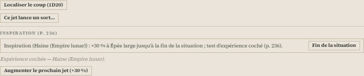

Un test sous une **Rune** ou une **Passion** propose aussi le bloc **Inspiration** (p. 228-229,
236). Sur une réussite, on choisit l'aptitude inspirée : **+50 %** sur une critique, **+30 %**
sur une spéciale, **+20 %** sur une réussite, **jusqu'à la fin de la situation** — et non pour le
seul jet suivant, comme l'augmentation. Le bonus s'ajoute à chaque jet de cette aptitude, au
pupitre comme sur la tablette ; il ne se cumule pas avec une augmentation, la meilleure seule
compte. La source gagne un test d'expérience.

Les suites d'un échec se **proposent**, et s'appliquent par un geste :

- par une **Passion**, l'aventurier est **découragé** : −10 % à **tous** les tests tant que dure
  la situation ;
- par une **Rune** : −20 % aux tests qui font appel à **cette Rune**, jusqu'à une journée entière
  de méditation ;
- un **échec critique** fait lancer la perte de 1D10 % (la Rune opposée monte d'autant ; une
  Passion tombée à 0 se raye de la feuille) et la durée du **tourment** ou du **désespoir** sur
  1D10.

Une seule tentative par situation, même par une autre Rune ou Passion ; une Rune qui a inspiré ne
sert plus de la session. **Fin de la situation**, **Journée de méditation** et **Nouvelle
session** lèvent ces limites, dans la carte ci-dessous.

### Magie et progression

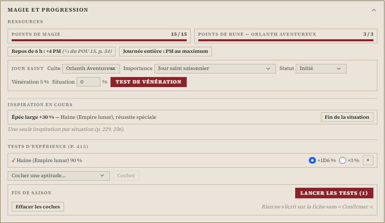

La carte **Magie et progression**, à côté du test :

- les **points de magie** et les **points de Rune** de chaque culte ;
- **Repos de 6 h** : le quart du POU, arrondi au plus proche (Vasana, POU 15, en regagne 4) ;
  **Journée entière** : les PM au maximum (p. 54) ;
- le **jour saint** : le culte, l'importance du jour, le statut (lu dans le rang du culte :
  initié, ou Chantre sacré, Prêtre runique, Seigneur runique) et la situation (+50 % dans un
  grand temple). **Test de Vénération** lance le D100, dépense les 2 PM de la cérémonie et rend
  les points de Rune de la table, plafonnés au maximum du culte (p. 315) ;
- l'**inspiration en cours** et les malus, avec **Fin de la situation**, **Journée de
  méditation** et **Nouvelle session** ;
- les **tests d'expérience** (p. 415) : une réussite propose **« Cocher l'expérience »** au jet,
  et la carte en coche d'autres. En **fin de saison**, on choisit pour chaque coche **+1D6 %** ou
  **+3 %** — à annoncer avant — puis **Lancer les tests** : 1D100 plus le modificateur de
  catégorie (aucun pour une Rune ou une Passion) doit dépasser le score, ou atteindre 100. **Rien
  ne s'écrit sans « Confirmer »** ; une Rune d'une paire plafonne à 99 % et son opposée baisse
  d'autant. Puis **Effacer les coches**.

La Réputation ne progresse pas par l'expérience (p. 237) : elle ne se coche pas. Le dernier geste
sur les ressources s'**annule**.

### Les dégâts de l'attaque

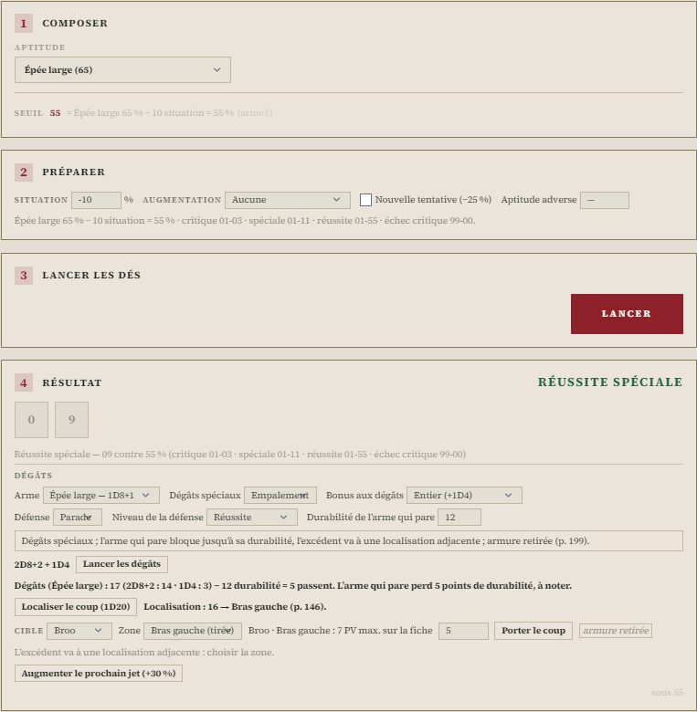

Quand l'aptitude lancée est le score d'une **arme de la feuille** (mêlée, distance ou bouclier),
un bloc **Dégâts** paraît sous le résultat :

- **Arme** : celle du jet, ou une autre arme renseignée ; ses dégâts sont lus sur la fiche.
- **Dégâts spéciaux** : proposés d'après le nom de l'arme et les tables du livre (p. 208-212) —
  une arme de taille et d'estoc (épée large, dague) choisit **empalement ou lacération avant le
  test** (p. 203) ; un nom inconnu se choisit.
- **Bonus aux dégâts** : entier en mêlée, **moitié** pour une arme lancée (javelot, hache de
  lancer, p. 212), **aucun** pour un arc ou une fronde. Si la fiche note les dégâts bonus compris
  (« 1D8+1+1D4 », comme les prétirés), le bonus n'est compté **qu'une fois**, et c'est dit.
- **Défense** : aucune, parade ou esquive, et son niveau. La case de la table du livre — attaques
  contre parades p. 199, esquives p. 201 — s'affiche en une phrase : dégâts normaux, spéciaux ou
  maximaux, armure retirée ou ignorée, excédent vers la zone touchée ou une zone **adjacente**,
  échecs critiques. Une parade demande la **durabilité de l'arme qui pare** : elle bloque jusque-là.

La formule suit le résultat (p. 200-204) :

| Résultat | Dégâts | Armure |
| :--- | :--- | :--- |
| Réussite | arme + bonus — épée large 1D8+1 + 1D4 | retirée |
| Spéciale, empalement ou lacération | dés **et** constante de l'arme doublés, bonus une fois — 2D8+2 + 1D4 | retirée |
| Spéciale, écrasement | arme + bonus + **maximum du bonus** — massue 2D8 + 1D4 + 4 | retirée |
| Critique | **maximum** des dégâts spéciaux + bonus lancé — épée large 18 + 1D4 | **ignorée** |

**Lancer les dégâts** écrit au journal le total, son détail et ce qui passe la parade. Au
meneur, la ligne **Porter le coup** se remplit : les dégâts qui passent, la **zone** (celle du
D20, modifiable pour une zone adjacente) et l'étiquette **armure retirée** ou **armure ignorée**.
Un coup critique traverse l'armure de la zone ; le plafond d'un membre (le double de ses PV)
tient toujours. Une **lacération** qui égale les PV de la zone appelle le test de (CON − dégâts)
×5 pour rester conscient, calculé sur la CON de la cible (p. 204). Un coup porté vide le champ :
il ne se porte pas deux fois.

Les **pertes de durabilité** des armes et les **tables d'échecs critiques** sont annoncées, pas
écrites sur les fiches (choix de David, 03/11).

## La fiche du personnage

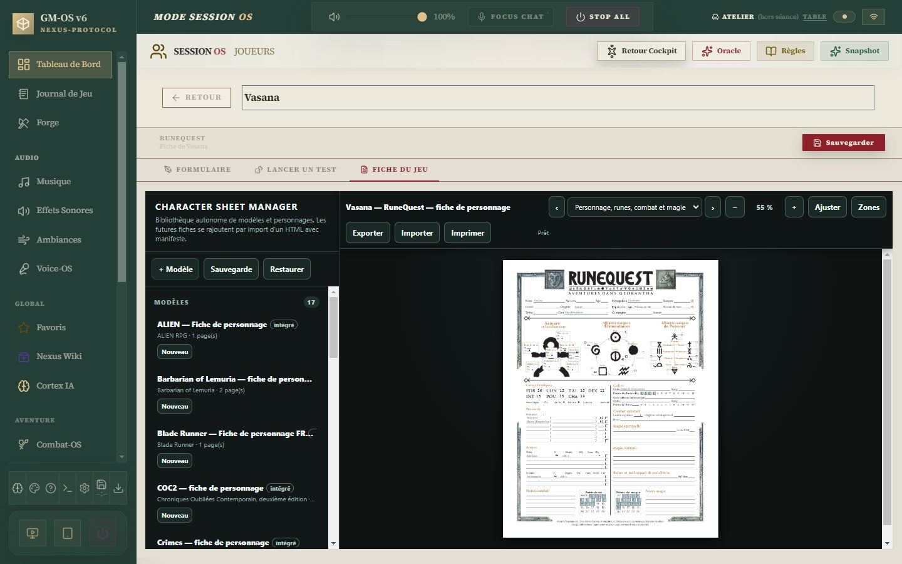

La fiche fidèle au PDF de Deadcrows (`docs/fiches/RuneQuest/`, gabarit `runequest-fr`, quatre
pages, moteur de fiches **version 20**) s'ouvre dans l'onglet **Fiche du jeu**. Ses 735 clés sont
toutes décidées (`docs/systems/runequest/fiche/correspondance.json`) : **327 sont reliées** à la fiche
GM-OS — identité, caractéristiques, attributs, Runes, Passions, compétences, armes, cultes et
points de Rune, localisations, magie, matériel, richesse, notes —, les autres **restent sur la
fiche** : famille, ascendance, compagnon, propriétés, récoltes, états Mort et Inconscient, et les
coches d'expérience. Une saisie GM-OS ne part vers la fiche qu'après **Sauvegarder**.

La fiche GM-OS suit la même feuille (p. 52-63) :

- les **sept caractéristiques** et les **attributs** : points de vie maximum, points de magie
  (le POU), points de Rune, bonus aux dégâts, dégâts de combat spirituel, vitesse de guérison,
  ENC maximum, rangs d'action de DEX et de TAI, déplacement en DÉP (8, soit 24 m) ;
- les **sept modificateurs de catégorie** ;
- les **six Runes élémentaires** et les **cinq paires** de Pouvoir et de Forme — chaque paire
  totalise 100, 50/50 au départ ;
- l'**Honneur** et **sept Passions** avec leur nature et leur sujet (Haine — Empire lunar), et la
  **Réputation** ;
- **deux cultes**, leur rang et leurs points de Rune ;
- les **compétences du livre**, à leur valeur de base (p. 61) ; celles qui se précisent — Monte,
  Langue étrangère, Connaissance du culte, Artisanat, Vénération — se lancent sous le nom saisi ;
- les **compétences d'armes** de la feuille (Dague, Épée large, Arc composite, boucliers, armes
  naturelles et lignes libres) et **quatre armes de mêlée, trois à distance et le bouclier** en
  main, avec dégâts, rang d'action, ENC, durabilité, portée et cadence ;
- les **sept localisations**, points de vie, armure et **dégâts reçus** — ces derniers n'existent
  que dans GM-OS, la feuille n'a pas de case pour eux ;
- les jauges de **points de vie**, **de magie** et **de Rune**, plafonnées par les maximums.

Les dérivés se **proposent** depuis les caractéristiques (carte « Attributs calculés »,
ci-dessous) ; on peut toujours garder une valeur saisie. Les points de vie maximum, le
déplacement et le rang d'action d'une arme à distance n'ont pas de case sur la feuille : ils
vivent dans GM-OS.

### Les attributs calculés

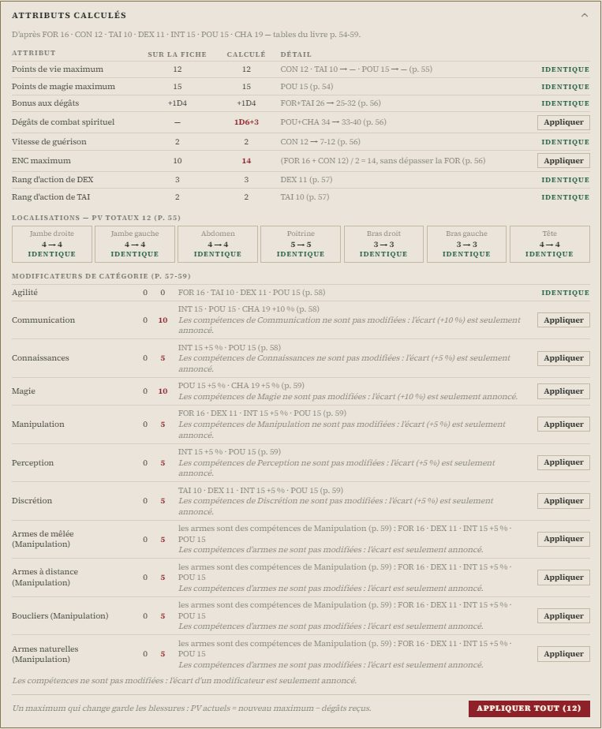

Dans l'onglet **Lancer un test**, la carte **Attributs calculés** reprend les tables du livre
(p. 54-59) : points de vie (CON modifiée par la TAI et le POU), points de vie des sept zones
selon les PV totaux, points de magie (le POU), bonus aux dégâts (FOR + TAI), dégâts de combat
spirituel (POU + CHA), vitesse de guérison (CON), ENC maximum (moyenne de FOR et CON, sans
dépasser la FOR), rangs d'action de DEX et de TAI, et les sept modificateurs de catégorie. Les
modificateurs d'armes que la feuille imprime à part prennent celui de **Manipulation** : le
livre y range toutes les armes (p. 59).

Chaque ligne dit la valeur de la fiche, celle des tables, le **détail** et la page ;
**Appliquer** l'écrit, **Appliquer tout** écrit toutes celles qui diffèrent. Il faut que les
sept caractéristiques soient saisies, et la fiche sauvegardée.

- Un maximum qui change **garde les blessures** : 12 PV dont 3 perdus, passés à 14, en laissent
  11. Les dégâts reçus par les zones ne bougent pas ; seuls leurs maxima changent.
- Les **compétences ne bougent pas** quand un modificateur de catégorie change : leur score mêle
  base, culture, occupation et expérience. L'écart est seulement annoncé.
- Le livre ne dit pas comment arrondir l'ENC quand la moyenne tombe sur une demie : GM-OS
  l'arrondit au plus proche, et le détail le dit.

## Le thème

Le thème `runequest` (papier calcaire clair, encre charbon, titres cinabre, cadre vert-de-gris) s'applique quand il est activé dans la
campagne ; matière, ornements et icônes demandent les **personnalités** allumées dans les
Paramètres. Accepté par le validateur sans erreur ni avertissement.

## Le combat

Combat-OS range les combattants par **rang d'action**, du plus bas au plus haut, selon l'action
que chacun déclare (ci-dessous). La santé suivie est celle des
**points de vie totaux**, plafonnés par la fiche. Les portées sont les catégories de poursuite du
livre, de Côte à côte à Hors de portée (p. 152-153), sans modificateur : celui d'une arme à
distance dépend de sa portée (p. 213).

### Les rangs d'action

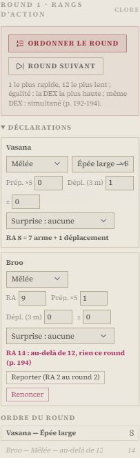

Dans la colonne de Combat-OS, le panneau **Rangs d'action** remplace le tirage d'initiative. Pour
chaque combattant, le meneur déclare l'**action** (p. 192, phase 1) :

| Action | Rang d'action | Exemple du livre |
| :--- | :--- | :--- |
| Mêlée | le **RA de l'arme** noté sur la fiche, qui comprend déjà DEX, TAI et allonge | Vasana, épée large : 7 |
| Tir | le RA de l'arme à distance, la **DEX seule** | son arc composite : 3 |
| Magie spirituelle | RA de DEX + 1 par point de magie au-delà du premier ; **+5** pour passer d'une arme au sort | Démoralisation (2 PM) : 4 |
| Magie runique | RA 1, +1 par point de renforcement au-delà du premier | — |
| Sorcellerie | un round complet, puis le RA de DEX du round suivant, **+2 par PM supplémentaire** | Damastol, 7 PM : RA 5, deux rounds plus tard |

S'y ajoutent les délais du round : **+5** par arme ou sort à préparer (dégainer, recharger), **+1**
par tranche de 3 m de déplacement, la **surprise** (+3 à moins de 3 m, +1 de 4 à 9 m), et un
ajustement libre (p. 192-195, 386). Sans RA d'arme sur la fiche — un adversaire —, on le saisit ;
à défaut, DEX + TAI, sans l'allonge, et c'est dit.

**Ordonner le round** range le plateau du RA 1 au RA 12 ; à égalité, la **DEX la plus haute**
d'abord ; à DEX égale, les deux actions sont **simultanées**, sans dé (p. 192). L'ordre va au
journal.

**Au-delà de 12, rien ne s'exécute dans le round** (p. 194) : la ligne passe en rouge et le
combattant reste en fin de plateau. Le meneur décide : **Reporter** l'action au round suivant
(RA réduit de 12), ou **Renoncer**. Un sort se poursuit : **Poursuivre** le place où il agit —
37 RA font trois rounds complets et un effet au RA 1 du quatrième. **Round suivant** garde les
intentions et efface les délais.

### Les coups localisés

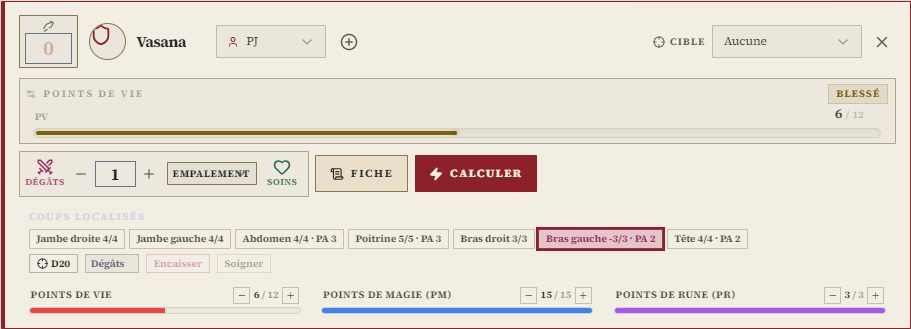

Sous la santé de chaque combattant — PJ, PNJ ou adversaire fabriqué —, les **sept zones** avec
leurs points de vie restants et leur armure (PA). La teinte dit l'état : entamée, hors d'usage,
au double.

1. **Choisir la zone** : **D20** sur la table du livre, ou un clic sur la zone.
2. **Saisir les dégâts** du jet, armure **non** retirée, puis **Encaisser**.

GM-OS fait le reste, d'après le livre (p. 146-148) :

- **l'armure** de la zone se retire ;
- **un membre** (bras, jambe) ne prend jamais plus du **double** de ses points de vie en un
  coup : l'excédent est perdu, total compris — un bras à 2 points touché pour 5 n'en perd que 4 ;
- la **zone** et le **total** perdent ce qui reste, la carte et la jauge suivent ;
- **l'effet** se dit, au message et au journal :

| La zone a perdu… | Membre | Tête, poitrine, abdomen |
| :--- | :--- | :--- |
| ses points de vie | hors d'usage : la jambe fait tomber, le bras lâche ce qu'il tient | abdomen : les jambes ; poitrine : ni agir ni se soigner ; tête : inconscient — tous mortels sans soin |
| le double | **en un seul coup** : neutralisé, en état de choc | **coups cumulés** : inconscient, −1 PV par round |
| le triple, **en un seul coup** | tranché, hors combat | mort sur le coup |

Au total, **1 ou 2 points** : inconscient ; **0 ou moins** : mort à la fin du round, sauf soin
(p. 146-147) — la carte l'écrit en rouge.

**Soigner** rend des points à la zone choisie **et** au total, jamais plus que la zone n'a perdu.

Les boutons **Dégâts** et **Soins** du panneau de santé restent ceux du **total seul** : un
poison, une chute, une hémorragie ne visent pas de zone (« sauf cas particuliers », p. 146).

## Ce qui reste à la table

- **La durabilité des armes** et les **tables d'échecs critiques** : le bloc des dégâts les
  annonce, la meneuse les note (p. 198-200).
- **L'arme fichée** d'un empalement (la dégager, ½ dégâts par round en se déplaçant, p. 203-204)
  et les **attaques divisées** au-delà de 100 % (p. 202).
- **Les effets d'un sort**, sa portée et sa durée : GM-OS paie le sort, la meneuse dit ce qu'il
  fait (p. 254, 313-314). La limite de magie spirituelle (CHA) et l'INT libre se surveillent à la
  table.
- **Les effets d'une localisation** se disent, ils ne s'appliquent pas seuls : le combat au sol
  (attaque divisée par deux, +40 % pour l'adversaire), l'hémorragie et ses minutes, le PV perdu
  à chaque round d'une tête au double se jouent à la table (p. 147-148).
