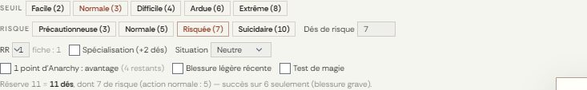
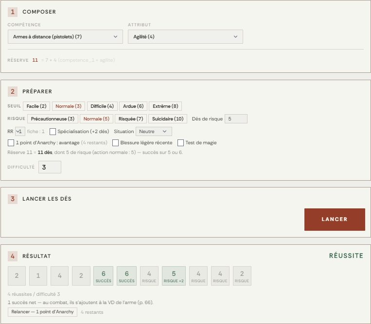
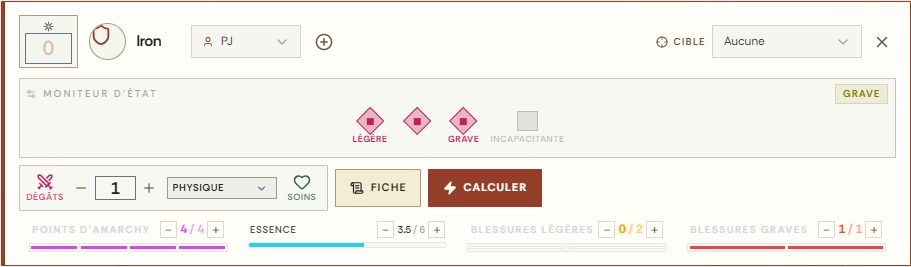
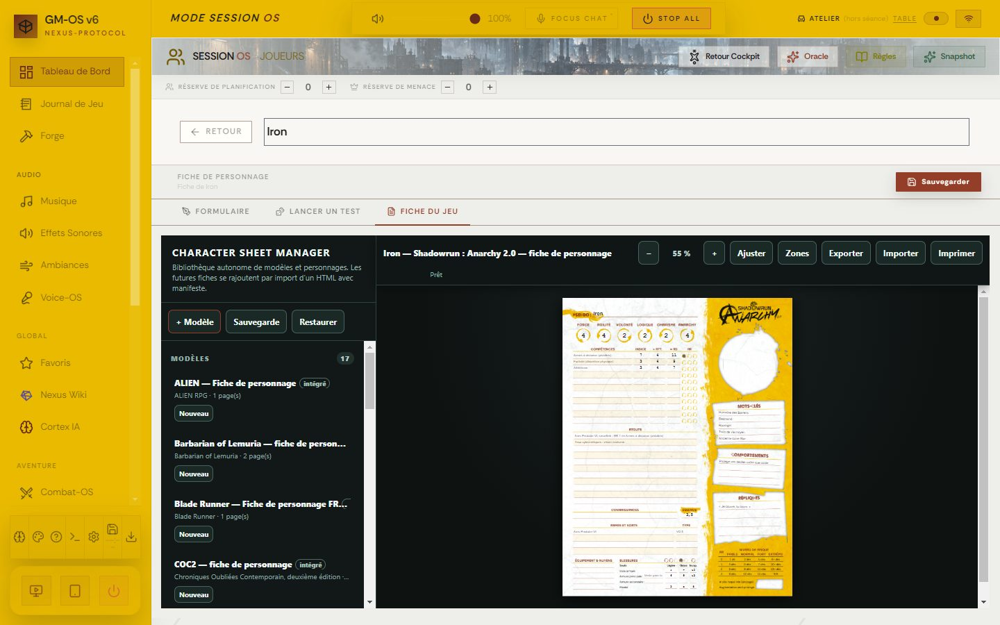
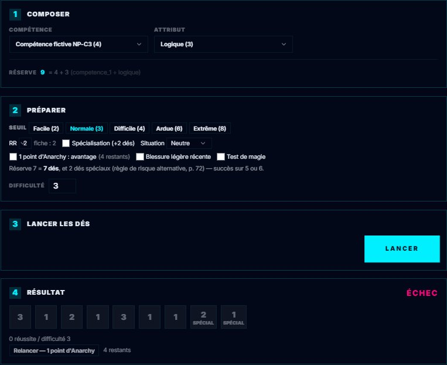

# 🕶️ Jeu — Shadowrun : Anarchy 2.0

> **Pilote décrit :** « Shadowrun: Anarchy 2.0 », forgé par David, exporté le 2026-10-31, **fini le
> 2026-10-31**, version 2.0.0 (`Export Dirvers/corriges/SR_Anarchy_driver_gmos_finir.gmos-driver`,
> construit par `outils/shadowrun-anarchy/finir_shadowrun.py`). Thème `shadowrun-anarchy`, fiche de
> personnage HTML, bannière et identité livrés le même jour par Codex. Retour à
> [Les jeux et leurs mécaniques](./53-Les-jeux-et-leurs-mecaniques.md).

Un seul geste : le **test**. On lance autant de d6 que **compétence + attribut**, chaque **5 ou 6**
est un succès, et il en faut autant que le **seuil**. Ce qui fait le jeu, c'est le **risque** : le
joueur remplace des dés par des **dés de risque**, dont les succès comptent double et dont les 1
provoquent des complications. Autour : les **points d'Anarchy**, le **moniteur d'état** (deux
blessures légères, une grave, une incapacitante) et la fiche HTML, reliée champ par champ.

> Règles relues contre le livre de base `sran2_01anarchyv2_web_v1` le 2026-10-31 — pages imprimées
> 50-72, 77-81 et 127 (PDF = page + 2).

**Réimporter le pilote avec « Remplacer ».** Le pilote forgé additionnait la compétence et
l'attribut pour en faire le **seuil de chaque dé** — 9 sur un d6 —, ne lançait **aucun dé** et
exigeait trois succès : **tous les tests échouaient**. Il vendait aussi des dés contre la réserve de
planification, ce que le livre ne prévoit pas. La version 2.0.0 garde son identifiant, mais **sa
fiche change** : onze lignes de compétence (libellé, indice, attribut, réserve, RR), cinq mots-clés,
quatre comportements et quatre répliques, onze atouts, quatre armes ou sorts, les seuils de blessure
et trois compteurs de blessures remplacent les zones de texte du pilote forgé. Les attributs,
`competence_1` à `competence_5`, l'Anarchy, l'Essence, le pseudo, le métatype et les connaissances
gardent leur identifiant ; un personnage créé avec la fiche forgée garde ces valeurs, mais le
libellé de ses compétences, ses atouts et son équipement sont à ressaisir.

**Anciennes fiches — NP-C2, 03/11/2026.** Le meneur peut maintenant préparer une
[reprise avec aperçu et sauvegarde](./63-Fiche-de-personnage-HTML.md#reprendre-une-ancienne-fiche)
depuis le formulaire du PJ. Les anciennes clés restent présentes ; les correspondances se
choisissent explicitement, sans déduire une conversion de leurs noms. Les notes et la santé
ne sont pas remises à zéro. L'import d'une campagne conserve un pilote de même ID et signale
les différences ; pour changer ce pilote, importer son .gmos-driver avec **Remplacer**.
252 tests ciblés et six parcours Electron passent le 03/11 ; huit captures relues.
Validation globale de David : « ok tout est testé, commit et pousse ».

---

## Le test

- **Composer** : une **compétence** de la fiche, sous son libellé — « Armes à distance (pistolets)
  (7) » —, et un **attribut**. Sans la compétence, elle vaut 0 (p. 64).
- **Préparer** :
  - le **seuil** : Facile 2, Normale 3 (par défaut), Difficile 4, Ardue 6, Extrême 8 (p. 64) ; en
    **test opposé**, le nombre de succès de l'adversaire ;
  - les **dés de risque** : les raccourcis sont la table « Combien prendre de dés de risque ? »
    (p. 71) à la RR du moment — précautionneuse, normale, risquée, suicidaire —, et le champ en prend
    autant qu'on veut, de 0 à toute la réserve. L'action **normale** est le défaut du livre ;
  - la **RR** : proposée d'après la ligne de la compétence (« fiche : 1 »), corrigeable si l'atout
    ne s'applique pas ; elle ignore autant de 1 de risque, trois au plus (p. 71) ;
  - la **spécialisation** : +2 dés (p. 52) ;
  - la **situation** : avantage (4+ réussit) ou désavantage (6 seul) (p. 65) ;
  - **1 point d'Anarchy : avantage** — déclaré avant le jet, retiré de la fiche au lancer (p. 77) ;
  - **Blessure légère récente** : désavantage jusqu'à la fin de la prochaine narration (p. 68) ;
  - **Test de magie** : l'Essence annule un succès à 5 ou moins, deux à 3 ou moins (p. 60).
- La réserve ne change **jamais** (p. 64) : les circonstances déplacent la valeur du succès, et
  avantages et désavantages s'annulent sans dépasser un. Une **blessure grave** sur la fiche impose
  le désavantage d'elle-même ; une **incapacitante** fait dire au panneau que le test est impossible.

| Résultat | Quand (p. 64, 70) |
| :--- | :--- |
| **Réussite exceptionnelle** | le seuil atteint avec **4 succès nets** ou plus |
| **Réussite** | les succès — ceux des dés de risque comptés double — atteignent le seuil |
| **Échec** | ils restent en dessous, ou un **désastre** survient |

| 1 sur les dés de risque, RR retirée | Complication (p. 70) |
| :--- | :--- |
| un | **mineure** : un petit imprévu, le test reste ce qu'il est |
| deux | **critique** : un effet grave pour la scène ; le meneur peut forcer l'échec — **+1 point d'Anarchy** |
| trois et plus | **désastre** : l'équipe change ses plans, le test échoue — **+2 points d'Anarchy** |

Les 1 des dés normaux n'ont aucun effet. Sous le résultat, **Relancer — 1 point d'Anarchy** relance
tous les dés, avec les mêmes dés de risque et le même (dés)avantage ; la complication du premier jet
**reste**, et un jet sans complication n'en gagne pas (p. 77). Le journal dit chaque mouvement
d'Anarchy.

> **Règle de risque alternative** (p. 72) : `jet.shadowrun.risqueAlternatif: true` remplace les dés
> de risque par un **dé spécial** par niveau de RR, ajouté à la réserve, qui vaut −1 à 3 succès ;
> deux 1 consécutifs font une complication critique, trois un désastre, jamais de mineure. Le pilote
> livré garde la règle standard.

## Le moniteur d'état

Dans Combat-OS, la valeur des **Dégâts** est la **VD finale**, succès nets compris. Elle se compare
aux **seuils** de la fiche, selon le type : **physique** (armure principale), **armure secondaire**,
**sans armure**, **mental**. Vides, ils se calculent sur la Force ou la Volonté seule. Il faut les
**dépasser**, et un coup ne fait qu'une blessure (p. 68) :

| VD | Blessure | Effet (p. 68) |
| :--- | :--- | :--- |
| > seuil léger | **légère** | désavantage jusqu'à la fin de la prochaine narration |
| > seuil léger + 3 | **grave** | désavantage jusqu'à ce que les graves soient soignées |
| > seuil léger + 6 | **incapacitante** | ni action ni déplacement ; mourant si la blessure est létale |

Une case pleine passe au **degré supérieur** : la troisième légère devient grave, la quatrième
incapacitante (p. 69). Un atout porte les légères à trois et les graves à deux : les champs
« Cases de blessures légères » et « Cases de blessures graves » de la fiche.

Les **compteurs** de la fiche font foi — les jauges « Blessures légères » et « Blessures graves »
de la carte les montrent. Les quatre **cases** de la carte disent la **pire** blessure : une grave
seule allume aussi les deux cases légères devant elle. **Soins** efface la blessure la plus grave
d'abord, dans l'ordre de la guérison naturelle (p. 70) ; le seuil d'un soin monte d'un succès à
Essence 4 ou moins, de deux à 2 ou moins (p. 60).

## Les points d'Anarchy

4 par scénario pour un humain, 3 pour les autres métatypes, sans plafond en cours de partie (p. 77).
Le panneau en dépense pour l'**avantage** et la **relance**, et en ajoute pour une **complication
critique** (+1) ou un **désastre** (+2). Les autres gains — un comportement joué à ses dépens, une
idée inspirante, une décision arbitraire du meneur — et les autres dépenses — action supplémentaire,
effet spécial, équipement temporaire, flashback (1 à 4) — se font sur la jauge de la carte.

La **réserve de planification** (joueurs) et la **réserve de menace** (meneur, narration partagée
totale, p. 127) sont au bandeau des réserves.

## La fiche du jeu

La fiche HTML `shadowrun-anarchy2-fr` (une page) est intégrée au moteur et reliée : ses 120 clés de
valeur ont chacune leur champ dans GM-OS (`docs/systems/shadowrun-anarchy/fiche/correspondance.json`).
Le portrait reste sur la fiche. Une saisie GM-OS ne part vers la fiche HTML qu'après
**Sauvegarder**. Le métatype, le train de vie, les capacités du moniteur et sa position n'existent
que dans GM-OS.

## L'option de risque alternative

Une variante de pilote activant la règle de risque alternative affiche les dés spéciaux
à la place des dés de risque (p. 72). L'import avec **Remplacer**, le lancer et le retour
au standard ont été éprouvés le 03/11 sur une copie jetable du pilote ; aucune variante
officielle ajoutée au dépôt. Les personnages et leurs valeurs restent conservés.

## Ce qui n'est pas automatisé

- L'**ordre des narrations** se décide à la table (p. 66) : pas de jet d'initiative.
- Le **drain**, le **piratage** et la surveillance de DIEU : les seuils et les dés de risque minimum
  du piratage sont sur la fiche, à appliquer à la main.
- Les variantes « plus sombre » (p. 69) : blessures légères qui durent, guérison plus lente.
- Les **dommages des véhicules** (Structure × 2, × 3) : le meneur saisit la gravité à la main.

## Les campagnes de recette

Lot du **01/11/2026**, dans `output/campagnes-tests/shadowrun-anarchy/` : importer d’abord
**01-La-Derniere-Couleur.gmos**, mission originale de deux à quatre séances pour Vif,
Prisme et Sillage. Les trois joueurs existants sont conservés. Deux laboratoires indépendants
complètent la mission : **02-Moniteur-et-Seuils.gmos** et **03-Risque-Anarchy-et-Matrice.gmos**.
Pour remettre un laboratoire à zéro, réimporter uniquement celui-ci avec **Remplacer**.

Le ZIP contient les archives, les médias embarqués, la matrice, les **64 cas humains** et le
CSV vierge. **22 nouveaux PJ**, profils aux valeurs choisies hors budget novice officiel.
Les imports, le remplacement isolé et les trois Hub ont été éprouvés en instance jetable,
avec jets et sauvegarde de la fiche HTML. **GM-05 reste en échec : des secrets de séance
sont transmis aux Hub joueurs** ; marqueurs fictifs uniquement dans la recette.
Voir le rapport et les anomalies du lot. Partie complète, matériel et cas humains restent à jouer.
