# 🖖 Jeu — Star Trek

> **Pilote décrit :** « Star Trek », exporté le 2026-10-14 ; module LCARS 0.5.0 relu le 2026-10-16 ; paiement au choix le 2026-10-22 ; **toutes les améliorations le 2026-10-23**, version 2.0.0 : la tâche complète, le Stress et les blessures, la Réputation, l'alternance des camps, la Menace par personnage, et le module **Bataille spatiale et tâches étendues** (`Export Dirvers/corriges/ST_driver_gmos_finir.gmos-driver`). Retour à [Les jeux et leurs mécaniques](./53-Les-jeux-et-leurs-mecaniques.md).

> Règles relues contre le **Livre de Base de la deuxième édition** le 2026-10-23 (pages imprimées 132, 166–178,
> 185–191, 226–228, 241–243, 250–313, 329–333), et le corpus `docs/systems/star-trek/` corrigé d'après lui.

Star Trek Adventures, deuxième édition : le système 2d20, comme [Dune](./54-Jeu-Dune.md), avec un Attribut
et une Fonction.

---

## L'Impulsion et la Menace

| Réserve | Ce qu'elle fait dans GM-OS |
| :--- | :--- |
| **Impulsion** (0 à 6, aux joueurs) | Chaque **réussite excédentaire** l'alimente ; elle paie les dés achetés. **« Fin de scène »** lui retire un point ; **« Nouveau scénario »** la remet à 0 (p. 259). Les joueurs la voient et la dépensent depuis leur tablette |
| **Menace** (au meneur, sans plafond) | Visible des joueurs. **Un dé acheté sans Impulsion se paie en Menace** — ou **par choix** du joueur, même avec de l'Impulsion |

> **La Menace de départ** (2026-10-23) : **« Nouveau scénario »** la remet à **deux points par
> personnage joueur** de la campagne, et la confirmation dit le calcul (« Menace revient à 8 (2 × 4
> personnages) », p. 264). Ajustez ensuite au ton de la mission.
>
> **« Début de séance »** remet la **Détermination** de chaque personnage à 1 (p. 168), même s'il en
> avait davantage.

---

## Le jet

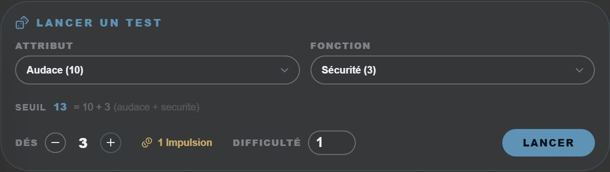

- On retient un **Attribut** et une **Fonction** : leur somme est le **seuil**.
- **2d20** sous le seuil ; un **1** vaut deux réussites, un **20** est une complication.
- **Spécialisation** : cochez la case quand la tâche entre dans une spécialisation du personnage
  (le *Focus* de l’édition anglaise). Chaque dé **inférieur ou égal à la Fonction** vaut alors deux
  réussites ; la borne s’affiche à côté de la case, « critique ≤ 4 ».
- Les dés achetés coûtent 1, 2 puis 3 points d'Impulsion, jusqu'à 5 dés.
- **« Dont en Menace »** : le joueur peut payer tout ou partie de ces dés en Menace, même quand
  l'Impulsion suffirait (décision du 22/10 ; le livre le permet pour l'aide d'un équipier). À 0,
  l'Impulsion d'abord et le manque en Menace. Le journal dit « payés en Menace par choix ».
- La **difficulté** (0 à 5) est le nombre de réussites à atteindre. Ce que la réserve, pleine, ne
  peut pas garder de l'excédent reste sur le test : « Dépenser un point » ou « Verser à la
  réserve ».
- Au **pupitre** et à la **télécommande**, le dernier jet se règle aussi : « un personnage » paie en
  Impulsion et la remplit, « un PNJ » paie en Menace et la nourrit (voir le guide de Dice-OS).

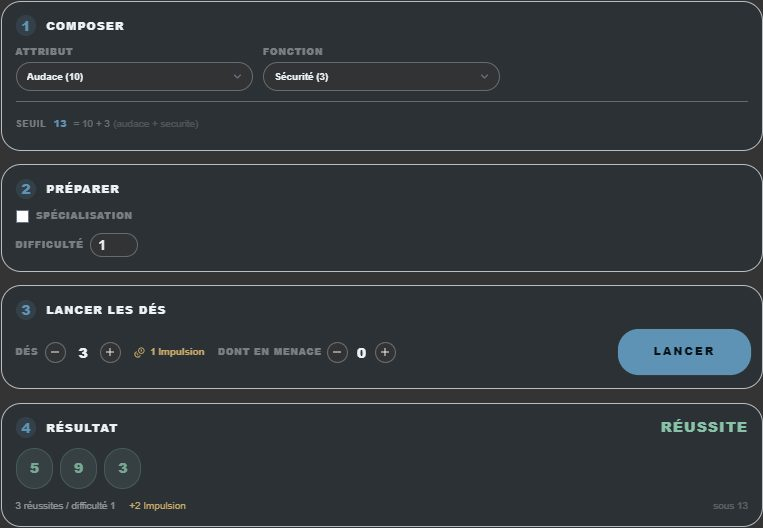

### La tâche complète

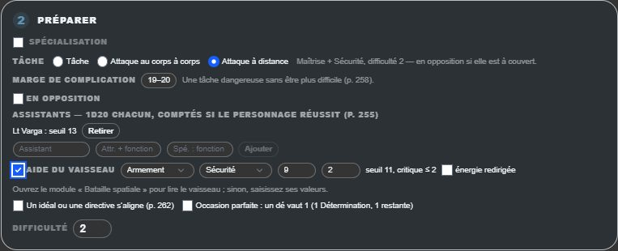

À l'étape **Préparer** (2026-10-23) :

- **Tâche, attaque au corps à corps, attaque à distance** : l'attaque règle l'attribut, la fonction et la
  difficulté du livre — Audace + Sécurité, difficulté 1 ; Maîtrise + Sécurité, difficulté 2 (p. 290).
- **Marge de complication** : de 20 seul à 16–20, pour une tâche plus dangereuse sans être plus
  difficile (p. 258).
- **En opposition** : le réactif lance d'abord ; ses réussites, moins les facteurs qui le gênent, font la
  difficulté (p. 256–258).
- **Assistants** : chacun lance un d20 à son propre seuil (attribut + fonction), avec sa spécialisation ;
  leurs réussites comptent **si le personnage en obtient au moins une**. Le premier est gratuit, les
  suivants coûtent 1 Impulsion chacun, payée au lancer (p. 255).
- **Aide du vaisseau** : un d20 au seuil système + fonction du vaisseau, qui a toujours la spécialisation
  (sous la fonction, deux réussites). Les valeurs se lisent dans le module **Bataille spatiale** quand il
  tient le vaisseau de l'équipage ; sinon, saisissez-les. **Énergie redirigée** : le dé vaut 1 (p. 178, 185).
- **Un idéal ou une directive s'aligne** : la Détermination devient utilisable ; **Occasion parfaite**
  fait d'un dé un 1, pour un point (p. 262).
- **Difficulté 0** : « Réussie sans lancer » la consigne, sans Impulsion ni complication (p. 254).

Les dés d'aide portent leur nom sous le dé, et le compte dit ce qu'ils ont donné — ou pourquoi ils ne
comptent pas.

### Après le lancer

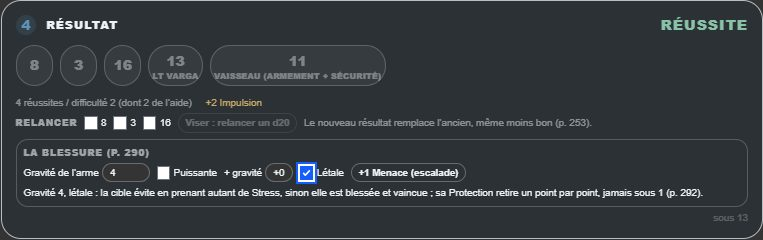

- **Repousser une complication** : +2 Menace par complication (p. 258).
- **Réussite mitigée** (au meneur) : réussie avec une complication de plus, sans Impulsion à dépenser (p. 259).
- **Relancer** : cochez les dés. **Éclair d'inspiration** (1 Détermination, avec un idéal) relance ceux
  qu'on veut ; **Viser**, sur une attaque, relance un d20. Le nouveau résultat remplace l'ancien, même
  moins bon ; l'Impulsion déjà versée suit le nouveau compte (p. 253, 262, 288).
- **En opposition, échouée** : le réactif gagne l'Impulsion manquante ; un PNJ la change en Menace.
- **La blessure** d'une attaque réussie : la gravité de l'arme, +1 pour 2 Impulsion (1 si Puissante),
  deux fois au plus, et **Létale** : +1 Menace pour l'escalade (p. 290).

---

## Combat et santé

- **L'ordre du tour** : les **camps alternent** (p. 277). Le meneur donne le premier tour à un PJ ;
  **garder l'initiative** coûte 2 Impulsion, et l'allié qui la reçoit doit céder ensuite (deux tours
  d'affilée au plus). Le panneau d'alternance du combat les tient ; 1 Menace donne le premier tour à un
  PNJ, à la main.
- **Santé :** le modèle « blessures » au combat ; le **Stress**, la **Détermination** et la
  **Réputation** sont suivis sur chaque carte de combattant.
- **Distances** en zones.

### Stress et blessures

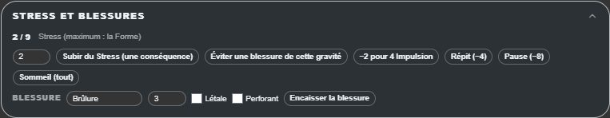

La carte, sous le panneau de jet :

- **Stress** : maximum la **Forme** (ou le « Stress maximum » de la fiche, quand un talent l'a changé).
  **Subir du Stress** au lieu d'une conséquence ; **éviter une blessure** en prenant autant de Stress que
  sa gravité. Plein, le personnage est **épuisé** : difficulté +1, un attribut bloqué, choisi sur la carte
  (p. 277–278). Le réduire : 2 Impulsion par case (trois au plus), **Répit** −4, **Pause** −8, **Sommeil**
  tout (p. 278).
- **Blessure** : un nom (Brûlure…), une gravité — la **Protection** de la fiche la réduit, jamais sous 1 ;
  Perforant l'ignore —, létale ou étourdissante. Blessé, le personnage est **vaincu** ; vaincu avec une
  blessure létale, il est **mourant** et meurt à la fin de la scène si personne ne le soigne (p. 292).
- **Soins** : premiers secours (Audace + Médecine, difficulté 2 : il n'est plus vaincu) ; traiter
  (difficulté égale à la gravité, les pénalités s'annulent ; une complication la rouvre) ; guérir
  (intervention de Maîtrise + Médecine, difficulté égale à la gravité, +1 si elle n'a pas été traitée,
  autant d'heures). « Fin de l'étourdissement » efface les blessures étourdissantes.

### La Réputation de fin de mission — au meneur

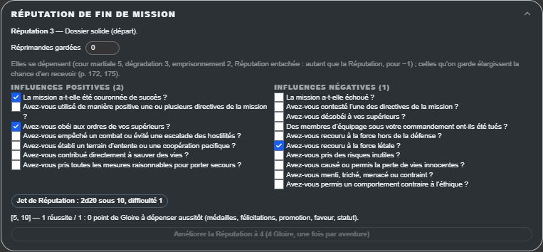

Les questions du livre en cases à cocher (p. 171), puis **le jet** : autant de d20 que d'influences
positives, sous 7 + Réputation (deux réussites sous la Réputation), difficulté égale aux négatives. Au-delà,
des points de **Gloire**, à dépenser aussitôt ; « Améliorer la Réputation » coûte autant de Gloire que le
niveau visé, une fois par aventure (p. 172). En deçà, des **Réprimandes** : une par réussite manquante, plus
une par 20 ; celles qu'on garde se notent sur la carte et élargissent la chance d'en recevoir.

### Création et progression — au meneur

Un contrôle sans écriture : un attribut au plus à 12 (de 7 à 12), une fonction au plus à 5 (p. 132) ; et les
plafonds d'un jalon (11 et 4) ou d'un arc narratif (12 et 5).

### Le tour de conflit

Une carte de rappels : actions majeure et mineure, garder l'initiative, les attaques, l'escalade, éviter une
blessure, le contact, à terre, viser.

---

## Bataille spatiale et tâches étendues — un module du jeu

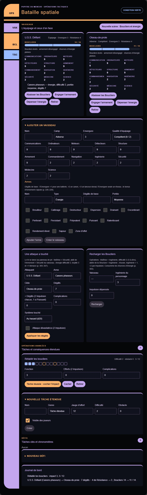

Dans **Cockpit › Modules du jeu**, à côté de LCARS, **Bataille spatiale et tâches étendues** a le même
habillage. Le meneur y tient ce que la table partage ; les tablettes, quand il leur ouvre l'accès, voient le
vaisseau de l'équipage en entier, ceux d'en face de loin (Boucliers en pour cent, brèches), et les tâches
qu'il montre.

- **Les vaisseaux** : six systèmes, six fonctions, l'Envergure ; la **Résistance** (moitié de
  l'Envergure, plus le bonus de Structure) et les **Boucliers** (Structure + Envergure + Sécurité) se
  calculent (p. 185). Pour un vaisseau adverse, la **qualité d'équipage** donne l'attribut et la fonction de
  ses tâches (p. 296). Les **armes** : énergie (difficulté 2) ou torpille (difficulté 3, +1 Menace), leurs
  dégâts de base plus le bonus d'Armement, leurs qualités (p. 226–228).
- **Une attaque a touché** : le tir se lance **au panneau de jet** (Maîtrise + Sécurité, aidé de
  l'Armement + Sécurité) ; le pupitre applique ses dégâts — l'Impulsion en plus, les complications en
  moins, la Résistance (Perforant l'ignore), le système touché au hasard (d20) ou choisi, l'attaque
  dévastatrice. Les Boucliers encaissent : **sous la moitié, secoué** (au d20, ou la position de sécurité
  pour un PNJ) ; **sous le quart dans le même coup, une brèche** ; **à zéro, une de plus** et ils
  tombent ; déjà à zéro, chaque coup est une brèche (p. 308–309). *Les trois seuils se cumulent dans l'ordre
  du livre : un coup qui fait passer les Boucliers de 18 à 0 secoue et ouvre deux brèches.*
- **Les brèches** se colmatent (les pénalités s'annulent) puis se réparent après la bataille. Un système
  est **détruit** à la moitié de l'Envergure ; au-delà de l'Envergure, **dégâts critiques**, et la brèche
  suivante détruit le vaisseau ; Moteurs détruits, le **noyau de distorsion** se lance à chaque fin de
  round (p. 311).
- **Recharger les Boucliers** (Ingénierie du personnage + 1, +2 par Impulsion) consomme les réserves
  d'énergie ; **Nouvelle scène** remet Boucliers et énergie (p. 185, 303, 308).
- **Tâches étendues** : jauge d'effort, difficulté, obstacle, avancées à la moitié et aux trois quarts ;
  « Tâche réussie » coche l'impact — la fonction moins l'obstacle, jamais sous 1, +1 par effort (2
  Impulsion), −1 par complication. **Conséquences étendues** : la jauge d'achoppement monte de son impact,
  +1 par Menace, trois au plus (p. 271–272, 329–331).
- **Défis** : des tâches clés à cocher, et des **intervalles** pour les chronométrer — une tâche en
  consomme 2, 1 avec 2 Impulsion, une complication en ajoute (p. 268–270, 333).

---

## Ce qui reste à la main

- Le **choix des actions de poste** en bataille (éviter, se défendre, manœuvrer…) : leurs tâches se lancent
  au panneau ; leur effet se règle au pupitre (secousse, Boucliers) ou de vive voix.
- Les **talents** des personnages et des vaisseaux : leurs noms sont libres, GM-OS n'en interprète aucun.
- Les **complications doublées** d'une énergie redirigée (p. 185) et les **dés d'aide relancés** par la
  Détermination : à compter à la main.
- Les **PNJ** : Stress et blessures selon leur rang (mineur, notable, majeur, p. 278, 291) — leur carte de
  combat.
- Les **différends sociaux** (tromperie, preuve, intimidation, négociation, p. 279–283) : des tâches en
  opposition et des traits.

---

## LCARS — la passerelle dans le Tablet Hub

Dans **Bibliothèque des modèles › pilote Star Trek › Modules du jeu**, sélectionnez
**LCARS — Passerelle**. Le choix accompagne l’export/import du pilote. Un ancien pilote
Star Trek ne l’active pas automatiquement : il faut le sélectionner une première fois.

Dans **Cockpit › Modules du jeu**, ouvrez le pupitre LCARS. Vous pouvez préparer le
vaisseau, ses éléments et ses rapports avant de commencer la séance.

1. Dans **Passerelle**, choisissez un **Personnage à préparer**, puis **Préparer ce personnage**.
2. Attribuez-lui une ou plusieurs consoles. Les noms viennent des personnages de la campagne.
3. Démarrez la séance, puis cochez les personnages dans **Accès des personnages**, au-dessus
   du pupitre. Préparer un poste et ouvrir LCARS sont deux décisions séparées du meneur.
4. Sur la tablette, ouvrez **Modules du jeu › LCARS — Passerelle**. Seules les consoles
   attribuées au personnage apparaissent. Sans poste, il peut consulter les rapports communs.

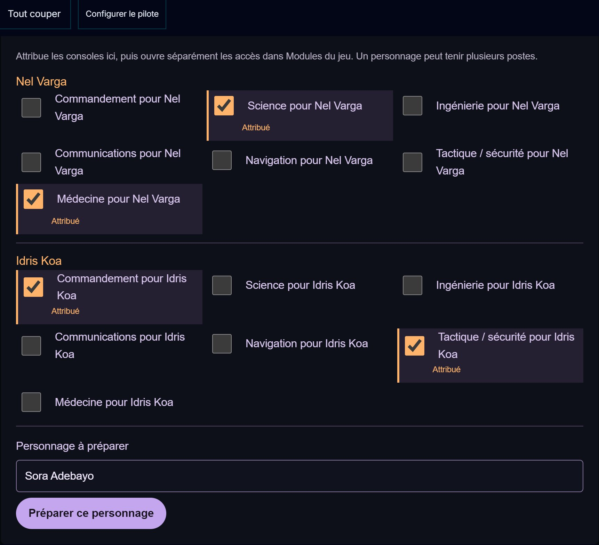

| Console | Ce qu’elle présente et permet de proposer |
| --- | --- |
| Commandement | Objectifs et suivi des ordres ; rapport de situation, proposition d’alerte et ordres avec accusés de lecture. |
| Science | Capteurs et contacts ; scan ou analyse ciblée. |
| Ingénierie | Coque et circuits ; diagnostic, réparation ou reconfiguration. |
| Communications | Canaux et récepteur ; ouverture de liaison, décodage ou transmission. |
| Navigation | Carte et itinéraires ; cap, évitement ou passage en distorsion. |
| Tactique / sécurité | Secteurs et contacts ; identification, verrouillage proposé ou intervention. |
| Médecine | Dossiers et examen ; diagnostic, analyse ou soins proposés. |

Les schémas sont illustratifs ; les états sont définis par le meneur. LCARS ne calcule ni
réussite, dégâts, boucliers ou soins, et ne modifie pas les réserves de la partie.

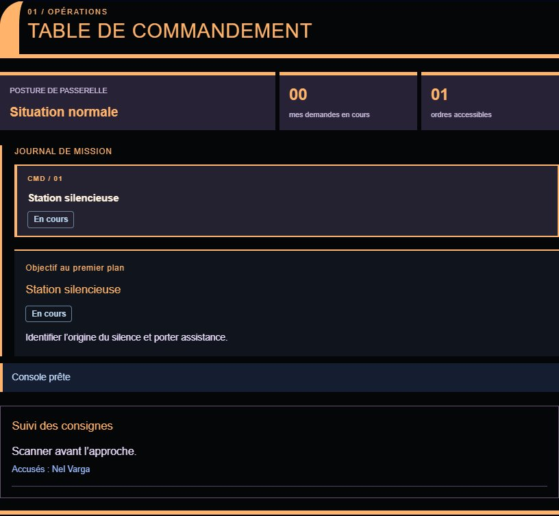

### Reconnaître les sept instruments

Chaque console a son écran. Touchez une fiche pour la sélectionner aussi dans le formulaire
d’intervention. Sur téléphone, les parties s’empilent et défilent ; les commandes restent
accessibles en faisant défiler la zone centrale du Hub.

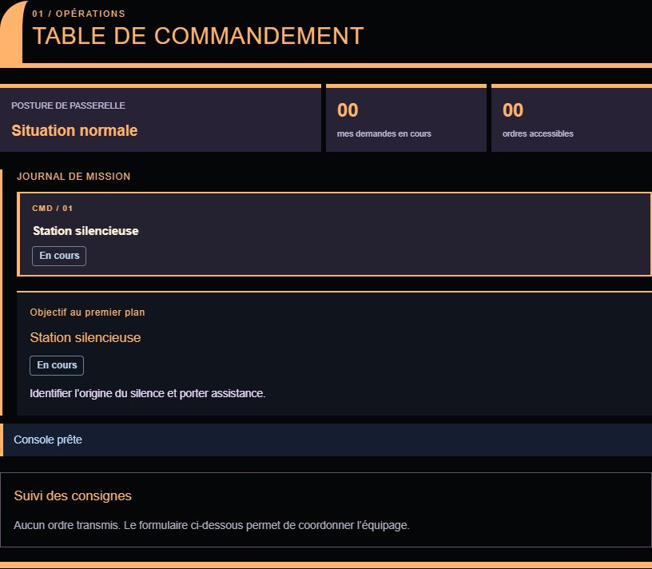

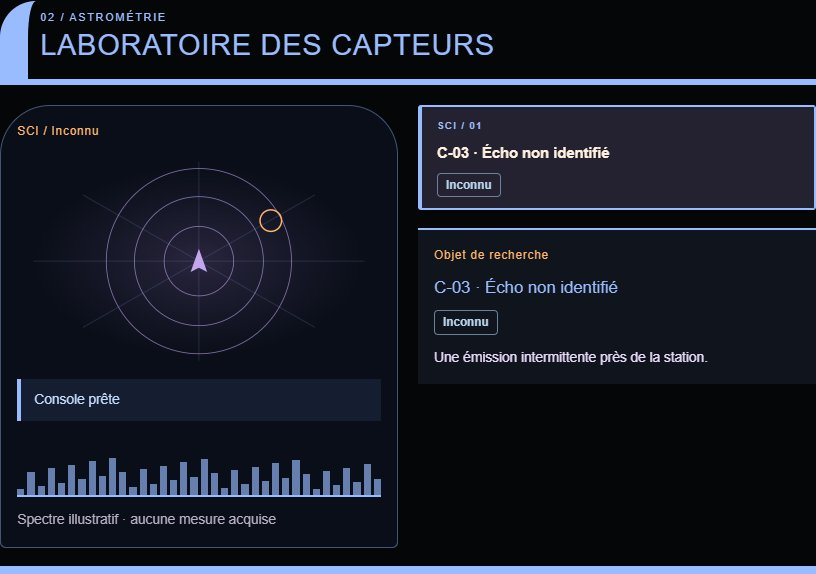

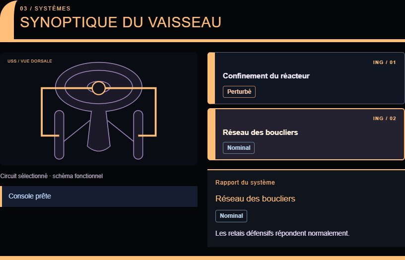

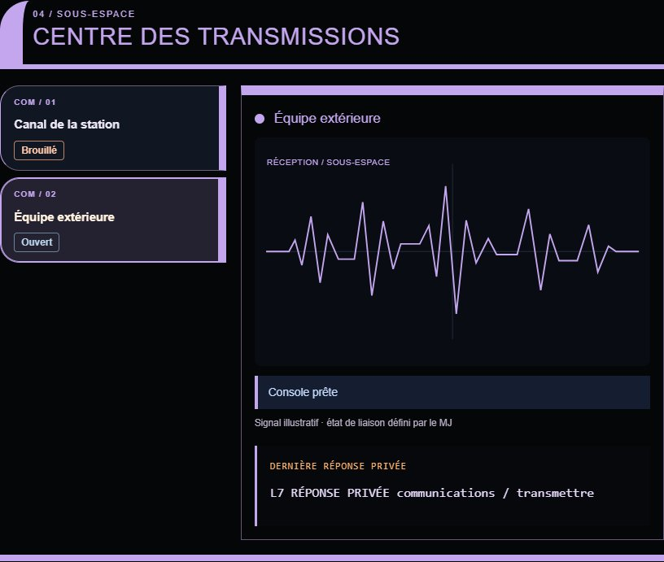

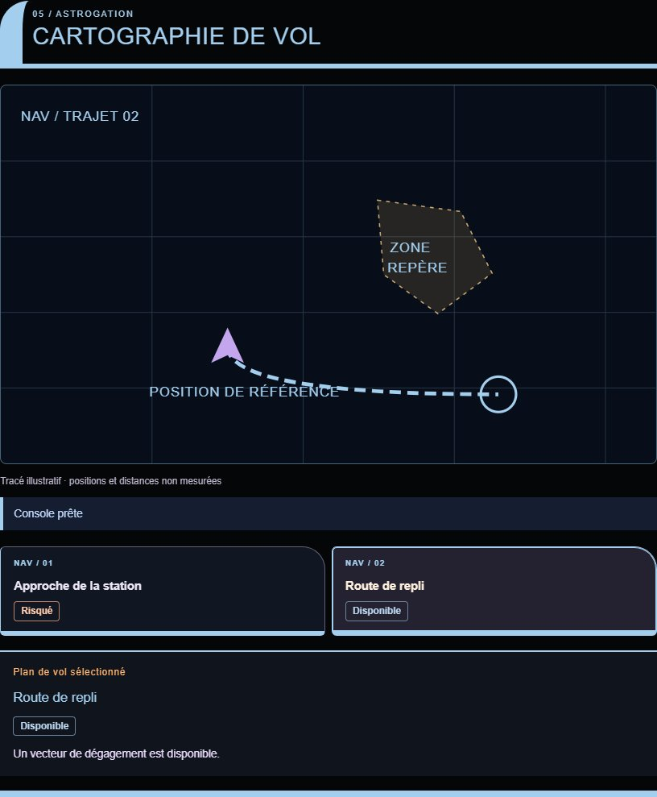

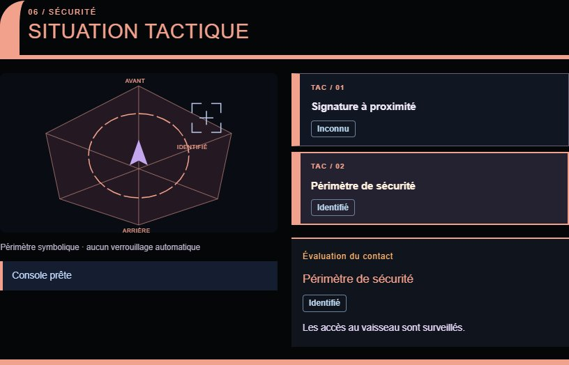

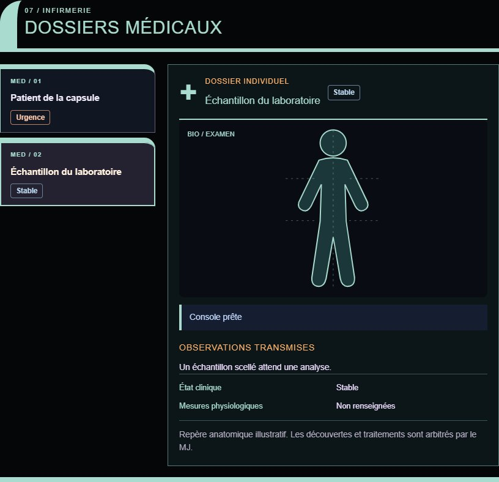

### Interventions et rapports

Le joueur choisit une fiche dans son instrument, indique l’action et son intention, puis
**Transmettre l’intervention**. Dans **Demandes**, le meneur peut prendre en charge la demande,
demander un jet, répondre, accepter/refuser et choisir un état résultant.
Le rapport préparé reste privé au meneur. La réponse est privée au demandeur ; elle devient
commune seulement si le meneur autorise le partage et si le joueur la partage volontairement.
Le meneur peut aussi publier directement un rapport ciblé dans **Diffusion**.

Les éléments se créent et se révèlent dans **Préparation**. **Préréglages** mémorise la
situation et les états sans effacer les affectations et rapports.

### Pièces jointes privées

Dans **Demandes** ou **Diffusion**, **Pièce jointe** ajoute une image PNG/JPEG/WebP, un son
MP3/OGG/WAV ou une vidéo MP4/WebM, jusqu’à **4 Mo par fichier**. Les destinataires du rapport
sont aussi ceux du média. Une pièce jointe privée n’est pas accessible aux autres personnages,
même s’ils recopient son adresse. Retirer le rapport ou l’accès ferme sa lecture dans le Hub.
Cela n’efface pas une information déjà lue ou copiée.

Les sauvegardes et exports de campagne emportent les fichiers. Leur lecture nécessite la
connexion à GM-OS et un format décodable par le navigateur ; en cas d’échec, le texte reste
accessible. Une vidéo se lance volontairement, avec commandes de lecture et de déplacement.
Elle reste muette sur les appareils qui ne sont pas choisis pour le son.

### Alertes et appareil sonore

Dans **Alertes**, le meneur publie une alerte normale, jaune ou rouge, sa consigne et un
compte à rebours facultatif de 1 à 3 600 secondes. Les écrans suivent l’heure du serveur.
À zéro, la sirène s’arrête ; le récit reste à résoudre par le meneur.

1. Dans les contrôles communs de **Modules du jeu**, le meneur choisit **Son : [appareil]**.
2. Sur cet appareil, ouvrir LCARS et toucher **Activer le son**. Il doit rester sur cet écran.
3. **Annonces vocales** ajoute le niveau d’une nouvelle alerte et les changements de minute,
   si une voix française locale est disponible. Les annonces manquées ne sont pas rejouées.

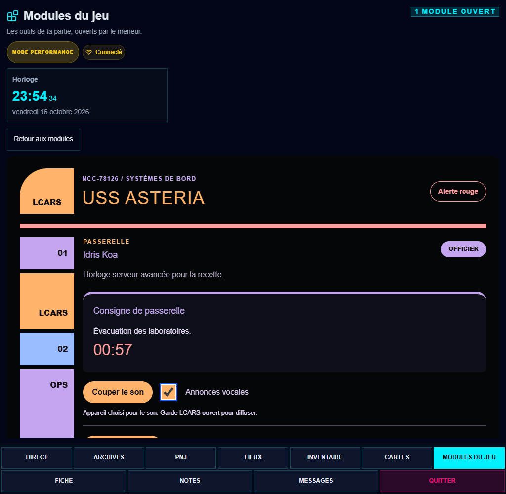

Un seul appareil diffuse la sirène, les voix et le son des pièces jointes. Un transfert coupe
l’ancien diffuseur ; la nouvelle lecture d’un média reste volontaire. Une autre voix de GM-OS
est prioritaire sur les annonces LCARS. La vidéo n’est pas synchronisée automatiquement entre
les écrans. Les mouvements réduits conservent les repères visuels sans animation.

La veille, le passage en arrière-plan ou la suspension audio peuvent couper le son : toucher
de nouveau **Activer le son** au retour. **Arrêter les effets** coupe l’alarme, les annonces et
le diffuseur ; un retrait d’accès, une déconnexion ou **Tout couper** ferme également les médias.

### Conservation et import de l’atelier

GM-OS sauvegarde la préparation et les historiques privés par campagne et les inclut dans
ses sauvegardes/exportations. Fermer le pupitre les conserve. Au redémarrage ou à la restauration,
les effets sont arrêtés et le meneur doit rouvrir les accès. Une préparation d’une version
plus récente est conservée et signalée comme indisponible.

**Importer une préparation** accepte le JSON exporté de l’atelier LCARS. L’aperçu montre le
vaisseau et les nombres d’éléments/préréglages ; une confirmation précède le remplacement.
Celui-ci efface les historiques et affectations LCARS actuels et ferme les accès. Les
personnages fictifs et leurs échanges ne sont pas importés. Sauvegardez GM-OS avant de
remplacer une instance dont vous souhaitez conserver les rapports.

Retirer un poste annule ses demandes encore actives et conserve les autres consoles.
Décocher un accès retire immédiatement LCARS à ce personnage. **Tout couper** ferme tous
les modules ; une déconnexion ferme la vue jusqu’à la reprise de la liaison.

*Relu le 2026-10-16 : L1–L7 logiciel, sept instruments dans le vrai Hub, médias privés et diffuseur unique. Essais des appareils physiques encore à réaliser.*

*Relu le 2026-10-23, Star Trek 2.0.0 — toutes les améliorations.*
