# 🌑 Jeu — Symbaroum

> **Pilote décrit :** « Symbaroum », exporté le 2026-10-20 et corrigé le 2026-10-21 (un seul attribut au jet, plus de « difficulté » qui faisait tout réussir, santé de départ sur l'Endurance, fiche HTML reliée), puis le 2026-10-22 (modificateur et opposition au seuil ; Endurance raccordée et fin de scène ; Avantage tactique et Corruption au seuil), et **fini le 2026-10-23**, version 2.0.0 : attaque et Défense avec leurs dégâts, agonie, Stigmates, départage de l'initiative, création et progression, bourse, voyages, règles optionnelles (`Export Dirvers/corriges/Symbaroum_driver_gmos_finir.gmos-driver`). Retour à [Les jeux et leurs mécaniques](./53-Les-jeux-et-leurs-mecaniques.md).

Un seul geste : le **test**, un d20 sous un attribut. Autour de lui : l'**attaque** et la
**Défense**, que seuls les joueurs lancent, avec leurs dégâts ; l'**Endurance** et l'agonie ; la
**Corruption** et ses Stigmates ; et, sous le panneau de jet, les cartes de la fiche — de la
création au voyage. La fiche de personnage HTML est reliée champ par champ.

> Règles relues contre le **Livre de Base** le 2026-10-23 (pages imprimées 77–79, 103, 123–124,
> 152–157, 161–167, 177–184, 190, 205), et le corpus `docs/systems/symbaroum/` corrigé d'après lui
> (lot S0 : le choix après un coup douloureux, le Test de mort qui continue, la cécité, l'asymétrie
> des dés, le gain de Corruption permanente au seuil).

---

## Le test

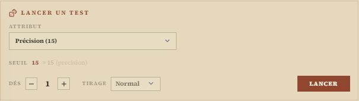

- On retient **un attribut** parmi les huit : Agilité, Astuce, Discrétion, Force, Persuasion,
  Précision, Vigilance, Volonté — ou la **Défense**, pour se défendre. Sa valeur est le seuil.
- On lance **1d20** : **sous ou égal au seuil**, le test réussit.
- Le **1** et le **20** n'ont **pas d'effet de base** : le panneau n'écrit plus « réussite
  critique » sous un simple test (corrigé le 2026-10-23). Les attaques parfaites et les échecs
  critiques en Défense sont une **règle optionnelle**, que la table choisit (voir
  [Les règles optionnelles](#les-règles-optionnelles)).

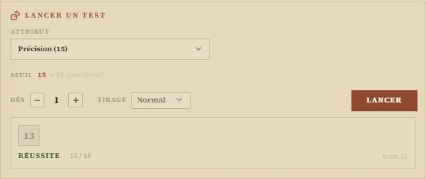

### Le modificateur et l'opposition

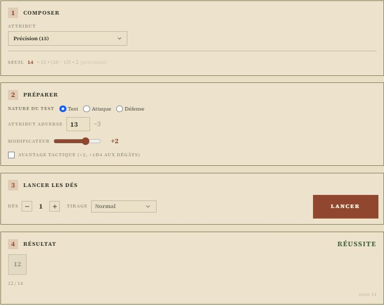

À l'étape **Préparer**, deux réglages déplacent le seuil, et ils **s'additionnent** :

- **Attribut adverse** : contre un adversaire, saisissez son Attribut. Le livre retire **10 moins
  cet Attribut** : un adversaire à 13 donne −3, un adversaire à 7 donne +3. Case vide, pas
  d'opposition.
- **Modificateur** : la difficulté de la tâche, de **+5** (très facile) à **−5** (très complexe),
  et les bonus de situation.

Le calcul se lit sous **Seuil** : `15 + (10 − 13) + 2`, soit 14. Le dé se juge contre ce seuil, et
le journal redit l'opposition et le modificateur avec le jet (« Attribut · Attribut adverse 13 ·
+2 »). Les deux réglages restent en place d'un jet à l'autre : remettez la case à vide et le
curseur à 0 quand l'adversaire change.

> *Pourquoi ce n'est pas la « difficulté »* : la Forge y avait rangé ce −5 / +5. Or, dans GM-OS,
> la difficulté est un **nombre de réussites à obtenir** (celui de Dune). À 0, chaque test
> réussissait, un 20 compris. Depuis le 2026-10-22, la revue de la Forge refuse ce réglage sur un
> jet d'un seul dé.

> Au **pupitre** de Dice-OS, qui ne lit pas de fiche, le seuil se saisit déjà calculé.

### L'Avantage tactique

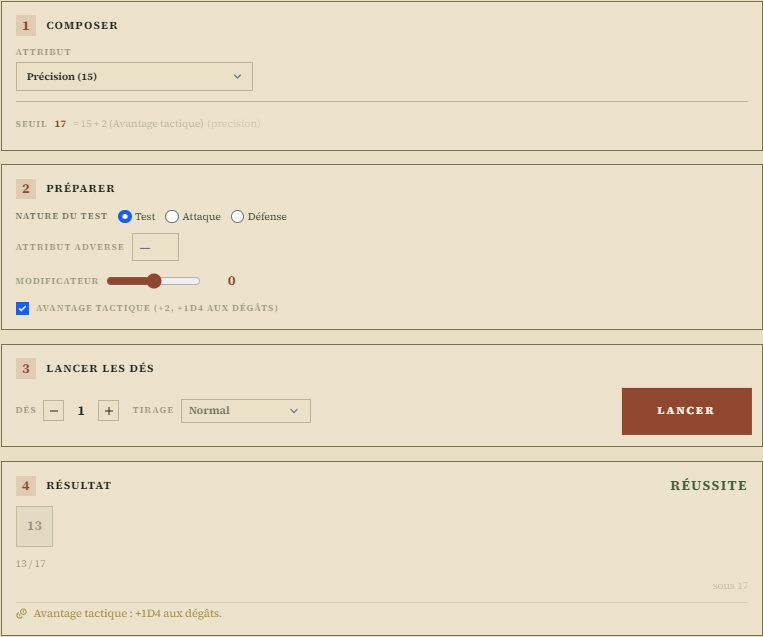

Encerclement, attaque surprise, cible à terre en mêlée… : la case **Avantage tactique** ajoute
**+2** au seuil et rappelle **+1D4 aux dégâts** après le lancer (p. 166). **Un seul d20** : ce
n'est pas un double lancer. Une case, pas un compteur : plusieurs causes d'Avantage comptent une
fois — *le livre ne le dit pas en toutes lettres, c'est la convention retenue.* Elle s'ajoute à
l'opposition et au modificateur.

Le sélecteur **« Tirage »** lance, lui, deux d20 et garde le meilleur ou le pire : pour la
cécité, certains Talents, l'option des dégâts critiques. Il s'appelle ici « Deux dés, le
meilleur / le pire », pour ne plus se confondre avec l'Avantage du jeu.

> **La cécité** (p. 165) : si le personnage ne voit pas, « Deux dés, le pire » ; si c'est son
> ennemi, « Deux dés, le meilleur » — c'est toujours le joueur qui lance ; si les deux sont
> aveuglés, rien. Le rang Maître de Sixième sens retire ce malus.

---

## Attaquer et se défendre

**Seuls les joueurs lancent les dés** (p. 177–178). À l'étape **Préparer**, la **nature du test** dit
ce qui suivra le lancer :

- **Attaque** : l'Attribut d'attaque (la Précision, ou celui qu'un Talent lui substitue), et dans
  « Attribut adverse » la **Défense** de la cible (p. 162) ;
- **Défense** : le panneau retient la **Défense** de la fiche — une valeur secondaire, qu'on peut
  aussi choisir dans la liste —, et dans « Attribut adverse » la **Précision** de l'attaquant
  (p. 164). Un Talent qui fait défendre avec un autre Attribut (Tacticien…) : cocher « Défense »,
  puis choisir cet Attribut ;
- **Test** : rien ne suit.

### Les dégâts

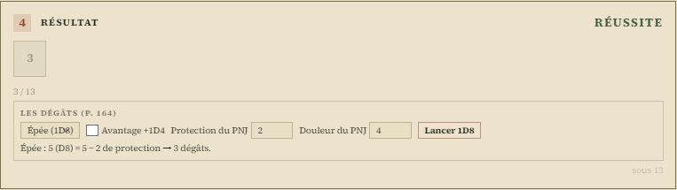

Une **attaque réussie** ouvre **« Les dégâts »** : l'arme se choisit parmi celles de la fiche (ou
« Autre… », une formule saisie), la case **Avantage +1D4** reprend l'Avantage tactique coché au jet,
et l'Attaque parfaite optionnelle ajoute **+1D6**. On saisit la **protection fixe du PNJ** et, si on
la connaît, sa **Résistance à la douleur** ; **« Lancer »** jette les dés du joueur et dit :

- les **dégâts effectifs**, jamais négatifs (p. 167) ;
- si la douleur est atteinte, en un seul coup : **le joueur choisit** — la cible tombe à terre, ou il
  obtient une Attaque gratuite (p. 164) ;
- avec l'option des dégâts critiques, une cible **grièvement touchée** (des dégâts qui *dépassent*
  sa douleur).

Le PNJ perd ces points dans le suivi de combat, à la main : la fiche du PJ n'est pas la sienne.
Une valeur fixe de PNJ vaut **la moitié de la plus haute face** de son dé : 4 pour 1D8, pas 4,5
(p. 178).

### Encaisser

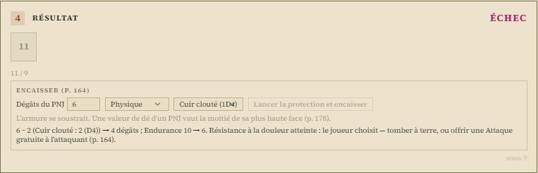

Une **Défense ratée** ouvre **« Encaisser »** : les **dégâts fixes** que le meneur annonce, le
**genre** de dégâts et l'**armure** de la fiche. Le bouton lance la protection du joueur, retire le
reste de l'**Endurance** et l'écrit sur la fiche :

| Genre | L'armure | L'Endurance |
| :--- | :--- | :--- |
| Physique | se soustrait | baisse |
| Acide | se soustrait, chaque tour | baisse ; une Action de combat et un test d'Astuce l'enlèvent (p. 182) |
| Poison qui agit | ne compte plus | baisse, chaque tour, jusqu'à la fin de l'effet ou un antidote (p. 182) |
| Sur un Attribut | — | ne change pas : les dégâts alternatifs se reportent sur l'Attribut nommé ; à 0, la victime meurt (p. 205) |

L'échec critique en Défense optionnel ajoute **+3**. À **0**, le personnage s'effondre, **mourant** ;
avec la **Mort subite**, un coup qui atteignait sa douleur le tue (p. 183).

### Relancer, critiques

Avec les options de la table, sous le résultat : **« Refaire ce jet »** contre **1 Expérience**
(perdue) ou **1 Corruption permanente**, une seule fois ; et l'effet d'un 1 ou d'un 20 à l'attaque
ou en Défense, confirmé par un second jet si la table limite les critiques (p. 184). Un échec
critique en Défense ne se relance pas, comme le livre le recommande.

---

## La fiche de personnage

La fiche HTML de Symbaroum (deux pages : identité, attributs, douze cadres de talents et pouvoirs,
armes et protections ; portrait, compagnons, artéfacts, équipement) se relie à son personnage
GM-OS : voir [Fiche de personnage HTML](./63-Fiche-de-personnage-HTML.md).

| Sur la fiche HTML | Dans GM-OS |
| :--- | :--- |
| Les huit attributs | Les huit champs du jet |
| Endurance maximale, Endurance, Résistance à la douleur, Seuil de Corruption | Attributs secondaires |
| Défense, sous chaque protection | « Défense » (la première protection, celle qui se jette) et « Défense — protection 2 » |
| Corruption, Corruption permanente | Les deux jauges de Corruption |
| Talent ou pouvoir : nom, type, niveau N / A / M, effet | Douze champs « Talent ou pouvoir », niveau Novice, Adepte ou Maître |
| Les 21 lignes d'équipement | Un seul texte « Équipement », une ligne par objet |
| Argent (« 127 thalers ») | « Argent — tel que noté sur la fiche », que la carte **Bourse** sait réécrire |
| Apparence | La Description du personnage |
| Portrait | Reste sur la fiche : GM-OS a son propre portrait |

> **Un seul compte d'argent** (2026-10-23) : « Argent (thalers) » fait foi, centièmes compris —
> 5,37 thalers valent 5 thalers, 3 shillings et 7 ortegs. La carte **Bourse** le tient, et réécrit
> la bourse de la fiche HTML **sur un clic**, jamais d'office : un texte déjà rempli à la main
> n'est pas converti en silence.
>
> **La fiche ne calcule rien** : la carte **Valeurs dérivées** fait le calcul du livre à côté
> d'elle (voir plus bas).

L'**archétype** (Guerrier, Mystique, Roublard) n'est pas imprimé sur la fiche : il se choisit dans
le formulaire de GM-OS.

---

## Combat et santé

- **Initiative :** l'**Agilité**, du plus haut au plus bas ; à égalité, la **Vigilance**, puis un
  **d20** relancé entre les ex aequo jusqu'à ce que l'un l'emporte (p. 161). L'ordre tiré tient
  pour tout le combat ; pour retarder son action, glisser le combattant plus bas.
- **Santé :** l'**Endurance** de la fiche est la santé du combat, plafonnée par l'**Endurance
  maximale** : un coup porté au combat s'écrit sur la fiche, une fiche blessée se lit au combat. Un
  personnage **neuf naît à son Endurance maximale** ; un personnage existant garde la sienne —
  vérifiez qu'elle n'est pas restée à 0 avant la première séance.
- **Types de dégâts :** physique, poison, acide, alternatifs, chute.
- **Ressources suivies**, en jauges segmentées : Corruption temporaire, Corruption permanente,
  Argent, Expérience, Expérience à dépenser.

### Endurance et agonie

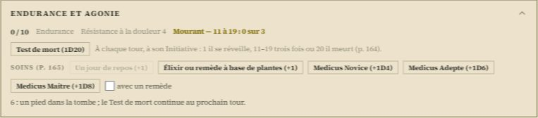

La carte dit l'**Endurance**, la Résistance à la douleur et l'état : debout, **mourant**, **mort**.
Mourant, le bouton **« Test de mort (1D20) »** se lance à chaque tour, à l'Initiative du personnage
(p. 164) : **1**, il se réveille avec 1D4 d'Endurance ; **2–10**, un pied dans la tombe — le test
**continue** ; **11–19**, compté, le **troisième** tue ; **20**, il meurt. Le compte reste sur la
fiche d'un tour à l'autre, d'un rechargement à l'autre.

Les **soins** (p. 165, 123–124) : un jour de repos (+1, pas sur un mourant), un élixir ou un remède à
base de plantes (+1), le **Medicus** selon son rang — Novice 1D4, Adepte 1D6, Maître 1D8, un dé de
plus « avec un remède », après un test d'Astuce réussi, une fois par patient et par jour. Un
premier soin sur un mourant arrête ses Tests de mort. « Annuler la mort », au meneur, défait une
mort notée par erreur.

### La fin de scène

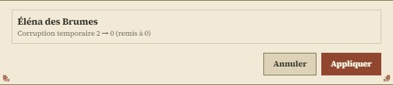

Le bouton **« Fin de scène »** du bandeau ouvre un aperçu, personnage par personnage : la
**Corruption temporaire** revient à 0, la **permanente** reste. « Appliquer » écrit les fiches. Rien
ne détecte la fin d'une scène — ni la fin d'un combat, ni un changement de lieu : c'est vous qui la
déclarez.

### La Corruption au seuil

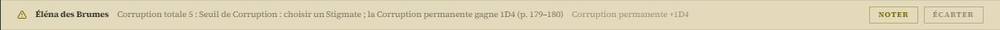

GM-OS surveille la **Corruption totale** (temporaire + permanente) :

- au **Seuil de Corruption** — la moitié de la Volonté, arrondie au-dessus — une ligne paraît
  sous le bandeau : **choisir un Stigmate**. **« Noter »** lance **1D4** et l'ajoute à la
  Corruption permanente (p. 179–180), et le consigne au journal ; **« Écarter »** le laisse ;
- à la **Volonté**, l'**Abomination** (p. 180) : un rappel, que « Noter » consigne. Le
  personnage passe au meneur, sauf accord du groupe pour le jouer (p. 184).

Une fois par passage : ni un rechargement, ni une tablette qui se reconnecte ne la reproposent.
La **fin de scène**, qui vide la Corruption temporaire, fait redescendre la totale : le seuil se
réarme, et un nouveau franchissement se proposera — *le livre n'explicite pas les réentrées
dans une même scène ; c'est la convention retenue.* Une Volonté pas encore remplie ne déclenche
rien.

### Corruption et Stigmates

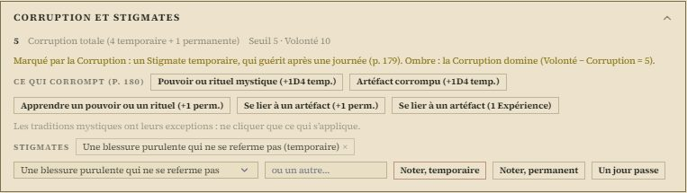

La carte montre la **Corruption totale**, le seuil et la Volonté, l'état (touché, marqué,
marqué de façon permanente, Abomination) et l'**Ombre** qui domine — la Corruption l'emporte dès
qu'elle égale Volonté − Corruption (p. 180).

- **Ce qui corrompt** (p. 180) : un pouvoir ou un rituel, un artéfact corrompu (+1D4 temporaire,
  lancé) ; apprendre un pouvoir, se lier à un artéfact (+1 permanente) — ou se lier contre
  **1 Expérience**. Les traditions ont leurs exceptions : ne cliquer que ce qui s'applique.
- **Les Stigmates** : un du Tableau 24, ou inventé, noté **temporaire** (il guérit après une
  journée) ou **permanent** (tant que la Corruption permanente tient le seuil, p. 179–180).
  **« Un jour passe »** fait guérir les temporaires ; la carte Voyage fait passer les jours aussi.
  Le 1D4 permanent du seuil se note par la ligne du bandeau, pas ici : il ne se compte qu'une fois.

---

## Les cartes de la fiche

Sous le panneau de jet, chaque carte se replie ; l'appareil se souvient de celles qu'on a fermées.

### Le tour de combat

Le Tableau 22 (p. 167) en rappels : une Action de combat et une de mouvement, les Réactions sans
limite, l'arme Longue au premier tour, se désengager, se relever, l'élixir sur soi ou sur autrui,
l'Avantage et ses causes, la cécité, l'initiative.

### Valeurs dérivées — au meneur

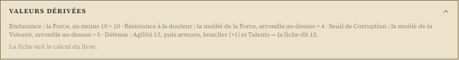

Le calcul du livre à côté de la fiche : **Endurance** la Force, au moins 10 ; **Résistance à la
douleur** la moitié de la Force, arrondie au-dessus, même sous 10 ; **Seuil de Corruption** la
moitié de la Volonté, arrondie au-dessus ; **Défense** l'Agilité, puis l'armure, le bouclier (+1)
et les Talents. Un écart se montre avec **« Adopter »** — mais un Talent ou un Trait (Robuste,
Résistant…) l'explique souvent : garder la fiche, alors. La Défense ne s'écrit jamais d'office.

### Création et progression — au meneur

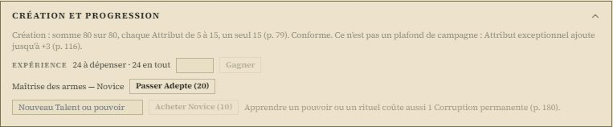

- **La création** (p. 79) : la somme des huit Attributs à **80**, chacun de 5 à 15, un seul 15. La
  carte contrôle et n'écrit rien : ce n'est pas un plafond de campagne (Attribut exceptionnel, +3
  au plus, p. 116).
- **L'Expérience** : « Gagner » l'ajoute au total et à l'Expérience à dépenser.
- **Les rangs** (p. 166) : **10** pour un nouveau Talent Novice, **20** pour passer Adepte, **30**
  pour Maître, un rang après l'autre, débités de l'Expérience **à dépenser**. Apprendre un pouvoir
  coûte aussi 1 Corruption permanente (carte Corruption).

### Bourse

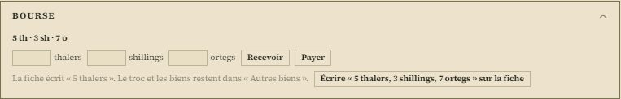

**1 thaler = 10 shillings = 100 ortegs** (p. 190). **Recevoir** et **Payer** en trois monnaies ;
on ne paie pas ce qu'on n'a pas. Le troc et les biens restent dans « Autres biens ».

### Voyage — au meneur

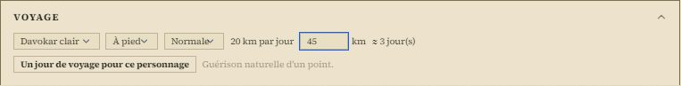

Le **Tableau 26** (p. 190) : terrain, à pied ou à cheval, allure — les kilomètres par jour, et les
jours pour une distance. **« Un jour de voyage pour ce personnage »** fait passer la journée sur sa
fiche : allure **normale**, la guérison naturelle (+1) ; **forcée**, aucune ; **éreintante**,
−1 Endurance et un **test de Force** — raté, 1D6 de plus ; un **20**, l'accident mortel (Endurance
à 0, mourant). La Corruption des zones sombres, que le meneur dose (p. 180), se clique sur la
carte Corruption.

### Les règles optionnelles

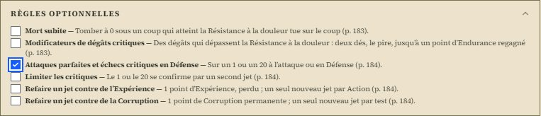

Le chapitre 19 (p. 183–184), retenu **par campagne**, par le meneur — la tablette les lit sans les
changer. Aucune ne s'applique sans être cochée :

| Option | Ce qui change |
| :--- | :--- |
| Mort subite | À 0 sous un coup qui atteint la douleur : mort sur le coup |
| Modificateurs de dégâts critiques | Des dégâts qui dépassent la douleur : deux dés, le pire, jusqu'à un point regagné — la préparation du jet le rappelle |
| Attaques parfaites et échecs critiques en Défense | Attaque : 1, +1D6 dégâts ; 20, Attaque gratuite de l'ennemi. Défense : 1, Attaque gratuite ; 20, +3 dégâts de l'ennemi |
| Limiter les critiques | Le 1 ou le 20 se confirme par un second jet |
| Refaire un jet contre de l'Expérience | 1 point, perdu ; un seul nouveau jet |
| Refaire un jet contre de la Corruption | 1 point permanent ; un seul nouveau jet |

Le livre recommande de ne relancer ni le Test de mort ni l'échec critique en Défense : la carte
d'agonie n'offre pas de relance.

---

## Ce qui reste à la main

- La **cible à terre** (mêlée seulement) et la **cécité** : la case Avantage et le « Tirage » se
  règlent au jet.
- L'**Endurance des PNJ** dans le suivi de combat, après « Les dégâts ».
- Les **effets des Talents** : leurs noms sont libres, GM-OS n'en interprète aucun (Tacticien,
  Robuste…) ; leurs bonus se règlent au modificateur.
- La **durée** d'un poison ou d'un acide, et l'antidote.
- La **réentrée** dans le Seuil de Corruption au cours d'une même scène : le livre ne la règle pas.
- **Jouer une abomination** : l'accord du groupe (p. 184).

*Relu le 2026-10-23, Symbaroum fini (pilote 2.0.0).*
