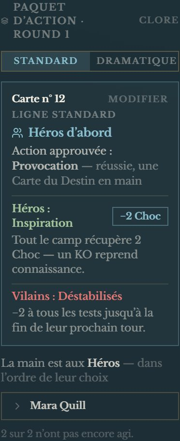
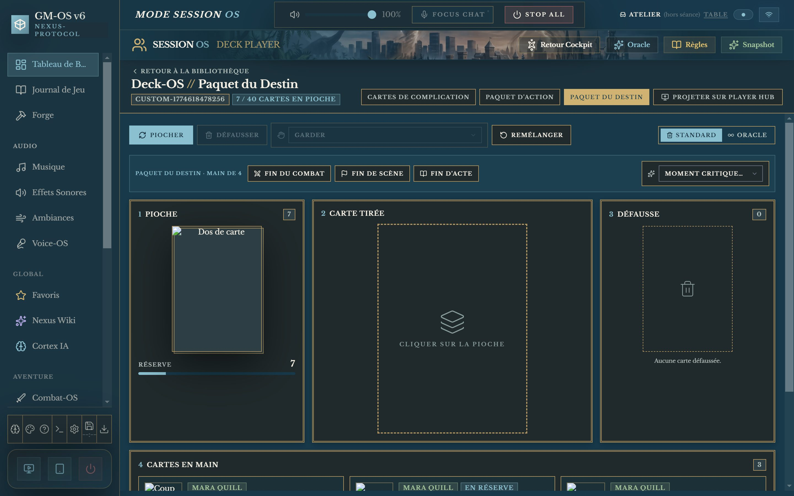
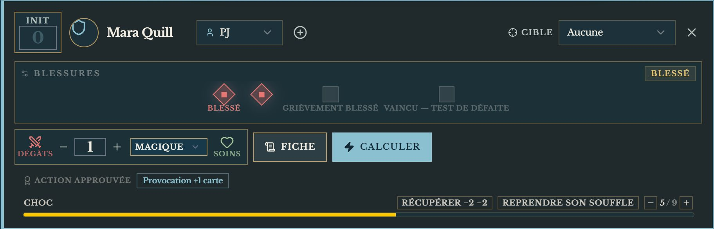
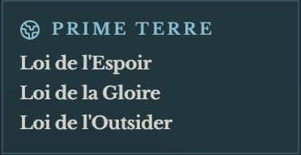
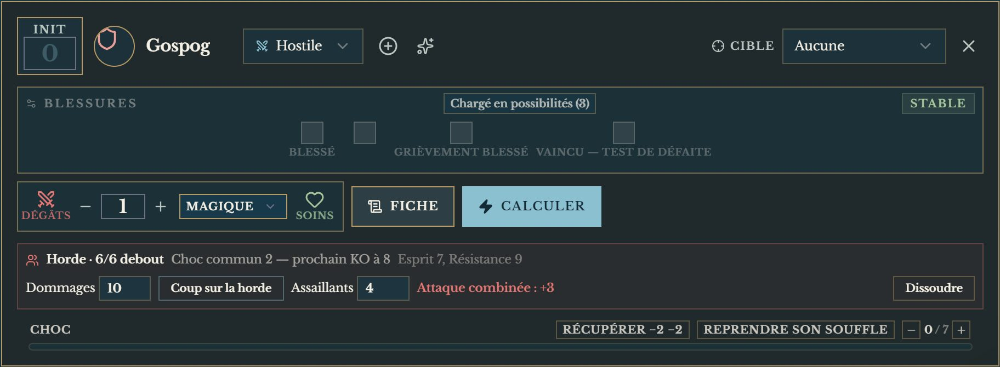

# ⚡️ Jeu — Torg Eternity

> **Pilote décrit :** « Torg Eternity », exporté le 2026-10-13, corrigé le même soir ; cosms ajoutés le 2026-10-14 ; réexporté le 2026-10-16 pour les captures. Retour à [Les jeux et leurs mécaniques](./53-Les-jeux-et-leurs-mecaniques.md).

Les Chevaliers des Tempêtes contre les Seigneurs de Réalité. Les règles de cette page ont été
relues contre le carnet NotebookLM « Torg » le 2026-10-13.

---

## Le jet — la Table des Bonus

1. On retient un **attribut** et, s'il y en a une, une **compétence** : leur somme est le **niveau**.
   Une compétence **non entraînée** se laisse vide (« — aucune — ») : le test se fait sur
   l'attribut seul, et **seul le 10 explose, pas le 20**.
2. On règle le **Niveau de Difficulté** : 10 par défaut (Normale), de 6 (Très facile) à 20 (Presque
   impossible).
3. On règle, si le risque l'exige, la **plage d'échec critique** : 1 d'ordinaire, jusqu'à 1–4 (rafale,
   axiomes, certains Atouts et pouvoirs).
4. **Lancer** : un d20. **Sur 10 ou 20, il explose** — on relance et on cumule.
5. Le total du dé devient un **bonus** par la Table des Bonus, ajouté au niveau : c'est le **total
   d'action**. **Chaque Blessure retire 1**, jusqu'à −3 — le panneau le lit sur la fiche et le dit.

| Total d'action moins ND | Résultat |
| :--- | :--- |
| 10 et plus | **Succès Spectaculaire** |
| 5 à 9 | **Succès Supérieur** |
| 0 à 4 | **Succès Simple** |
| moins de 0 | **Échec** |
| le **premier dé** dans la plage critique | **Échec critique**, quel que soit le reste |

### Après le premier dé

Tant que ce n'est pas un échec critique, trois boutons complètent le test — chacun une seule fois :

| Geste | Ce qu'il fait |
| :--- | :--- |
| **Relancer (compétence favorisée)** | Relance le **premier** dé et garde le nouveau résultat — seulement avant les deux autres gestes |
| **Dépenser une Possibilité** | Un d20 de plus, **ajouté au dé avant la table** ; un 1 à 9 y vaut 10, sans relance ; un 10 ou un 20 naturel explose. La Possibilité se décompte sur la fiche |
| **Un de plus !** | Le d20 de la carte d'action — **sans** le minimum de 10 |

Le panneau dit tout le calcul : « Succès Simple — dé 7 + Possibilité 10 = 17 → bonus +4 ; total
d'action 15 (niveau 12, −1 Blessure) contre ND 10, marge +5 ».

### La Table des Bonus

| Dé | Bonus | Dé | Bonus |
| :---: | :---: | :---: | :---: |
| 1 | Échec | 15 | +2 |
| 2 | −8 | 16 | +3 |
| 3–4 | −6 | 17 | +4 |
| 5–6 | −4 | 18 | +5 |
| 7–8 | −2 | 19 | +6 |
| 9–10 | −1 | 20 | +7 |
| 11–12 | 0 | 21–25 | +8 |
| 13–14 | +1 | puis +1 par tranche de 5 | |

> La table vient du carnet NotebookLM « Torg » (livre de base, page 109), pas du corpus, qui ne la
> contient pas. Si une ligne diffère de votre livre, elle se corrige dans
> `src/modules/dice/systemes/torg.ts`, et ses tests avec.

---

## L'Annulation des dommages

Le bouton **« Annulation des dommages »** du panneau de jet : **une Possibilité**, un test de
**Réalité** (Esprit + Réalité) contre **ND 10**, *après que les dommages ont été calculés, mais avant
qu'ils ne prennent effet*.

| Résultat | Ce qui est annulé, pour cette attaque |
| :--- | :--- |
| Succès Simple | 1 Blessure et tout le Choc |
| Succès Supérieur | 2 Blessures et tout le Choc |
| Succès Spectaculaire | toutes les Blessures et tout le Choc |
| Échec | rien |

Une tentative par attaque ; elle ne rend jamais des dommages déjà subis. Le panneau dit ce qui est
annulé ; décochez les cases par **« Soins »** sur la carte de combattant — GM-OS ne sait pas quelle
part de quel coup retirer.

---

## Combat et santé

- **Les dommages se calculent seuls.** Dans « Dégâts » sur la carte de combattant, saisissez le
  **total de dommages** de l'attaque : GM-OS lit la **Résistance** de la cible et applique la Table
  des Dommages — et le dit, à l'écran et au journal : « 29 dommages contre Résistance 17 : 2
  Blessures, 4 Choc ».

  | Dommages − Résistance | Effet |
  | :--- | :--- |
  | −6 ou moins | rien |
  | −5 à −1 | 1 Choc |
  | 0 à 4 | 2 Choc |
  | 5 à 9 | 1 Blessure, 2 Choc |
  | puis par tranche de 5 | +1 Blessure, +2 Choc |

- **Blessures : quatre cases.** Trois Blessures au plus (**Blessé**, puis **Grièvement blessé** à 3) ;
  la quatrième, c'est **Vaincu** — le test de Défaite (ND 10, sous le plus faible de Force et Esprit).
  La jauge « Blessures » de la fiche suit les cases, et le jet en tire son malus.
- **Choc** : suivi sur la carte de combattant, **plafonné à l'Esprit** du personnage. Le dépasser
  met **KO** — GM-OS l'annonce ; le surplus est ignoré. Le Choc ne donne aucun malus.
- **Faire baisser le Choc** — les boutons de la jauge Choc, sur la carte :

  | Bouton | La règle |
  | :--- | :--- |
  | **Récupérer −2** | Le personnage **sacrifie tout son tour** (ni déplacement ni action), **hors de la mêlée** : 2 Choc, sans test |
  | **Reprendre son souffle** | Fin du combat ou de la scène, **si le meneur estime qu'on peut souffler** : tout le Choc s'efface (un KO se réveille alors) |
  | **−** / **+** | Un point à la main — hors combat, on récupère **1 Choc par minute** |

  « Soins » ne touche pas au Choc : il décoche les Blessures.
- **« Soins »** décoche les Blessures sans passer par la table.
- **Distances** en mètres, de « au corps à corps » à « Portée Longue ».

---

## Le Paquet d'Action — l'ordre du round

Il n'y a pas d'initiative individuelle. **Au début de chaque round, le meneur retourne une carte
d'Action** (Combat-OS, bloc d'initiative) :

1. **Standard ou Dramatique** : choisissez la ligne avant de retourner. La ligne claire sert à la
   plupart des combats ; la sombre aux moments charnières, aux dénouements, et à toute scène face à
   une créature à **Effroi**.
2. **Qui commence** : **H**, les Héros (les joueurs et leurs alliés), ou **V**, les Vilains. Le camp
   désigné joue **tous ses tours, dans l'ordre de son choix** — cliquez chacun quand il agit —, puis
   l'autre camp. Le round fini : **« Retourner la carte suivante »**.
3. **La Ligne de Conflit** donne à chaque camp ses avantages ou désavantages. Ils s'annoncent sur la
   carte ; trois se jouent d'un clic :

   | Effet | Ce qu'il fait | Dans GM-OS |
   | :--- | :--- | :--- |
   | **Inspiration** | Le camp récupère 2 Choc — un KO reprend connaissance | bouton « −2 Choc » |
   | **Un de plus !** | Un second d20 s'ajoute à chaque test (il explose, sans minimum de 10) | le bouton « Un de plus ! » du jet est mis en avant |
   | **Vivacité** | Le camp prend un second tour complet | bouton « Second tour » |
   | **Déferlement** | Test de Contradiction pour qui n'est pas natif du cosm | annoncé |
   | **Désorientés** | Aucune carte ne se joue depuis la Réserve d'Action ce round | annoncé |
   | **Déstabilisés** | −2 à tous les tests | **retiré seul** au jet des Héros |
   | **Fatigués** | 2 Choc à la fin du tour de chacun | bouton « +2 Choc » |
   | **Revers** | Une complication — à défaut, le camp perd son tour | annoncé |

4. **L'Action approuvée** (en bas de la carte) : un héros qui la réussit pioche une Carte du Destin.

**Vos cartes, décrites une fois.** Dans Deck-OS, marquez votre paquet **Rôle : Paquet d'Action**.
Quand une carte encore inconnue sort, Combat-OS vous demande ce qu'elle dit — les deux lignes,
les effets de chaque camp, l'Action approuvée — et s'en souvient. Vous pouvez aussi les décrire
d'avance, carte par carte, dans le lecteur de Deck-OS. Sans paquet, Combat-OS vous laisse désigner
le camp qui commence.

> Les effets se lisent dans le panneau de jet **de votre fenêtre** : une tablette ne voit pas la carte
> du round (Déstabilisés n'y est pas retiré seul).

---

## Les Cartes du Destin

Chaque héros tient une **main de 4 Cartes du Destin**. Leurs effets sont imprimés sur les cartes :
GM-OS ne les joue pas à votre place, il tient les mains. Dans Deck-OS, marquez votre paquet
**Rôle : Paquet du Destin**.

| Geste | Où | Ce qu'il fait |
| :--- | :--- | :--- |
| **Poser en Réserve** | la tablette du joueur, ou votre lecteur | En combat, une carte par fin de tour, face visible devant soi : **toute la table la voit** et elle se joue à tout moment |
| **Moment critique** | la tablette, ou votre lecteur (liste « Moment critique… ») | **Une fois par Acte** : toute la main passe en Réserve — ce qui n'est pas joué aussitôt est défaussé |
| **Jouer** | la tablette, ou votre lecteur | La carte part en défausse |
| **Fin du combat** | votre lecteur | Les cartes de Réserve reviennent en main |
| **Fin de scène** | votre lecteur | Chaque héros de la campagne **complète sa main à 4**. Qui en a plus doit défausser l'excédent : GM-OS le dit, il ne choisit pas pour lui |
| **Fin d'Acte** | votre lecteur | Chacun défausse toute sa main, Réserve comprise, et en tire une nouvelle ; les Moments critiques reviennent |

**L'Action approuvée.** Quand la carte d'Action du round en nomme une, la carte de combat de
chaque héros montre un bouton par action :

Cliquez quand le héros la réussit : il pioche **une Carte du Destin en main** (pas en Réserve).
Une fois par action et par round — deux actions sur la carte, deux cartes possibles.

Le don de carte entre joueurs reste celui de Deck-OS (proposé, accepté ou refusé, vous arbitrez) :
la règle du livre — **en combat, une carte contre une carte, de Réserve à Réserve** — reste à la
table. **Désorientés** (aucune carte jouée depuis la Réserve ce round) est annoncé, pas bloqué.

---

## Le cosm et ses Lois du Monde

Le cosm se choisit **sur la scène**, dans la Trame (« Cosm », et « zone mixte avec… » pour un
second) ; sans choix, c'est celui de la **campagne**, réglé sous son nom dans le cockpit. Ses Lois
s'affichent sur l'écran de la scène et, en bref, dans Combat-OS. Celles marquées **GM-OS** jouent
d'elles-mêmes, ou s'annoncent au bon moment (livre de base, relu contre le carnet « Torg ») :

| Cosm | Loi | Dans GM-OS |
| :--- | :--- | :--- |
| Empire du Nil | **Héroïsme** | La main passe de 4 à **5** cartes |
| Empire du Nil | **Action** | Après « Dépenser une Possibilité », **« seconde Possibilité »** : la meilleure des deux compte |
| Orrorsh | **Persévérance** | Annulation : Simple n'annule que le Choc, Supérieur une seule Blessure |
| Aysle | **Magie** | « Choc volontaire » au jet d'Altération, Cinétique, Conjuration ou Divination : +1 par point, jusqu'aux rangs ; ce Choc ne se récupère pas avant la fin du sort |
| Pan-Pacifica | **Ténacité** | Annoncée quand le Choc met KO : une Blessure pour effacer tout le Choc |
| Tharkold | **Souffrance** | Annoncée quand une Blessure tombe : l'attaquant récupère un point de Choc |

Les autres Lois (Gloire, Outsider, Sauvagerie, Vie, Domination, Vengeance…) restent à la table, en
rappel.

---

## Les Cartes de Cosm

Un paquet par cosm (Empire du Nil, Aysle…) : dans la bibliothèque de Deck-OS, **Rôle : Paquet de
Cosm**, puis **Cosm** : celui du paquet. Chargez les cartes que vous voulez — comme pour le Destin.

Dans le lecteur d'un Paquet de Cosm :

- **Début d'Acte** — chacun défausse la carte qu'il n'a pas jouée, le paquet du cosm courant est
  remélangé, et chacun en reçoit une (livre p. 113).
- **Changement de cosm** — en cours d'Acte, la carte d'un cosm quitté s'échange contre une du
  nouveau ; qui a déjà joué la sienne cet Acte ne reçoit rien.
- **Zone mixte** — un sélecteur par joueur : il pioche dans le paquet qu'il a choisi.

La carte de Cosm n'est **pas** une Carte du Destin : elle ne compte pas dans la main, ne va jamais en
Réserve, et se joue selon ce qu'elle dit — **« Jouer »** sur la tablette, ou depuis Deck-OS. Elle
est alors comptée comme jouée pour l'Acte. Ce qu'elle fait reste à la table.

---

## Sbires, hordes, attaques à plusieurs

- **Le type d'adversaire** — sur la santé d'un adversaire, « Type… » : **Sbire (—)** tombe à la
  première Blessure, **Aguerri (1)** à la deuxième, **Chargé en possibilités (3)** comme un héros
  (livre p. 263). Choisissez-le avant les coups : il remet les cases à neuf.
- **La horde** (règle optionnelle, p. 264) — sur la carte d'un adversaire, **« En horde… »** : le
  nombre de membres, l'Esprit et la Résistance d'un membre (lus sur sa fiche s'il en a une). Le
  **Choc est commun** : un membre tombe KO chaque fois qu'il dépasse l'Esprit (Esprit 7 : un KO
  tous les 8 points) ; **une Blessure élimine un membre** sans toucher au Choc. Les coups se portent
  dans le bloc de la horde, en dommages.
- **Les Actions combinées** (p. 119) — le bloc de la horde dit le bonus de ses assaillants : 2 → +1,
  3 → +2, 4–5 → +3, 6–9 → +4, 10–14 → +5… En mêlée, quatre au plus contre un même défenseur.
- **Les Cibles multiples** (p. 122) — au jet, « Cibles » : −2 par cible supplémentaire ; toutes les
  cibles touchées subissent les dommages.

---

## Ce qui manque encore

- Les Atouts qui touchent aux cartes (Chef naturel…).
- **La capacité « Sbires » d'un vilain** (transférer une attaque sur un laquais) et la capacité
  **Horde** de certaines créatures (le bonus d'Actions combinées ajouté aux dommages) restent à la
  table.
