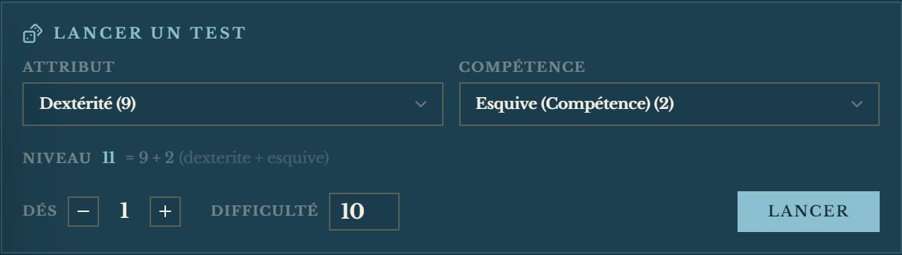
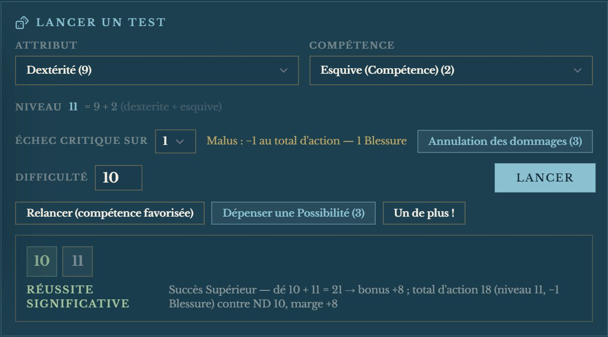
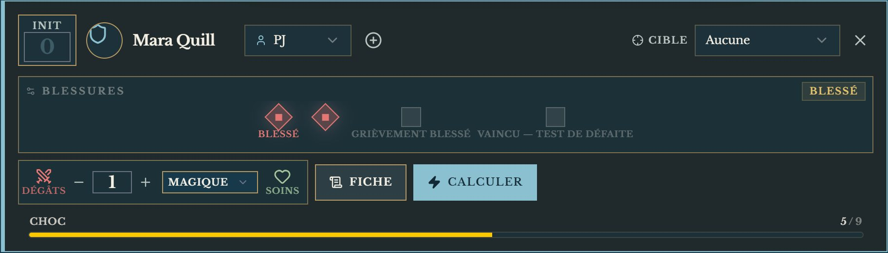

# ⚡️ Jeu — Torg Eternity

> **Pilote décrit :** « Torg Eternity », exporté le 2026-10-13, corrigé le même soir. Retour à [Les jeux et leurs mécaniques](./53-Les-jeux-et-leurs-mecaniques.md).

Les Chevaliers des Tempêtes contre les Seigneurs de Réalité. Les règles de cette page ont été
relues contre le carnet NotebookLM « Torg » le 2026-10-13.

---

## Le jet — la Table des Bonus

1. On retient un **attribut** et, s'il y en a une, une **compétence** : leur somme est le **niveau**.
   Une compétence **non entraînée** se laisse vide (« — aucune — ») : le test se fait sur
   l'attribut seul, et **seul le 10 explose, pas le 20**.
2. On règle le **Niveau de Difficulté** : 10 par défaut (Normale), de 6 (Très facile) à 20 (Presque
   impossible).
3. On règle, si le risque l'exige, la **plage d'échec critique** : 1 d'ordinaire, jusqu'à 1–4 (rafale,
   axiomes, certains Atouts et pouvoirs).
4. **Lancer** : un d20. **Sur 10 ou 20, il explose** — on relance et on cumule.
5. Le total du dé devient un **bonus** par la Table des Bonus, ajouté au niveau : c'est le **total
   d'action**. **Chaque Blessure retire 1**, jusqu'à −3 — le panneau le lit sur la fiche et le dit.

| Total d'action moins ND | Résultat |
| :--- | :--- |
| 10 et plus | **Succès Spectaculaire** |
| 5 à 9 | **Succès Supérieur** |
| 0 à 4 | **Succès Simple** |
| moins de 0 | **Échec** |
| le **premier dé** dans la plage critique | **Échec critique**, quel que soit le reste |

### Après le premier dé

Tant que ce n'est pas un échec critique, trois boutons complètent le test — chacun une seule fois :

| Geste | Ce qu'il fait |
| :--- | :--- |
| **Relancer (compétence favorisée)** | Relance le **premier** dé et garde le nouveau résultat — seulement avant les deux autres gestes |
| **Dépenser une Possibilité** | Un d20 de plus, **ajouté au dé avant la table** ; un 1 à 9 y vaut 10, sans relance ; un 10 ou un 20 naturel explose. La Possibilité se décompte sur la fiche |
| **Un de plus !** | Le d20 de la carte d'action — **sans** le minimum de 10 |

Le panneau dit tout le calcul : « Succès Simple — dé 7 + Possibilité 10 = 17 → bonus +4 ; total
d'action 15 (niveau 12, −1 Blessure) contre ND 10, marge +5 ».

### La Table des Bonus

| Dé | Bonus | Dé | Bonus |
| :---: | :---: | :---: | :---: |
| 1 | Échec | 15 | +2 |
| 2 | −8 | 16 | +3 |
| 3–4 | −6 | 17 | +4 |
| 5–6 | −4 | 18 | +5 |
| 7–8 | −2 | 19 | +6 |
| 9–10 | −1 | 20 | +7 |
| 11–12 | 0 | 21–25 | +8 |
| 13–14 | +1 | puis +1 par tranche de 5 | |

> La table vient du carnet NotebookLM « Torg » (livre de base, page 109), pas du corpus, qui ne la
> contient pas. Si une ligne diffère de votre livre, elle se corrige dans
> `src/modules/dice/systemes/torg.ts`, et ses tests avec.

---

## L'Annulation des dommages

Le bouton **« Annulation des dommages »** du panneau de jet : **une Possibilité**, un test de
**Réalité** (Esprit + Réalité) contre **ND 10**, *après que les dommages ont été calculés, mais avant
qu'ils ne prennent effet*.

| Résultat | Ce qui est annulé, pour cette attaque |
| :--- | :--- |
| Succès Simple | 1 Blessure et tout le Choc |
| Succès Supérieur | 2 Blessures et tout le Choc |
| Succès Spectaculaire | toutes les Blessures et tout le Choc |
| Échec | rien |

Une tentative par attaque ; elle ne rend jamais des dommages déjà subis. Le panneau dit ce qui est
annulé ; décochez les cases par **« Soins »** sur la carte de combattant — GM-OS ne sait pas quelle
part de quel coup retirer.

---

## Combat et santé

- **Les dommages se calculent seuls.** Dans « Dégâts » sur la carte de combattant, saisissez le
  **total de dommages** de l'attaque : GM-OS lit la **Résistance** de la cible et applique la Table
  des Dommages — et le dit, à l'écran et au journal : « 29 dommages contre Résistance 17 : 2
  Blessures, 4 Choc ».

  | Dommages − Résistance | Effet |
  | :--- | :--- |
  | −6 ou moins | rien |
  | −5 à −1 | 1 Choc |
  | 0 à 4 | 2 Choc |
  | 5 à 9 | 1 Blessure, 2 Choc |
  | puis par tranche de 5 | +1 Blessure, +2 Choc |

- **Blessures : quatre cases.** Trois Blessures au plus (**Blessé**, puis **Grièvement blessé** à 3) ;
  la quatrième, c'est **Vaincu** — le test de Défaite (ND 10, sous le plus faible de Force et Esprit).
  La jauge « Blessures » de la fiche suit les cases, et le jet en tire son malus.
- **Choc** : suivi sur la carte de combattant, **plafonné à l'Esprit** du personnage. Le dépasser
  met **KO** — GM-OS l'annonce ; le surplus est ignoré. Le Choc ne donne aucun malus.
- **« Soins »** décoche les Blessures sans passer par la table.
- **Initiative :** la Dextérité, dans l'ordre croissant — en attendant le Paquet d'Action.
- **Distances** en mètres, de « au corps à corps » à « Portée Longue ».

---

## Ce qui manque encore

- **Le Paquet d'Action** (l'initiative par faction, la Ligne de Conflit, l'Action approuvée) et
  **les Cartes du Destin** (la main, la Réserve d'Action) : en chantier, ils attendent vos cartes.
- **La Loi de l'Action** de l'Empire du Nil (une seconde Possibilité pour relancer) et **les Lois
  des cosms** qui changent l'Annulation.
- **Les sbires** (vaincus dès la première Blessure) et **les hordes** (Choc mis en commun) n'ont pas
  de modèle à part : réglez leur santé à la main.
