# ⚡️ Jeu — Torg Eternity

> **Pilote décrit :** « Torg Eternity » 2.0.0, exporté le 2026-11-07 ; essais validés par David le 07/11/2026. [Pilote à réimporter avec « Remplacer »](../../Export%20Dirvers/corriges/Torg-Eternity-2.0.0.gmos-driver). Retour à [Les jeux et leurs mécaniques](./53-Les-jeux-et-leurs-mecaniques.md).

Les Chevaliers des Tempêtes contre les Seigneurs de Réalité. Les passages utilisés pour les
améliorations ont été relus le 07/11/2026 contre le livre de base et *L’Empire du Nil*, version 1.
Les chemins et décalages sont dans `docs/systems/torg/livres.json`.

[Voir le clip Playwright de 2 min 58](../../output/clips/torg-mecanismes-et-tablette.mp4) :
dé explosif, Possibilités, Ingénieux, carte d’Action, Réserve et échange un contre un,
fiche HTML, Ténacité, Sbires et Souffrance. Le joueur utilise le vrai Hub en émulation
tactile : appuis et glissement, avec réception vérifiée côté MJ. Légendes françaises,
dés préparés ; aucun appareil physique. [Chapitres et vérifications](../../output/clips/torg/README.md).

## La fiche PJ vierge

[Ouvrir la fiche HTML interactive](../../docs/fiches/Torg/torg-eternity-fiche-pj-vierge-interactive.html)
ou [la version PDF à imprimer](../../output/fiches/torg/torg-eternity-fiche-pj-vierge.pdf).
La page fournie par David est reproduite avec ses données préremplies retirées ; la
**Table des Bonus est conservée à l'identique**, sans zone de saisie superposée.

L'identité, les attributs, les rangs et valeurs, les compétences libres, la description,
les Atouts, l'équipement, l'armure et les armes sont remplissables. Les repères de droite
sont cliquables ; le compteur Blessures et sa piste de niveau restent indépendants.
Aucun calcul de règles n'est ajouté. **Zones** montre les champs, **Exporter JSON** sauvegarde
une copie transportable, **Imprimer** conserve le format de la page. La fiche fonctionne hors ligne.

Le modèle `torg-eternity-fr` est intégré au moteur de fiches (version 24) et relié au pilote.
Après **Sauvegarder**, l'identité, les attributs, les axiomes, les défenses, la Résistance,
l'Armure, le Choc, les Blessures et les rangs des neuf compétences imprimées remontent dans
GM-OS ; les lignes d'armes, d'armures et d'équipement rejoignent l'inventaire.
Les compétences libres et les champs sans correspondance restent manuels. Les cases
structurées de possession des Atouts se cochent toujours dans le formulaire GM-OS.

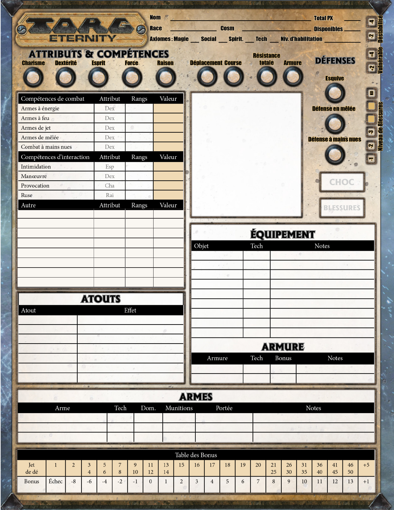

---

## Le jet — la Table des Bonus

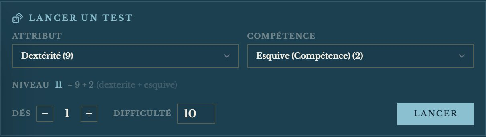

1. On retient un **attribut** et, s'il y en a une, une **compétence** : leur somme est le **niveau**.
   Une compétence **non entraînée** se laisse vide (« — aucune — ») : le test se fait sur
   l'attribut seul, et **seul le 10 explose, pas le 20**.
2. On règle le **Niveau de Difficulté** : 10 par défaut (Normale), de 6 (Très facile) à 20 (Presque
   impossible).
3. On règle, si le risque l'exige, la **plage d'échec critique** : 1 d'ordinaire, jusqu'à 1–4 (rafale,
   axiomes, certains Atouts et pouvoirs).
4. **Lancer** : un d20. **Sur 10 ou 20, il explose** — on relance et on cumule.
5. Le total du dé devient un **bonus** par la Table des Bonus, ajouté au niveau : c'est le **total
   d'action**. **Chaque Blessure retire 1**, jusqu'à −3 — le panneau le lit sur la fiche et le dit.

| Total d'action moins ND | Résultat |
| :--- | :--- |
| 10 et plus | **Succès Spectaculaire** |
| 5 à 9 | **Succès Supérieur** |
| 0 à 4 | **Succès Simple** |
| moins de 0 | **Échec** |
| le **premier dé** est **1** | **Échec automatique**, aucune Possibilité ne le modifie |
| le **premier dé** est **2 à 4** dans une plage critique étendue | Le total peut réussir, avec une Possibilité si nécessaire ; la conséquence critique demeure |

### Après le premier dé

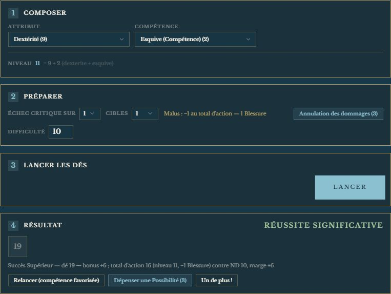

Sauf sur un 1 au premier dé, les gestes suivants complètent le test, chacun une seule fois :

| Geste | Ce qu'il fait |
| :--- | :--- |
| **Relancer (compétence favorisée)** | Relance le **premier** dé et garde le nouveau résultat — avant les autres gestes, hors de la plage critique |
| **Dépenser une Possibilité** | Un d20 de plus, **ajouté au dé avant la table** ; un 1 à 9 y vaut 10, sans relance ; un 10 ou un 20 naturel explose. La Possibilité se décompte sur la fiche |
| **Un de plus !** | Le d20 de la carte d'action — **sans** le minimum de 10 |

Le panneau dit tout le calcul : « Succès Simple — dé 7 + Possibilité 10 = 17 → bonus +4 ; total
d'action 15 (niveau 12, −1 Blessure) contre ND 10, marge +5 ».

### La Table des Bonus

| Dé | Bonus | Dé | Bonus |
| :---: | :---: | :---: | :---: |
| 1 | Échec | 15 | +2 |
| 2 | −8 | 16 | +3 |
| 3–4 | −6 | 17 | +4 |
| 5–6 | −4 | 18 | +5 |
| 7–8 | −2 | 19 | +6 |
| 9–10 | −1 | 20 | +7 |
| 11–12 | 0 | 21–25 | +8 |
| 13–14 | +1 | puis +1 par tranche de 5 | |

> Table vérifiée en image contre le livre de base p. 109 le 07/11/2026. Un dé 15 donne +2 : avec un niveau 12, le total vaut 14.

---

## L'Annulation des dommages

Le bouton **« Annulation des dommages »** du panneau de jet : **une Possibilité**, un test de
**Réalité** (Esprit + Réalité) contre **ND 10**, *après que les dommages ont été calculés, mais avant
qu'ils ne prennent effet*.

| Résultat | Ce qui est annulé, pour cette attaque |
| :--- | :--- |
| Succès Simple | 1 Blessure et tout le Choc |
| Succès Supérieur | 2 Blessures et tout le Choc |
| Succès Spectaculaire | toutes les Blessures et tout le Choc |
| Échec | rien |

Une tentative par attaque ; elle ne rend jamais des dommages déjà subis. Le panneau dit ce qui est
annulé ; décochez les cases par **« Soins »** sur la carte de combattant — GM-OS ne sait pas quelle
part de quel coup retirer.

---

## Combat et santé

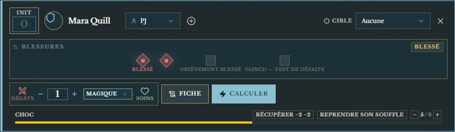

- **Les dommages se calculent seuls.** Dans « Dégâts » sur la carte de combattant, saisissez le
  **total de dommages** de l'attaque : GM-OS lit la **Résistance** de la cible et applique la Table
  des Dommages — et le dit, à l'écran et au journal : « 29 dommages contre Résistance 17 : 2
  Blessures, 4 Choc ».

  | Dommages − Résistance | Effet |
  | :--- | :--- |
  | −6 ou moins | rien |
  | −5 à −1 | 1 Choc |
  | 0 à 4 | 2 Choc |
  | 5 à 9 | 1 Blessure, 2 Choc |
  | puis par tranche de 5 | +1 Blessure, +2 Choc |

- **Blessures : quatre cases.** Trois Blessures au plus (**Blessé**, puis **Grièvement blessé** à 3) ;
  la quatrième, c'est **Vaincu** — le test de Défaite (ND 10, sous le plus faible de Force et Esprit).
  La jauge « Blessures » de la fiche suit les cases, et le jet en tire son malus.
- **Choc** : suivi sur la carte de combattant, **plafonné à l'Esprit** du personnage. Le dépasser
  met **KO** — GM-OS l'annonce ; le surplus est ignoré. Le Choc ne donne aucun malus.
- **Faire baisser le Choc** — les boutons de la jauge Choc, sur la carte :

  | Bouton | La règle |
  | :--- | :--- |
  | **Récupérer −2** | Le personnage **sacrifie tout son tour** (ni déplacement ni action), **hors de la mêlée** : 2 Choc, sans test |
  | **Reprendre son souffle** | Fin du combat ou de la scène, **si le meneur estime qu'on peut souffler** : tout le Choc s'efface (un KO se réveille alors) |
  | **−** / **+** | Un point à la main — hors combat, on récupère **1 Choc par minute** |

  « Soins » ne touche pas au Choc : il décoche les Blessures.
- **« Soins »** décoche les Blessures sans passer par la table.
- **Distances** en mètres, de « au corps à corps » à « Portée Longue ».

---

## Le Paquet d'Action — l'ordre du round

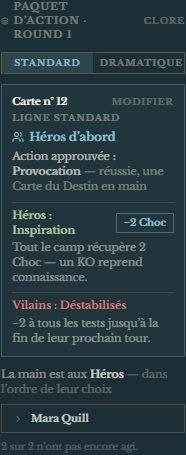

Il n'y a pas d'initiative individuelle. **Au début de chaque round, le meneur retourne une carte
d'Action** (Combat-OS, bloc d'initiative) :

1. **Standard ou Dramatique** : choisissez la ligne avant de retourner. La ligne claire sert à la
   plupart des combats ; la sombre aux moments charnières, aux dénouements, et à toute scène face à
   une créature à **Effroi**.
2. **Qui commence** : **H**, les Héros (les joueurs et leurs alliés), ou **V**, les Vilains. Le camp
   désigné joue **tous ses tours, dans l'ordre de son choix** — cliquez chacun quand il agit —, puis
   l'autre camp. Le round fini : **« Retourner la carte suivante »**.
3. **La Ligne de Conflit** donne à chaque camp ses avantages ou désavantages. Ils s'annoncent sur la
   carte ; trois se jouent d'un clic :

   | Effet | Ce qu'il fait | Dans GM-OS |
   | :--- | :--- | :--- |
   | **Inspiration** | Le camp récupère 2 Choc — un KO reprend connaissance | bouton « −2 Choc » |
   | **Un de plus !** | Un second d20 s'ajoute à chaque test (il explose, sans minimum de 10) | le bouton « Un de plus ! » du jet est mis en avant |
   | **Vivacité** | Le camp prend un second tour complet | bouton « Second tour » |
   | **Déferlement** | Test de Contradiction pour qui n'est pas natif du cosm | annoncé |
   | **Désorientés** | Aucune carte ne se joue depuis la Réserve d'Action ce round | jeu bloqué ; gain et pose restent possibles |
   | **Déstabilisés** | −2 à tous les tests | **retiré seul** au jet des Héros |
   | **Fatigués** | 2 Choc à la fin du tour de chacun | bouton « +2 Choc » |
   | **Revers** | Une complication — à défaut, le camp perd son tour | annoncé |

4. **L'Action approuvée** (en bas de la carte) : un héros qui la réussit pioche une Carte du Destin.

**Vos cartes, décrites une fois.** Dans Deck-OS, marquez votre paquet **Rôle : Paquet d'Action**.
Quand une carte encore inconnue sort, Combat-OS vous demande ce qu'elle dit — les deux lignes,
les effets de chaque camp, l'Action approuvée — et s'en souvient. Vous pouvez aussi les décrire
d'avance, carte par carte, dans le lecteur de Deck-OS. Sans paquet, Combat-OS vous laisse désigner
le camp qui commence.

> Les effets valent aussi **sur les tablettes** : la carte du round part avec la séance, et le jet
> d'un Héros lancé depuis sa tablette retire Déstabilisés et signale « Un de plus ! », comme dans
> votre fenêtre.

---

## Les Cartes du Destin

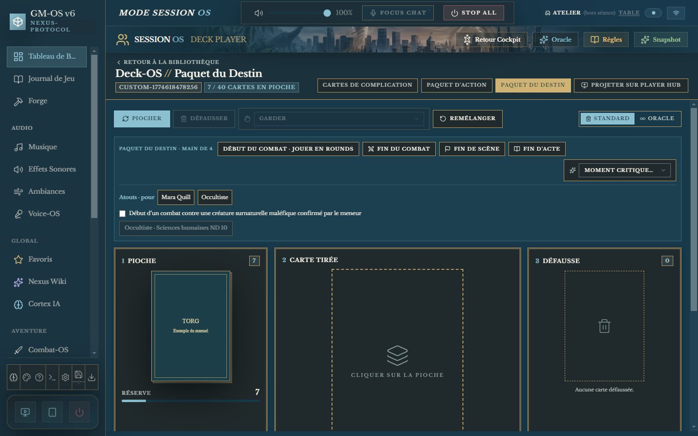

Chaque héros tient une **main de 4 Cartes du Destin**. Leurs effets sont imprimés sur les cartes :
GM-OS ne les joue pas à votre place, il tient les mains. Dans Deck-OS, marquez votre paquet
**Rôle : Paquet du Destin**.

| Geste | Où | Ce qu'il fait |
| :--- | :--- | :--- |
| **Poser en Réserve** | la tablette du joueur, ou votre lecteur | En combat, une carte par fin de tour, face visible devant soi : **toute la table la voit** et elle se joue à tout moment |
| **Moment critique** | la tablette, ou votre lecteur (liste « Moment critique… ») | **Une fois par Acte** : toute la main passe en Réserve — ce qui n'est pas joué aussitôt est défaussé |
| **Jouer** | la tablette, ou votre lecteur | La carte part en défausse |
| **Fin du combat** | votre lecteur | Les cartes de Réserve reviennent en main |
| **Fin de scène** | votre lecteur | Chaque héros de la campagne **complète sa main à 4**. Qui en a plus doit défausser l'excédent : GM-OS le dit, il ne choisit pas pour lui |
| **Fin d'Acte** | votre lecteur | Chacun défausse toute sa main, Réserve comprise, et en tire une nouvelle ; les Moments critiques reviennent |

**L'Action approuvée.** Quand la carte d'Action du round en nomme une, la carte de combat de
chaque héros montre un bouton par action :

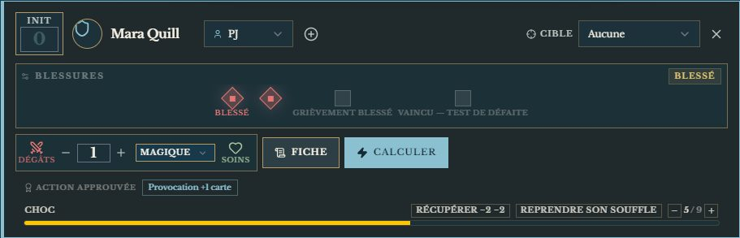

Cliquez quand le héros la réussit : il pioche **une Carte du Destin en main** (pas en Réserve).
Une fois par action et par round — deux actions sur la carte, deux cartes possibles.
La mention **Toutes** propose chaque action séparément ; Intimidation bénéficie alors aussi
d’Aspect effrayant ou de la Loi de la Domination, si ces conditions sont réunies.

**Les Atouts qui touchent aux cartes.** Cocher les Atouts réellement possédés dans la section
**« Atouts et capacités possédés »**, puis **Sauvegarder**. Le texte libre « Atouts » reste un
carnet : il n’accorde aucun geste automatiquement. Les boutons se trouvent dans la fiche,
onglet **Lancer un test**, et sous les gestes du Paquet du Destin dans Deck-OS.

| Atout | Condition et coût | Geste proposé |
| --- | --- | --- |
| **Ingénieux** | Une fois par scène, action simple, une Possibilité | Une carte pour soi, test de Raison ND 10, puis une à trois cartes selon le succès ; une gardée pour le bénéficiaire choisi |
| **Occultiste** | Début d’un combat contre une créature surnaturelle maléfique, confirmé par le MJ | Test de Sciences humaines ; une à trois cartes selon le succès, une gardée. Peut ensuite poser une carte en Réserve |
| **Populaire** | Une fois par Acte | Cherche une **Relation** dans la pioche ou la défausse ; nommer ces cartes dans Deck-OS |
| **Chef naturel** | Une Possibilité, deux cartes de sa main, un autre personnage | Pose les deux cartes dans la Réserve du bénéficiaire |
| **Conscience environnementale** | Une fois par scène | Pose immédiatement une carte de sa main en Réserve |
| **Aspect effrayant** | Intimidation approuvée réussie | La carte de combattant propose deux cartes, une gardée ; même choix sous la Loi de la Domination |

Les coûts et usages sont conservés. **Fin de scène**, **Fin du combat** et **Fin d’Acte** rendent
les usages correspondants. Terminer un choix déjà ouvert avant d’en lancer un autre. Si la pioche
a changé, la reprise renouvelle les cartes autorisées sans repayer ni relancer le test.
Le test de Raison d’Ingénieux est un test d’attribut pur : le 10 et le 20 y explosent.

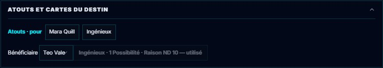

**Échanger une carte.** Une pour une dans les deux modes (livre p. 113). Hors rounds, de main à
main ; en rounds, de Réserve à Réserve. Le destinataire choisit sa carte en retour, puis accepte :
les deux cartes changent de porteur ensemble. Le serveur revérifie les cartes au dernier moment,
sur le Hub comme chez le meneur. Le don ordinaire ne contourne pas la règle.
**Début du combat · jouer en rounds** annonce le mode depuis Deck-OS ; le Paquet d’Action le fait
aussi. **Fin du combat** ferme les rounds et reprend les Réserves.

**Désorientés** interdit de jouer une carte de Réserve ce round, tout en laissant gagner et poser
des cartes. Un **KO** déclaré bloque jeu et échanges. **Déconnecté** bloque les dépenses de
Possibilités et les cartes Drame/Héros, sans interdire tous les échanges. Le meneur confirme
la fin d’un KO ou d’une déconnexion sur la fiche ; Inspiration et Reprendre son souffle réveillent aussi.
Ces contrôles portent sur les cartes et les Atouts ci-dessus. Le meneur vérifie aussi ces
états avant un jet ordinaire ou une Annulation, dont le panneau conserve son fonctionnement manuel.

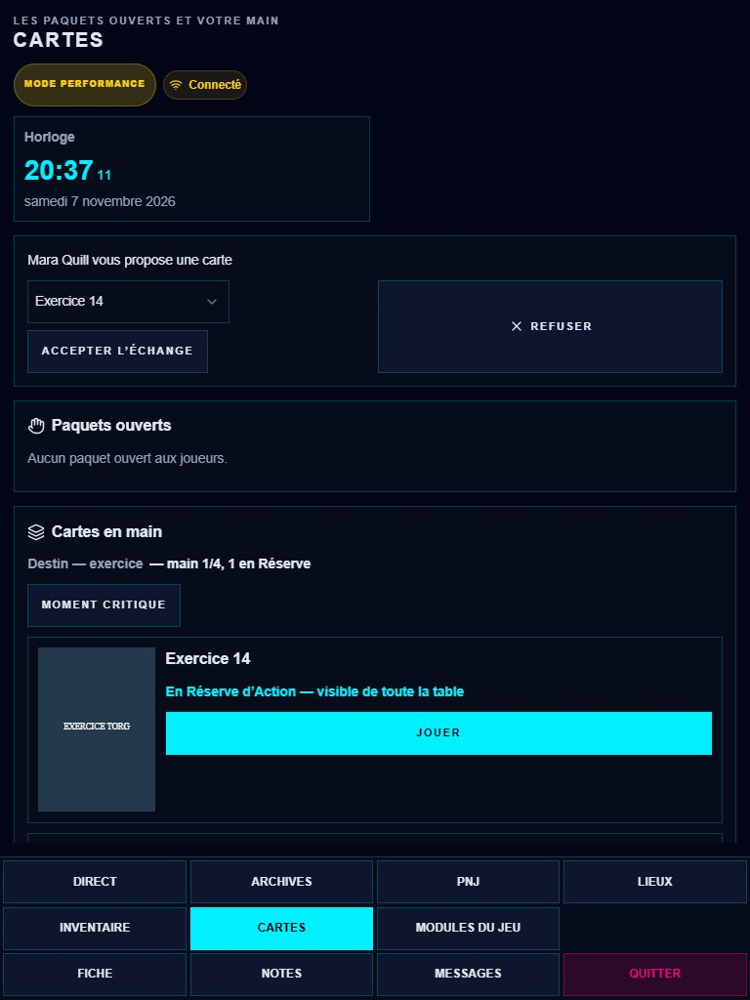

---

## Le cosm et ses Lois du Monde

Le cosm se choisit **sur la scène**, dans la Trame (« Cosm », et « zone mixte avec… » pour un
second) ; sans choix, c'est celui de la **campagne**, réglé sous son nom dans le cockpit. Ses Lois
s'affichent sur l'écran de la scène et, en bref, dans Combat-OS. Celles marquées **GM-OS** jouent
d'elles-mêmes, ou s'annoncent au bon moment (passages vérifiés dans le livre de base) :

| Cosm | Loi | Dans GM-OS |
| :--- | :--- | :--- |
| Empire du Nil | **Héroïsme** | La main passe de 4 à **5** cartes |
| Empire du Nil | **Action** | Après « Dépenser une Possibilité », **« seconde Possibilité »** : la meilleure des deux compte |
| Orrorsh | **Persévérance** | Annulation : Simple n'annule que le Choc, Supérieur une seule Blessure |
| Aysle | **Magie** | « Choc volontaire » au jet d'Altération, Cinétique, Conjuration ou Divination : +1 par point, jusqu'aux rangs ; ce Choc ne se récupère pas avant la fin du sort |
| Pan-Pacifica | **Ténacité** | Après un coup qui met KO : subir une Blessure pour effacer le Choc ; la dernière Blessure conserve le tour complet avant Défaite |
| Tharkold | **Souffrance** | Après une Blessure, désigner l’auteur de l’action : il récupère un Choc, une fois par reçu d’action |
| Tharkold | **Domination** | Intimidation approuvée réussie : deux cartes, une gardée |

Les autres Lois (Gloire, Outsider, Sauvagerie, Vie, Vengeance…) restent à la table, en
rappel.

Les suites chiffrées se choisissent sur la carte de combattant et sont tracées au journal de la
séance. Un reçu empêche une seconde application. Le test de Défaite reste à résoudre au moment
indiqué ; GM-OS ne décide pas de la séquelle ou de la mort à la place du MJ.

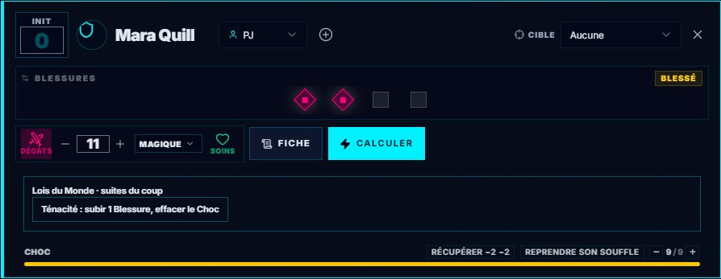

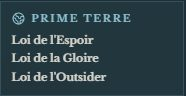

---

## Les Cartes de Cosm

Un paquet par cosm (Empire du Nil, Aysle…) : dans la bibliothèque de Deck-OS, **Rôle : Paquet de
Cosm**, puis **Cosm** : celui du paquet. Chargez les cartes que vous voulez — comme pour le Destin.

Dans le lecteur d'un Paquet de Cosm :

- **Début d'Acte** — chacun défausse la carte qu'il n'a pas jouée, le paquet du cosm courant est
  remélangé, et chacun en reçoit une (livre p. 113).
- **Changement de cosm** — en cours d'Acte, la carte d'un cosm quitté s'échange contre une du
  nouveau ; qui a déjà joué la sienne cet Acte ne reçoit rien.
- **Zone mixte** — un sélecteur par joueur : il pioche dans le paquet qu'il a choisi.

La carte de Cosm n'est **pas** une Carte du Destin : elle ne compte pas dans la main, ne va jamais en
Réserve, et se joue selon ce qu'elle dit — **« Jouer »** sur la tablette, ou depuis Deck-OS. Elle
est alors comptée comme jouée pour l'Acte. Ce qu'elle fait reste à la table.

---

## Sbires, hordes, attaques à plusieurs

- **Le type d'adversaire** — sur la santé d'un adversaire, « Type… » : **Sbire (—)** tombe à la
  première Blessure, **Aguerri (1)** à la deuxième, **Chargé en possibilités (3)** comme un héros
  (livre p. 263). Choisissez-le avant les coups : il remet les cases à neuf.
- **La horde** (règle optionnelle, p. 264) — sur la carte d'un adversaire, **« En horde… »** : le
  nombre de membres, l'Esprit et la Résistance d'un membre (lus sur sa fiche s'il en a une). Le
  **Choc est commun** : un membre tombe KO chaque fois qu'il dépasse l'Esprit (Esprit 7 : un KO
  tous les 8 points) ; **une Blessure élimine un membre** sans toucher au Choc. Les coups se portent
  dans le bloc de la horde, en dommages.
- **Les Actions combinées** (p. 119) — le bloc de la horde dit le bonus de ses assaillants : 2 → +1,
  3 → +2, 4–5 → +3, 6–9 → +4, 10–14 → +5… En mêlée, quatre au plus contre un même défenseur.
- **La capacité « Horde »** de certaines créatures (infectés p. 271, daémons…) : cocher sa
  possession dans la fiche de la créature. Le bonus compte alors aux dommages comme à l’attaque ;
  le simple regroupement de sbires n’accorde pas cette capacité.
- **La capacité « Sbires »** (p. 265), uniquement sur un vilain qui la possède. Avant d’appliquer
  l’attaque, saisir son total de dommages, choisir un laquais du même camp et confirmer sa
  proximité à quelques mètres. **Sbires · Réalité ND 10** fait le test avec le malus de Blessures.
  Réussi, le coup va au laquais ; échoué, au vilain. **Confirmer le coup** applique le total contre
  la Résistance de cette cible, une seule fois. **Nouvelle attaque** ouvre une autre réaction.
  Ne pas appliquer aussi le même coup par « Dégâts ». Sans laquais proche, le vilain encaisse normalement.
- **Les Cibles multiples** (p. 122) — au jet, « Cibles » : −2 par cible supplémentaire ; toutes les
  cibles touchées subissent les dommages.

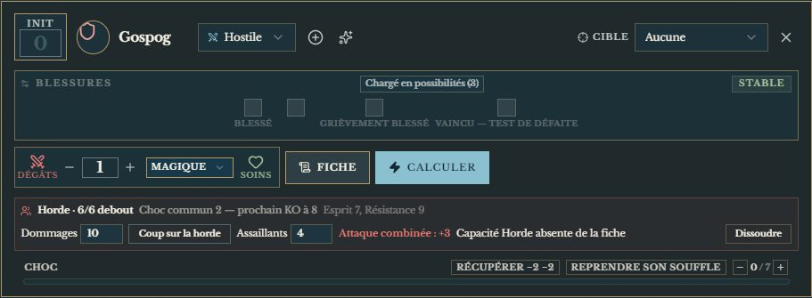

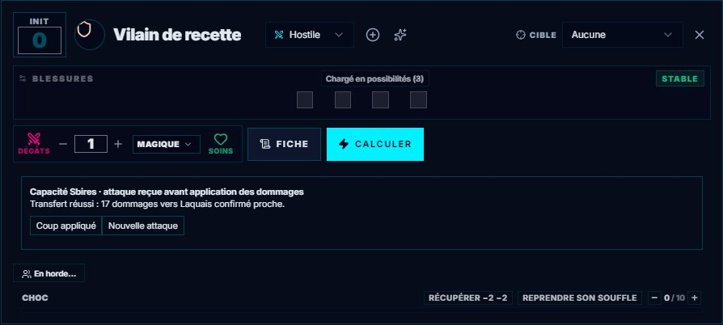

---

## Réimport et arbitrages

- Réimporter le pilote **2.0.0** avec **Remplacer**. Identifiants et valeurs des personnages sont conservés ; les nouvelles cases restent absentes ou fausses tant qu’elles ne sont pas cochées et sauvegardées.
- Le MJ confirme les conditions fictionnelles : créature surnaturelle maléfique, laquais proche, auteur de l’action. Les autres Atouts, Lois et effets imprimés des cartes se jouent selon leur texte.
- L’Annulation des dommages garde le fonctionnement décrit plus haut ; terminer les réactions avant l’application d’un coup.
- Essais validés par David le 07/11/2026 : les améliorations TORG-A0 à A4 sont marquées bonnes dans leur suivi.
