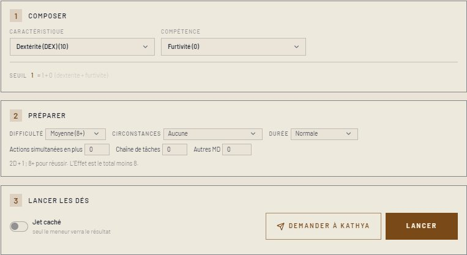
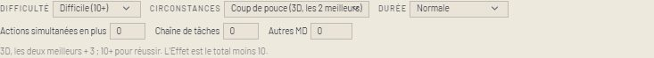
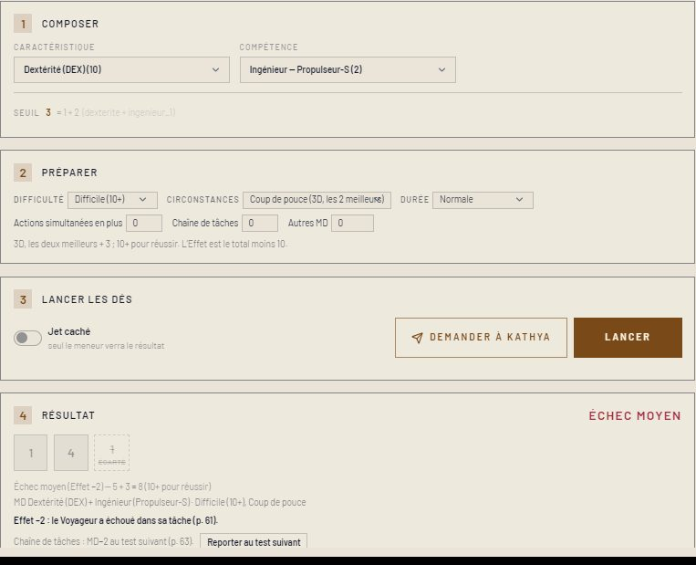
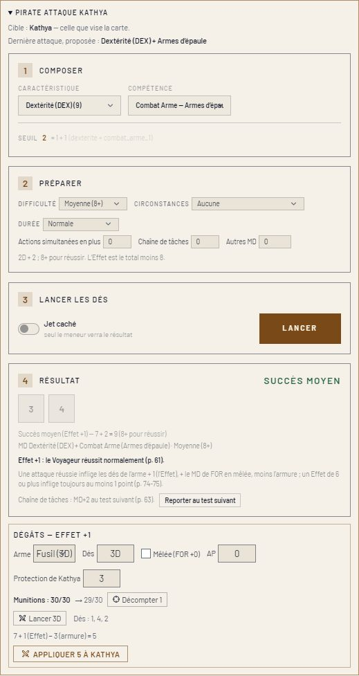
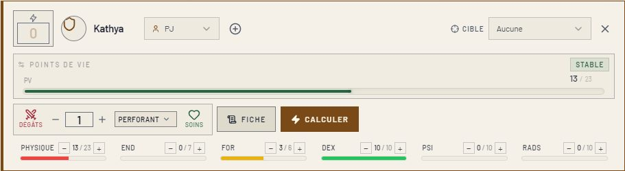
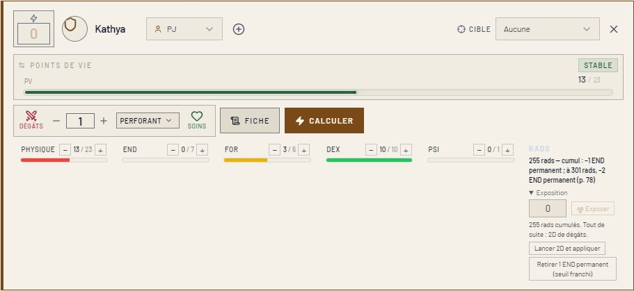
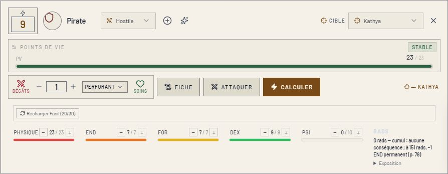
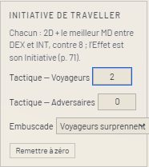
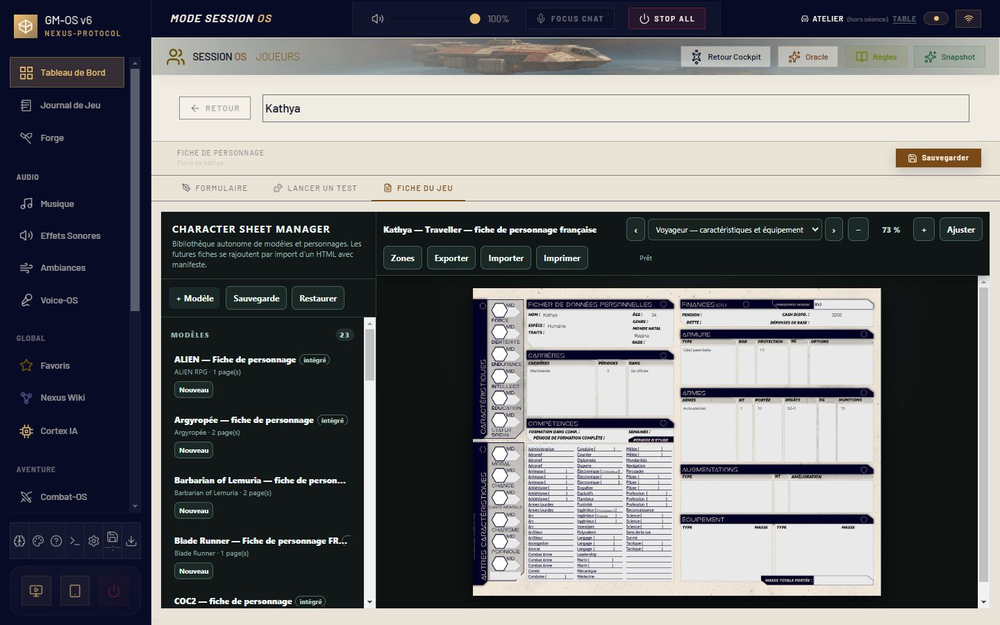

# 🚀 Jeu — Traveller

> **Pilote décrit :** « Traveller », forgé par David, exporté le 2026-11-26, **fini le
> 2026-11-26**, essayé par David le 2026-11-27 ; **version 2.2.0 du 2026-11-27** (PSI sans dépense,
> radiations, dégâts incapacitants à guérir — à réimporter avec « Remplacer ») (`Export Dirvers/corriges/Traveller-2.2.0.gmos-driver`, construit par
> `outils/traveller/finir_traveller.py`, contrôlé par `outils/traveller/verifier_pilote.mjs`).
> Thème `traveller`, fiche de personnage HTML, bannière et identité visuelle livrés le même jour par
> GM-OS Studio. Retour à [Les jeux et leurs mécaniques](./53-Les-jeux-et-leurs-mecaniques.md).

Un seul geste : le **test**. Le joueur lance **2D**, ajoute le **MD** de la caractéristique et son
**niveau de compétence**, et doit atteindre le **nombre cible** que fixe l'Arbitre — 8+ pour une
tâche Moyenne. L'écart est l'**Effet**, qui dit comment la tâche réussit ou échoue, et ce qu'elle
donne à la suivante. Il n'y a pas de points de vie : les dégâts frappent les caractéristiques
physiques, et GM-OS les reporte sur la fiche.

> Règles relues contre le livre de règles français v2.2 le 2026-11-26 — page du PDF = page
> imprimée + 1 : 5-13, 58-81, 96-129, 136, 145-171, 224-254. Les vingt et une fiches du corpus
> `docs/systems/traveller/rules/` sont relues ; cinq sont corrigées (registre § 278).

**Réimporter le pilote avec « Remplacer ».** Le pilote forgé comptait des réussites : chaque D6
était comparé à la valeur brute de la caractéristique, et la difficulté exigeait huit réussites de
deux dés — **chaque test échouait**. La version 2.0.0 garde son identifiant, mais **sa fiche
change** : elle reprend une à une 328 des 331 clés de la fiche HTML, dont les **72 lignes de
compétence** qui remplacent la zone de texte unique. Un personnage créé avec la fiche forgée garde
ses anciennes valeurs sans qu'elles paraissent : il faut ressaisir ses caractéristiques, ses
compétences et son équipement.

---

## Le test

- **Composer** : la **caractéristique** (Force, Dextérité, Endurance, Intellect, Éducation, Statut
  social, Psionique, et les caractéristiques optionnelles de la feuille) et, au choix, la
  **compétence**, nommée avec sa spécialité (« Ingénieur — Propulseur-S »). Le seuil affiché est le
  **MD total** : celui de la caractéristique, lu sur son niveau (table p. 9 : 6-8 → +0, 9-11 → +1,
  12-14 → +2…), plus le niveau de compétence.
- **Sans la compétence**, MD−3 (p. 58), réduit d'un point par niveau de **Polyvalent**, annulé au
  niveau 3 (p. 69). Une **autre spécialité** du même domaine fait passer le test au niveau 0
  (p. 58) — sauf **Profession**, dont chaque spécialité s'apprend à part (p. 69).

> ⚠️ Un niveau de compétence se saisit en **texte** : une case **vide** veut dire « non formé »
> (MD−3), **0** veut dire « formé, sans bonus ». Un champ nombre de GM-OS aurait affiché 0 partout.

- **Préparer** : la **difficulté** de l'Arbitre, de Simple 2+ à Impossible 16+ (p. 60) ; le
  **Coup de pouce** ou le **Coup du sort** — trois dés, on garde les deux meilleurs ou les deux pires ;
  ils s'annulent et ne se cumulent pas (p. 61) ; la **durée** — plus vite MD−2, plus lentement MD+2
  (p. 62) ; les **actions simultanées**, qui montent chacune la difficulté d'un niveau (p. 62) ; le MD
  d'une **chaîne de tâches** (p. 63) ; et les **autres MD** des règles : viser, portée, couvert (p. 72).
- **Demander à un joueur** (depuis le 2026-11-27, TRV-A1) : « Demander à Kathya » envoie la
  composition **et** la préparation. La tablette s'ouvre sur la même difficulté, le même Coup de
  pouce ou du sort, la même durée, les mêmes actions, la même chaîne et les mêmes MD ; le joueur peut
  encore les changer, et c'est lui qui lance.

## Le résultat

| Effet | Résultat (p. 61) | MD au test suivant (p. 63) |
| :--- | :--- | :--- |
| 6 ou plus | Succès exceptionnel | +3 |
| 1 à 5 | Succès moyen | +2 |
| 0 | Succès marginal — une condition possible | +1 |
| −1 | Échec marginal — le succès possible contre une conséquence | −1 |
| −2 à −5 | Échec moyen | −2 |
| −6 ou moins | Échec exceptionnel | −3 |

« **Reporter au test suivant** » porte le MD de la chaîne au prochain jet ; il se vide après ce
lancer.

## Les dégâts d'une attaque

Depuis le 2026-11-27 (TRV-A2), une attaque réussie ouvre la carte **Dégâts** (p. 74-76) :

- **les dés de l'arme**, lus sur la fiche (« 3D-3 », « 1D+2 ») ou, à défaut, au catalogue du pilote,
  qui donne aussi ses **traits** ; une arme **destructrice** (« 1DD ») multiplie ses dés par 10 ;
- **+ l'Effet** du test, **+ le MD de FOR** en mêlée (« en plus de l'Effet », p. 74) ;
- **+ le niveau Auto** pour une **rafale** (p. 76) ;
- **− la protection** de la cible : la meilleure de ses armures, ou le trait « Armure (+X) » d'un
  animal, moins l'**AP** de l'arme ; tout se change avant de lancer ;
- **au moins 1 point** sur un Effet de 6+ (p. 75).

« **Appliquer à …** » passe par la porte des blessures ci-dessous ; une arme **Incapacitante** ne
touche que l'END. Explosion, Rayonnement, Viseur, l'auto complet et la Reflec face aux lasers sont
**rappelés**, et se règlent à la main.

**Les munitions** (TRV-A6, 2026-11-27) : sous l'attaque, réussie ou manquée, la ligne
« **Munitions : 30/30 → 26/30** » et **Décompter** : un tir simple prend un coup, une rafale le niveau
Auto, l'auto complet trois fois le niveau Auto (p. 76). Le champ « munitions » de la fiche s'écrit
**« restants/capacité »** (« 26/30 ») ; un nombre seul, recopié du livre, vaut un chargeur plein ; vide,
la capacité vient du catalogue. Chargeur vide : **Recharger** (une action mineure, p. 74). Sans
capacité lisible, la ligne se tait. Rien ne s'écrit sans clic, et chaque geste a sa ligne au journal.

La carte s'ouvre à trois endroits :

1. **« Attaquer »** sur la carte d'un adversaire, dans Combat-OS : DEX + Combat Arme, ou FOR + Mêlée
   pour une arme de mêlée, proposés depuis sa première arme ;
2. **sous le test d'attaque d'un Voyageur, chez le meneur** (Mêlée, Combat Arme, Armes lourdes,
   Artilleur) : la cible se choisit parmi les combattants. Jamais sur la tablette ;
3. **l'attaque d'un animal** du bestiaire : 2D + sa Mêlée (naturelles), l'attaque du livre
   (« Morsure (4D) »), sans MD de FOR ; tout va à ses PdV (p. 81).

## Les blessures

Un Voyageur n'a pas de points de vie (p. 74). Quand un coup arrive — de Combat-OS ou de la console
de santé —, GM-OS l'écrit sur la fiche :

1. l'**END** d'abord ;
2. à 0, l'excédent va à la **FOR** ou à la **DEX**, selon « Excédent des dégâts » sur la fiche (le
   choix de la cible) ;
3. quand l'une des deux tombe à 0, le Voyageur est **inconscient** (un test d'END par minute,
   MD+1 cumulatif, p. 80) et le reste frappe la dernière ; les trois à 0, il est **tué**.

Les **MD** des caractéristiques blessées sont recalculés aussitôt (p. 74) : le test suivant les lit.
Une arme **Incapacitante** ne touche que l'END ; à 0, la carte reçoit l'état **« Neutralisé »** pour
autant de rounds que l'excédent, décompté à chaque tour (p. 76). Ses dégâts se retiennent dans
« Dégâts incapacitants à guérir » (version 2.2.0), que **Une heure de repos** rend à l'END. Un **soin** se répartit également entre les caractéristiques blessées (p. 79), sans dépasser
les niveaux **sans blessure** de la fiche. La jauge **Physique** est le total END + FOR + DEX.
Une créature du bestiaire n'a que ses **PdV** (p. 81) : la colonne PDV du bestiaire remplit sa santé.

GM-OS recalcule les MD, le total physique, et relève un niveau « sans blessure » qu'une
caractéristique saisie dépasse (un personnage qu'on crée ou qui progresse) — **d'où que vienne la
saisie** depuis le 2026-11-27 (TRV-A3) : l'éditeur du meneur, la **tablette** du joueur, la **fiche
HTML**, un clic sur une jauge de la carte de combat. Un blessé garde ses niveaux sans blessure.

## La PSI et les radiations

Depuis la version 2.1.0 (TRV-A5, 2026-11-27) :

- la **PSI** se dépense et revient d'un point par heure, trois heures après le dernier pouvoir ; le
  MD des pouvoirs suit la PSI **actuelle** (p. 224-225). La jauge PSI se lit sur la **PSI sans
  dépense**, un champ de la fiche GM-OS que la fiche imprimée n'a pas ; elle se relève seule quand
  la PSI saisie la dépasse ;
- les **Rads** sont une **dose cumulée**, sans maximum (p. 78) : la carte affiche la dose, la
  conséquence cumulée — −1 à −4 END permanent au-delà de 150, 300, 500 et 800 rads — et le prochain
  seuil. « **Exposition** » ajoute une dose (une arme à rayonnement : 2D × 20 ; une fuite, une
  éruption : la table p. 78), rappelle ses conséquences immédiates — de 1D à 8D de dégâts, la nausée
  au-delà de 50 rads —, lance et applique les dégâts, et, quand un seuil cumulé est franchi, retire
  l'END permanente de l'END et de son niveau sans blessure. Rien ne s'écrit sans un clic.

## Les pouvoirs psioniques et les gestes de la carte

Depuis le 2026-11-27 (TRV-A6) :

- **un test de talent psionique** — une ligne de compétence libre nommée Télépathie, Clairvoyance,
  Télékinésie, Conscience ou Téléportation — ouvre la carte **Pouvoir psionique** : les pouvoirs du
  livre avec leur test, leur portée et leur coût (p. 225-229). Choisir un pouvoir pose sa difficulté
  sur le test ; la **portée allongée** d'une ou deux Zones double ou quadruple le coût. Le jet se fait
  avec la PSI comme caractéristique. Après le jet : « **Réussite — dépenser 3 PSI** » ou « **Échec —
  dépenser 1 PSI** » ; ce qui passe sous zéro part en **dégâts** ; sans point de PSI, la carte refuse
  la tentative (p. 225). Un coût au choix (Télékinésie, Force augmentée, Robustesse, Régénération) se
  saisit ;
- sur la **carte de combat**, quand ils ont un sens : **Recharger** une arme entamée ; **Récupérer la
  PSI** — le meneur dit les heures écoulées depuis le dernier pouvoir : rien les trois premières
  heures, puis un point par heure, jusqu'à la PSI sans dépense (p. 224) ; **Une heure de repos**, qui
  rend les dégâts incapacitants (p. 76) ; **Test de réveil** d'un inconscient : 2D + MD END contre 8,
  MD+1 par échec, une minute par test (p. 80).

## L'initiative

Depuis le 2026-11-27 (TRV-A4), « Jet système » dans Combat-OS fait pour chacun le test du livre
(p. 71) : **2D + le meilleur MD entre DEX et INT**, contre 8 ; l'**Effet** est son Initiative pour
tout le combat. Avant le jet, la carte « Initiative de Traveller » note :

- l'**Effet du test de Tactique** de chaque camp, ajouté à l'Initiative de tous ses membres ;
- l'**embuscade** : MD+6 au camp qui surprend, MD−6 à l'autre, **au premier round seulement** —
  au round 2, GM-OS les retire et refait l'ordre.

Les Voyageurs sont les joueurs et leurs alliés ; un neutre ne reçoit ni l'un ni l'autre. Un animal,
sans DEX ni INT, fait son test sans MD. Le détail de chaque Initiative part au journal.

## La fiche HTML

La fiche (`traveller-fr`, deux pages paysage) est intégrée au moteur de fiches (version 30 : les
chiffres des caractéristiques, des MD et des compétences s'y lisent depuis le 2026-11-27) et
reliée par `docs/systems/traveller/fiche/correspondance.json` : 328 clés une à une. Restent à la
fiche : le portrait, et le nom et l'espèce de la page 2, qu'elle recopie seule. Le total physique,
les niveaux sans blessure et le choix de l'excédent n'ont pas de case imprimée : ils restent dans
GM-OS. Une saisie GM-OS ne part vers la fiche HTML qu'après « Sauvegarder ».

## Ce qui n'est pas dans le pilote

- Les **chargeurs de rechange** ne se comptent pas ; les **attaques** de l'auto complet, l'**Explosion**
  et le **Rayonnement** se règlent à la main (le décompte des munitions de l'auto complet, lui, se fait).
- Les **médicaments psi** et les **inhibiteurs** (p. 230) se rendent à la main ; le temps ne fait pas
  revenir la PSI seul : c'est le meneur qui dit les heures.
- L'option « **forces opposées** » (un seul test pour toutes les forces de l'Arbitre, p. 71) n'est
  pas prévue : chaque adversaire fait son test.
- Les **portées** sont les Zones de Portée des rencontres (p. 80) ; le MD d'une portée d'arme
  (courte +1, longue −2, extrême −4, p. 74) se règle au jet, dans « Autres MD ».
- Le **commerce**, le **saut**, la **création de mondes** et le **combat
  spatial** vivent dans le corpus et l'Oracle, pas dans des écrans.
