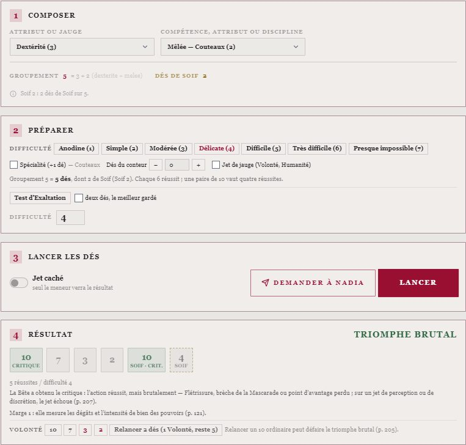
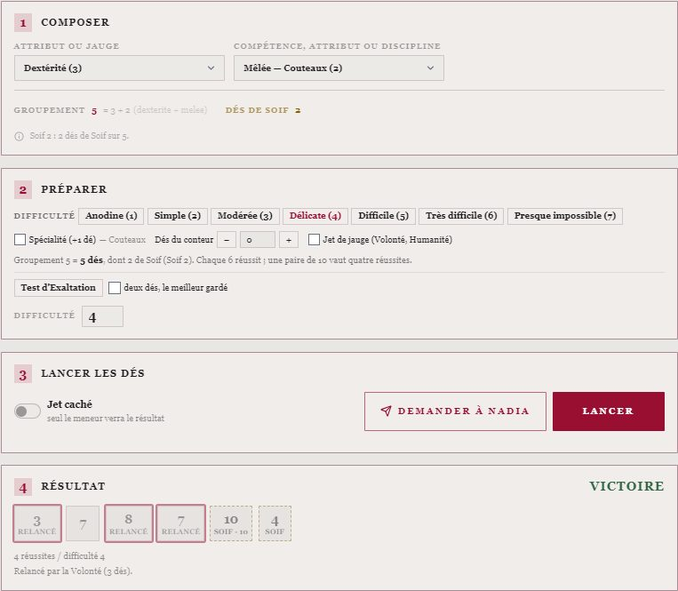
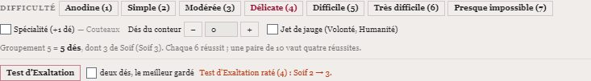
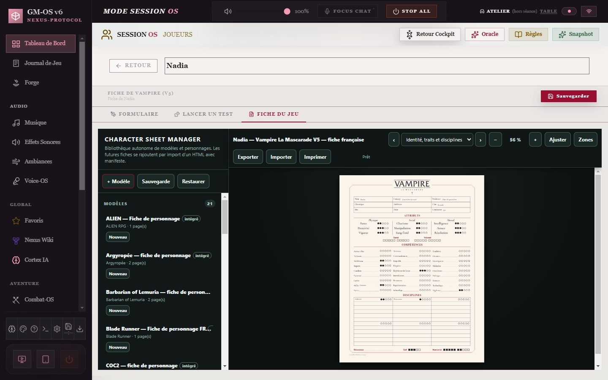

# 🧛 Jeu — Vampire : la Mascarade (V5)

> **Pilote décrit :** « Vampire: la Mascarade », forgé par David, exporté le 2026-11-17, **fini le
> 2026-11-17**, version 2.0.0 (`outils/vampire/finir_vampire.mjs` →
> `Export Dirvers/corriges/Vampire-2.0.0.gmos-driver`, à réimporter avec « Remplacer »). Thème
> `vampire`, bannière, fiche de personnage HTML et identité visuelle livrés le même jour par
> GM-OS Studio. Retour à [Les jeux et leurs mécaniques](./53-Les-jeux-et-leurs-mecaniques.md).

Un seul geste : le **jet**. On lance autant de d10 que le **groupement** — un attribut et une
compétence, ou deux attributs, ou un attribut et une discipline. Chaque **6 ou plus** est une
réussite, et **chaque paire de 10 en vaut quatre**. Les réussites doivent atteindre la
**difficulté**. Autant de dés que la **Soif** sont des **dés de Soif** : un 10 de Soif dans un
critique fait un **triomphe brutal**, un 1 de Soif dans un échec fait un **échec bestial**.
Autour : la **Volonté** qui relance, le **test d'Exaltation** qui monte la Soif. La fiche HTML est
reliée champ par champ.

> Règles relues contre le livre de base français le 2026-11-17 — pages imprimées 117-127, 136-137,
> 152-173, 205-245, 298-305, 370-377, 409-422 (page du PDF = imprimée + 4). Les 24 fiches du corpus
> `docs/systems/vampire/rules/` sont corrigées d'après lui.

**Réimporter le pilote avec « Remplacer ».** Le pilote forgé prenait attribut + compétence pour le
seuil de chaque dé, **ne lançait aucun dé** et exigeait trois réussites. Ses attributs
s'appelaient « Puissance, Finesse, Résistance, Social 1… » et ses compétences « Compétence 1 à 27 ».
La version 2.0.0 garde son identifiant, mais **sa fiche change** : les 9 attributs et les 27
compétences du livre, chacune avec ses spécialités, six disciplines nommées, onze avantages, le
Sang, les croyances et le profil. Un personnage créé avec la fiche forgée garde ses anciennes
valeurs ; ses traits sont à ressaisir.

---

## Le jet

- **Composer** : l'**attribut** (ou une jauge : la Volonté, l'Humanité), puis la **compétence**
  — ou un second attribut (« Force + Force pour soulever une poutre »), ou une **discipline**,
  proposée sous son nom (« Célérité »). Sans compétence, l'attribut seul, sans pénalité (p. 118).
  Une compétence avec spécialité s'affiche « Mêlée — Couteaux ». La ligne **Groupement** fait la
  somme ; à côté, les **dés de Soif**.
- **Préparer** :
  - la **difficulté** du livre, en réussites requises : Anodine (1), Simple (2), Modérée (3, par
    défaut), Délicate (4), Difficile (5), Très difficile (6), Presque impossible (7) ; au-delà
    pour une opposition (p. 119) ;
  - **Spécialité (+1 dé)**, avec le texte des spécialités de la compétence ; elle se décoche après
    le lancer (p. 118) ;
  - les **dés du conteur**, en plus ou en moins — le livre conseille trois au plus (p. 120) ;
  - **Jet de jauge** : un jet de Volonté ou d'Humanité ne prend aucun dé de Soif et ne se relance
    pas. Retenir la Volonté ou l'Humanité au menu le coche d'office (p. 119, 205).
- **Lancer** : jamais moins d'un dé (p. 120).

Le résultat se lit avec les mots du livre (p. 120-122, 205-208) :

| Bilan | Quand |
| --- | --- |
| **Triomphe brutal** | Une victoire avec au moins une paire de 10, dont un 10 de Soif |
| **Victoire critique** | Une victoire avec au moins une paire de 10 |
| **Victoire** | Les réussites atteignent la difficulté ; la **marge** est l'excédent |
| **Échec** | Pas assez de réussites, mais au moins une : une **victoire à la Pyrrhus** se négocie |
| **Échec bestial** | Un échec avec au moins un 1 de Soif — jamais sur une victoire |
| **Échec total** | Aucune réussite |

Sous les dés, chaque dé de Soif porte son nom (« Soif », « Soif · 1 », « Soif · 10 ») et les 10
appariés « Critique ». Un échec bestial propose **Tirer la Compulsion** : le tableau du livre
(1-3 Soif, 4-5 Domination, 6-7 Destruction, 8-9 Paranoïa, 0 Compulsion de clan) et son malus.

## La Volonté

Sous le résultat, la ligne **Volonté** montre les dés ordinaires : les échecs sont choisis
d'office, et l'on en change en cliquant, **trois au plus**. **Relancer** dépense un point de
Volonté sur la fiche ; les dés de Soif ne se relancent jamais (p. 122, 205). L'exemple de David
(p. 206) : relancer le 10 ordinaire défait le triomphe brutal. Une seule relance par jet ; aucune
sur un jet de jauge.

## Le test d'Exaltation

**Test d'Exaltation**, à l'étape « Préparer » : un dé ; sur 6 ou plus, rien ne change ; sinon la
Soif monte d'un point sur la fiche (p. 211). La case **deux dés, le meilleur gardé** sert à une
grande Puissance du sang, selon le niveau du pouvoir (tableau p. 216). Raté à 5 de Soif, il appelle
un jet contre la frénésie de Soif, difficulté 4 — au réveil, c'est la torpeur (p. 219-220).

## La fiche, les jauges et le combat

- **Santé = Vigueur + 3**, jauge principale ; **Volonté = Résolution + Sang-froid** ; la Soif de 0
  à 5 ; l'Humanité de 0 à 10 (p. 119, 205, 239).
- **Initiative** : Sang-froid + Vigilance, sans jet, du plus haut au plus bas (p. 300).
- **Fiche HTML** (`vampire-v5-fr`, intégrée au moteur des fiches) : 135 champs reliés dans les
  deux sens — identité, attributs, compétences et spécialités, disciplines et leurs pouvoirs,
  avantages, Sang, croyances, expérience, profil. Une saisie GM-OS ne part vers la fiche HTML
  qu'après « Sauvegarder ».
- **Pas encore suivi par GM-OS** : les **dégâts superficiels et aggravés case par case** (« / » et
  « X ») restent sur la fiche HTML ; GM-OS tient la Santé et la Volonté restantes. Le Coup de sang,
  la frénésie, les Flétrissures et le Remords se jouent à la table, sans outil dédié.
