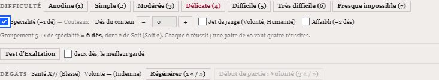
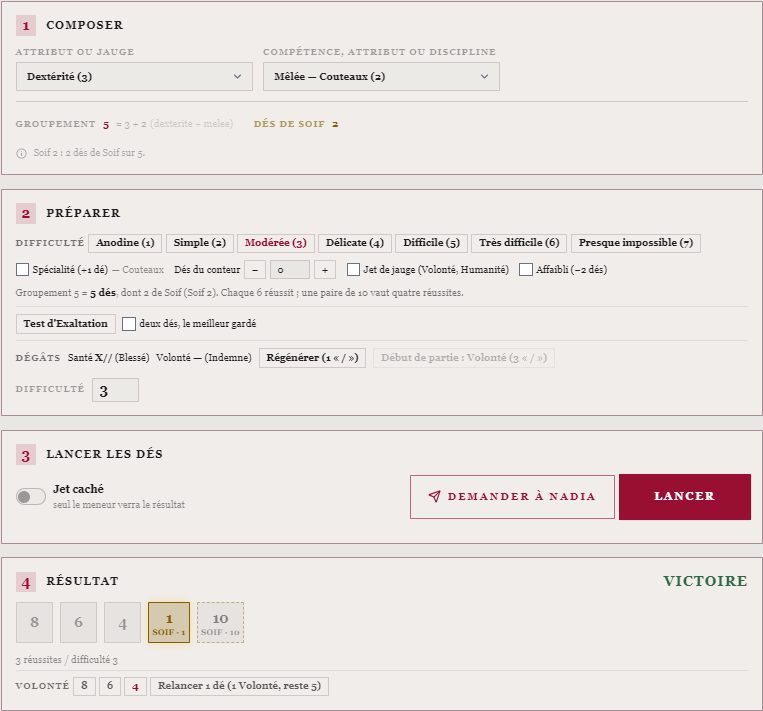
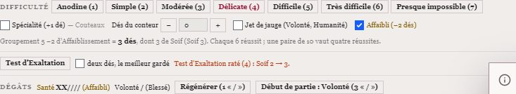
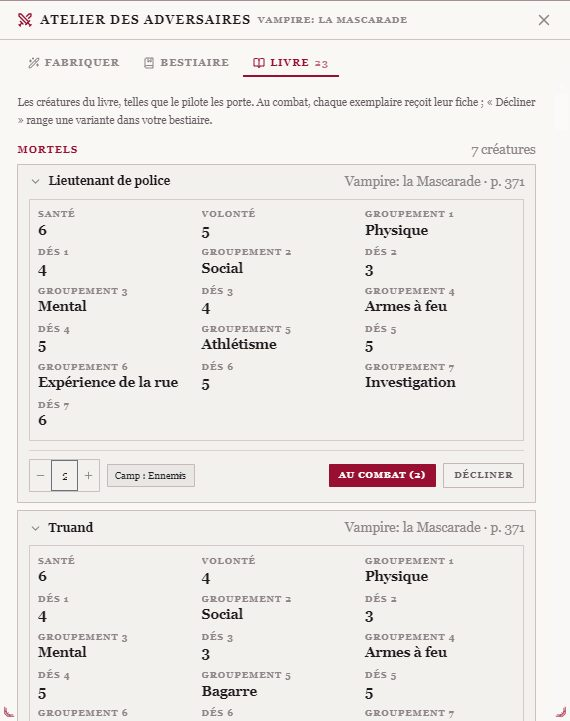
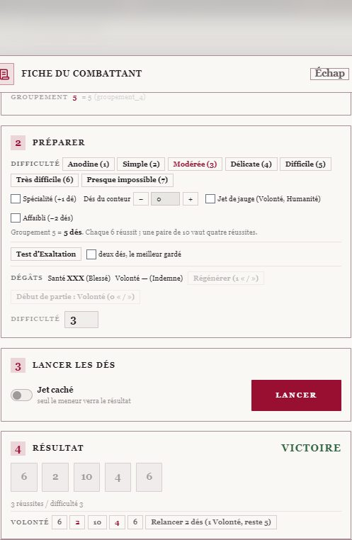

# 🧛 Jeu — Vampire : la Mascarade (V5)

> **Pilote décrit :** « Vampire: la Mascarade », forgé par David, exporté le 2026-11-17, **fini le
> 2026-11-17**, **essayé par David le 2026-11-18**, version 2.2.0 — les dégâts case par case, le bestiaire et l'équipement du livre
> (`outils/vampire/finir_vampire.mjs` → `Export Dirvers/corriges/Vampire-2.2.0.gmos-driver`, à
> réimporter avec « Remplacer » ; les fichiers 2.0.0 et 2.1.0 n'ont ni bestiaire ni catalogue). Thème
> `vampire`, bannière, fiche de personnage HTML et identité visuelle livrés le même jour par
> GM-OS Studio. Retour à [Les jeux et leurs mécaniques](./53-Les-jeux-et-leurs-mecaniques.md).

Un seul geste : le **jet**. On lance autant de d10 que le **groupement** — un attribut et une
compétence, ou deux attributs, ou un attribut et une discipline. Chaque **6 ou plus** est une
réussite, et **chaque paire de 10 en vaut quatre**. Les réussites doivent atteindre la
**difficulté**. Autant de dés que la **Soif** sont des **dés de Soif** : un 10 de Soif dans un
critique fait un **triomphe brutal**, un 1 de Soif dans un échec fait un **échec bestial**.
Autour : la **Volonté** qui relance, le **test d'Exaltation** qui monte la Soif, et les **dégâts**
superficiels « / » et aggravés « X », case par case. La fiche HTML est reliée champ par champ.

> Règles relues contre le livre de base français le 2026-11-17 — pages imprimées 117-127, 136-137,
> 152-173, 205-245, 298-305, 370-377, 409-422 (page du PDF = imprimée + 4). Les 24 fiches du corpus
> `docs/systems/vampire/rules/` sont corrigées d'après lui.

**Réimporter le pilote avec « Remplacer ».** Le pilote forgé prenait attribut + compétence pour le
seuil de chaque dé, **ne lançait aucun dé** et exigeait trois réussites. Ses attributs
s'appelaient « Puissance, Finesse, Résistance, Social 1… » et ses compétences « Compétence 1 à 27 ».
La version 2.0.0 garde son identifiant, mais **sa fiche change** : les 9 attributs et les 27
compétences du livre, chacune avec ses spécialités, six disciplines nommées, onze avantages, le
Sang, les croyances et le profil. Un personnage créé avec la fiche forgée garde ses anciennes
valeurs ; ses traits sont à ressaisir. La version 2.1.0 ajoute les dégâts case par case et passe
la Santé en points : la 2.0.0 dessinait cinq cases génériques, quelle que soit la Vigueur.

---

## Le jet

- **Composer** : l'**attribut** (ou une jauge : la Volonté, l'Humanité), puis la **compétence**
  — ou un second attribut (« Force + Force pour soulever une poutre »), ou une **discipline**,
  proposée sous son nom (« Célérité »). Sans compétence, l'attribut seul, sans pénalité (p. 118).
  Une compétence avec spécialité s'affiche « Mêlée — Couteaux ». La ligne **Groupement** fait la
  somme ; à côté, les **dés de Soif**.
- **Préparer** :
  - la **difficulté** du livre, en réussites requises : Anodine (1), Simple (2), Modérée (3, par
    défaut), Délicate (4), Difficile (5), Très difficile (6), Presque impossible (7) ; au-delà
    pour une opposition (p. 119) ;
  - **Spécialité (+1 dé)**, avec le texte des spécialités de la compétence ; elle se décoche après
    le lancer (p. 118) ;
  - les **dés du conteur**, en plus ou en moins — le livre conseille trois au plus (p. 120) ;
  - **Jet de jauge** : un jet de Volonté ou d'Humanité ne prend aucun dé de Soif et ne se relance
    pas. Retenir la Volonté ou l'Humanité au menu le coche d'office (p. 119, 205) ;
  - **Affaibli (−2 dés)** : cochée d'office quand une jauge pleine touche ce groupement ; on la
    décoche si le conteur l'épargne, on la coche s'il en juge un autre touché (p. 126). Voir
    [Les dégâts](#les-dégâts).
- **Lancer** : jamais moins d'un dé (p. 120).

Le résultat se lit avec les mots du livre (p. 120-122, 205-208) :

| Bilan | Quand |
| --- | --- |
| **Triomphe brutal** | Une victoire avec au moins une paire de 10, dont un 10 de Soif |
| **Victoire critique** | Une victoire avec au moins une paire de 10 |
| **Victoire** | Les réussites atteignent la difficulté ; la **marge** est l'excédent |
| **Échec** | Pas assez de réussites, mais au moins une : une **victoire à la Pyrrhus** se négocie |
| **Échec bestial** | Un échec avec au moins un 1 de Soif — jamais sur une victoire |
| **Échec total** | Aucune réussite |

Sous les dés, chaque dé de Soif porte son nom (« Soif », « Soif · 1 », « Soif · 10 ») et les 10
appariés « Critique ». Un échec bestial propose **Tirer la Compulsion** : le tableau du livre
(1-3 Soif, 4-5 Domination, 6-7 Destruction, 8-9 Paranoïa, 0 Compulsion de clan) et son malus.

## La Volonté

Sous le résultat, la ligne **Volonté** montre les dés ordinaires : les échecs sont choisis
d'office, et l'on en change en cliquant, **trois au plus**. **Relancer** coche un « / » sur la
jauge de Volonté, sans le diviser par deux ; sur une jauge déjà pleine, un « / » devient « X »
(p. 122, 126). Les dés de Soif ne se relancent jamais (p. 205). L'exemple de David
(p. 206) : relancer le 10 ordinaire défait le triomphe brutal. Une seule relance par jet ; aucune
sur un jet de jauge.

## Le test d'Exaltation

**Test d'Exaltation**, à l'étape « Préparer » : un dé ; sur 6 ou plus, rien ne change ; sinon la
Soif monte d'un point sur la fiche (p. 211). La case **deux dés, le meilleur gardé** sert à une
grande Puissance du sang, selon le niveau du pouvoir (tableau p. 216). Raté à 5 de Soif, il appelle
un jet contre la frénésie de Soif, difficulté 4 — au réveil, c'est la torpeur (p. 219-220).

## Les dégâts

La Santé et la Volonté sont des jauges de cases ; chaque case reçoit un dégât **superficiel « / »**
ou **aggravé « X »** (p. 126). On les porte comme tout coup, par le **panneau de santé** ou le
**pupitre de Combat-OS**, en choisissant le type :

| Type | Ce qui est noté |
| --- | --- |
| **Superficiels** | Divisés par deux, arrondi au supérieur, puis autant de « / » sur la Santé |
| **Aggravés** | Autant de « X » sur la Santé |
| **Superficiels non divisés** | Quand un pouvoir ou le conteur le précise |
| **Volonté — superficiels**, **Volonté — aggravés** | La même chose sur la Volonté, pour un conflit social |

- **Affaibli** : une jauge remplie, de « / », de « X » ou des deux, retire **deux dés** aux
  groupements physiques (Santé) ou sociaux et mentaux (Volonté). Chaque niveau de dégâts reçu
  ensuite change un « / » en « X » (p. 126-127).
- **Hors de combat** : une Santé pleine de « X » met un vampire en **torpeur** et un mortel dans le
  coma ou la mort ; une Volonté pleine de « X » dans un conflit social le fait craquer et perdre la
  face (p. 127).
- **La Santé et la Volonté de GM-OS comptent les cases sans « X »** : elles ne tombent à zéro
  qu'avec la torpeur. Les « / » se lisent sur la ligne **Dégâts** du panneau de jet (« Santé XX////
  (Affaibli) »), dans le champ « Dégâts de Santé » de la fiche, et case par case sur la fiche HTML.
- **Régénérer**, à l'étape « Préparer » : un test d'Exaltation efface des « / » de Santé selon la
  Puissance du sang — un jusqu'à 1, deux jusqu'à 3, trois jusqu'à 7, quatre jusqu'à 9, cinq à 10
  (p. 216, 218). Un seul par tour. Les « X » se régénèrent à la nuit, un par nuit contre trois tests
  (p. 219) : un soin d'**Aggravés** au panneau de santé les efface.
- **Début de partie : Volonté** efface autant de « / » de Volonté que la Résolution ou le
  Sang-froid, le plus élevé (p. 127).

## Le bestiaire et l'équipement

Le **bestiaire** porte les 23 antagonistes du livre (p. 370-377), rangés en Mortels, Animaux,
Vampires et Créatures d'épouvante, chacun avec sa page. On les pose au combat depuis l'atelier des
adversaires, onglet **Livre**, bouton **Au combat** : chaque exemplaire entre avec sa fiche.

- **Mortels et animaux** sont des antagonistes simplifiés (p. 370) : des **groupements nommés**,
  Physique, Social, Mental, puis leurs groupements exceptionnels (« Armes à feu 5 »). Chacun est un
  groupement **complet** : au panneau de jet, on le choisit seul au premier menu, sans compétence.
  Ces groupements n'apparaissent pas sur la fiche d'un joueur.
- **Vampires et créatures d'épouvante** ont les attributs, compétences et disciplines d'un
  personnage, l'Humanité et la Puissance du sang : ils se lancent comme un joueur.
- **La Santé et la Volonté du livre** sont sur la fiche : un lieutenant de police entre à 6, une
  Harpie à 5 ; les dégâts suivent les cases « / » et « X » ([Les dégâts](#les-dégâts)).
- Les particularités du livre sont rappelées sur la fiche du combattant ; celles des créatures
  d'épouvante disent leur test d'Exaltation raté (1 dégât superficiel, p. 376).

**Lancer un test pour un adversaire** : sur sa carte de combat, bouton **Fiche**, puis le panneau
**Lancer un test pour …**. C'est le panneau d'un personnage : au premier menu, un groupement nommé
(« Armes à feu ») ou un attribut ; la Soif, l'Affaiblissement, la relance par la Volonté et le test
d'Exaltation suivent la fiche de l'adversaire et s'y écrivent — sur sa fiche de campagne s'il est
rangé en PNJ (« Dans la campagne »), sur le plateau sinon. Un joueur, lui, lance depuis sa fiche.

Le **catalogue** porte les armes et armures de la table p. 304 et le chapitre « Matériel »
(p. 378-381) : armes dissimulées et incendiaires, munitions Souffle-du-Dragon et Raufoss, Hafla DM34,
lance-flammes, cocktail Molotov, fusil à filet, lance-pieu, chaoscope, XScope, sac pare-soleil et les
objets surnaturels. La valeur de dégâts s'ajoute à la marge du jet (p. 303) ; **l'armure n'agit pas
seule au combat** — chaque point change un aggravé d'arme tranchante ou perforante en superficiel
(p. 304) : choisir le type du coup en conséquence.

## La fiche, les jauges et le combat

- **Santé = Vigueur + 3** cases, jauge principale ; **Volonté = Résolution + Sang-froid** ; GM-OS
  compte leurs cases sans « X ». La Soif de 0 à 5 ; l'Humanité de 0 à 10 (p. 119, 126, 205, 239).
- **Initiative** : Sang-froid + Vigilance, sans jet, du plus haut au plus bas (p. 300).
- **Fiche HTML** (`vampire-v5-fr`, intégrée au moteur des fiches) : 137 champs reliés dans les
  deux sens — identité, attributs, compétences et spécialités, disciplines et leurs pouvoirs,
  avantages, Sang, croyances, expérience, profil, et les dix cases de Santé et de Volonté (« X »
  d'abord, puis « / »). Une saisie GM-OS ne part vers la fiche HTML qu'après « Sauvegarder ».
- **Sans outil dédié** : les blessures incapacitantes du combat avancé (1d10 + aggravés, p. 303), le
  Coup de sang, la frénésie, les Flétrissures et le Remords se jouent à la table.
