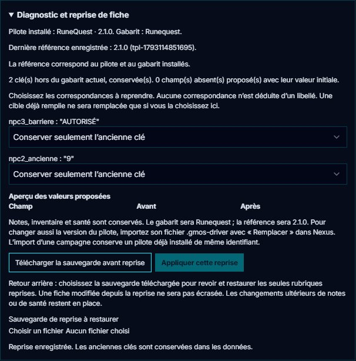

# 📄 La fiche de personnage HTML

GM-OS peut afficher une **vraie fiche de personnage** — celle du jeu, avec sa mise en page, ses
cases et ses couleurs — et la brancher sur ses données. Elle apparaît chez le meneur **et** sur la
tablette du joueur.

> ⭐ **La fiche est un outil d'immersion des JOUEURS**, pas un tableau de bord du meneur. Tout ce
> qui suit découle de ce cadrage.

---

## Reprendre une ancienne fiche

Depuis le 03/11/2026, le meneur peut ouvrir **Formulaire → Diagnostic et reprise de fiche**
sur un PJ. Le panneau affiche le pilote installé, sa version, le gabarit attendu et la dernière
référence enregistrée. Une référence inconnue signifie que GM-OS ne connaît pas la version de
création ; ce n'est pas une preuve que la fiche est périmée. Les nouveaux PJ retiennent leur
référence à la création. Le Voyageur conserve son panneau de reprise spécifique.

1. Sauvegarder ou abandonner les saisies en cours du formulaire.
2. Lire les clés hors gabarit, les valeurs incompatibles et les champs absents. Les anciennes
   clés sont conservées ; aucun rapprochement n'est déduit du nom d'un champ.
3. Choisir explicitement les valeurs anciennes à copier vers les champs actuels et relire
   **l'aperçu avant/après**. Une cible déjà remplie peut être remplacée par ce choix.
4. **Télécharger la sauvegarde avant reprise**, puis **Appliquer cette reprise**. Le JSON
   conserve les rubriques avant et après la reprise et désigne ce PJ précis.
5. Pour revenir en arrière, choisir ce JSON sous **Sauvegarde de reprise à restaurer**, vérifier
   l'aperçu puis **Restaurer les anciennes valeurs**. Si les rubriques reprises ont changé entre
   temps, la restauration refuse de les écraser. La sauvegarde d'un autre PJ est refusée.

La reprise conserve les notes, l'inventaire, la santé et les anciennes clés. Les champs absents
reçoivent les valeurs initiales du gabarit, montrées avant l'application. Si le gabarit change,
le lien vers l'ancienne fiche HTML est détaché ; cette fiche reste dans la bibliothèque. Relier
ensuite la fiche adaptée au jeu. Le JSON ne remplace pas une sauvegarde complète : il ne
restaure ni un pilote remplacé, ni toute une campagne, ni une bibliothèque HTML.

Pour changer le pilote installé, importer son **.gmos-driver** dans Nexus avec **Remplacer**.
Importer une campagne ne remplace pas un pilote déjà présent du même identifiant ; le bilan
signale désormais une différence de version, de règles ou de gabarit, même si le numéro de
version est identique entre deux variantes. Voir [Nexus](./90-Nexus-OS-emporter-une-campagne.md).

*NP-C2 vérifié le 03/11/2026 : tests structurels et quatre reprises réelles avec restauration
passent ; huit captures relues sur l’ensemble NP-C2/NP-C3. Validation globale de David :
« ok tout est testé, commit et pousse ». Aucune campagne personnelle ouverte.*

## 1. Ce que c'est vraiment

Ce n'est pas une image ni un PDF : c'est un **moteur de fiches** — une page HTML qui sait afficher
plusieurs gabarits, avec des champs typés, et qui **parle** à GM-OS.

La fiche est affichée dans un cadre isolé, servi depuis une autre origine que le reste de
l'application. Rien ne traverse directement : tout passe par un **pont de messages**. Ce n'est pas
une contrainte subie, c'est l'isolation voulue — *elle vient de la différence d'origine, pas du
protocole.*

## 2. Qui gagne quand les deux ne disent pas la même chose

> ⭐ **La dernière écriture gagne.** Décision de David du 2026-10-03 (*option A*), qui remplace celle
> du 2026-08-28 (*« c'est la tablette qui gagne »*).

| Sens | Quand |
| :--- | :--- |
| **La fiche → GM-OS** | À l'ouverture, **et à chaque saisie du joueur**. |
| **GM-OS → la fiche** | À la création ; **à l'ouverture, si GM-OS a été modifié plus récemment** que la fiche ; et, fiche ouverte, **dès que GM-OS change** une valeur — seulement celle-là. |

GM-OS date chaque écriture des données d'un personnage. À l'ouverture d'une fiche, il compare : si
ses valeurs sont plus récentes — une Force corrigée dans le formulaire, par exemple —, il les pousse
vers la fiche ; sinon, c'est la fiche qui fait foi, comme avant.

> ⛔ **Ce que cela répare.** La fiche gagnait toujours : une valeur corrigée dans le formulaire de
> GM-OS ne partait jamais vers la fiche, et la fiche la remettait à l'ancienne valeur à la
> réouverture. *Une règle qui donne toujours raison au même côté efface l'autre en silence.*

**Deux garde-fous** :

- **Le vide n'efface jamais.** Un champ laissé blanc dans la fiche n'écrase pas une valeur connue.
- **Chaque valeur écrasée est journalisée**, dans les deux sens, dans `main.log`. *La règle est simple ; c'est son coût
  qui doit rester visible* — un champ écrasé par une resynchronisation se découvre en séance, et
  sans trace on ne peut plus dire ce qu'il contenait.

## 3. La bibliothèque vit par appareil

Le moteur garde sa propre bibliothèque de fiches, **sur l'appareil qui l'affiche**. La tablette d'un
joueur a la sienne ; le poste du meneur a la sienne.

C'est une conséquence directe du cadrage « outil d'immersion du joueur ». Et c'est aussi pourquoi
le magasin qui détient la vérité — celui de la fiche — est sauvegardé à part : une copie est prise
quand une fiche est ouverte chez le meneur.

## 4. Les identifiants de champ ne s'inventent pas

Un champ de la fiche est relié à une donnée de GM-OS par une **table de correspondance**. Ces
identifiants **viennent de la Forge** — ils ne sont pas libres.

Mesuré au moment de la construire : **48 % de simples renommages, 52 % d'un seul motif, zéro
orphelin**. C'est ce qui a fait renoncer à une couche d'abstraction : *il n'y avait rien à
abstraire.*

⚠️ **Les données de la fiche sont à plat** : deux sections peuvent se disputer une même clé. C'est
le piège à connaître en écrivant une correspondance.

## 5. Le décor revient quand la fiche s'en va

Sur un écran de projection, **l'image est le décor, les fiches passent devant**. Fermer une fiche
projetée ne laisse pas un écran noir : le décor reprend sa place.

⚠️ **Enregistrer une retouche coupait la projection** — c'est réparé par une option qui force le
maintien. Si vous voyez une fiche projetée disparaître en l'éditant, c'est là qu'il faut regarder.

## 6. Le Livret du voyageur de Rêve de Dragon

Le modèle **Rêve de Dragon — Livret du voyageur** contient cinq pages : personnage,
équipement, sorts et rituels, feuille de route et Archétype. Il est intégré à GM-OS depuis
le 2026-10-19. Réimportez le pilote étendu **`RDD_driver_gmos_relie.gmos-driver`** avec
**Remplacer**, puis relancez GM-OS. Dans le personnage, **Fiche du jeu** ouvre le livret ;
**Formulaire** retrouve les champs GM-OS et les panneaux du Voyageur.

La page **Archétype** est reliée aux champs **Archétype — niveaux** du formulaire. Pour utiliser
ces niveaux comme potentiels de progression, reportez-les aussi dans **Stress, expérience et
Archétype → Répartir et progresser → Reporter le potentiel**. Ce report reste explicite.
Les caractéristiques calculées par GM-OS gardent leurs formules : leur saisie dans le livret
ne remplace pas le calcul. Les compteurs et les noms des compétences libres sont reliés.
Le [guide Rêve de Dragon](54-Jeu-Reves-de-Dragons.md) détaille les champs, les armes et les suivis.

Le fichier HTML peut également s'ouvrir **seul**, hors ligne, avec sauvegarde dans le navigateur,
import/export JSON, zoom et impression. Ces sauvegardes autonomes sont séparées des données du
personnage dans GM-OS. Pour modifier le personnage pendant la partie, utilisez sa fiche reliée
dans l'application ou sur la tablette.

---

## 💡 Ce qu'il faut retenir

- **La dernière écriture gagne** entre GM-OS et la fiche ; le vide n'efface pas une valeur connue.
- **La synchronisation fonctionne dans les deux sens**, à l'ouverture et pendant la saisie.
- **La bibliothèque est locale à l'appareil** : ce que le joueur voit sur sa tablette lui appartient.
- Pour les scores **calculés**, voir le [moteur de calcul des
  fiches](./51-Formules-de-fiche.md) ; pour le détail technique, le
  [document technique](../Technical%20Docs/Character_Sheet_Technical_Doc.md).

---

*Guide écrit le 2026-09-04. La couture a été publiée le 2026-08-27 et livrée sur les deux écrans le
2026-08-28.*

*Relu le 2026-10-03 : la règle « la fiche fait foi » est remplacée par **la dernière écriture gagne**
(commit du même jour).*

*Relu le 2026-10-19 : Livret du voyageur RdD intégré, Archétype du formulaire et carnet de
progression distingués ; rappel final aligné sur la synchronisation décrite au § 2.*
