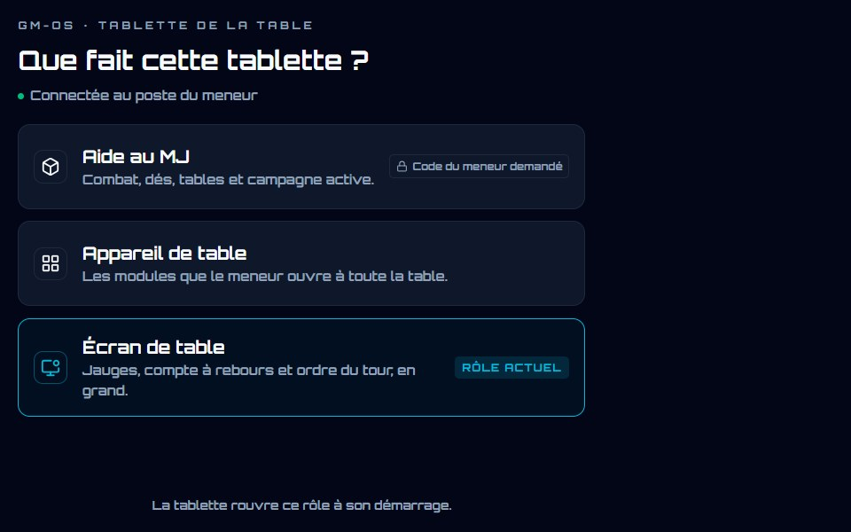
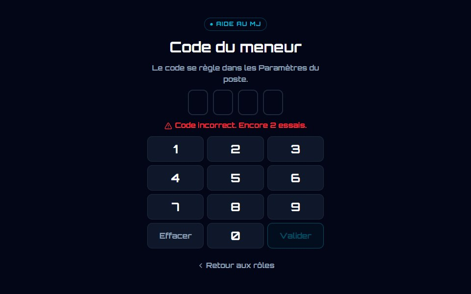
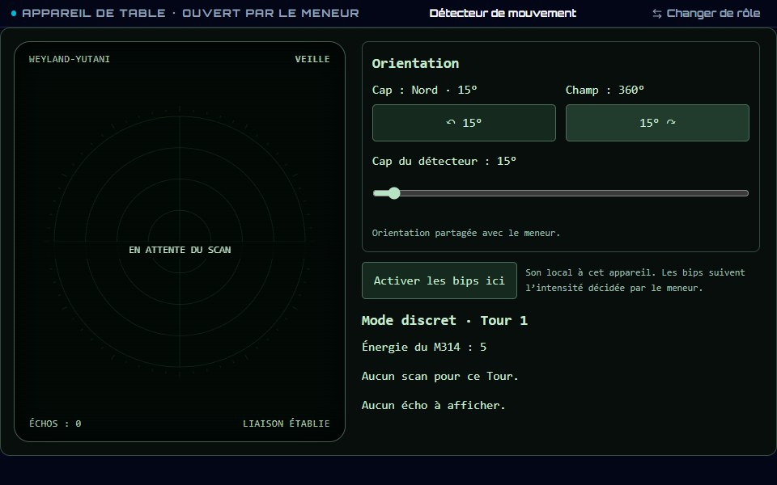

# 📟 La tablette de la table (Fire HD 8)

*Nouveau le 2026-11-16.* Une tablette de plus, posée sur la table, qui prend **un rôle à la fois** :

| Rôle | Pour qui | Ce qu'elle fait |
| --- | --- | --- |
| 🎛️ **Aide au MJ** | vous | la [tablette du meneur](./60-Tablette-du-meneur.md) : combat, dés, sons, scénario, notes… et l'onglet **Tables** |
| 🧭 **Appareil de table** | le groupe | un module du jeu que vous ouvrez **à toute la table** — le détecteur M314 d'Alien |
| 📺 **Écran de table** | les joueurs | l'ordre du tour, les jauges, le minuteur et l'heure du monde, **en grand**, face à la table |

Elle a été pensée pour une **Amazon Fire HD 8 (7ᵉ génération)**, mais toute tablette avec un
navigateur récent fait l'affaire. C'est une page web : rien à installer dans GM-OS.

> 🔒 **Les rôles « Appareil de table » et « Écran de table » sont publics.** La tablette n'y reçoit
> que ce que vos joueurs ont le droit de voir : ni notes privées, ni secrets, ni jauge cachée, ni
> combattant caché. Seule l'**Aide au MJ**, appairée par son QR code, voit vos secrets.

---

## 🛠️ Préparer la tablette (une fois)

1. **Navigateur : Firefox, pas Silk.** Le navigateur d'Amazon (Silk) démarre GM-OS mais perd des
   couleurs : un bouton peut y devenir illisible. Firefox est souvent déjà installé sur la Fire ;
   sinon, installez-le.
2. **Branchez-la sur son chargeur secteur.** Le port USB d'un PC la charge à peine quand elle est
   allumée. Sur secteur, elle ne se met plus en veille (réglé à l'étape 3).
3. **Réglages automatiques**, si vous avez branché la tablette en USB avec le débogage ADB activé :
   ```powershell
   powershell -ExecutionPolicy Bypass -File outils\fire\preparer-la-fire.ps1
   ```
   Écran allumé tant qu'elle est branchée, Wi-Fi jamais en veille, épinglage d'écran disponible.
   `-Retablir` remet les réglages d'usine.
4. **Une adresse fixe pour le PC.** Réservez son adresse (ici `192.168.0.211`) dans les réglages de
   votre box : si elle change, le raccourci de la tablette ne mène plus nulle part.
5. **Le volume de la tablette au maximum** : les bips du M314 passent par son haut-parleur.

---

## 🔀 L'accueil des rôles, et le code du meneur

*Nouveau le 2026-11-24.* Une seule adresse, avec GM-OS lancé normalement (port **3001**) :

`http://192.168.0.211:3001/?window=accueil-tablette`

**Faites-en le raccourci de la tablette** : ouvrez-la dans Firefox, puis menu ⋮ › **Ajouter à
l'écran d'accueil**. Le script de préparation l'ouvre déjà par défaut.



- **Au démarrage, la tablette rouvre son dernier rôle** sans passer par cet écran.
- **« Changer de rôle »**, en haut à droite de l'Appareil et de l'Écran de table et en bas de la
  colonne de l'Aide au MJ, ramène à ces trois cartes.

> ⚠️ En `npm run dev`, le port n'est pas le même (et une tablette s'y recharge seule à la moindre
> coupure). Les soirs de séance, lancez GM-OS normalement.

### 🔒 Le code du meneur

Pour que les joueurs ne tombent pas sur vos secrets en touchant « Changer de rôle » :

1. **Réglez un code à quatre chiffres** au poste : **Paramètres › Télécommande**, sous le QR code
   d'appairage, encadré **« Code du meneur — tablette de la table »**. Il ne s'affiche plus une fois
   enregistré ; **Changer** et **Retirer** sont à côté.
2. **Appairez la tablette une fois** par le QR code de la télécommande, comme une tablette du meneur.
3. Quand la tablette passe en **Appareil de table** ou en **Écran de table**, elle **oublie son
   appairage**. Pour revenir à l'**Aide au MJ**, elle demande le code :



- Le code reste sur votre PC : c'est GM-OS qui le compare, la tablette ne le connaît jamais. Le bon
  code lui rend son appairage.
- **Trois essais**, puis cinq minutes d'attente, puis dix, et ainsi de suite.
- Taper l'adresse de la télécommande à la main ne sert à rien : la tablette reste « Non appairée ».
- **Sans code réglé**, la tablette garde son appairage et revient à l'Aide au MJ sans rien demander ;
  l'accueil le rappelle en bas de l'écran.

### 🖥️ Plein écran

**Touchez l'écran une fois** : la barre d'adresse de Firefox et les barres d'Android disparaissent.
Dans les trois rôles, ce premier toucher fait aussi son effet (un bouton touché agit). L'Écran de
table l'annonce en haut à droite tant qu'il n'est pas en plein écran.

**Pour en sortir** : balayez depuis le haut de l'écran, puis touchez Retour. Le toucher suivant y
revient.

---

## 🎛️ Aide au MJ — et l'onglet Tables

C'est la [tablette du meneur](./60-Tablette-du-meneur.md), avec son appairage par QR code : tout y
est décrit. Un onglet s'y ajoute, **Tables**, juste sous **Dés**.

1. L'onglet montre **les tables du jeu de la campagne active**, et elles seules — la pastille dit le
   jeu (« Alien », « Dune »…). Sans campagne active, ou pour un jeu sans tables, il le dit.
2. **Filtrer les tables…** pour retrouver la vôtre, puis touchez-la.
3. Réglez le **Modificateur** (− / +), puis **Tirer**.
4. Le résultat s'affiche : valeur, titre, description et **Effet**. Il est marqué **« Vu par toi
   seul »** : le tirage est fait **par votre PC** (même moteur et même historique que
   [Table-OS](./40-Table-OS-tables-aleatoires.md)), mais il ne revient qu'à cette tablette.
5. **Montrer aux joueurs** l'écrit au journal de séance (si une séance est enregistrée) **et**
   l'annonce sur les tablettes des joueurs. Le badge devient **« Montré aux joueurs »**.

> 💡 Au PC, le bouton de partage de Table-OS n'écrit qu'au journal ; celui de la tablette montre
> vraiment le résultat aux joueurs.

---

## 🧭 Appareil de table — un module pour tout le groupe

La tablette posée au milieu de la table devient l'appareil commun du groupe. Aujourd'hui, **seul le
détecteur M314 d'Alien** sait la servir ; les autres modules le disent dans leur carte.

### Ouvrir le module à la table

1. Démarrez une **séance** (un module ne s'ouvre aux joueurs qu'en séance).
2. Ouvrez la tablette sur l'adresse de l'**Appareil de table** : elle affiche « Aucun module ouvert à
   la table ».
3. Dans **Modules du jeu** (au PC ou sur votre Aide au MJ), sur la carte **Détecteur de mouvement**,
   cochez **La table** (la case n'apparaît que pour les modules qui la servent).
4. Le M314 s'affiche sur la tablette, sous un bandeau « Appareil de table · Ouvert par le meneur ».
   Décochez : il disparaît.



En paysage (depuis le 2026-11-25), le radar occupe la gauche à la hauteur de l'écran, et
l'orientation, les bips et le mode discret la droite : rien à faire défiler.

> 🔒 Une seule tablette peut être l'appareil de table. Une seconde affiche « Une autre tablette sert
> déjà d'appareil de table ».

### Laisser la table orienter le détecteur

Dans le pupitre du M314 (mode discret, porteur posé sur le plan), choisissez **La table** dans
**Joueur qui oriente le M314**. Les boutons **↶ 15°** / **15° ↷** et le curseur **Cap du détecteur**
apparaissent sur la tablette : les joueurs tournent le cône, votre pupitre suit. **Meneur seul** leur
reprend la main. La **largeur** du cône reste à vous.

### Échos et bips

- Un écho n'apparaît qu'après **Scanner ce Tour**, pour des pions **en mouvement** et **détectables**,
  dans le cône. **Tour suivant** efface les échos.
- Un écho **dans la zone du porteur** se montre en **points tout proches du centre**, un par pion.
- **Activer les bips ici** sur la tablette (un navigateur ne joue rien sans un geste). En mode discret,
  les bips **accélèrent avec la proximité** : très rapides dans la zone du porteur, lents au bord du
  radar. Le **Volume** du pupitre les dose ; montez-le pour une tablette posée au milieu de la table.

---

## 📺 Écran de table — en grand, face aux joueurs

Tournez la tablette **en paysage** et ouvrez l'adresse de l'**Écran de table**.

### Choisir ce qu'il montre

Dans le **cockpit** de la séance, le cadre **Afficheur Ulanzi** a une section **Écran de table** —
réglable même si l'Ulanzi est éteint, et **distincte** de la sélection de l'Ulanzi. Cochez :

| Widget | Ce qu'il montre | Il faut |
| --- | --- | --- |
| **Ordre du tour** | qui joue, en grand, le tour, et les deux suivants | le **combat projeté** |
| **Horloges de tension** | chaque jauge, en chiffres et en segments | l'**horloge projetée**, et la jauge **Vue par les joueurs** |
| **Minuteur** | le compte à rebours | l'horloge projetée, un minuteur lancé |
| **Heure du monde** | la date et l'heure (et le nom de l'heure du calendrier, s'il en a) | l'horloge projetée |
| **Réserves de table** | les réserves du jeu visibles des joueurs | un jeu qui en déclare |

> ⚠️ **Une jauge que vous venez de créer naît secrète.** Dans sa carte de Clock-OS, activez **Vue par
> les joueurs** (l'œil) pour qu'elle apparaisse — sur les tablettes, l'Ulanzi et l'écran de table.

À côté de chaque case cochée, le tableau de bord dit **ce que l'écran montre, ou pourquoi il ne
montre rien** : « horloge non projetée », « aucune jauge visible (2 secrètes) », « combat non
projeté », « 1 affichée · 1 secrète »… En orange, le widget n'a rien à montrer.

### Ce qui se passe à l'écran

- **Un éclair** quand une valeur change : la jauge bouge, le tour passe, l'heure tourne.
- **Une jauge presque pleine** (ou presque vide, pour celles qui s'épuisent) passe en rouge et bat.
- **Le minuteur** bat sous la minute, deux fois plus vite sous dix secondes.
- Les couleurs suivent le **thème du PC** (néon, parchemin…). Une tablette réglée pour réduire les
  animations ne les joue pas.
- **Jamais à l'écran** : une jauge secrète, un combattant caché (il est sauté ; s'il agit, il s'affiche
  « ? »), vos notes.

Les widgets de Blade Runner (défilé des Quarts, jour d'enquête, signal Voight-Kampff) restent pour
l'instant sur l'[Ulanzi](./76-Afficheur-de-table-Ulanzi.md).

---

## 🧯 Dépannage

| Ce que vous voyez | Pourquoi | Que faire |
| --- | --- | --- |
| Un bouton devenu un pavé de couleur sans texte | Silk, le navigateur d'Amazon | Utilisez Firefox |
| « Connexion au poste du meneur… » qui dure | GM-OS fermé, mauvaise adresse ou mauvais port | Lancez GM-OS ; vérifiez l'adresse du PC et le port 3001 |
| « Aucun widget choisi pour l'écran de table » | Rien de coché pour ce jeu | Section **Écran de table** du cadre Afficheur Ulanzi |
| « Rien à montrer pour l'instant » | Widgets cochés, mais rien de projeté | Lisez l'indication à côté de chaque case |
| Les horloges n'apparaissent pas | Jauge secrète, ou horloge non projetée | **Vue par les joueurs** sur la jauge ; projetez l'horloge |
| « Aucun module ouvert à la table » | Le module n'est pas ouvert à la table | Cochez **La table** dans sa carte ; démarrez une séance |
| Pas d'écho sur le M314 | Pas de scan ce Tour, ou pions immobiles | **Scanner ce Tour** ; mettez les pions **En mouvement** |
| Pas de bip | Bips non activés, ou volume trop bas | **Activer les bips ici** ; montez le Volume du pupitre et celui de la tablette |
| La tablette s'éteint | Sur batterie, ou chargeur USB du PC | Chargeur secteur ; `preparer-la-fire.ps1` |

---

*Accueil des rôles et code du meneur ajoutés le 2026-11-24 (T14). Chantier : registre des chantiers, § 256 et § 276 ; spécification
`documentation/Planning/2026-11-15-fire-hd8-interface.md`.*
