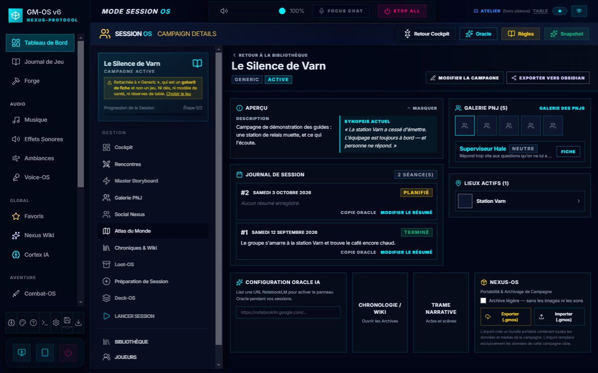

# 📦 Nexus-OS — export & import

Nexus-OS empaquette une campagne, ou un système de jeu, dans **un seul fichier** que vous pouvez
copier sur une clé, envoyer à quelqu'un, ou rouvrir après une réinstallation.

C'est de la **portabilité**, pas de la sauvegarde. Pour protéger vos données au quotidien, c'est la
[sauvegarde automatique](./91-Sauvegarde-automatique.md) qui travaille, toute seule, sans que
vous ayez à y penser.

> ⚠️ **Nexus-OS ne fonctionne que dans l'application de bureau.** Ouvert dans un navigateur, les
> boutons sont grisés et un badge le dit — l'empaquetage a besoin d'écrire des fichiers.

---

## 📤 Exporter une campagne

**Bibliothèque → Gérer la campagne → panneau « Nexus-OS — Portabilité & Archivage de Campagne » →
Exporter (.gmos)** — ou, plus court, le lien **Exporter (N médias)** de la carte de la campagne,
dans la bibliothèque.

Une fenêtre plein écran, le **Nexus HUD**, suit le travail. Il traverse ces étapes :

| Étape | Ce qui se passe |
| :--- | :--- |
| **Extraction des données** | Tout ce qui appartient à la campagne est rassemblé |
| **Vérification des liens distants** | Les images qui vivent sur le web sont repérées — **le HUD s'arrête ici s'il en trouve** |
| **Moissonnage des médias** | Les fichiers sont récupérés depuis le Media Hub |
| **Compression du bundle** | L'archive `.gmos` est écrite |
| **Opération terminée** | Le HUD se referme au bout de trois secondes |

Un sélecteur vous demande où poser le fichier.

> ✅ **Une case « archive légère » est offerte depuis le 2026-09-05**, juste au-dessus des deux
> boutons. Cochée, l'archive part **sans les images ni les sons** : le JSON seul, quelques centaines
> de kilo-octets au lieu de quelques centaines de mégaoctets. C'est ce qu'il faut pour envoyer une
> campagne par courriel, ou pour une copie de travail.
>
> Elle est décochée par défaut et **ne se retient pas d'une fois sur l'autre** : emporter les médias
> est ce qu'on veut presque toujours, et une case qui resterait cochée produirait un jour une
> archive vide qu'on croit complète.
>
> *L'option existait dans le code depuis le début et aucun écran ne la passait.*

### L'arrêt sur les liens distants

Si des images pointent vers Internet (une URL Pinterest, Unsplash…), le HUD s'interrompt et propose :

- **Tout localiser** — GM-OS télécharge ces images, les range dans votre Media Hub et les met dans
  l'archive. La campagne devient utilisable **hors ligne**, chez vous comme chez le destinataire.
- **Ignorer** — les liens restent des liens. L'archive est plus légère, mais elle dépend du web.

Un téléchargement qui échoue (lien mort) est signalé dans le journal du HUD et **n'interrompt pas
l'export**.

---

## 📥 Importer

Trois boutons ouvrent **le même sélecteur**, qui accepte aussi bien un `.gmos` qu'un
`.gmos-driver` :

| Où | Bouton |
| :--- | :--- |
| Bibliothèque des campagnes | **Importer un bundle Nexus** |
| Panneau d'une campagne | **Importer (.gmos)** |
| Bibliothèque des fiches et règles, onglet **Règles (drivers)** | **Importer driver** |

> 🔎 **C'est l'archive qui décide de sa destination, pas l'écran d'où vous partez.** Le fichier porte
> le nom de sa campagne : l'importer depuis le panneau d'une *autre* campagne ne l'y verse pas, il
> restaure la campagne du fichier. Il n'y a donc aucun risque à se tromper de bouton.

### GM-OS vous demande comment l'importer

Depuis le 2026-10-19, **toute campagne qui arrive pose la question**, qu'elle existe déjà ou non.
*Rejouer se fait le plus souvent sans conflit : la campagne a été purgée, ou l'archive vient d'un
autre poste.* Le choix se fait **avant que rien n'entre** : annuler ne laisse plus aucun média
orphelin dans le Media Hub.

La fenêtre montre d'abord **ce que l'archive apporte**, compté : PNJ, personnages, lieux, actes,
scènes, indices, séances, journaux, storyboard, tuiles de lumière, médias… Ce qui vaut zéro n'est
pas listé.

Puis, une fois votre choix fait :

1. **Une sauvegarde automatique est écrite avant que rien n'entre** — la même garde que la purge.
   Si GM-OS ne peut pas l'écrire (base pas encore relue, données de démonstration), **l'import
   s'arrête sans rien toucher** et dit pourquoi. Sur un poste sans aucune campagne, il n'y a rien à
   sauver : l'import passe, et le bilan le dit.
2. Les médias entrent, puis la campagne.
3. **Le bilan s'affiche et reste à l'écran jusqu'à « Fermer »** : la sauvegarde préalable, ce que
   vous avez choisi (et, en cas de remplacement, le nom de la version écrasée), ce qui est entré
   compté, et les médias entrés ou en échec. Il est aussi écrit dans le journal de l'application,
   pour être relu plus tard.

Un **pilote** (`.gmos-driver`) passe par la même sauvegarde préalable et le même bilan.

**Si la campagne n'est pas sur ce poste :**

| Choix | Effet |
| :--- | :--- |
| **Importer telle quelle** | La campagne revient comme elle était, séances et parcours compris |
| **Rejouer** | Une **nouvelle partie** (voir ci-dessous) |
| **Annuler** | Rien n'est touché |

**Si une campagne du même identifiant existe déjà**, le **résolveur de conflits** montre les deux
versions côte à côte et propose :

| Choix | Effet |
| :--- | :--- |
| **Remplacer** | Les données de la campagne existante sont écrasées par celles de l'archive |
| **Cloner** | L'archive entre comme une **nouvelle campagne indépendante**, « (Copie) » : tout reçoit un nouvel identifiant, et **tous les liens suivent** — la trame et son graphe, les relations, les rencontres, les journaux, le storyboard, les tuiles de lumière. Les personnages de la campagne sont **copiés pour la copie** : le joueur garde aussi les siens dans l'original |
| **Rejouer** | Une **nouvelle partie**, « (Nouvelle partie) », à côté de l'original, qui ne bouge pas |
| **Annuler** | Rien n'est touché |

Les médias de l'archive sont étiquetés pour la campagne **qui entre** : une copie ou une nouvelle
partie a les siens dans le Media Hub, pas ceux de l'original.

À la fin, GM-OS **bascule sur la campagne importée** et vous dépose dans le cockpit.

### 🔁 Rejouer une campagne

Pour refaire jouer une campagne, à d'autres joueurs ou aux mêmes. **Rejouer**, c'est cloner (tout
reçoit un nouvel identifiant, tous les liens suivent), puis remettre la partie au début :

| Ce qui reste — la préparation | Ce qui part — la première partie |
| :--- | :--- |
| Actes, scènes, enchaînements, graphe de la trame | Les **séances** et les **journaux** |
| PNJ, lieux, wiki, rencontres et combats préparés | Les passages dans les scènes, les scènes terminées, les actes achevés, la clôture de la campagne |
| Les **indices**, de nouveau **cachés** | La date à laquelle chacun avait été révélé |
| Storyboard, favoris, butin à distribuer, tuiles de lumière | Les messages entre tablettes, l'historique du butin distribué |
| Les **personnages**, tels qu'ils étaient | Les événements de chronologie écrits pendant une séance |
| La chronologie préparée | L'état des paquets de cartes (les cartes tenues étaient celles de la première partie) |

Les **réserves de table** (Traque, Impulsion, Menace…) reviennent **toutes** à leur valeur de
départ.

> ℹ️ Les personnages restent tels quels, avec leur expérience et leur équipement. Pour de
> nouveaux joueurs, créez-leur des personnages comme d'habitude.

---

## 🎲 Partager un système de jeu

Un `.gmos-driver` contient un **système**, sans aucune campagne : les règles, le moteur de dés, les
consignes d'IA, le gabarit de fiche associé, et — depuis le 2026-09-03 — **le bestiaire du jeu**,
c'est-à-dire les gabarits d'adversaires que vous avez rangés. *Partager un jeu sans ses adversaires
reviendrait à partager un livre de règles sans son bestiaire.*

**Exporter** : Bibliothèque des fiches et règles → onglet **Règles (drivers)** → sélectionnez-en un → **Exporter** dans le
panneau d'aperçu.

**Importer** : le bouton **Importer driver** du même onglet. Un driver du même nom
déclenche le même résolveur de conflits, avec l'option **Cloner** pour ne pas écraser votre travail.

> Un `.gmos-driver` fabriqué avant le 03/09 ne contient pas de bestiaire. Il s'importe sans rien
> perdre : le champ est facultatif.

---

## 📊 Le badge Nexus dans la bibliothèque

Chaque campagne porte l'un de **deux** badges :

| Badge | Ce qu'il dit |
| :--- | :--- |
| **« *n* médias »** (bleu) | La campagne référence *n* fichiers médias locaux → l'export emportera de vrais fichiers |
| **Nexus** (gris) | Aucun fichier média local → l'export sera **léger, JSON seulement** |

> ⛔ **Correction.** Ce guide décrivait jusqu'au 2026-09-04 un feu tricolore — 🟢 Nexus-Ready,
> 🟡 Localisable, 🔴 Non portable (YouTube) — qui **n'a jamais existé**. Il n'y a que deux états, et
> le badge compte des médias : **il ne dit pas si vos images sont portables.** Une campagne dont
> toutes les illustrations sont des URL web affichera le badge gris, et c'est bien à l'arrêt sur les
> liens distants, pendant l'export, que la question se règle.
>
> ✅ **Le badge a été renommé le soir même.** Il s'appelait « Nexus-Ready », ce qui promettait la
> portabilité alors qu'il ne compte que des fichiers. Il annonce désormais « *n* médias », et son
> infobulle dit ce qui est compté.

---

## 📋 Ce que l'archive contient — et ce qu'elle laisse

C'est la partie qu'il faut lire avant d'envoyer un fichier à quelqu'un, ou avant de compter dessus
pour une migration.

### ✅ Ce qui part

La campagne · ses **PNJ** · ses **joueurs et leurs personnages** · l'historique des **séances** ·
les **cartes de l'Atlas** · le **wiki** · la **chronologie** · les **indices** · **la trame**, actes
et scènes · les **rencontres préparées** (depuis le 12/10) · les **journaux de séance** · les
**paquets de cartes** et l'état de **ses** paquets · le **système de jeu forgé** et son gabarit de
fiche · et, depuis le 19/10 : les **moments de storyboard**, les **réserves de table** (Traque,
Impulsion…), les **combats préparés** de ses scènes, les **favoris**, le **butin**, les
**messages** entre tablettes, les **tuiles de Light-OS** de son râtelier, et les **ambiances
sonores** et **playlists** étiquetées pour elle — et, côté médias, toutes les images moissonnées
avec leur empreinte de contrôle.

Deux règles revues le 2026-10-19 (chantier des archives de campagne) :

> ✂️ **Les PNJ d'autres campagnes ne partent plus.** Si un de vos PNJ a une **relation sociale**
> vers un personnage d'une autre campagne, ce lien est **retiré de la copie emportée** — votre
> fiche, elle, ne change pas. Avant, ces personnages partaient caviardés pour garder le réseau
> entier ; désormais, *l'archive d'une campagne n'emporte que la campagne*, et aucun secret d'une
> autre ne peut y voyager.

<!-- -->

> 🎵 **Seules les ambiances et playlists de la campagne partent** — celles qui portent son
> étiquette. La **bibliothèque commune** (le même orage sert dans trois campagnes) voyagera dans
> l'**archive des médias** (`.gmos-medias`), en préparation. À l'import, rien ne change : ce qui
> porte le même identifiant est remplacé, ce qui est nouveau s'ajoute, ce qui n'est pas dans
> l'archive reste.

### ⛔ Ce qui ne part pas, ou ne revient pas

| Ce qui manque | Conséquence concrète |
| :--- | :--- |
| **Le plateau tactique (Map-OS)** | Brouillard et pions ne voyagent pas. Voir le [guide de Map-OS](./22-Map-OS-le-plateau.md). |
| **Les sons distants** | Un pad ou une piste qui pointe vers Spotify, SoundCloud ou une URL quelconque reste un lien. |
| **Le bestiaire du jeu** | Une rencontre qui désigne un adversaire du bestiaire arrive sans lui : à l'invocation, il est **refabriqué depuis son archétype**, et GM-OS le dit. |

> ✅ **Quatre manques comblés le 2026-09-04.** Jusqu'à cette date, l'archive **laissait la trame**
> — actes et scènes — sur la machine d'origine, et **mettait dedans sans jamais reposer** les
> paquets de cartes et le système de jeu forgé. Les quatre voyagent désormais.
>
> Deux précautions accompagnent le retour : **le pilote s'ajoute, il ne remplace jamais** un
> système du même identifiant déjà présent — l'import d'une campagne n'a pas à détruire votre
> travail de Forge —, et **une archive d'avant cette date ne perd rien** : sans trame dedans, la
> trame d'ici n'est pas touchée.

<!-- -->

> ✅ **Et le défaut le plus coûteux est corrigé.** Importer une campagne **remplaçait
> l'intégralité de votre bibliothèque d'ambiances de Sound-OS** par celle de l'archive : des heures
> de pads rangés effacées sans un mot. *Le bon code était déjà là, deux lignes plus bas — les
> playlists fusionnaient proprement depuis le début.* Les deux suivent maintenant la même règle :
> **ce qui porte le même identifiant est remplacé, ce qui est nouveau s'ajoute, ce qui n'est pas
> dans l'archive reste.**

---

## 🔒 Ce que GM-OS refuse d'ouvrir

Une archive n'est pas un fichier de confiance : elle vient d'ailleurs. Avant toute écriture,
GM-OS vérifie que le manifeste porte bien sa version de schéma et les champs obligatoires, et
**rejette tout chemin de fichier qui tente de sortir du dossier d'extraction** (les fameux `../`).
Un fichier dont le manifeste ne passe pas est refusé **avant** que quoi que ce soit ne soit injecté.

Chaque média est accompagné de son empreinte **SHA-256** et de sa taille, ce qui permet de détecter
une archive abîmée.

---

## 🔧 Dépannage

| Problème | Ce qu'il faut regarder |
| :--- | :--- |
| **L'archive semble vide de toute image** | La campagne portait le badge gris **Nexus** : ses illustrations sont des liens web. Relancez l'export et choisissez **Tout localiser**. |
| **« Archive invalide » à l'import** | Le manifeste ne passe pas la vérification. Un `.gmos` est un **fichier ZIP** : renommez-en une copie en `.zip` pour regarder dedans — vous devez y trouver `manifest.json` et `state.json`. |
| **Des PNJ sans portrait après l'import** | Leur avatar était une URL distante non localisée. Reposez une image depuis le Media Hub. |
| **Une campagne d'avant le 04/09 arrive sans sa trame** | Normal : les archives antérieures n'en contiennent pas. Réexportez-la depuis la machine d'origine. |
| **Les boutons Nexus sont grisés** | Vous êtes dans un navigateur, pas dans l'application de bureau. |
| **L'export est long** | Normal : chaque image est copiée et empreintée. Comptez une à deux minutes pour une campagne bien illustrée. |

---

*Guide refait le 2026-09-04, code à l'appui, **et complété le soir même** quand les quatre
manques qu'il décrivait ont été comblés. Quatre sections qui n'avaient rien à faire ici ont été
retirées — le « Theater Mode » (un nom qui n'apparaît nulle part dans le code), le style
« Glassmorphism / Bento », la messagerie du Hub, et le moment de la journée de Map-OS, qui a
[son guide](./22-Map-OS-le-plateau.md). Le feu tricolore Nexus-Ready a été corrigé en deux états, les
étapes de l'export rétablies, et la liste de ce que l'archive **ne** contient **pas** ajoutée —
c'est elle qu'il fallait écrire.*

*Relu le 2026-10-03 contre l'interface refondue, et illustré. Les chemins suivent l'écran : la page
de la campagne s'ouvre par **Gérer la campagne**, et les pilotes vivent dans l'onglet **Règles
(drivers)** de la bibliothèque des fiches et règles.*
