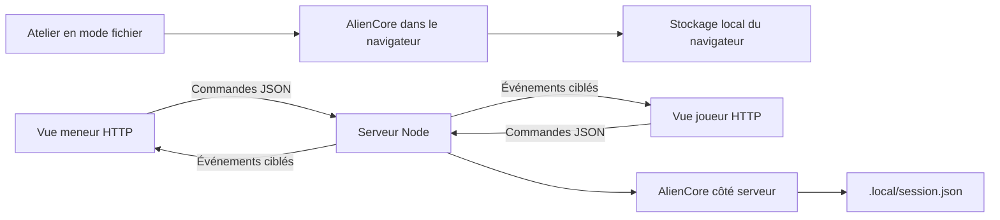

# Architecture du prototype Alien — version 0.3.0

État mis à jour le 15/10/2026. Cette note décrit le code livré, sans présenter les
propositions de l'étude comme des fonctions déjà disponibles.

**Ajout du 15/10 :** un [adaptateur de MU/TH/UR au contrat v1](modules/muthur/README.md)
est livré à côté du prototype. Il importe le même `core.js`, fournit les
six fonctions du moteur, un manifeste distinct et les composants React
joueur/MJ. Son état exclut le radar ; aucun service partagé n'est déclaré
pour ces deux modules à ce stade. L'adaptateur n'ajoute ni endpoint ni port,
et le serveur autonome continue à utiliser le moteur d'origine.
Le registre et l'hôte du Tablet Hub restent à implémenter. Le détail ci-dessous
décrit toujours le transport et la persistance du prototype autonome.

**Création de dossiers, 15/10 :** `creer-dossier` côté contrat est traduit en
`creer-document` dans le cœur commun. Action réservée au MJ, validation avant
ajout, plafond de 256 dossiers, identifiants non ambigus pour READ et collision
avec les codes de protocole refusée. Les formulaires du module et du prototype
proposent « Nouveau dossier… » ; le format des données reste en v2.

## Deux transports, un moteur

[core.js](core.js) publie `AlienCore.créer()` et `AlienCore.initial()`.
Le moteur créé offre `inscrire`, `snapshot`, `agir` et `sauvegarde`.
Il ne connaît pas GM-OS, Electron, Foundry ou les fiches de personnages.

`AlienCore.positionsDuDetecteur(tracker, fauxEcho)` calcule les positions
normalisées depuis la graine partagée et la proximité. Le passage arrêté →
actif tire une nouvelle graine ; une commande déjà active ne la change pas.
Directions et rayons sont variés dans la zone maximale choisie, avec rejet
limité des points trop rapprochés. Le rendu met ce calcul en cache et conserve
son agitation locale à l'intérieur du même rayon. Le faux écho est un point
supplémentaire dans ce tirage, sans changement de graine. Format d'état inchangé.

En mode fichier, [app.js](app.js) appelle le moteur directement avec le rôle
meneur. L'aperçu joueur masque les contrôles mais n'est pas une frontière
d'accès : la configuration entière est dans ce navigateur d'atelier.
La clé de stockage est `alien-accessoires:atelier:v1`.

L'aperçu React `scratch/muthur-v1/apercu.html` utilise une autre clé,
`gmos:alien:muthur:configuration:v1`. Seule sa préparation (config, dossiers,
protocoles) est conservée. `configuration.mjs` valide et copie le format
portable ; `atelier.mjs` gère stockage, export Blob et import confirmé.
Une restauration recrée un état de démonstration sans effets actifs. Les
vues de contrat restent sans stockage propre et la sauvegarde par campagne
du Hub reste une responsabilité de son futur hôte.

En HTTP, les actions passent au serveur et les vues reçoivent des instantanés
filtrés. Le transport est **HTTP + Server-Sent Events**, et non WebSocket.
Le serveur peut garder l'état lorsque Web-OS ferme sa vue.

## Modèle de données

| Élément | Contenu |
| --- | --- |
| `config` | Nom du vaisseau, réponse à STATUS, mot de passe administrateur, CRT et parasites |
| `documents` | Identifiant, titre, accès équipage/code/admin, code et contenu |
| `players` | Identité, accès, dossiers déverrouillés, dialogue, demande et dernière séquence |
| `tracker` | Activation, intensité, volume, contacts, proximité, parasites, destinataire et faux écho |
| `countdown` | Date de fin du compte à rebours fictif, ou absence |
| `protocoles` | Codes, messages type, effet, durée, activation et destinataires ; réservés au MJ |
| `portes` | État fictif public : inconnues, ouvertes ou fermées |
| `autodestruction` | Identifiant de séquence, date de départ et message public ; utilise l'échéance unique de `countdown` |
| `diffusionAlarme` | Identifiant du seul appareil sonore choisi ; le joueur reçoit seulement `diffusionAutorisee` |
| `revision` | Numéro des mutations du moteur |

Les messages sont plafonnés à 200 par opérateur. Le moteur ne contient ni
campagnes multiples, ni droits de capitaine, ni gestion des fiches GM-OS.
Le mot de passe et les codes sont des chaînes, comparées exactement après
retrait des espaces extérieurs lors de la commande. Le rôle fictif `admin`
du terminal ne devient jamais le rôle meneur du serveur.

## Protocole HTTP

| Méthode et chemin | Accès | Résultat |
| --- | --- | --- |
| `GET /` | Public | Page de connexion ou interface selon le jeton détenu |
| `POST /api/join` | Code de table | Inscrit un opérateur et rend un jeton joueur |
| `GET /api/session` | Jeton | Rôle réel et identifiant de l'opérateur |
| `GET /api/state` | Jeton | Instantané complet meneur ou instantané joueur filtré |
| `GET /api/events` | Jeton | Flux SSE d'instantanés, avec maintien de connexion |
| `GET /api/table` | Meneur | Code de table et adresses réseau proposées |
| `POST /api/action` | Jeton | Traite une action autorisée et sauvegarde l'état |

Le jeton voyage dans `Authorization: Bearer …`. Le lien initial meneur le
porte dans un fragment `#mj=…`, retiré de l'adresse par l'interface ; il est
ensuite rangé dans le stockage de session de l'onglet. Le fragment n'est pas
envoyé comme partie de la requête HTTP.

Le joueur peut envoyer `command` et choisir cet appareil sonore via `diffusion`.
Il ne choisit aucun autre appareil dans sa charge. Le serveur prend son identité
dans le jeton, sans se fier à un `playerId` fourni dans l'action. Le meneur
peut gérer configuration, dossiers, réponses, piratage, révocation, tracker,
faux écho, compte à rebours et réinitialisation. Il peut aussi saisir une
commande pour son aperçu de l'opérateur sélectionné.

`createTable()` est importable sans écouter un port. Sa méthode `request()`
permet de vérifier le protocole directement. Seule l'exécution de
`node outils/alien/server.mjs` appelle `listen`. Le CLI écoute sur `0.0.0.0`
pour les tablettes du réseau local, port 8787 ou `ALIEN_PORT`.

## Filtrage et sauvegarde

Un instantané joueur contient son propre dialogue et ses accès, la
configuration publique, les seuls documents autorisés sans leur code et
l'état du détecteur qui lui est destiné. Pour un non-destinataire, le
détecteur est neutralisé, sans contacts ni intensité révélés.

Les actions sont sérialisées. Les deux sauvegardes sont écrites via un
fichier temporaire puis renommées, avant la diffusion de la mutation :

- `.local/session.json` : configuration et état de la table ;
- `.local/connexion.json` : jeton meneur, code de table et jetons des joueurs.

Le dossier `.local/` est ignoré par Git. Une sauvegarde illisible fait
échouer le chargement ; le serveur ne l'efface pas pour repartir à zéro.
À la reprise, radar, autodestruction, diffusion sonore et compte à rebours sont arrêtés et les séquences de
piratage ne sont pas rejouées. Les dialogues et accès sont conservés.

Le serveur ne sert que les fichiers publics explicitement listés. Le
dossier `.local/` n'est pas accessible par HTTP. Il ne donne aucun accès
au disque de GM-OS ni aux sauvegardes de David.

## Animation et son

Le texte progressif, les parasites et le radar utilisent un même cycle
`requestAnimationFrame`, interrompu pour les traitements lorsque la page est
cachée. Le radar utilise un canvas adapté à sa taille, avec un ratio de
pixels plafonné à 2. Le bruit du terminal est calculé sur un petit canvas.

Les effets CRT utilisent des lignes CSS, une vignette et un halo. Ils ne
simulent pas une vraie déformation géométrique de tube cathodique.
Les sons sont synthétisés par Web Audio après activation explicite sur
l'appareil. L'intensité modifie le rythme et l'agitation, le volume reste
indépendant. `alarme.js`, commun à l'atelier et au module React, synthétise
la sirène et pilote les annonces françaises locales à la minute. L'autorisation
de diffuser vient de l'état ciblé, et le son exige aussi un clic local.
La sirène est atténuée pendant les annonces ; l'arrêt détruit les oscillateurs,
la minuterie et les annonces encore actives. Les voix distantes sont exclues.

Le format de données est maintenant v2. Une table v1 conserve configuration,
dossiers et opérateurs, avec zéro protocole ajouté implicitement. En mode
HTTP, l'identité sonore est dérivée côté serveur du jeton et de l'adresse
réseau de l'appelant ; aucun jeton brut n'est diffusé comme identifiant.
Les fenêtres d'un même appareil partageant le même jeton correspondent à la
même identité sonore : utiliser une seule vue de diffusion sur cet appareil.

Depuis la 0.3, `video-alerte.js` porte le lecteur commun et la durée mesurée
du film fourni par David (775,701 s). Une autodestruction est prolongée à
au moins cette durée. La vidéo a la priorité audio sur l'appareil choisi ;
la sirène/voix reprennent si du temps reste après elle. Le lecteur rejoint
le temps écoulé, ne boucle pas et est arrêté à l'annulation ou à la coupure
de liaison. Le serveur autorise explicitement son chemin et les requêtes
HTTP par plage d'octets (206/416), avec HEAD sans chargement du fichier entier.
La [provenance du média](medias/README.md) distingue le fichier fourni par
David des effets originaux de l'application.

## Intégration GM-OS à construire

[manifest.json](manifest.json) est un descripteur du prototype, **pas un
contrat déjà consommé par GM-OS**. Il identifie le corpus Alien et deux
points d'entrée. Aucun champ du type `GameDriver` n'a été ajouté.

Le prochain contrat devra définir disponibilité par pilote, identité de
campagne et d'opérateur, ouverture/fermeture, sauvegarde et arrêt des effets
au changement de campagne. Les secrets resteront dans la configuration de
campagne. L'identité devra reconnaître les pilotes forgés dont l'identifiant
est horodaté, sans supposer `campaign.system === 'alien'`.

Le service actuel n'héberge qu'une table. Le choix d'un nom à la connexion
ne retrouve pas un ancien opérateur sans son jeton. Une reconnexion automatique
retrouve en revanche les données de l'onglet dont le jeton est encore valide.

## Limite des contrôles réalisés

Le protocole et les parcours de navigateur ont été vérifiés sans écouter
sur le réseau : `request()` appelée directement et routes du navigateur
interceptées. Cela ne remplace pas un essai de l'écoute HTTP et du flux SSE
continu avec des tablettes physiques. La qualité sonore, la fluidité sur
les appareils de David et la fidélité à la référence Foundry restent à juger.
